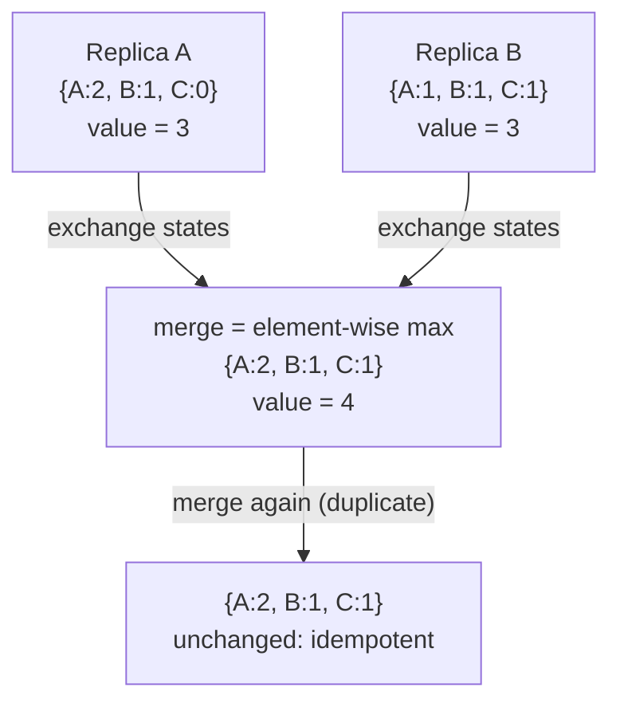
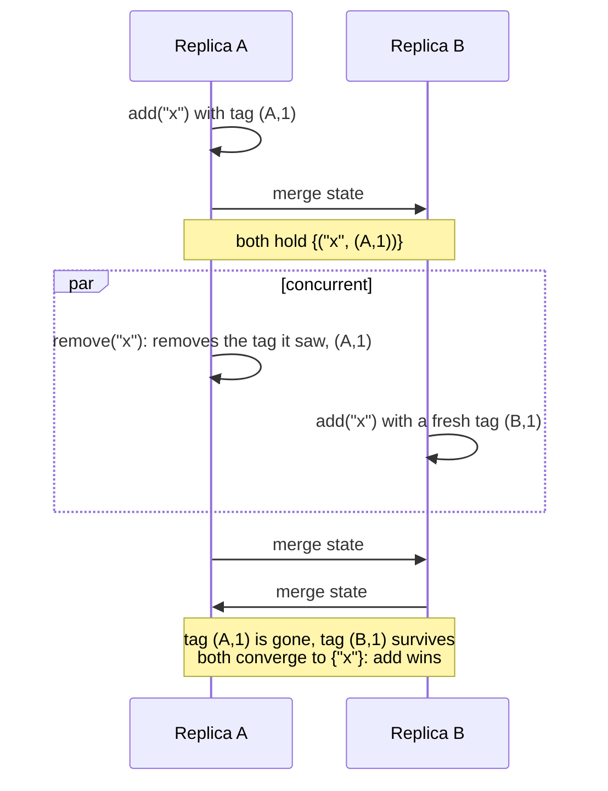

Some systems must accept writes at replicas that can't reach each other at that moment: a phone that is offline, a datacenter cut off from the rest, two people editing the same document. [[systems/distributed-systems/dynamo-db|Dynamo]] and [[systems/distributed-systems/disconnected-operation|disconnected operation]] both run into what follows. Concurrent updates conflict, and someone has to reconcile them later. Dynamo hands the merge to the application (its shopping cart), and Coda hands it to the user.

A **conflict-free replicated data type** (CRDT) builds the merge into the data type and proves it converges. Each replica applies updates locally without asking anyone, ships them to the others whenever it can, and any two replicas that have seen the same updates hold the same value. This note covers the condition that makes that work, the standard constructions, the hard case of collaborative text, and what the approach costs and can't do.

## Strong eventual consistency

Plain eventual consistency only promises that replicas agree *eventually*. It says nothing about how, so a system that reconciles by rolling back work, or by keeping whichever write has the later wall-clock time, satisfies it while losing data.

[Shapiro et al. (2011)](https://hal.inria.fr/inria-00609399/document) define the stronger property CRDTs meet, **strong eventual consistency (SEC)**:

- **Eventual delivery:** every update delivered at one correct replica is eventually delivered at every correct replica.
- **Strong convergence:** any two replicas that have delivered the same *set* of updates are in the same state, at once and deterministically, whatever order the updates arrived in.

There is no consensus round, no rollback, and no conflict handed back to the caller. [Gomes et al. (2017)](https://arxiv.org/abs/1707.01747) machine-checked this property in Isabelle/HOL for three of the constructions below: the Replicated Growable Array (RGA, for lists and text), the observed-remove set, and an increment-decrement counter. That matters because the arguments are about interleavings of concurrent messages, which hand proofs in this area have a history of missing.

## Two ways to build one

**State-based (convergent, CvRDT).** Replicas send each other their whole state and merge what they receive. Convergence follows if the states form a **join-semilattice**: a partial order $\le$ in which any two states $a, b$ have a least upper bound $a \sqcup b$, every update moves the state up ($s \le \mathrm{update}(s)$), and merge is the join. A join is commutative, associative and idempotent, so merges can arrive in any order, any number of times, over any gossip topology that eventually connects everyone. The whole proof obligation is "is merge a join, and is every update an inflation".

**Operation-based (commutative, CmRDT).** Replicas broadcast the operations themselves and every replica applies each one. The requirements move to the network and the operations: delivery must be exactly once and in causal order, and operations that are concurrent must commute. Op-based types send far less data, but they lean on causal broadcast, usually built from the vector clocks in [[systems/distributed-systems/clocks|clocks]] and [[systems/distributed-systems/ordering-events-in-distributed-systems|ordering events]].

Shapiro et al. show that each style can emulate the other. **Delta-state CRDTs** ([Almeida, Shoker and Baquero, 2018](https://arxiv.org/abs/1603.01529)) sit between them: a replica ships only the part of its state that changed, and those deltas merge with the same join, so they keep the state-based tolerance of reordering and duplication while sending about as little as an op-based type.

> [!info]- Why a join gives convergence, in a paragraph
> A replica's state is the join of its initial state with every update it has received, $s = s_0 \sqcup u_1 \sqcup \dots \sqcup u_k$ (applying an inflation and then merging is still such a join). Because $\sqcup$ is commutative and associative, the order of the $u_i$ doesn't change the result, and because it is idempotent, receiving some $u_i$ twice doesn't either. So the state depends only on the *set* of updates received, which is strong convergence. The op-based argument is the same idea with the commutativity of concurrent operations doing the work, and causal delivery making sure operations that aren't concurrent arrive in the order that makes them meaningful: you can't delete a character you haven't received.

## Counters, registers and sets

**G-Counter.** A map from replica id to a count. A replica increments only its own entry, the value is the sum, and merge takes the element-wise maximum. Element-wise max over vectors of naturals is a join, and an increment is an inflation. A **PN-Counter** is two G-Counters, increments minus decrements.



**LWW-Register.** A value with a timestamp; merge keeps the larger timestamp. It is cheap and common (each Cassandra cell works this way), and honest about its trade. Of two concurrent writes, one silently disappears; equal timestamps need a deterministic tiebreaker such as the replica id or the replicas diverge; and with skewed clocks an older write can win. LWW is the CRDT that admits it loses data.

**G-Set and 2P-Set.** A grow-only set with union as merge is the simplest CRDT there is. The obvious way to add removal, a set of adds plus a set of tombstones where a tombstone always beats an add, gives the 2P-Set, whose catch is that a removed element can never come back.

**OR-Set (observed-remove, add-wins).** Every add attaches a unique tag, and a remove deletes only the (element, tag) pairs the removing replica has *seen*. An add that is concurrent with a remove carries a tag the remove never saw, so the element survives: adds win against concurrent removes, and elements can be re-added freely.



The whole construction fits in a few lines, and running it shows both behaviors:

```python
class ORSet:
    def __init__(self, rid):
        self.rid, self.n = rid, 0
        self.adds, self.removed = set(), set()
    def add(self, e):
        self.n += 1
        self.adds.add((e, (self.rid, self.n)))       # a unique tag per add
    def remove(self, e):                             # removes OBSERVED tags only
        self.removed |= {(x, t) for (x, t) in self.adds if x == e}
    def merge(self, other):
        self.adds |= other.adds
        self.removed |= other.removed
    def value(self):
        return {e for (e, t) in self.adds if (e, t) not in self.removed}

A, B = ORSet("A"), ORSet("B")
A.add("x"); B.merge(A)
A.remove("x"); B.add("x")         # concurrent remove at A, re-add at B
A.merge(B); B.merge(A)
print(A.value(), B.value())       # {'x'} {'x'}: add wins, replicas agree

A, B = ORSet("A"), ORSet("B")
A.add("milk"); A.add("eggs"); B.merge(A)
A.remove("milk"); B.add("bread")  # concurrent, unrelated edits
A.merge(B); B.merge(A)
print(A.value(), B.value())       # {'eggs', 'bread'} twice: milk stays deleted
```

The second run is the case [Dynamo's shopping cart](https://www.allthingsdistributed.com/files/amazon-dynamo-sosp2007.pdf) gets wrong. Dynamo merges divergent carts by taking their union, so a removal on one branch is undone by any concurrent edit on another; in the paper's words, "deleted items can resurface". The OR-Set knows which adds each remove saw, so only a genuinely concurrent re-add brings an item back.

Maps, flags, and registers that keep every concurrent value (multi-value registers) are built the same way; [crdt.tech](https://crdt.tech/papers.html) keeps the catalogue.

## Text: the hard case

Sets and counters have no positions. Text does, and that is where CRDT design gets hard. An operation like "insert `x` at index 7" doesn't commute with a concurrent insert at index 3, so every list CRDT replaces indexes with **stable identifiers**. Each character gets an id when it is typed, an insert says where it goes relative to existing ids, and deleted characters stay behind as **tombstones** so that a concurrent insert next to them still lands in the right place. The designs differ in how they order characters inserted concurrently at the same place.

- **Logoot** and **LSEQ** give each character a position from a dense order (think of a fraction, written as a list of digits) between its neighbours' positions, and the document is the positions in sorted order.
- **RGA** ([Roh et al., 2011](https://doi.org/10.1016/j.jpdc.2010.12.006)) records the character each new one was typed after. Concurrent inserts after the same character go newest first by Lamport timestamp, and a character typed after another stays attached to it. [Automerge](https://automerge.org/)'s text type is RGA.
- **YATA** ([Nicolaescu et al., 2016](https://doi.org/10.1145/2957276.2957310)), the algorithm in [Yjs](https://github.com/yjs/yjs), records both neighbours at the time of the insert.
- **Fugue** ([Weidner and Kleppmann](https://arxiv.org/abs/2305.00583)) builds a tree. A new character becomes the right child of its left neighbour if that neighbour has no right children yet, and otherwise the left child of its right neighbour. The document is an in-order walk of the tree.

All of these converge. What separates them is *where* concurrent text ends up. [Kleppmann et al. (2019)](https://www.cl.cam.ac.uk/~arb33/papers/KleppmannEtAl-InterleavingAnomalies-PaPoC2019.pdf) showed the failure that matters: with Logoot or LSEQ, two people who concurrently type " Alice" and " Charlie" into "Hello!" can converge on "Hello Al Ciharcliee!". Both replicas agree, every character is there, and the result is garbage. RGA keeps text typed left to right together, but they found a weaker anomaly. Characters typed back to front, each in front of the last, all attach to the same neighbour and are ordered only by timestamp, so two such runs can shuffle. Weidner and Kleppmann later defined forward and backward interleaving formally, showed that Fugue never interleaves text typed forwards, and proved that a variant, FugueMax, meets their strongest non-interleaving definition.

The figure runs all three algorithms on two replicas. Pick a start, press Sync, then switch the CRDT to see the same keystrokes merge differently.

<ListCrdtLab algo="logoot" scenario="forwards" />

The figure's Logoot is simplified: it picks each new digit at random within the gap, where real Logoot and LSEQ allocate more carefully to keep identifiers short (and interleave all the same). Its RGA gives the same text as Automerge 3.5.0, and its Fugue the same text as a separate Python implementation, on 80 recorded random editing sessions; the figure's [tests](https://github.com/elimelt/web/blob/main/notes/quartz-site/plugins/mdx/test/list-crdt.test.mjs) check both.

### How often it happens

To see whether this is a corner case, I ran 1,000 random trials per case. Two replicas start from the same short random text, each types a random word of 3 to 8 letters at the same random spot while offline, and then they sync. A trial counts as interleaved if the merged text at that spot isn't one word followed by the other. "Backwards" types each letter in front of the previous one, as you do when going back to fix the start of a word.

| Trials out of 1,000 that interleaved | both forwards | both backwards | one each way |
| --- | ---: | ---: | ---: |
| Fugue (the figure's) | 0 | 0 | 0 |
| RGA (the figure's) | 0 | 1,000 | 495 |
| Automerge 3.5.0 | 0 | 1,000 | 495 |
| Yjs 13.6.33 | 0 | 0 | 0 |
| Logoot-style, random digits (the figure's) | 808 | 949 | 519 |

Automerge matches the figure's RGA trial for trial, as it should. Two words typed back to front interleaved every time, because every letter attaches to the same neighbour and only timestamps order them; when one side types backwards, the other word lands inside it about half the time. Yjs and Fugue kept the words apart in every trial. That is evidence about this pattern only: Weidner and Kleppmann describe a backward case spread across several replicas in which Yjs can still interleave, so the zeros aren't a proof. The Logoot row describes the figure's simplified allocator, not the published one.

> [!info]- Deep dive: why RGA shuffles backward typing and Fugue doesn't
> Type " Alice" forwards in RGA and each letter is inserted after the previous letter, so the word forms a chain hanging off the character before it. A concurrent " Charlie" forms another chain off the same character. RGA orders the two chain heads by timestamp and keeps each chain together, so both words stay whole. Type " Alice" backwards and every letter is inserted *after the same character*, the "o" of "Hello", with rising timestamps. Now all of A's letters and all of B's are siblings, ordered newest first by timestamp alone, and the words interleave letter by letter; the figure shows "Hello Ch aArlliicee!".
>
> Fugue makes the same backward insert a *left child of the right neighbour*. The first letter typed becomes a left child of "!", the next becomes a left child of that letter, and so on: a chain again. The two replicas' chains are siblings under "!", ordered by replica id, so each word stays whole. Turn on "Show ids and tombstones" in the figure to see each character's parent and side (↙ for a left child, ↘ for a right child).
>
> Kleppmann et al. proposed an RGA fix that orders concurrent runs by where they first diverge, at some cost in metadata, and left its proof for future work. Fugue reaches the same goal for forward typing with a simpler structure.

## What the metadata costs

A list CRDT keeps an identifier for every character ever typed, and a tombstone for every character ever deleted, until something cleans them up. How much that costs depends on how people actually type, so I replayed four real keystroke traces from Joseph Gentle's [editing-traces](https://github.com/josephg/editing-traces) collection into Yjs and Automerge, and saved each document in the library's own binary format.

| Trace | Edits | Characters typed | Characters left | Yjs | Yjs, no GC | Automerge |
| --- | ---: | ---: | ---: | ---: | ---: | ---: |
| sveltecomponent | 19,749 | 93,984 | 18,451 | 98 KB | 174 KB | 66 KB |
| rustcode | 40,173 | 522,531 | 65,218 | 248 KB | 705 KB | 219 KB |
| seph-blog1 | 137,993 | 212,489 | 56,769 | 338 KB | 464 KB | 220 KB |
| automerge-paper | 259,778 | 182,315 | 104,852 | 311 KB | 388 KB | 129 KB |

The traces are ASCII, so "characters left" is also the size of the plain text in bytes. Three things stand out.

- **Most typed characters don't survive.** The rustcode session typed eight characters for every one in the final file, and even the paper, written mostly front to back, typed 1.7. A list CRDT that keeps tombstones holds every one of them.
- **The saved document is 1.2 to 6 times the size of the text.** Automerge's file was 1.2 times the final text for the paper and 3.4 to 3.9 times for the others; Yjs's was 3.0 to 6.0 times. Both are compressed encodings, so the structures in memory are larger again.
- **Keeping history is cheaper than it sounds.** Automerge's file holds the *entire* edit history, every change ever made, yet it was the smallest in every trace, because its column-oriented encoding compresses runs of consecutive keystrokes very well. Yjs's garbage collection (on by default) drops the content of deleted characters, which made its file 20 to 65 percent smaller than with collection off.

Collecting tombstones completely requires every replica to have seen the delete, which is a coordination problem again, moved from writes to cleanup. [Eg-walker](https://arxiv.org/abs/2409.14252) (Gentle and Kleppmann, EuroSys 2025) takes another route. It stores the plain graph of edit events, builds CRDT state only while merging concurrent branches, and throws that state away afterwards; the authors report an order of magnitude less memory in the steady state than existing CRDTs.

> [!note]- How this was measured
> Everything is in [crdts-experiments](https://github.com/elimelt/web/tree/main/notes/content/systems/distributed-systems/crdts-experiments) beside this note. Run `npm install` there and in `notes/quartz-site/plugins/mdx` first.
>
> - **Machine:** a 4-vCPU Intel Xeon at 2.10 GHz on Linux, Node 22.23.4, `yjs` 13.6.33, `@automerge/automerge` 3.5.0.
> - **Traces** (`./fetch-traces.sh`, then `node replay.mjs traces/<name>.json.gz 5`): the ASCII-only sequential traces. Each recorded transaction becomes one Yjs transaction or one Automerge change, and the run checks that the final text equals the trace's `endContent`. Sizes are `Y.encodeStateAsUpdate` and `Automerge.save`. Yjs sizes were identical across 5 runs; Automerge's varied by at most 20 bytes, because each change records a timestamp. Replay times, median of 5 runs [min to max], in table order: Yjs 108 ms [90 to 132], 256 ms [190 to 269], 679 ms [658 to 735] and 1.52 s [1.46 to 1.80]; Automerge 2.3 s [2.27 to 2.82], 11.3 s [11.0 to 11.4], 13.0 s [12.7 to 13.6] and 19.8 s [19.3 to 20.3]. Committing one Automerge change per keystroke transaction is its slowest way to be driven, so these aren't a fair speed comparison. Raw output: `replay-results.jsonl`.
> - **Interleaving** (`node interleave.mjs 1000`): seeds 1 to 1,000, the same trial for every implementation and mode, with which replica id sorts first randomized per trial. Raw counts and one example per failing case: `interleave-results.json`.
> - **Reference sessions** (`node reference.mjs && python3 fugue_ref.py`): 80 random two-replica sessions of inserts and deletes with random sync points, the text Automerge converges to for each, and the text an independent Python Fugue converges to. The figure's tests replay them.

## What CRDTs can't do

**No global invariants.** SEC promises that replicas agree, not that the state they agree on satisfies a constraint across objects or replicas. "Balance never negative", "usernames are unique" and "at most one winner" all need to forbid one of two concurrent operations, which is exactly the coordination CRDTs avoid. Those paths need consensus ([[systems/distributed-systems/paxos-intro|Paxos]] or similar). The usual design is consensus where an invariant demands it and CRDTs everywhere else.

**Resolution is a policy fixed in advance.** Add-wins, remove-wins, last-writer-wins: each type is a fixed answer to what two concurrent, conflicting intentions mean, and choosing the type is choosing which anomaly you can live with. Every list CRDT above merges "delete this word" with a concurrent "extend this word" into the extension alone, sitting where the word used to be. The figure's "One deletes a word the other extends" start shows it: A turns "Hello!" into "Hi!", B turns it into "Hello there!", and both converge on "Hi there!".

**Metadata grows.** Unique tags, per-replica counters and tombstones accumulate, as the traces above show, and removing them safely takes coordination.

On the [[systems/distributed-systems/consistency|consistency]] spectrum, CRDT systems sit well below linearizability: op-based types delivered causally give causal consistency per object, and the point is to stay available and keep accepting writes through any partition. In production, Riak exposes [counters, sets, maps and flags](https://docs.riak.com/riak/kv/2.2.3/learn/concepts/crdts) as data types, Redis Enterprise builds [active-active geo-replication](https://redis.io/docs/latest/operate/rs/databases/active-active/) on CRDTs, and Automerge and Yjs sit under many collaborative editors.

> [!info]- Potentially interesting ideas
> Questions that came up while working on this note. None of them has been tested; they are starting points, not results.
>
> - **Count interleaving on real concurrent sessions.** The trials above use made-up words. The [editing-traces](https://github.com/josephg/editing-traces) collection also has traces where several people typed at once, and the figure's split count (pairs of characters typed side by side that end up separated by the other replica's text) could be computed on them for RGA, Yjs and Fugue. That would say how often the anomaly shows up in real use rather than in a worst case.
> - **Find the Yjs backward case.** Yjs kept the words apart in all 3,000 two-replica trials here, while Weidner and Kleppmann describe a backward case across several replicas where it can interleave. Trials with three or more replicas typing backwards might show how narrow that case is.
> - **Separate encoding from structure.** Automerge saved the whole history in less space than Yjs saved the current state. Measuring each library's memory after loading the same trace would show how much of that gap is the file encoding and how much is the data structure.
> - **What makes a trace expensive.** The two code traces typed 5 and 8 characters per surviving one, the blog post 3.7 and the paper 1.7. Four traces are too few to say whether editing code generally costs more tombstones than writing prose.

## Related notes

- [[systems/distributed-systems/consistency|Consistency]]: where SEC sits among the other models.
- [[systems/distributed-systems/dynamo-db|Dynamo]]: application-level merges, and the cart anomaly above.
- [[systems/distributed-systems/disconnected-operation|Disconnected Operation]]: Coda's user-driven conflict resolution.
- [[systems/distributed-systems/clocks|Clocks]] and [[systems/distributed-systems/ordering-events-in-distributed-systems|Ordering Events in Distributed Systems]]: Lamport timestamps, vector clocks and causal delivery.
- [[systems/distributed-systems/paxos-intro|Paxos]]: the coordination CRDTs avoid, for when you need it.

## Sources

- [Shapiro, Preguiça, Baquero, Zawirski (2011), A Comprehensive Study of Convergent and Commutative Replicated Data Types, INRIA RR-7506](https://hal.inria.fr/inria-00609399/document)
- [Shapiro, Preguiça, Baquero, Zawirski (2011), Conflict-free Replicated Data Types, SSS](https://www.cs.tufts.edu/~nr/cs257/archive/marc-shapiro/CRDTs_SSS-2011.pdf)
- [Gomes, Kleppmann, Mulligan, Beresford (2017), Verifying Strong Eventual Consistency in Distributed Systems, OOPSLA](https://arxiv.org/abs/1707.01747)
- [Almeida, Shoker, Baquero (2018), Delta State Replicated Data Types, JPDC](https://arxiv.org/abs/1603.01529)
- [Roh, Jeon, Kim, Lee (2011), Replicated Abstract Data Types: Building Blocks for Collaborative Applications, JPDC](https://doi.org/10.1016/j.jpdc.2010.12.006)
- [Nicolaescu, Jahns, Derntl, Klamma (2016), Near Real-Time Peer-to-Peer Shared Editing on Extensible Data Types, GROUP](https://doi.org/10.1145/2957276.2957310)
- [Kleppmann, Gomes, Mulligan, Beresford (2019), Interleaving Anomalies in Collaborative Text Editors, PaPoC](https://www.cl.cam.ac.uk/~arb33/papers/KleppmannEtAl-InterleavingAnomalies-PaPoC2019.pdf)
- [Weidner and Kleppmann, The Art of the Fugue: Minimizing Interleaving in Collaborative Text Editing](https://arxiv.org/abs/2305.00583)
- [Gentle and Kleppmann (2025), Collaborative Text Editing with Eg-walker: Better, Faster, Smaller, EuroSys](https://arxiv.org/abs/2409.14252)
- [DeCandia et al. (2007), Dynamo: Amazon's Highly Available Key-value Store, SOSP](https://www.allthingsdistributed.com/files/amazon-dynamo-sosp2007.pdf)
- [Gentle, editing-traces](https://github.com/josephg/editing-traces)
- [crdt.tech, papers and taxonomy](https://crdt.tech/papers.html)
