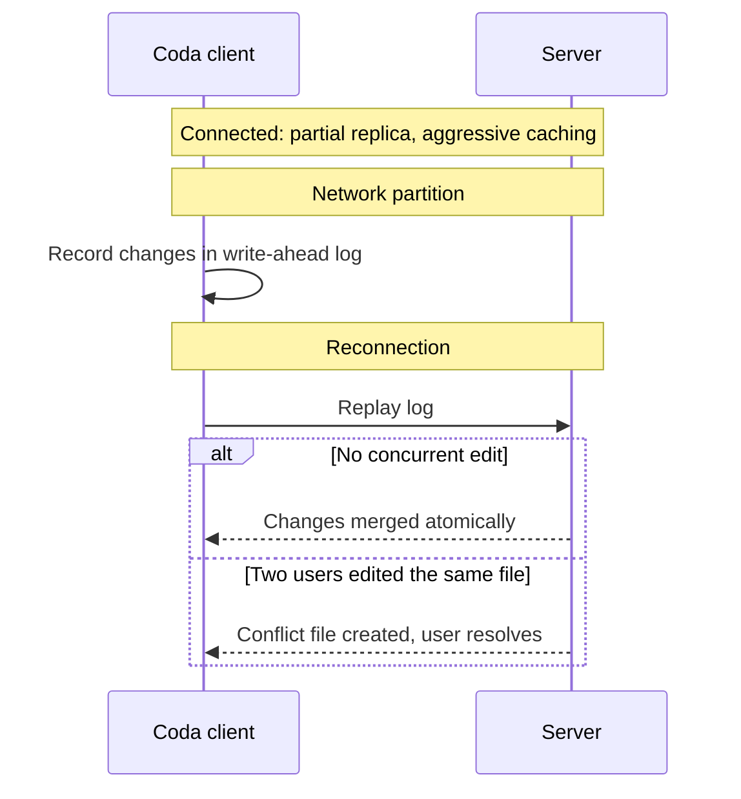

**Disconnected operation** is the continued reading and writing of data by a client that cannot communicate with the rest of the system. The client writes to a local copy and synchronizes with the rest of the system when connectivity returns. Since two clients can modify the same data while apart, writes can conflict, and conflicts are resolved either automatically or by a human.

Writes that remain available during disconnection are incompatible with a single authoritative copy of the data. The pattern appears in file synchronization, source control and offline-capable applications, and in each the central problem is merging and conflict resolution.

Systems follow one of two communication models.

- Clients communicate only with a central service (Coda, SVN). Changes are logged locally and applied on reconnection.
- Clients communicate with the service and with each other (Git). Changes are logged and exchanged with whichever peer a client connects to, and merges happen again on each new connection.

## Coda

[Coda](https://coda.cs.cmu.edu/) mounts a remote file system as a local directory, keeping a partial replica of the global version and caching aggressively to reduce latency. While disconnected it records changes in a write-ahead log. On reconnection it replays the log to the server and merges the changes atomically.

Coda merges automatically when it can. When two users edit the same file, it creates a conflict file and leaves resolution to the user.

## Offline-capable web apps

Apps like Gmail and Google Docs support offline editing with a local cache plus a log of changes. On reconnection the log is sent to the server and merged, with conflicts resolved by application-level rules.

> [!info] Version vectors
> A common building block is the **version vector**: each client has a unique ID, each change is tagged with it, and comparing vectors during a merge determines which changes are newer and which are concurrent. This is the same mechanism as [[systems/distributed-systems/clocks|vector clocks]].

## Source code control

In source control, disconnected operation is the normal mode. Each client reads and writes its own local copy, and syncs are occasional and manual. The system tracks the full history of changes plus metadata, which is what makes late merging tractable.

## Building apps around local storage

In one application model, the application writes to a local storage engine (SQLite, LevelDB) and syncs with the server when online. The synchronization mechanism, and in particular its conflict resolution, carries all of the difficulty.

### Conflict resolution

- **Client wins**: the client's changes are always accepted
- **Server wins**: the server's changes are always accepted
- **Merge**: changes are combined, and remaining conflicts are resolved manually or automatically

### Merge strategies

- **Last write wins**: the most recent write is accepted, which requires some form of timestamp or versioning
- **Operation based**: changes are represented as operations (add, delete, and so on) and applied in order. CRDTs work this way.

## Related notes

- [[systems/distributed-systems/consistency|consistency]]
- [[systems/distributed-systems/dynamo-db|Dynamo]]
