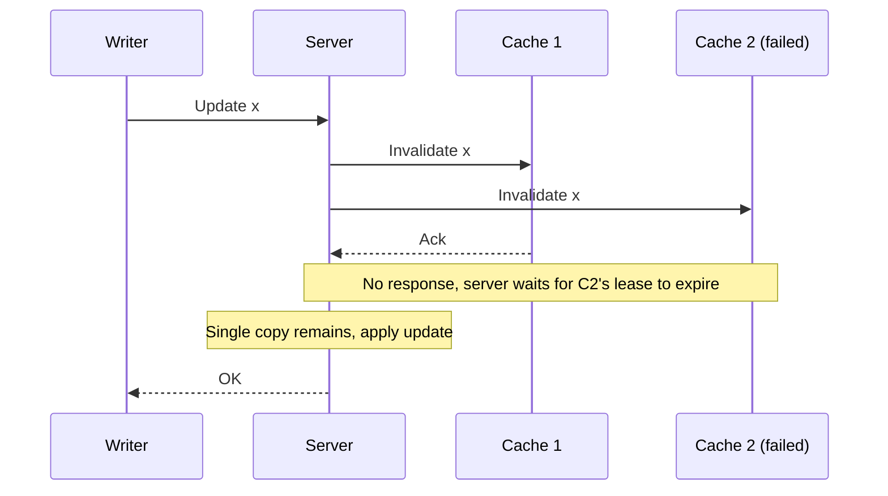

**Cache coherence** is the property that every node holding a copy of mutable data sees the same view of that data. When linearizability is required, any duplication of mutable data across nodes must be kept coherent.

Leases provide linearizable caching. Their costs explain why many large systems, including NFS, DNS and much of the web, provide weaker consistency for cached data.

## Distributed caching with leases

A **lease** is a time-limited grant of a right, here the right to cache some data.

The time limit makes leases fault tolerant. If a node holding a lease fails, the other nodes wait for the lease to expire. A live holder can renew its lease and keep caching.

### Cache reads

1. A cache obtains a lease along with the data.
2. No node can modify the data until the lease expires or is revoked, so the server must track who holds which data and until when.
3. Once the lease expires, the value can change. Nothing is cached at that point, so the only copy is at the server, and subsequent caches fetch the new data.

This is linearizable and fault tolerant, since a failed holder's lease eventually expires on its own. It scales poorly, because the server holds state for every cached item.

Clients can cache values too. The server forwards the lease along with the data to the client.

### Cache updates

Leases allow the server to return to a single copy whether or not the caches are available. The naive update path waits for every outstanding lease to time out before each write.

The optimized path uses callbacks, avoiding the wait when nothing has failed. On receiving an update for a cached value, the server sends an invalidation to every node holding a copy, waits for all of them to respond or for their leases to expire, then applies the update.

> [!info] The one-copy rule
> In both update paths, linearizability requires exactly one copy of the data while it is being updated.

### Lease timeouts

> [!tip] Choosing lease timeouts
> Using one timeout value for all leases means less state at the server and a shorter worst-case wait to reclaim every lease. Using varied timeouts staggers renewal requests, so that the server does not receive renewals from every cache at once. The choice depends on which of these effects matters more in a given deployment.

## Weaknesses of linearizable caches

- Server state grows linearly with the number of cached items
- During an update no node can read the item, and a failed cache extends that interval to the full lease time
- More copies means more chances some holder is down, so updates wait for lease expiry more often

## Caching widely shared data

For widely shared data, snapshot-read consistency, under which reads may return stale data, is often acceptable, and much of the web operates this way. A common arrangement is many read-only caches and a single writable copy, with updates propagating from the writable copy out to the caches.

## Examples

### Sun Network File System (NFS)

NFS is a protocol for accessing a remote shared file system that appears as a local directory (via mount in Unix). Open, close, read, and write are RPCs to a remote server. Reads and writes are block oriented rather than positional, so the server keeps no per-client state and every operation is idempotent.

The stateless server simplifies failure handling. If the server crashes, a client waits for it to reboot and resends the request, with at-least-once RPC semantics, no callbacks, and no error handling needed in client applications.

Clients locally cache file data and metadata, and the caches are eventually consistent:

- Each cache entry has a TTL, and the local copy is revalidated on the next access after the TTL expires (3 to 30 seconds)
- Updates are sent back to the server after a similar delay
- Metadata such as directories and file status uses shorter TTLs, file data uses longer ones

This design performs well when files are not shared, for example when each user works in a separate directory. Concurrent sharing through NFS can serve stale data within the TTL window.

### Domain Name System (DNS)

DNS translates domain names to IP addresses. Servers are stateless, with at-least-once semantics for fetching records. Resolution is hierarchical so that each domain manages its own names. A resolver asks the root for `com`, then `com` for `google.com`, then `google.com` for `www.google.com`.

DNS is eventually consistent. Clients cache at each level, updates go directly to the relevant name server, and clients discover changes only after the TTL expires. Domain owners set TTLs, which vary widely and can even be infinite. CDN records typically use short TTLs so traffic can move quickly when a server fails.

## Caching terminology

- **Write through**: the cache holds read-only data. Writes go to the store, and the store revokes outstanding copies. Exploits locality for reads.
- **Write back**: the cache holds read-write data, so updates happen client side too, as in NFS. The cache writes locally and asks the store to revoke other copies. Exploits locality for reads and writes.

### Write back cache coherence

On a write:

- Send invalidations to all caches
- Each cache invalidates and responds, possibly with updated data
- Wait for all invalidations, then return

Reads proceed whenever a local copy exists. The server must order concurrent requests to avoid deadlock.

Write back caching creates a durability problem, since a cache failure can lose writes that have not reached the store. Two remedies are available.

- Periodic distributed checkpoints, restarting from the last checkpoint if any cache fails. Appropriate for long-running background computations.
- Send a log of changes to replicated storage. If a cache fails, read its log back from storage. This is how a backup takes over from a failed primary in [[systems/distributed-systems/primary-backup|primary-backup replication]], by replaying the log.

## Related notes

- [[systems/distributed-systems/consistency|consistency]]
- [[systems/distributed-systems/primary-backup|primary-backup replication]]
- [[systems/research/development-of-the-dns|Development of the Domain Name System]]
- [[systems/networks/5-application/DNS|Domain Name System (DNS)]]
- [[systems/operating-systems/benchmarks/false_sharing|False Sharing Benchmarks]]
- [[systems/research/hints-for-computer-system-design|Hints for Computer System Design]]
- [[systems/databases/distributed-data/preface|Scalable Distributed Data Systems]]
