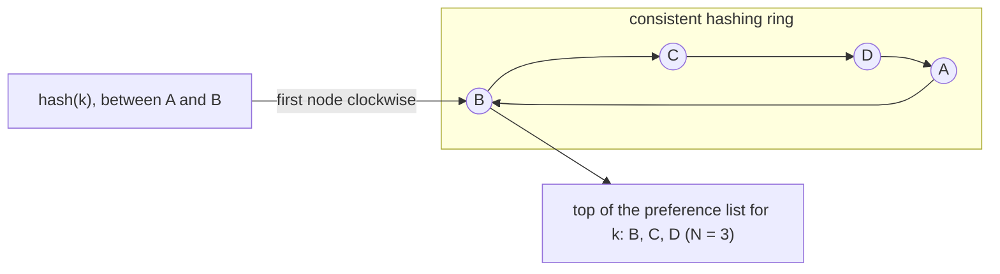
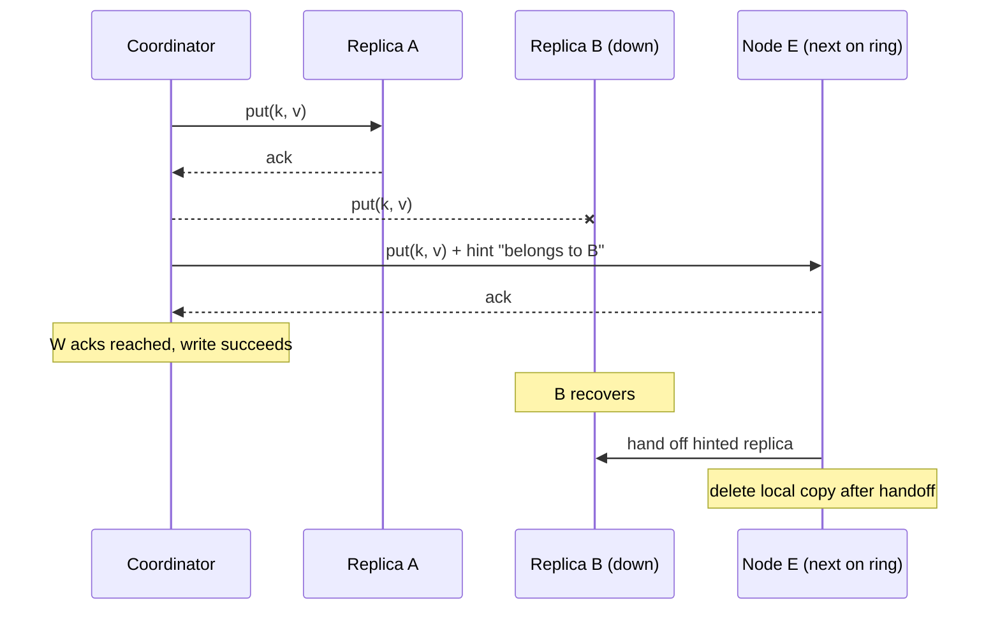

Dynamo is a partitioned, replicated key-value store, described by [DeCandia et al. (SOSP 2007)](https://www.allthingsdistributed.com/files/amazon-dynamo-sosp2007.pdf), that offers `get` and `put` on single keys and provides eventual consistency. Each key is stored on $N$ nodes chosen by consistent hashing. A `put` returns once $W$ of them acknowledge and a `get` once $R$ of them reply, so a read can miss a write that some replicas have not yet applied, and concurrent writes can produce divergent versions that a later read returns together for the application to merge.

Dynamo is designed to accept writes during disk failures, network partitions and the loss of a datacenter, and it moves the cost of that availability to reads: a read may return a stale value or several conflicting ones. The paper's contribution is the combination of known techniques (consistent hashing, version vectors, quorums, hinted handoff, Merkle trees and gossip) into one production system, and its measurements of that system at Amazon. Amazon DynamoDB, the AWS service launched in 2012, shares the name but little of the design, as described in [[#Dynamo and Amazon DynamoDB]].

## Requirements and interface

The paper states the requirements of the services Dynamo was built for (section 2.1). Objects are binary blobs, usually under 1 MB, addressed by a primary key; no operation spans more than one key, and Dynamo provides no isolation guarantees. Latency targets are set at the 99.9th percentile, and "a typical SLA required of services that use Dynamo is that 99.9% of the read and write requests execute within 300ms." The system runs inside one administrative domain, so nodes are trusted. The motivating application is the shopping cart, whose service in one day "served tens of millions requests that resulted in well over 3 million checkouts".

> [!quote] DeCandia et al., section 1
> "customers should be able to view and add items to their shopping cart even if disks are failing, network routes are flapping, or data centers are being destroyed by tornados."

The interface has two operations. `get(key)` returns one object, or a list of objects with conflicting versions, together with a *context*. `put(key, context, object)` writes a new version; the context, opaque to the caller, carries the version information of the object that was read, and so names the version the write supersedes. Dynamo applies MD5 to the key and uses the 128-bit result to place it.

Table 1 of the paper lists the technique Dynamo uses for each problem:

| Problem | Technique | Advantage the paper claims |
| --- | --- | --- |
| Partitioning | Consistent hashing | Incremental scalability |
| High availability for writes | Vector clocks with reconciliation during reads | Version size is decoupled from update rates |
| Handling temporary failures | Sloppy quorum and hinted handoff | High availability and durability when some replicas are not available |
| Recovering from permanent failures | Anti-entropy using Merkle trees | Synchronizes divergent replicas in the background |
| Membership and failure detection | Gossip-based membership protocol and failure detection | Symmetry, and no centralized registry of membership and liveness |

## Partitioning and replication

Dynamo places nodes and keys on a consistent hashing ring (section 4.2). A key is assigned to the first node clockwise from its position, and that node replicates it on the next $N - 1$ nodes clockwise, so each node stores the keys between itself and its $N$-th predecessor. In the paper's Figure 2, with $N = 3$, a key between A and B is stored on B, C and D, and D stores the ranges (A, B], (B, C] and (C, D].

The list of nodes responsible for a key is its *preference list*. Every node can compute it, and it holds more than $N$ nodes so that substitutes are available when some fail. Each node occupies many positions on the ring (*virtual nodes*, or *tokens*), so the list is built by walking clockwise and skipping positions whose physical node is already in the list. The paper gives three advantages for virtual nodes: when a node fails, its load is spread over the remaining nodes; when a node joins, it takes a roughly equal amount of load from each of the others; and a node's number of tokens can be set by its capacity. The [[systems/distributed-systems/sharding|sharding]] note measures how the imbalance of a ring falls with the number of tokens per node, and shows which keys move when a server joins.

### The three partitioning strategies

Section 6.2 describes how Dynamo's partitioning changed in production. The paper compares three strategies:

1. **$T$ random tokens per node, partition by token value.** This was the original scheme. Consecutive tokens bound the ranges, so ranges vary in size and change whenever a node joins or leaves. A joining node must take its key ranges from other nodes, which then scan their local stores for the affected keys; this scan ran at the lowest priority, and in the busy shopping season bootstrapping "has taken almost a day to complete." Membership changes also alter many ranges and force Merkle trees to be recomputed, and the random ranges made it inefficient to archive the key space. The paper identifies the root cause as partitioning and placement being "intertwined".
2. **$T$ random tokens per node, $Q$ equal-sized partitions.** The hash space is cut into $Q$ fixed partitions, with $Q \gg N$ and $Q \gg S \cdot T$ for $S$ nodes. Tokens now only decide placement: a partition is stored on the first $N$ distinct nodes met walking clockwise from its end. Dynamo used this strategy briefly while migrating from strategy 1 to strategy 3.
3. **$Q/S$ tokens per node, $Q$ equal-sized partitions.** Each node holds $Q/S$ of the fixed partitions; a departing node's tokens are redistributed at random among the rest, and a joining node takes tokens from the others, in both cases preserving the $Q/S$ property.

The paper compares the strategies for $S = 30$ nodes and $N = 3$ at equal membership metadata per node, using *load balancing efficiency*, the mean number of requests per node divided by the requests served by the busiest node. Strategy 3 had the highest efficiency and strategy 2 the lowest (its Figure 8). Relative to strategy 1, strategy 3 also reduced the membership information held at each node "by three orders of magnitude", let a partition move as a single file during bootstrapping and recovery, and simplified archival. Its disadvantage is that a membership change requires coordination to preserve the assignment. Strategy 3 is an indirection table in the terms of the [[systems/distributed-systems/sharding#Indirection tables|sharding]] note.

The paper also measures load imbalance in production over 24 hours, counting a node as out of balance when its request load deviates from the mean by more than 15%. The fraction of nodes out of balance was about 20% at low load and close to 10% at high load (Figure 6). The paper attributes the difference to the number of popular keys being accessed: at high load many popular keys are active and spread over the nodes.

## Versioning and reconciliation

Dynamo treats every `put` as a new, immutable version (section 4.4). It tags each version with a vector clock, a list of (node, counter) pairs, one entry per node that coordinated a write to the object; the [[systems/distributed-systems/clocks#Vector Clocks|clocks]] note covers vector clocks and the closely related version vectors. Version $a$ is an ancestor of version $b$ if every counter in $a$ is at most the corresponding counter in $b$, and $a$ can then be discarded. Otherwise the two versions are concurrent, and both are kept.

The paper's Figure 3 follows one object through five versions:

| Version | Written | Vector clock |
| --- | --- | --- |
| D1 | first write, coordinated by Sx | [(Sx, 1)] |
| D2 | update of D1, by Sx | [(Sx, 2)] |
| D3 | update of D2, by Sy | [(Sx, 2), (Sy, 1)] |
| D4 | another client's update of D2, by Sz | [(Sx, 2), (Sz, 1)] |
| D5 | a client's merge of D3 and D4, by Sx | [(Sx, 3), (Sy, 1), (Sz, 1)] |

D2 supersedes D1, but D3 and D4 are concurrent: neither clock dominates the other. A read that finds both returns both, with a context that summarizes their clocks, [(Sx, 2), (Sy, 1), (Sz, 1)]. The client's next `put` with that context is the reconciliation, and its version D5 descends from both.

The paper distinguishes *syntactic* reconciliation, which the system performs when one version descends from the other, from *semantic* reconciliation, which the application performs on concurrent versions. The shopping cart merges concurrent carts by taking their union, so "an 'add to cart' operation is never lost. However, deleted items can resurface." The [[systems/distributed-systems/crdts|CRDTs]] note constructs this anomaly and shows a set type that avoids it. Not every service uses semantic reconciliation. Section 6 names three patterns: business-logic reconciliation (the cart), timestamp-based last-write-wins (the session service), and a "high performance read engine" with $R = 1$ and $W = N$ for read-heavy data such as the product catalog.

Divergent versions were rare. Over 24 hours of the shopping cart service, "99.94% of requests saw exactly one version; 0.00057% of requests saw 2 versions; 0.00047% of requests saw 3 versions and 0.00009% of requests saw 4 versions" (section 6.3). As printed, these percentages sum to 99.941%, so they do not account for every request; the paper does not explain the remainder. It reports that divergence grew with the number of concurrent writers, usually automated clients, rather than with failures.

> [!warning] Vector clock truncation
> A vector clock grows by one pair for each distinct node that coordinates a write, which happens mainly when writes are handled by nodes outside the top $N$ of the preference list during partitions or failures. Dynamo stores a timestamp with each pair and, when the clock reaches a threshold ("say 10") pairs, removes the oldest. A truncated clock can make a descendant look concurrent with its ancestor, so a version the clocks would have discarded is returned to the application for reconciliation instead. The paper states that "this problem has not surfaced in production and therefore this issue has not been thoroughly investigated."

## Executing get and put

The node that handles a request is its *coordinator* (section 4.5). Clients reach one through a load balancer, in which case a node outside the key's top $N$ forwards the request, or through a partition-aware client library that sends it directly. The coordinator is usually the first of the top $N$ nodes in the preference list, but to spread load any of the top $N$ may coordinate a write. Since a write usually follows a read, Dynamo picks the node that replied fastest to that read, recorded in the context, which also raises the chance of read-your-writes consistency (section 5).

For a `put`, the coordinator generates the new version's vector clock, writes it locally, and sends it to the $N$ highest-ranked reachable nodes; the write succeeds once $W - 1$ of them respond. For a `get`, it requests every version of the key from the $N$ highest-ranked reachable nodes and waits for $R$ responses, then returns every version it finds causally unrelated. Choosing $R + W > N$ "yields a quorum-like system". Because an operation waits for the slowest of its $R$ or $W$ replicas, services usually set $R$ and $W$ below $N$ for latency. The paper's common configuration is $(N, R, W) = (3, 2, 2)$, and all of its section 6 measurements come from instances running it on "a couple hundred nodes".

After the read returns, the coordinator waits briefly for the remaining responses and writes the latest version to any replica that returned an older one. The paper calls this *read repair*.

The paper reports several latency results:

- **Diurnal latency.** Over December 2006, read and write latencies followed the request rate; write latencies exceeded read latencies because every write accesses disk, and the 99.9th percentile was around 200 ms, an order of magnitude above the mean (Figure 4).
- **Write buffering.** Holding writes in an in-memory buffer that a writer thread flushes periodically lowered the 99.9th percentile latency "by a factor of 5 during peak traffic even for a very small buffer of a thousand objects" (Figure 5). To bound the durability cost, the coordinator asks one of the $N$ replicas to perform a durable write, and since the coordinator waits for only $W$ responses, that replica's latency does not delay the write.
- **Client-driven coordination.** Moving the coordinator's state machine into the client library, which polls a random node for membership every 10 seconds, removes the load balancer and a possible forwarding hop. Over 24 hours (Table 2), the 99.9th percentile read latency fell from 68.9 ms to 30.4 ms, the 99.9th percentile write latency from 68.5 ms to 30.4 ms, and the mean read and write latencies from 3.9 ms and 4.02 ms to 1.55 ms and 1.9 ms.

Across the services using it, Dynamo answered 99.9995% of requests successfully without a timeout, and "no data loss event has occurred to date" (section 6.6).

## How stale is a partial quorum?

With $R + W \le N$, a read quorum need not contain any replica that acknowledged the write, yet the write usually reaches every replica within milliseconds because the coordinator sends it to all $N$. [Bailis et al. (VLDB 2012)](https://arxiv.org/abs/1204.6082) quantify this as *probabilistically bounded staleness* (PBS). Their *t-visibility* is the probability that a read issued $t$ after a write commits returns that write or a newer one. They compute it with the WARS model, in which each replica $i$ has four independent one-way delays: the write $W_i$, its acknowledgement $A_i$, the read request $R_i$ and the read response $S_i$. The write commits when the $W$-th smallest $W_i + A_i$ arrives. A read issued $t$ later reaches replica $i$ after $R_i$ more and is answered by the $R$ replicas with the smallest $R_i + S_i$; it is stale if none of them had received the write by the time the read request arrived.

They fit these delays to production latency measurements: LinkedIn's Voldemort on SSDs (LNKD-SSD) and on spinning disks (LNKD-DISK, which differs only in a heavier-tailed write delay), Yammer's Riak (YMMR), and a three-datacenter setting (WAN) that adds 75 ms to every message between datacenters. Each fit is a mixture of a Pareto body and an exponential tail (their Table 3).

The figure runs the WARS model with these fits in the browser, with every replica reached over the network as in Dynamo's client-driven coordination. Each curve is 40,000 simulated writes, each followed by a read. In the first copy, the paper's (3, 2, 2) sits on the floor of the chart, because every read quorum shares a replica with every write quorum; the dashed curve is (3, 1, 1).

<StaleReads preset="quorum" />

With $(3, 1, 1)$ on LNKD-DISK, about 56% of reads issued at the instant of commit are stale, and the probability falls below 0.1% only after about 50 ms (45.5 ms in PBS, 52 ms in the simulation below). The same quorum on SSDs is consistent 97% of the time at commit. Raising $R$ or $W$ to make $R + W > N$ removes staleness without failures, at the cost of waiting for a slower replica: on LNKD-DISK, PBS reports a 99.9th percentile write latency of 10.99 ms with $W = 1$ and 20.97 ms with $W = 2$, and the simulation gives about the same. The figure's readout gives both latencies for the reader's setting.

<StaleReads preset="disk" />

An independent Python implementation of the same model (see [[#How this was measured]]) reproduces the values PBS reports. Each row is the mean of 10 runs of 1,000,000 trials, with a 95% interval over the runs:

| Latencies, N = 3, R = W = 1 | Consistent at commit, simulated | PBS | Time to 99.9% consistent, simulated | PBS |
| --- | --- | --- | --- | --- |
| LNKD-SSD | 97.36% (97.35 to 97.38) | 97.4% | 1.96 ms (1.95 to 1.98) | 1.85 ms |
| LNKD-DISK | 43.66% (43.63 to 43.69) | 43.9% | 52.1 ms (51.7 to 52.4) | 45.5 ms |
| YMMR | 88.70% (88.67 to 88.73) | 89.3% | 1452 ms (1443 to 1461) | 1364 ms |
| WAN | 33.37% (33.34 to 33.41) | 33% | 116.2 ms (115.7 to 116.7) | 113 ms |

The immediate consistency agrees to within 0.6 percentage points. The time to 99.9% is 3% to 14% longer in this simulation than in PBS's Table 4; the 99.9th percentile is set by the Pareto tail of the write delay, whose fitted shape PBS gives to two or three significant figures, and the source of the gap was not identified. The same holds for the other quorum sizes: with $R = 2$, $W = 1$ the simulation gives 14.2 ms, 217 ms and 31.0 ms against PBS's 13.6 ms (LNKD-DISK), 202 ms (YMMR) and 30.2 ms (WAN), and every configuration with $R + W > N$ is consistent at commit in both.

## Sloppy quorums and hinted handoff

A strict quorum system would reject a write when fewer than $W$ of the key's top $N$ nodes are reachable. Dynamo instead uses a *sloppy quorum* (section 4.6): reads and writes go to the first $N$ healthy nodes of the preference list, which during a failure includes nodes past the top $N$. A substitute stores the write with a *hint* naming the intended node, keeps hinted replicas in a separate local database that it scans periodically, and delivers them once the intended node recovers, after which it may delete its copy.

With $W = 1$, a write is rejected only if every node in the system is unavailable, but the paper notes that most services set a higher $W$ for durability. A sloppy quorum also removes the guarantee that $R + W > N$ provides. The write quorum and a later read quorum are drawn from whichever nodes were reachable at each moment, and they need not overlap: a node that was down for the write can recover before its hint arrives, and a node that had the write can fail, sending the read to a substitute that never had it.

The figure's third copy keeps (3, 2, 2) and lets each node be down 5% of the time, in outages of 10 s on average, with hints delivered about 1 s after the node recovers. The outage length and hint delay are assumed values; the paper gives neither. The dashed curve is (3, 1, 1) under the same failures.

<StaleReads preset="sloppy" />

The Python simulator measured the same comparison with 5 runs of 500,000 trials per point, LNKD-DISK delays and outages averaging 10 s. In the strict variant, a write or read that finds fewer than $W$ or $R$ of the top $N$ nodes up fails instead of using substitutes, and no strict (3, 2, 2) read was ever stale.

| Each node down | Sloppy: stale at commit | 1 s after | 10 s after | 100 s after | Strict: writes rejected | Strict: reads rejected 100 s after |
| --- | --- | --- | --- | --- | --- | --- |
| 1% | 0.0002% | 0.0001% | 0.003% | 0.011% | 0.030% | 0.030% |
| 5% | 0.003% | 0.003% | 0.106% | 0.250% | 0.73% | 0.73% |
| 10% | 0.005% | 0.017% | 0.445% | 0.998% | 2.77% | 2.81% |

Each value is the mean of the 5 runs; the smallest come from a handful of stale reads among 2.5 million, and `results.json` gives every interval. Shortly after commit, the nodes that are down at the read are almost always the ones that were down at the write, so the read goes to the same substitutes as the write and finds the version. Staleness grows over the following tens of seconds, as outages end and new ones begin.

Most of the stale reads at long times come from one case: two of the key's three home nodes are down when the read arrives, so the sloppy read uses two substitutes that do not hold the version, and the two replies it waits for come from those substitutes with probability 1/3. With 5% of nodes down, two of three home nodes are down with probability $3 \cdot 0.05^2 \cdot 0.95 + 0.05^3 = 0.725\%$, the rate at which the strict variant rejects writes and reads, and a third of that is 0.24%, close to the 0.250% measured at 100 s. A strict quorum would have rejected those reads. Sloppy quorums thus exchange unavailable reads for stale ones; with a mean outage of 10 ms instead of 10 s, failures at the write and at the read are nearly independent, and (3, 2, 2) read stale data at commit 0.34% of the time with 1% of nodes down.

> [!note]- Deep dive: read repair in the simulator
> Read repair only helps a later read, and only after the first read's coordinator has collected every reply. In the simulator, a first read at commit with $(3, 1, 1)$ is followed by a second read some time later; with read repair, the coordinator sends the version to every replica that answered the first read without it.
>
> | Second read, after the first | LNKD-DISK, no repair | LNKD-DISK, read repair | YMMR, no repair | YMMR, read repair |
> | --- | --- | --- | --- | --- |
> | 1 ms | 41.7% | 39.2% | 9.31% | 9.33% |
> | 10 ms | 7.37% | 0.91% | 6.09% | 1.39% |
> | 100 ms | 0.038% | 2 of 10 million | 4.51% | 0.27% |
> | 1 s | 0.0013% | 0 of 10 million | 0.36% | 0.0014% |
>
> Values are means of 10 runs of 1,000,000 trials; the 95% intervals are narrower than the last digit shown. A second read 1 ms after the first sees no benefit, because the repair messages have not yet arrived.
>
> The effect lasts longest on YMMR, whose write delay has an exponential tail with a mean of 357 ms (rate 0.0028 per ms): a replica that has not received the write at the first read is likely to stay without it for hundreds of milliseconds, and read repair reduces staleness 100 ms later from 4.51% to 0.27%. On LNKD-DISK most late writes arrive within about 100 ms even without repair.

## Replica synchronization with Merkle trees

Hinted handoff does not cover a substitute that fails before delivering its hints. For these and other permanent failures, Dynamo runs an anti-entropy protocol (section 4.7). Each node keeps a Merkle tree for each key range it hosts: the leaves are hashes of the values of individual keys, and each parent is a hash of its children. Two nodes that host the same range exchange the roots; if they match, the range is in sync, and otherwise they descend into the children whose hashes differ until they reach the keys that are out of sync. Only the hashes along the differing paths and the differing keys cross the network, and fewer disk reads are needed than in a full comparison. Under strategy 1, membership changes altered many key ranges and forced the trees to be recomputed; the fixed partitions of strategy 3 removed this cost. The simulator above, like the WARS model, omits anti-entropy, so it never repairs a replica that missed a write except through read repair or hinted handoff.

## Membership and failure detection

Dynamo treats most outages as transient, so node joins and removals are explicit (section 4.8). An administrator issues a membership change through a command-line tool or a browser; the receiving node persists the change with its time of issue, and a gossip protocol propagates the history of changes: each node contacts a random peer every second and the two reconcile their histories. The same exchange propagates the token assignments, so every node knows the ranges of its peers and can route a request to the right nodes directly, which makes Dynamo a *zero-hop* DHT. Some nodes act as *seeds*, known to every node through configuration, so that two nodes joined separately cannot form a logically partitioned ring.

Failure detection is local. Node A considers node B failed if B does not answer A's messages, even if B answers C's, then sends B's requests to other nodes and periodically retries B. An early design used a decentralized failure detector to maintain a global view of failures, which the explicit join and leave mechanism made unnecessary. When a node joins, the nodes that hand over ranges to it transfer the keys after a confirmation round that prevents duplicate transfers. Background work of this kind, and replica synchronization, runs under an admission controller that watches foreground latencies (for example the 99th percentile database read latency over 60 seconds against a threshold such as 50 ms) and grants background tasks time slices accordingly (section 6.5).

The paper notes the limit of this design: every node gossips the full routing table, which "works well for a system that contains couple of hundreds of nodes" but would not scale easily to tens of thousands, a problem it suggests hierarchical extensions or O(1) DHTs could address.

## Dynamo and Amazon DynamoDB

Dynamo was an internal system: "Dynamo was a single-tenant system and teams were responsible for managing their own Dynamo installations," according to [Elhemali et al. (USENIX ATC 2022)](https://www.usenix.org/conference/atc22/presentation/vig). They describe Amazon DynamoDB, the public service launched in 2012, which "shared most of the name of the previous Dynamo system but little of its architecture." It kept Dynamo's incremental scalability and predictable performance and combined them with ideas from SimpleDB.

| | Dynamo (2007) | Amazon DynamoDB (2022 paper) |
| --- | --- | --- |
| Tenancy | Single-tenant; each service ran and managed its own instances | Multi-tenant managed service |
| Replication | $N$ replicas on the ring, sloppy quorum of $R$ and $W$ | Each partition replicated across availability zones; a replication group with Multi-Paxos for leader election and consensus |
| Writes | Any of the top $N$ coordinates; succeed after $W$ acknowledgements | Only the leader serves writes; acknowledged once a quorum, two of three replicas in different zones, persists the log record |
| Reads | $R$ replies, possibly several versions | Strongly consistent reads from the leader; eventually consistent reads from any replica |
| Conflicts | Vector clocks; concurrent versions returned to the application | One leader per partition serializes writes; multi-Region tables with eventual consistency use last-writer-wins by timestamp, per item ([AWS documentation](https://docs.aws.amazon.com/amazondynamodb/latest/developerguide/V2globaltables_HowItWorks.html)) |
| Placement | Consistent hashing; later fixed partitions (strategy 3) | Tables divided into partitions by throughput and storage; a partition is split for size or when its consumed throughput crosses a threshold; request routers look up placement in a metadata service (MemDS) |
| Load | Tuned by the operating team | Provisioned or on-demand capacity, with adaptive capacity and global admission control |
| Transactions | Single-key updates, no isolation | ACID transactions across items |

DynamoDB therefore does not expose divergent versions to applications, and a strongly consistent read returns the latest acknowledged write. Eventually consistent reads may be served by any replica of the group, including one that has not yet applied the leader's latest writes. The ATC paper reports a peak of 89.2 million requests per second during Prime Day 2021 and an availability SLA of 99.99% for regular tables and 99.999% for global tables.

> [!note]- How this was measured
> The code is in [dynamo-experiments](https://github.com/elimelt/web/tree/main/notes/content/systems/distributed-systems/dynamo-experiments), beside the note. It ran on a shared cloud VM (4-vCPU Intel Xeon x86-64, no GPU, three other agents running experiments at the same time), with Python 3.13.18 and NumPy 2.5.3, limited to two threads (`OMP_NUM_THREADS=2`); the full run took 35 minutes.
>
> - **Simulator:** `dynsim.py`. Message delays are sampled from the PBS Table 3 fits (Pareto body with CDF $1 - (x_m/x)^\alpha$, exponential tail with rate $\lambda$ per ms). WAN places replica $j$ in datacenter $j \bmod 3$, draws the write's and the read's datacenters independently and uniformly, and adds 75 ms to each message that crosses datacenters. Failure-free t-visibility is computed exactly per trial: the read is stale for every $t$ below the minimum, over its $R$ fastest repliers, of $W_i - w_t - R_i$.
> - **Failures:** each node alternates between up and down as a two-state Markov chain whose long-run down fraction is $f$ and whose mean outage is $D$; the states at the write and at the read are sampled exactly from the chain. The coordinator knows which nodes are up. The $k$-th down node among the top $N$ is paired with the $k$-th substitute that took the write, which delivers the hint an exponentially distributed time (mean 1 s) after the home node recovers and then deletes its copy; a substitute holding a hint returns it to reads. Re-failure during a hint's delivery and anti-entropy are not modeled. With a ring, the simulator builds real preference lists on a 30-node, 8-token MD5 ring (strategy 1); since node failures are independent and identical, the results match those computed on list positions alone (for (3, 2, 2) with 10% of nodes down and a read 1 s after commit, 20 of 100,000 reads were stale with the ring and 13 of 100,000 without, whose 95% intervals, 0.013% to 0.031% and 0.008% to 0.022%, overlap).
> - **Experiments:** `OMP_NUM_THREADS=2 python3 run_experiments.py > results.json`, then `python3 summarize.py results.json`. Ten seeds of 1,000,000 trials for failure-free results, five of 500,000 for failures; intervals are 95% Student t intervals over seeds.
> - **Checks:** `python3 checks.py > checks.txt` compares the simulator with PBS's $k$-staleness closed form $\left(\binom{N-W}{R} / \binom{N}{R}\right)^k$ for non-expanding quorums, with an exact formula for exponential write delays and instantaneous other messages, and with PBS Equation 4 (exact when read requests are instantaneous, an upper bound otherwise); it also checks the failure chain's transition probabilities, that strict quorums with $R + W > N$ never read stale data, and the preference lists against a brute-force walk of the ring. All 55 checks pass; the output is in `checks.txt`.
> - **Figure:** `quartz-site/plugins/mdx/src/components/stale-reads/model.ts` reimplements the simulator in TypeScript with its own generator (Mulberry32, seed 2007). Its test checks it against the exponential closed form, against 15 reference values that `python3 figure_reference.py > figure-reference.json` computes from 2,000,000 Python trials each, and against PBS's published immediate-consistency values.

> [!note]- Potentially interesting ideas
> - A sloppy read that substitutes a fallback node for a down home node can count the fallback's empty reply toward $R$. Requiring that at least one of the $R$ replies come from a node that was in the key's top $N$, or not counting a "not found" reply toward $R$, would turn some of those stale reads into slower or failed reads; the simulator could measure the trade, but which rule Dynamo itself used is not stated in the paper.
> - The simulated time to 99.9% consistency runs 3% to 14% longer than PBS's Table 4 while the immediate consistency matches. Refitting the Pareto tails to the raw LinkedIn and Yammer latencies, if they were available, would show whether the rounding of the published fits explains the gap.

## Related notes

- [[systems/distributed-systems/sharding|sharding]]: consistent hashing, virtual nodes and indirection tables, measured on a Twitter cache trace
- [[systems/distributed-systems/clocks|clocks]]: vector clocks and version vectors
- [[systems/distributed-systems/crdts|CRDTs]]: merges that avoid the shopping cart's resurfacing deletes
- [[systems/distributed-systems/consistency|consistency]]: the models between eventual consistency and linearizability
- [[systems/distributed-systems/disconnected-operation|disconnected operation]]: optimistic replication with reconciliation in Coda
- [[systems/distributed-systems/paxos-intro|Paxos]]: the consensus protocol DynamoDB's replication groups use
