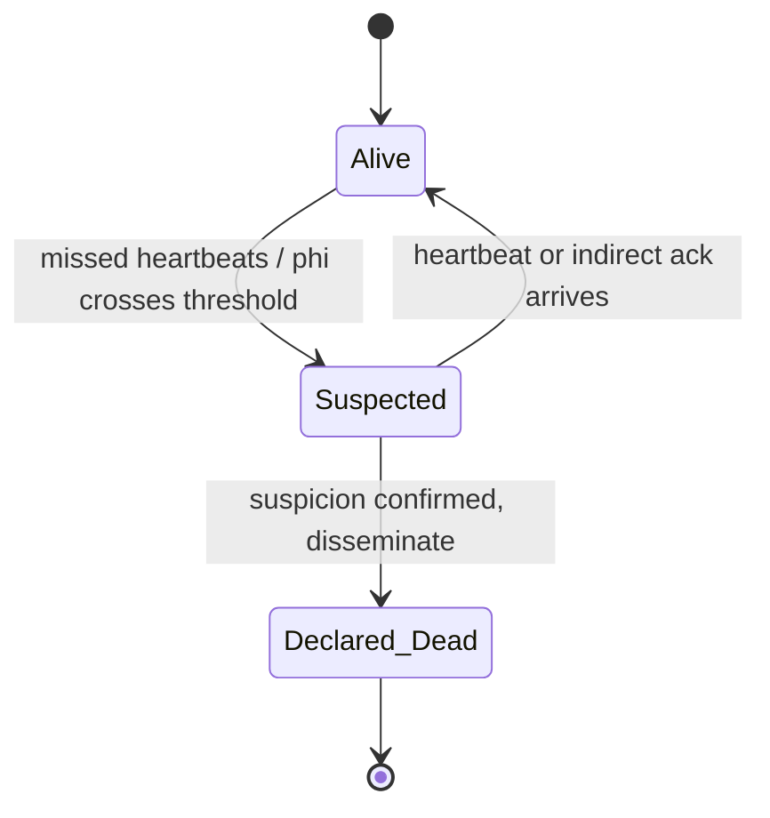
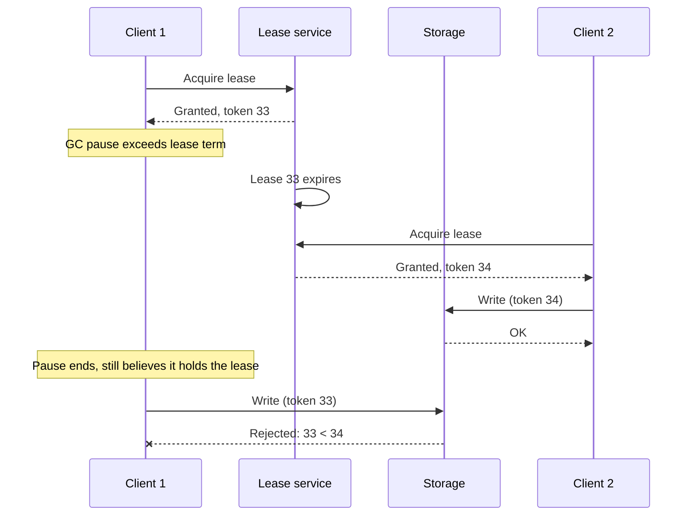

A **failure detector** is a mechanism by which a process forms suspicions that other processes have crashed. A **lease** grants authority for a bounded time, and **leader election** selects one process to act for a group. These mechanisms underlie [[systems/distributed-systems/paxos-intro|consensus]] and [[systems/distributed-systems/managing-critical-state|critical-state management]]: they determine when a node is treated as failed, grant time-bounded authority, and prevent two nodes from acting as leader at once.

Perfect failure detection is impossible in an asynchronous system, so practical designs ensure that a *wrong* suspicion delays progress without violating safety.

## Failure detection in asynchronous systems

In an asynchronous system, with unbounded message delay and unbounded processing pauses, no observation distinguishes a crashed process from a slow one. This indistinguishability underlies the FLP impossibility result (Fischer, Lynch, Paterson 1985), which shows that deterministic consensus is unsolvable when even one process may crash, because no protocol can distinguish waiting for a slow process from waiting for a crashed one. Every implementable failure detector is therefore a *suspicion* mechanism whose output can be wrong, and a correct system design must specify its behavior when a suspicion is wrong.

[Chandra and Toueg (1996)](https://dl.acm.org/doi/10.1145/226643.226647) classified failure detectors by two properties, **completeness** (crashed processes are suspected) and **accuracy** (correct processes are not), and asked how much accuracy consensus requires. A perfect detector $P$, which never suspects a correct process, requires a degree of synchrony that real networks do not provide. The class of practical consequence is **eventually strong** $\Diamond S$, under which suspicions can be arbitrarily wrong for an arbitrary prefix of the execution, provided that *eventually* some correct process is no longer suspected by any correct process. Consensus is solvable with $\Diamond S$ and a majority of correct processes, and, in work with Hadzilacos, no weaker detector suffices: $\Diamond W$/$\Omega$, the "eventual leader oracle," is the weakest failure detector for consensus. Consensus therefore requires an eventually stable leader hint and quorums rather than reliable failure detection, and Paxos and Raft have this structure.

Practical detectors approximate $\Diamond S$ with heartbeats and timeouts, and the choice of timeout is a tradeoff. Short timeouts detect crashes quickly but produce false suspicions under load spikes. A falsely suspected leader triggers an unnecessary election, which adds load and can sustain a metastable failure. Long timeouts produce fewer false suspicions but leave the system without a leader for longer after an actual crash. Two refinements are widely deployed. The **phi-accrual detector** (Cassandra, Akka) replaces the binary verdict with a suspicion level computed from the observed heartbeat-interval distribution, so that the effective timeout adapts to current network behavior. **SWIM**-style protocols decouple detection (randomized pings, with indirect probes through third parties before declaring suspicion) from dissemination (gossip), keeping per-node load constant as the cluster grows.



Suspicion is a reversible state. The `Suspected -> Alive` transition allows a wrong suspicion to be corrected, and the mechanisms built on detection (elections, leases, fencing) limit the cost of such corrections.

## Leases: authority with an expiry date

A **lease** ([Gray and Cheriton 1989](https://dl.acm.org/doi/10.1145/74850.74870)) is a grant of authority, such as cache validity, lock ownership or leadership, that is valid for a bounded time and renewable by communication. Expiry requires no communication. If the holder crashes or is partitioned, the grantor waits until the term ends and then reassigns the grant; a lock with a timeout is a lease. Correctness requires a **bounded drift rate** rather than synchronized clocks. The grantor and the holder each measure the term on their own clock, and if clocks run within (for example) 1% of the true rate, the grantor adds a small margin and the holder treats its lease as expired slightly early. An assumption on clock rate is weaker than an assumption on clock synchronization (see [[systems/distributed-systems/clocks|Clocks]]), since it does not require clocks to agree on the time.

> [!warning] The stalled leaseholder
> The hazard lies in the holder's behavior near expiry. [Kleppmann's distributed-locking critique](https://martin.kleppmann.com/2016/02/08/how-to-do-distributed-locking.html) describes a client that acquires a lease and then stalls (a GC pause, VM migration or swap storm) past its expiry. The lease service correctly reassigns the lease. The stalled client resumes *acting as the lease holder*, because its check ran before the pause, and writes to shared storage. Two clients then write to the same data and corrupt it, and timeout tuning cannot prevent this, because the pause can exceed any timeout.

A **fencing token** prevents this failure. The lease service issues a monotonically increasing number with each grant, every write to the protected resource carries it, and the resource rejects tokens older than the highest it has seen. The stalled client's token is older than the current one, so its write is rejected.



The same mechanism appears as Raft's term numbers, ZooKeeper's zxid epochs and Chubby's lock generation numbers. In each, authority carries a version that is checked where the effect takes place, which prevents a former leader that was wrongly suspected from acting after its replacement.

> [!tip] Safety and liveness
> **Timeouts and elections provide liveness** (a crashed leader is eventually replaced), and **quorums and fencing provide safety** (a falsely suspected leader cannot corrupt state). A wrong suspicion may slow the system but must not corrupt it.

## Leader election in practice

**Chubby** ([Burrows 2006](https://research.google/pubs/pub27897/)) is a Paxos-replicated, five-node lock service that exposes a small filesystem with advisory locks. It was designed for coarse-grained use, with locks held for hours rather than milliseconds, so that the cost of an election is amortized. Clients hold **sessions** maintained by keepalive RPCs with a ~12-second lease; if a session's lease lapses, the client enters a ~45-second grace period ("jeopardy") in which caches are disabled but handles survive, masking brief master failovers. Applications elect leaders by competing to acquire a lock file. GFS and Bigtable both elect masters this way, and the process that acquires the lock writes its identity into the file for discovery. Ephemeral files also serve as liveness signals. Burrows reports that a service intended for election and configuration came to be used primarily as a name server, a use that likewise requires one agreed value that changes rarely.

In **ZooKeeper**'s election recipe, every candidate creates a sequential-ephemeral znode, the candidate with the lowest sequence number is leader, and each other candidate watches only its immediate predecessor. When the leader's session ends, its znode is deleted and exactly one successor is notified, which avoids the thundering herd that results when every candidate competes again. **etcd** exposes election directly through its lease API. A candidate campaigns on a key bound to a lease, leadership persists while the lease is kept alive, and the key's creation revision serves as the fencing token. **Raft** integrates election into the consensus protocol. Followers that miss heartbeats become candidates after a *randomized* timeout (the randomization is Raft's only mechanism for avoiding split votes), a majority vote elects a leader, and the incremented term number fences the old leader, since any RPC carrying a stale term is rejected by protocol rule.

All three implement the same layering.

```text
suspicion:  heartbeats + timeouts        (approximate an eventual leader hint)
liveness:   election on suspicion        (randomized or ordered tie-breaking)
authority:  lease with bounded term      (self-expiring, renewable)
safety:     epoch/term/fencing token     (checked by every downstream effect)
```

A coordination service provides this stack as a primitive, so that applications built on it (masters, shard owners, singleton workers) obtain consensus-level safety with code no more complex than a lock-acquisition loop. This safety holds only if the *resources those applications write to* also check the fencing token. A leader correctly elected through Chubby can still corrupt a storage system that accepts unfenced writes. The election determines which process may act, and only token checks at the data limit the effects of a former leader that continues to act.

## Related notes

- [[systems/distributed-systems/paxos-intro|Paxos Intro]]
- [[systems/distributed-systems/managing-critical-state|Managing Critical State]]
- [[systems/distributed-systems/mutual-exclusion|Mutual Exclusion]]
- [[systems/distributed-systems/clocks|Clocks]]
- [[systems/distributed-systems/google-file-system|Google File System]]
- [[systems/distributed-systems/bigtable|Bigtable]]

## Sources

- [Chandra and Toueg (1996), Unreliable Failure Detectors for Reliable Distributed Systems, JACM 43(2)](https://dl.acm.org/doi/10.1145/226643.226647)
- [Burrows (2006), The Chubby Lock Service for Loosely-Coupled Distributed Systems, OSDI](https://research.google/pubs/pub27897/)
- [Gray and Cheriton (1989), Leases: An Efficient Fault-Tolerant Mechanism for Distributed File Cache Consistency, SOSP](https://dl.acm.org/doi/10.1145/74850.74870)
- [Kleppmann (2016), How to Do Distributed Locking](https://martin.kleppmann.com/2016/02/08/how-to-do-distributed-locking.html)
- [Ongaro and Ousterhout (2014), In Search of an Understandable Consensus Algorithm (Raft), USENIX ATC](https://raft.github.io/raft.pdf)
- [ZooKeeper recipes, leader election](https://zookeeper.apache.org/doc/current/recipes.html)
