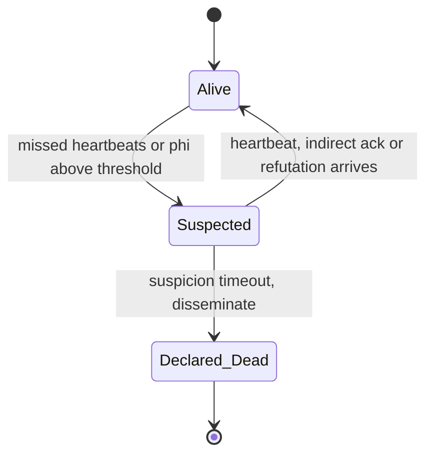
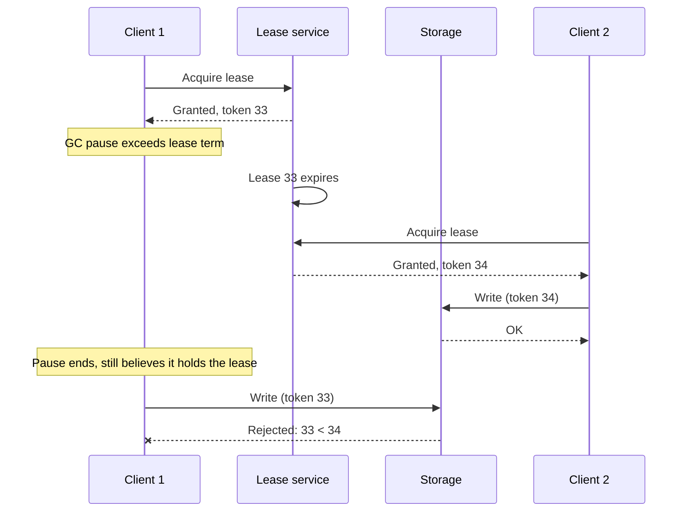

A **failure detector** is a module that outputs, at each process, the set of processes it currently suspects to have crashed. A **lease** is a grant of authority that expires after a bounded time unless renewed, and **leader election** selects one process to act on behalf of a group. Together they determine when a node is treated as failed, which node may act, and for how long, and they underlie [[systems/distributed-systems/paxos-intro|consensus]] and [[systems/distributed-systems/managing-critical-state|the management of critical state]].

In an asynchronous network a crashed process cannot be distinguished from a slow one, so every implementable failure detector makes mistakes. Practical designs bound the cost of a mistake: a wrong suspicion may trigger an unnecessary election or delay progress, while quorums and fencing tokens keep it from violating safety.

## Failure detection in asynchronous systems

In an asynchronous system, message delay and processing time have no upper bound, so no finite observation distinguishes a crashed process from a slow one. The FLP result ([Fischer, Lynch and Paterson 1985](https://groups.csail.mit.edu/tds/papers/Lynch/jacm85.pdf)) shows that no deterministic protocol solves consensus in this model if even one process may crash. A failure detector isolates the missing timing information: consensus algorithms are written against a detector with stated properties, and how to implement the detector becomes a separate question.

[Chandra and Toueg (1996)](https://dl.acm.org/doi/10.1145/226643.226647) classify detectors by two properties. **Completeness** requires that every crashed process is eventually suspected, by every correct process (strong) or by some correct process (weak). **Accuracy** restricts wrong suspicions: strong accuracy forbids suspecting any correct process, weak accuracy requires that some correct process is never suspected, and the *eventual* variants require these only after some unknown time. The perfect detector $P$ (strong completeness, strong accuracy) requires bounds on delay that an asynchronous network does not provide. The eventually strong detector $\Diamond S$ combines strong completeness with eventual weak accuracy: suspicions may be arbitrarily wrong for an arbitrary prefix of the execution, provided that eventually some correct process is suspected by no correct process. Chandra and Toueg give a consensus algorithm that uses $\Diamond S$ and tolerates $f < n/2$ crashes.

[Chandra, Hadzilacos and Toueg (1996)](https://courses.csail.mit.edu/6.895/fall02/papers/Chandra/jacm96.pdf) show that $\Diamond W$, the eventually weak detector, is the weakest failure detector that solves consensus when a majority of processes is correct. The proof goes through $\Omega$, a detector that outputs one trusted process, with the property that after some time all correct processes trust the same correct process. Any detector that solves consensus can be transformed into $\Omega$, and $\Omega$ can be obtained from $\Diamond W$. Consensus therefore requires an eventually stable leader hint and majority quorums, and does not require accurate failure detection. Paxos and Raft have this structure: the leader hint can be wrong for any length of time without violating safety, and progress resumes once it stabilizes.

## Heartbeat detectors

Implementations approximate an eventually accurate detector with **heartbeats**. The monitored process $p$ sends a message every $\Delta_i$ (the heartbeat period), and the monitor $q$ suspects $p$ when no heartbeat has arrived for longer than a timeout. Under partial synchrony, where delays are bounded after an unknown time, a timeout that is increased after each wrong suspicion eventually exceeds the bound and stops producing mistakes, which is how Chandra and Toueg implement $\Diamond P$, and hence $\Diamond S$, in that model.

[Chen, Toueg and Aguilera (2002)](https://doi.org/10.1109/12.980014) define the **quality of service** of a detector by metrics that apply to any implementation:

- **detection time** $T_D$: the time from a crash to the start of permanent suspicion;
- **mistake rate** $\lambda_M$: wrong suspicions per unit time, whose reciprocal is the mistake recurrence time $T_{MR}$;
- **mistake duration** $T_M$: how long a wrong suspicion lasts before the next heartbeat corrects it;
- **query accuracy probability** $P_A$: the probability that the detector's output is correct at a random time while $p$ is alive.

The timeout trades the first metric against the others. A timeout $\tau$ after the last heartbeat gives a detection time of at most $\tau$ plus one heartbeat's transit time, and a mistake whenever an inter-arrival interval exceeds $\tau$. The mistake rate is therefore the tail of the inter-arrival distribution evaluated at $\tau$, and choosing $\tau$ requires knowing that distribution, which changes with network load, scheduling and, in garbage-collected runtimes, collector pauses. Chen et al. estimate the expected arrival time of the next heartbeat from the last $n$ arrivals and add a fixed safety margin $\alpha$. The accrual detectors below also adapt the timeout to the observed variance.

### The phi accrual detector

The **φ accrual detector** ([Hayashibara et al. 2004](https://dspace02.jaist.ac.jp/dspace/bitstream/10119/4784/1/IS-RR-2004-010.pdf)) outputs a continuous suspicion level instead of a binary verdict. It keeps the last $W$ inter-arrival intervals (the paper uses $W = 1000$), fits a distribution to them, and reports

$$
\varphi(t) = -\log_{10} P_{\text{later}}(t - T_{\text{last}}),
$$

where $T_{\text{last}}$ is the arrival time of the most recent heartbeat and $P_{\text{later}}(x) = 1 - F(x)$ is the fitted probability that the next heartbeat arrives more than $x$ after the previous one. An application that suspects $p$ when $\varphi \geq \Phi$ accepts a mistake probability of about $10^{-\Phi}$ per interval if the fitted model is correct: $\Phi = 1$ gives about 10% and $\Phi = 2$ about 1%. Applications with different requirements can apply different thresholds to the same $\varphi$ value, which is the purpose of the accrual design.

Because $\varphi$ increases monotonically in $t$, a threshold is equivalent to a timeout recomputed after every heartbeat. With a normal model of mean $\mu$ and standard deviation $\sigma$ over the window,

$$
\tau = \mu + \sigma \, z_\Phi, \qquad z_\Phi = Q^{-1}(10^{-\Phi}),
$$

where $Q$ is the standard normal tail function. $\Phi = 8$ gives $z_\Phi = 5.61$, so the timeout is the mean interval plus 5.6 standard deviations of the recent history. With an exponential model, $P_{\text{later}}(x) = e^{-x/\mu}$, and

$$
\varphi(t) = \frac{t - T_{\text{last}}}{\mu \ln 10}, \qquad \tau = \Phi \, \mu \ln 10,
$$

so $\Phi = 8$ gives a timeout of $18.4\mu$ regardless of the variance.

Deployed detectors differ from the paper in ways that matter for tuning:

- **Akka and Apache Pekko** use the normal model with three changes ([`PhiAccrualFailureDetector.scala`](https://github.com/apache/pekko/blob/main/remote/src/main/scala/org/apache/pekko/remote/PhiAccrualFailureDetector.scala)): the mean is increased by `acceptable-heartbeat-pause`, the standard deviation is floored at `min-std-deviation`, and the normal tail is replaced by the logistic approximation $1/(1 + e^{-y(1.5976 + 0.070566 y^2)})$. The [cluster defaults](https://github.com/apache/pekko/blob/main/cluster/src/main/resources/reference.conf) are a 1 s heartbeat, a 3 s acceptable pause, a 100 ms minimum standard deviation, 1000 samples and $\Phi = 8$. Under the approximation, $\Phi = 8$ corresponds to $y = 5.23$ standard deviations rather than 5.61, and with a steady 1 s heartbeat the default timeout is about $1 + 3 + 0.1 \times 5.23 \approx 4.5$ s.
- **Apache Cassandra** uses the exponential model ([`FailureDetector.java`](https://github.com/apache/cassandra/blob/trunk/src/java/org/apache/cassandra/gms/FailureDetector.java), following [CASSANDRA-2597](https://issues.apache.org/jira/browse/CASSANDRA-2597)) with 1000 samples and `phi_convict_threshold` = 8, so a node is convicted after about 18.4 mean gossip intervals without a heartbeat.

The exponential model ignores the variance of the intervals and sets a timeout proportional to the mean. The normal model scales the timeout with the observed spread, but assigns a very small probability to an interval far outside the window's history, such as the first long pause after a quiet period.

### Measurement: heartbeats from a JVM under GC load

The three detectors were replayed on heartbeats recorded from a real sender. A JVM (OpenJDK 21, Parallel GC, 2 GB heap) sent a UDP heartbeat every 100 ms to a receiver process on the same 4-vCPU cloud VM for 10 minutes. From minute 3 to minute 7, two threads in the sender's JVM ran an allocation workload that retained about 800 MB; each stop-the-world collection also stopped the heartbeat thread. The [Pekko configuration](https://github.com/apache/pekko/blob/main/cluster/src/main/resources/reference.conf) names garbage collection as a reason for `acceptable-heartbeat-pause`, and the pause is the same one that defeats the leaseholder in [[#Leases]]. The run was repeated three times with different workload seeds. Transit time over the loopback interface was 0.19 to 0.20 ms at the median and at most 12 ms, so the variation in arrival times comes from the sender.

Outside the workload the intervals were concentrated near the period: in each run 99% of them were at most 101.9 ms, and the longest was 110 to 115 ms. During the workload the JVM logged 283 to 293 collection pauses per run, 200 to 245 intervals exceeded 150 ms, the 99th percentile was 234 to 265 ms, and the longest interval was 336 to 577 ms. Because heartbeats are scheduled at fixed times, a heartbeat delayed by a pause is followed immediately by the next one, so the mean interval stayed at 100 ms in both phases while the variance grew. No heartbeat was lost.

The figure replays run 1. The detector buttons and the threshold slider set the timeout after every heartbeat; the detail view plots the time since the last heartbeat against that timeout and shades each wrong suspicion, and the strip above it marks every wrong suspicion in the trace. The lower chart plots each detector's mean timeout against its mistake rate as the threshold varies.

<PhiDetector />

| Detector and setting | Mean timeout | Wrong suspicions | In the first minute of the workload |
|---|---|---|---|
| Fixed timeout, 300 ms | 300 ms | 2 to 4 | 2 to 4 |
| Fixed timeout, 500 ms | 500 ms | 0 to 1 | 0 to 1 |
| φ exponential (Cassandra), $\Phi = 2$ | 461 ms | 0 to 1 | 0 to 1 |
| φ exponential (Cassandra), $\Phi = 8$ | 1842 ms | 0 | 0 |
| φ normal, $W = 1000$, $\Phi = 3$ | 169 to 190 ms | 71 to 79 | 40 to 46 |
| φ normal, $W = 1000$, $\Phi = 8$ | 226 to 263 ms | 14 to 20 | 11 to 17 |
| φ normal, $W = 100$, $\Phi = 8$ | 211 to 243 ms | 10 to 29 | 2 to 5 |
| φ normal, $W = 1000$, $\Phi = 8$, $\sigma \geq 50$ ms | 381 to 383 ms | 0 to 1 | 0 to 1 |

Ranges are over the three runs; each run is judged on 5,000 intervals (8.3 minutes), of which 4 minutes fall in the workload.

The normal model adapted in the direction its design intends, and its mistakes came from the change of regime. During the quiet first three minutes the window's standard deviation fell below 1 ms, so at $\Phi = 8$ the median timeout was 101 to 104 ms. The collection pauses lengthened intervals to between 150 and 580 ms, and 11 to 17 of each run's wrong suspicions occurred in the first minute of the workload, before the 1000-interval window held enough pauses to raise $\sigma$. For the rest of the workload the median timeout was 324 to 380 ms and no further mistakes occurred. The nominal mistake probability of $10^{-8}$ per interval assumes that the next interval comes from the distribution the window describes, which does not hold at a change of regime.

At equal mean timeout, the normal model made more mistakes on these traces than a fixed timeout. Interpolated to a mean timeout of 300 ms, it made 65 to 119 wrong suspicions per hour, the fixed timeout 14 to 39 and the exponential model 14 to 48. The mean hides how the normal model distributes its timeout: while the sender was quiet, it would have detected a crash about 104 ms after the last heartbeat, where the 300 ms fixed timeout always waits 300 ms. A smaller window ($W = 100$) adapted faster at the onset (2 to 5 mistakes in the first minute) and also forgot the pauses faster, so after the workload stopped its timeout shrank toward 100 ms and it made 3 to 18 more mistakes on the residual jitter. A floor on the standard deviation, which Akka sets with `min-std-deviation`, addresses both: with $\sigma \geq 50$ ms the normal model made 0 or 1 mistakes at a mean timeout of 382 ms. Cassandra's exponential model at its default threshold made no mistakes, at the cost of a timeout of 18.4 periods.

> [!note]- Method
> [`Sender.java`](failure-detector-experiments/Sender.java) schedules heartbeat $k$ at $t_0 + 100k$ ms and sends it as soon as possible after that time; none are skipped. Each datagram carries a sequence number and the sender's `System.nanoTime()`. [`receiver.py`](failure-detector-experiments/receiver.py) records the receiver's `CLOCK_MONOTONIC` arrival time; both read the same clock, so arrival minus send time is the transit time. [`run.sh`](failure-detector-experiments/run.sh) records the three runs, kept with their GC logs in [`traces/`](failure-detector-experiments/traces/run1.csv.gz) (gzip, to be decompressed before analysis) (`java -Xms2g -Xmx2g -XX:+UseParallelGC`, 400,000 retained arrays of 1 to 3 KB, two allocating threads, workload from 180 s to 420 s after the JVM starts). [`analyze.mjs`](failure-detector-experiments/analyze.mjs) replays the traces through the same detector code the figure runs and writes [`results.json`](failure-detector-experiments/results.json). The detectors are judged from heartbeat 1000 onward, after the window has filled; every suspicion counts as a mistake, since the sender never crashed. The reported detection time is the mean timeout after a heartbeat, which is the detection time for a crash immediately after a heartbeat is sent, less that heartbeat's transit time. [`reference.py`](failure-detector-experiments/reference.py) is an independent implementation of the three detectors (bisection on $\varphi$, with the normal tail from `math.erfc`), and the figure's tests check the TypeScript model against it. Environment: OpenJDK 21.0.12.1, Node.js 22.23.4 and Python 3.13 on Linux 6.18, a 4-vCPU Intel Xeon VM at 2.1 GHz with 16 GB of memory; the receiver and the analysis ran on the same VM, and nothing else ran during the recordings.

### SWIM

Heartbeating every member from every other member costs $O(n^2)$ messages per period. **SWIM** ([Das, Gupta and Motivala 2002](https://courses.grainger.illinois.edu/cs425/fa2022/dsn02-SWIM.pdf)) separates detection from dissemination. In each protocol period a member pings one randomly chosen member; if no acknowledgment arrives, it asks $k$ other members to ping the target on its behalf (`ping-req`), so that a single lossy link does not produce a suspicion. Membership changes, including suspicions, travel by piggybacking on these messages in an infection-style (gossip) pattern. The expected detection time and the expected message load per member do not vary with group size. A suspected member can refute the suspicion before it is declared failed, which is the reversible state in the diagram below.



## Leases

A **lease** ([Gray and Cheriton 1989](https://dl.acm.org/doi/10.1145/74850.74870)) is a grant of authority, such as cache validity, lock ownership or leadership, that is valid for a bounded term and renewable by communication. Expiry requires no communication: if the holder crashes or is partitioned, the grantor waits until the term ends and then reassigns the grant. A lock with a timeout is a lease.

Correctness requires a **bounded drift rate** $\rho$ rather than synchronized clocks. Suppose the term is $L$ and every clock runs at a rate within a factor $1 \pm \rho$ of real time. The holder starts its timer before it sends the request and stops using the lease when its local clock has advanced by $L(1 - \rho)$, which is at most $L$ of real time after the request was sent. The grantor starts its timer when it receives the request, which is later, and reassigns the lease only after its local clock has advanced by $L(1 + \rho)$, which is at least $L$ of real time. The holder's authority therefore ends before the grantor reassigns it, without any agreement on the time of day (see [[systems/distributed-systems/clocks|Clocks]]).

> [!warning] The stalled leaseholder
> The drift argument assumes that the holder checks its timer before every use of the lease. [Kleppmann (2016)](https://martin.kleppmann.com/2016/02/08/how-to-do-distributed-locking.html) describes a client that checks its lease, then stops for longer than the term (a garbage-collection pause, VM migration or a page fault on a swapped-out page), and then writes to shared storage. The lease service correctly reassigns the lease during the pause, so two clients write to the same data. The heartbeats recorded above show the same pause from the other side: during a collection none of the sender's threads run, so the JVM can neither send a heartbeat nor recheck a lease. Tuning the term cannot prevent this, because the pause can exceed any term.

A **fencing token** prevents it. The lease service issues a monotonically increasing number with each grant, every write to the protected resource carries the number, and the resource rejects any number lower than the highest it has accepted. In Kleppmann's example the stalled client holds token 33, the new holder holds 34, and the storage service rejects the write that carries 33.



The same mechanism appears as Raft's term numbers, ZooKeeper's epochs (the high 32 bits of a zxid) and Chubby's lock sequencers. In each, authority carries a version number that is checked where the effect takes place, which prevents a former leader that was wrongly suspected from acting after its replacement.

> [!tip] Safety and liveness
> Timeouts and elections provide liveness: a crashed leader is eventually replaced. Quorums and fencing provide safety: a leader that was wrongly suspected cannot corrupt state. In a correct design a wrong suspicion reduces availability for the duration of an election and cannot violate safety.

## Leader election in practice

**Chubby** ([Burrows 2006](https://static.googleusercontent.com/media/research.google.com/en//archive/chubby-osdi06.pdf)) is a lock service replicated with Paxos, usually across five replicas per cell, of which three must be running for the cell to be available. It exposes a small file system with advisory locks and was designed for coarse-grained use, with locks held for hours or days, so that the cost of a failover is amortized. Clients hold **sessions** maintained by KeepAlive RPCs, with a default lease of 12 s. When a client's local lease timer expires, the client enters *jeopardy*, disables its cache and waits a further grace period (45 s by default) for the master to respond, which hides a master failover from applications. Applications elect a leader by acquiring a lock on a file and writing their identity into it; GFS and Bigtable elect their masters this way. The lock holder can obtain a *sequencer*, a byte string that names the lock and its generation number, and pass it to servers that check it before acting, which makes it a fencing token. Burrows reports that the most popular use of Chubby was as a name server rather than as a lock service.

In **ZooKeeper**'s [election recipe](https://zookeeper.apache.org/doc/current/recipes.html), every candidate creates a sequential ephemeral znode, the candidate with the lowest sequence number is the leader, and each other candidate watches only its immediate predecessor. When the leader's session expires its znode is deleted and exactly one successor is notified, which avoids the herd effect of every candidate competing again. **etcd** provides election through its [concurrency API](https://github.com/etcd-io/etcd/blob/main/client/v3/concurrency/election.go): a candidate writes a key bound to its session's lease (60 s TTL by default), leadership lasts while the session keeps the lease alive, and a transaction can compare the key's creation revision with the one returned at election to test for leadership before acting.

**Raft** ([Ongaro and Ousterhout 2014](https://raft.github.io/raft.pdf)) integrates election into the replication protocol. A follower that receives no heartbeat (an empty AppendEntries RPC) within its election timeout becomes a candidate, increments the term and requests votes; a candidate with votes from a majority becomes leader. The election timeout is a fixed-timeout failure detector, chosen randomly from an interval such as 150 to 300 ms so that split votes are rare. The authors first planned to assign candidates ranks and chose randomized timeouts instead, which they judged easier to understand. Raft's timing requirement, $\text{broadcastTime} \ll \text{electionTimeout} \ll \text{MTBF}$, is the trade-off between detection time and mistake rate in [[#Heartbeat detectors]], stated for one detector: the timeout must exceed the round-trip time by a margin large enough that followers rarely suspect a live leader. The incremented term fences the old leader, because every server rejects RPCs that carry a stale term.

All three systems implement the same layers:

```text
suspicion:  heartbeats + timeouts        (approximate an eventual leader hint)
liveness:   election on suspicion        (randomized or ordered tie-breaking)
authority:  lease with bounded term      (self-expiring, renewable)
safety:     epoch/term/fencing token     (checked by every downstream effect)
```

A coordination service provides this stack as a primitive, so that applications built on it (masters, shard owners, singleton workers) obtain an elected owner with code no more complex than a lock-acquisition loop. The guarantee extends only as far as the fencing check. A leader correctly elected through Chubby can still corrupt a storage system that accepts unfenced writes: the election determines which process should act, and only a token check at the resource stops a former leader that continues to act.

## Related notes

- [[systems/distributed-systems/paxos-intro|Paxos Intro]]
- [[systems/distributed-systems/managing-critical-state|Managing Critical State]]
- [[systems/distributed-systems/mutual-exclusion|Mutual Exclusion]]
- [[systems/distributed-systems/clocks|Clocks]]
- [[systems/distributed-systems/google-file-system|Google File System]]
- [[systems/distributed-systems/bigtable|Bigtable]]

## Sources

- [Fischer, Lynch and Paterson (1985), Impossibility of Distributed Consensus with One Faulty Process, JACM 32(2)](https://groups.csail.mit.edu/tds/papers/Lynch/jacm85.pdf)
- [Chandra and Toueg (1996), Unreliable Failure Detectors for Reliable Distributed Systems, JACM 43(2), 225 to 267](https://dl.acm.org/doi/10.1145/226643.226647)
- [Chandra, Hadzilacos and Toueg (1996), The Weakest Failure Detector for Solving Consensus, JACM 43(4), 685 to 722](https://courses.csail.mit.edu/6.895/fall02/papers/Chandra/jacm96.pdf)
- [Chen, Toueg and Aguilera (2002), On the Quality of Service of Failure Detectors, IEEE Transactions on Computers 51(5)](https://doi.org/10.1109/12.980014)
- [Hayashibara, Défago, Yared and Katayama (2004), The φ Accrual Failure Detector, SRDS (JAIST research report IS-RR-2004-010)](https://dspace02.jaist.ac.jp/dspace/bitstream/10119/4784/1/IS-RR-2004-010.pdf)
- [Das, Gupta and Motivala (2002), SWIM: Scalable Weakly-consistent Infection-style Process Group Membership Protocol, DSN](https://courses.grainger.illinois.edu/cs425/fa2022/dsn02-SWIM.pdf)
- [Burrows (2006), The Chubby Lock Service for Loosely-Coupled Distributed Systems, OSDI](https://static.googleusercontent.com/media/research.google.com/en//archive/chubby-osdi06.pdf)
- [Gray and Cheriton (1989), Leases: An Efficient Fault-Tolerant Mechanism for Distributed File Cache Consistency, SOSP](https://dl.acm.org/doi/10.1145/74850.74870)
- [Kleppmann (2016), How to Do Distributed Locking](https://martin.kleppmann.com/2016/02/08/how-to-do-distributed-locking.html)
- [Ongaro and Ousterhout (2014), In Search of an Understandable Consensus Algorithm (Raft), USENIX ATC](https://raft.github.io/raft.pdf)
- [ZooKeeper recipes: leader election](https://zookeeper.apache.org/doc/current/recipes.html)
- [Apache Cassandra, `FailureDetector.java`](https://github.com/apache/cassandra/blob/trunk/src/java/org/apache/cassandra/gms/FailureDetector.java) and [CASSANDRA-2597](https://issues.apache.org/jira/browse/CASSANDRA-2597)
- [Apache Pekko, `PhiAccrualFailureDetector.scala`](https://github.com/apache/pekko/blob/main/remote/src/main/scala/org/apache/pekko/remote/PhiAccrualFailureDetector.scala) and the [cluster `reference.conf`](https://github.com/apache/pekko/blob/main/cluster/src/main/resources/reference.conf)
- [etcd `client/v3/concurrency/election.go`](https://github.com/etcd-io/etcd/blob/main/client/v3/concurrency/election.go)
