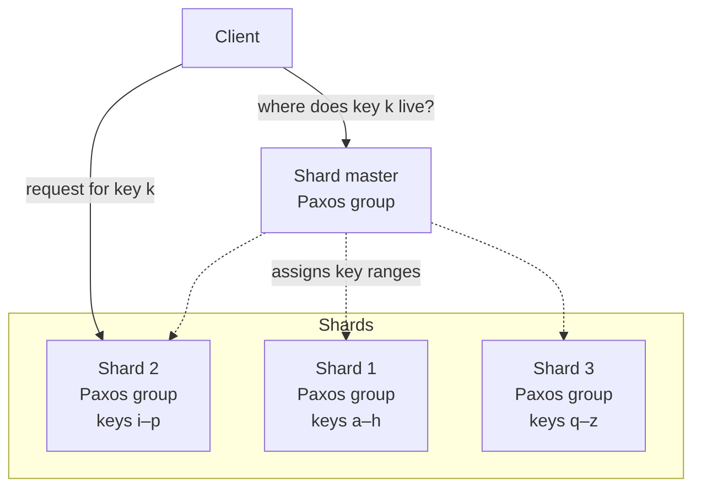

**Load balancing** is the assignment of requests and data to servers so that load is distributed evenly and response time, including its tail, stays low. Utilization determines tail latency, as the [queueing model](#queueing) shows. A load balancing scheme should satisfy the following properties.

1. Clients all follow the same assignment
2. Load is evenly distributed
3. Adding or removing a server moves only a few keys
4. Tail latency is minimized
5. Redistributing keys should not overload a single server
6. Load stays even despite differences in key popularity

## Scaling Paxos with sharding

This design combines [[systems/distributed-systems/paxos-intro|Paxos consensus]] with [[systems/distributed-systems/sharding|sharding]].

Paxos defines the order of a state machine running on a set of servers. For a key-value store, the key space is split into shards, and each shard is assigned a set of keys. A dedicated Paxos group called the **shard master** owns the assignment of keys to shards. Each shard is then its own Paxos group running the state machine for its subset of keys.

This spreads request load across multiple servers and distributes the data along with it.

## Edge caching

Content local to a user should be cached on the user's machine. Content that is popular and not user specific, such as `logo.png`, is cached on one designated server, and all requests for that content are redirected there. Requests spread across servers by content, and each piece of content occupies cache memory on only one server instead of every server.

## Queueing

Assume completely random (Poisson) arrivals and exponentially distributed service times, the M/M/1 queueing model. The mean response time is

$$
R = \frac{S}{1 - U}
$$

where $R$ is response time, $S$ is service time, and $U$ is server utilization. In an M/M/1 queue the response time is exponentially distributed, so its standard deviation equals its mean, $\frac{S}{1-U}$. As utilization approaches 1, both the mean and the spread of response times grow without bound, which produces high tail latency.

The system can be modeled as a Markov chain with states $0, 1, 2, \ldots$, where state $i$ means $i$ requests are in the system. The transition rate from state $i$ to $i+1$ is the arrival rate $\lambda$, and from $i$ to $i-1$ is the service rate $\mu$. The formulas above follow from the steady-state solution of this chain.

In practice load is bursty rather than Poisson, so services are overprovisioned to absorb spikes. The variance result justifies the cost of overprovisioning, since a server run near full utilization has very high tail latency.

> [!warning] Utilization drives tail latency
> As $U \to 1$, both the mean response time and its standard deviation grow as $\frac{S}{1-U}$. High utilization appears efficient in aggregate metrics, but it produces high tail latency, which is why services are deliberately overprovisioned.

## Key popularity

The **Zipf distribution** states that the $k$th most popular item has frequency proportional to $\frac{1}{k^c}$ for some $1 \le c \le 2$. It approximately fits many observed workloads, including web page hits, file access frequency, file sizes, word frequency, and friend counts on social networks. The consequence for load balancing is that hashing keys uniformly across servers still leaves whichever server holds the hottest keys overloaded.

The **power of two choices** mitigates the effect of popular keys: hash each key to two (or in general $k$) candidate servers, and forward each request to whichever candidate is under less load. [Mitzenmacher's analysis](https://www.eecs.harvard.edu/~michaelm/postscripts/tpds2001.pdf) shows that moving from one choice to two gives an exponential improvement in the maximum load, while more than two choices adds little.

> [!tip] Two choices give most of the improvement
> Going from one random choice to two gives an *exponential* improvement in maximum load; going from two to three or more gives only a constant-factor gain. Most of the improvement therefore comes from the second choice.

## Related notes

- [[systems/scheduling/0-foundations/queueing-models-and-tail-latency|queueing models and tail latency]]
- [[systems/scheduling/4-cluster-and-datacenter/stragglers-speculation-and-overload|stragglers, speculation, and overload]]
- [[systems/distributed-systems/scaling-web-services|scaling web services]]
- [[systems/distributed-systems/sharding|sharding]]
- [[reference/slides/system-design|Patterns for Scalability and Reliability in Systems]]
- [[systems/networks/5-application/CDNs|Content Delivery Networks (CDNs)]]
