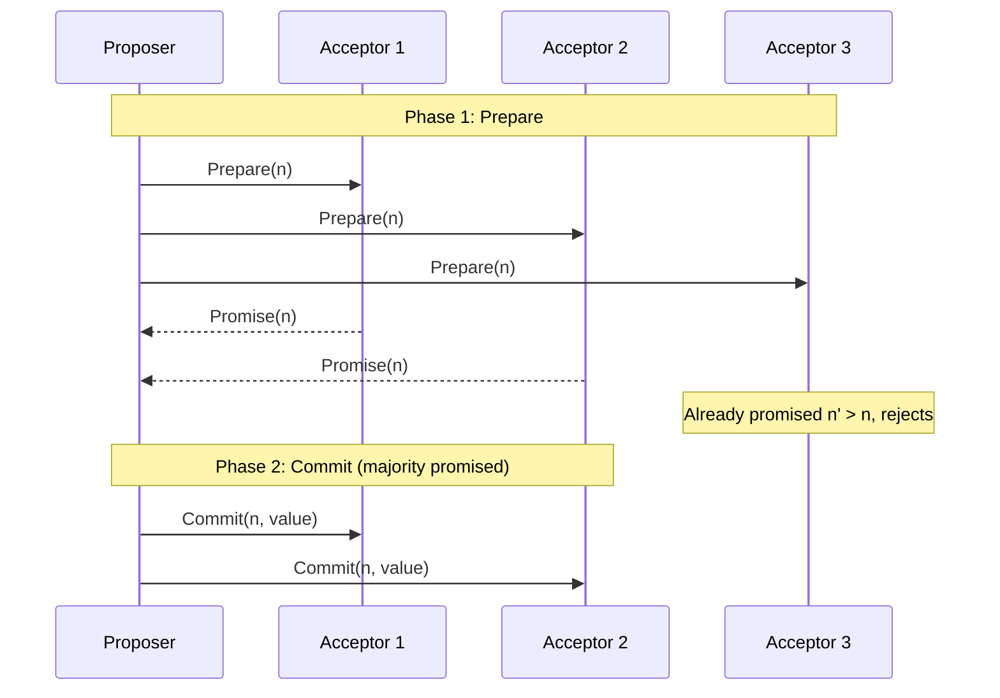

The [Managing Critical State chapter](https://sre.google/sre-book/managing-critical-state/) of the Google SRE book (chapter 23) treats distributed consensus as the basis for reliable shared state. It argues that agreement on state across nodes should be reached with a proven consensus protocol rather than with ad hoc coordination, and it surveys the system patterns built on such a protocol. The chapter's detailed Multi-Paxos message flow is omitted here.

## CAP theorem

The CAP theorem states that a distributed system can only guarantee two of the following three properties:

- **Consistency**: all nodes see the same data at the same time
- **Availability**: every request receives a response, without guarantee that it contains the most recent write
- **Partition tolerance**: the system continues to operate despite network partitions

Since real networks partition, the practical choice during a partition is between continuing to serve requests (availability) and refusing to serve until the partition heals (consistency).

## ACID's alternative: BASE

ACID (Atomicity, Consistency, Isolation, Durability) defines well-understood transaction semantics on a single node, and these semantics are difficult to provide efficiently across the nodes of a distributed system.

Some datastores instead offer BASE semantics (Basically Available, Soft state, Eventually consistent), which tolerate network partitions better. Most BASE systems use multi-leader replication, where each leader accepts writes and propagates them to the other leaders. Availability and partition tolerance improve, and the application must handle the anomalies that eventual consistency permits.

## Why ad hoc coordination fails

### The split brain problem

Split brain is the condition in which more than one node believes it is the leader. A naive defense uses heartbeats. The leader sends heartbeats to the followers, and if two nodes both act as leader, each eventually observes the other's heartbeats and issues a **STONITH** (Shoot The Other Node In The Head) command to terminate it.

> [!warning] STONITH standoff
> Because the network is asynchronous and unreliable, heartbeats can be delayed long enough that both nodes issue STONITH against each other and both shut down. Reliable detection of split brain is itself difficult, because a network partition and a node failure are indistinguishable to an outside observer, and nodes can be partitioned from each other in arbitrary ways.

### Faulty group membership algorithms

Cluster membership maintained by gossip protocols has the same weakness. A partition within a cluster can lead to the election of several leaders in the same cluster, which often results in data loss or corruption.

## How distributed consensus works

The problem of practical interest is **asynchronous distributed consensus**, in which nodes can fail and messages can be delayed, lost, or duplicated arbitrarily. The FLP impossibility result (Fischer, Lynch, and Paterson) shows that no deterministic algorithm can guarantee progress in an asynchronous system in which even one node can crash. Deployed systems provision enough healthy replicas and network connectivity that progress occurs most of the time, and they use exponential backoff to prevent cascading retries.

Fault models for consensus algorithms:

- **crash-fail**: nodes that fail never re-enter the system
- **crash-recovery**: nodes that fail can re-enter the system. This model is more realistic than crash-fail and more complex to handle.
- **Byzantine fault tolerance**: nodes can fail arbitrarily, including sending incorrect messages

## Paxos overview

Paxos ensures that a quorum (majority) of nodes agrees on a value. It does not guarantee that every node learns the agreed value, since that would require unbounded communication in an asynchronous network.

Paxos runs as a sequence of proposals, each of which a quorum may accept or reject. Each proposal carries a `sequenceNumber` that must be unique across all proposals and monotonically increasing, giving proposals a strict order.

In the first phase, a proposer sends a `sequenceNumber` to the acceptors. Each acceptor that has not seen a higher `sequenceNumber` responds with a `promise` to reject any proposal numbered lower. Otherwise it rejects the proposal. Once the proposer holds promises from a majority, it commits by sending a `commit` message carrying a value.

The safety of the protocol rests on quorum overlap. Any two majorities share at least one node, so a committed proposal has a unique committed value. Acceptors must persist a log of the proposals they have seen and accepted, so that they honor their promises even after a crash.

## System architecture patterns for distributed consensus

Consensus algorithms are low-level building blocks, and the chapter recommends placing them behind higher-level abstractions. The abstraction separates concerns, simplifies testing and debugging, and allows the protocol to be replaced without changes to the rest of the system.

Consensus is often consumed as a service, such as Zookeeper, instead of being embedded in the application. Google uses Chubby in this way. An application designed as a client of a consensus service separates the two concerns further.

### Reliable replicated state machines

A **replicated state machine** (RSM) maintains multiple copies of the same process by executing the same commands, in the same order, on every copy. Any deterministic program can be made a highly available service by implementing it as an RSM.

A consensus algorithm in a lower layer determines the order of operations. Nodes in the consensus group can miss decisions they weren't in the quorum for, so peers synchronize state using a sliding-window protocol.

### Reliable replicated datastores and configuration stores

Non-distributed storage systems often order operations by timestamp, and this fails in distributed systems because of clock drift. Google's Spanner addresses timestamp uncertainty directly with TrueTime, which models the uncertainty interval explicitly and minimizes it by periodic clock resynchronization; the approach is complex and costly. The reason the uncertainty is unavoidable is given in [[systems/distributed-systems/clocks|clocks]].

Consensus protocols replicate data without relying on timestamps, at a cost in latency. Storage operations are small and frequent, and consensus requires multiple round trips per decision, so a naive design has high latency.

### Highly available processing using leader election

Leader election is equivalent to distributed consensus. It fits systems where one node should process requests at a time, and commonly the elected leader delegates actual work to a pool of workers, as in GFS and Bigtable. The leader election service is off the critical path, so its latency has little effect on system throughput.

### Distributed coordination and locking services

A **barrier** blocks a group of nodes until all of them reach a certain point, splitting a distributed computation into ordered stages. MapReduce uses one to make sure every mapper finishes before reducers start. A single coordinator node can implement a barrier, but the coordinator is then a single point of failure, so implementations such as Zookeeper's build the barrier on an RSM.

**Distributed locking** provides mutual exclusion over shared resources among nodes. In practice locks require renewable leases with timeouts, so that a lock held by a failed node is eventually released. Locks are another low-level primitive, and the chapter recommends a higher-level abstraction that provides distributed transactions where one is available.

### Reliable distributed queuing and messaging

Queues commonly use a lease mechanism so that exactly one node processes a message at a time while failover remains possible when that node fails.

Queuing also generalizes into **atomic broadcast** and **publish-subscribe** systems, in which messages must be delivered reliably to multiple nodes, for example for notifications or for cache invalidation in [[systems/distributed-systems/distributed-cache-coherence|distributed cache coherence]]. A queue used for workload distribution spreads tasks across a pool of workers.

## Distributed consensus performance

The chapter disputes the view that consensus protocols are too slow for general use, and argues that consensus performs well when it is deployed appropriately.

Performance depends on:

- **Workload**
  - **Throughput**: proposals per second at peak load
  - Request mix: read-heavy, write-heavy, mixed
  - **Consistency semantics**: can reads be stale?
  - **Request size**: how much data moves per operation
- **Deployment**
  - **Network topology**: cluster size, LAN versus WAN
  - **Quorum type**: quorum size and geographic placement
  - **Optimizations**: sharding, pipelining, batching

> [!warning] Leader locality
> Under single-leader replication, the latency a client observes is proportional to the round-trip time between the client and the leader, wherever the leader is located.

## Related notes

- [[systems/distributed-systems/paxos-intro|Paxos]]
- [[systems/distributed-systems/consistency|consistency]]
- [[systems/distributed-systems/two-phase-commit|Two Phase Commit]]
