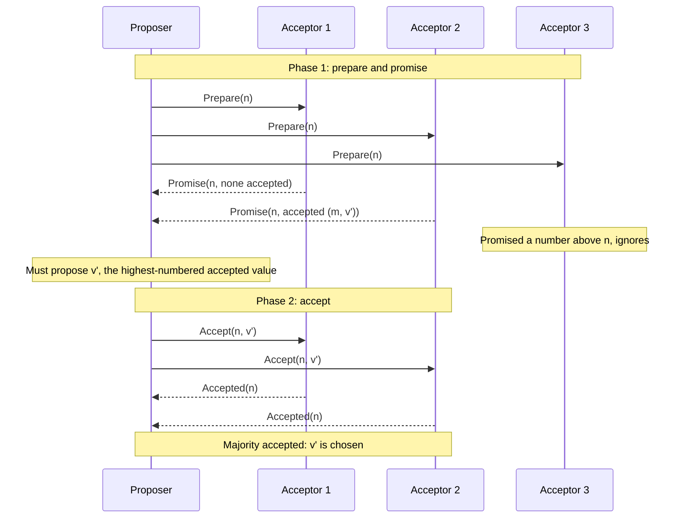
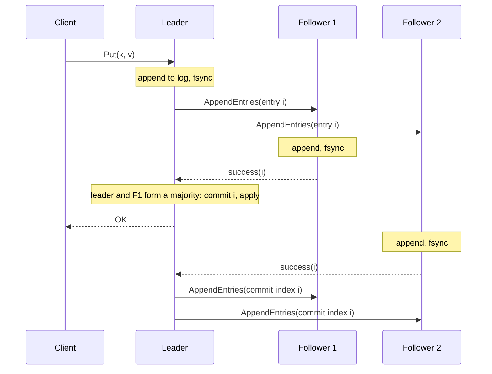

Critical state is state whose loss, or whose divergence between replicas, makes a system incorrect: which process is the leader, which client holds a lock, the current configuration, the membership of a group. [Chapter 23 of the Google SRE book](https://sre.google/sre-book/managing-critical-state/) argues that such state should be kept with a **distributed consensus** protocol, which lets a group of processes agree on a single value, or on a sequence of values, while some of them crash and messages between them are delayed, lost or reordered.

In practice the chapter's advice is to keep critical state in a small replicated service built on a proven protocol (Chubby, ZooKeeper, etcd) instead of coordinating processes with heartbeats and timeouts written for the purpose. Its second argument concerns cost. The latency of a consensus operation is set by two physical quantities, the round-trip time between replicas and the time to make a write durable, and a deployment that accounts for both performs well enough for most uses of critical state. The etcd measurements in [[#Measured latency in etcd]] separate the two terms. The chapter's detailed Multi-Paxos message flow is summarized in [[#Multi-Paxos and Raft]] rather than reproduced.

## The CAP theorem

Brewer stated the CAP conjecture in 2000, and [Gilbert and Lynch (2002)](https://www.comp.nus.edu.sg/~gilbert/pubs/BrewersConjecture-SigAct.pdf) proved it for a read/write register replicated across nodes, with these definitions:

- **Consistency** is atomic consistency, now called [[systems/distributed-systems/consistency#Linearizability|linearizability]]: "there must exist a total order on all operations such that each operation looks as if it were completed at a single instant."
- **Availability**: "every request received by a non-failing node in the system must result in a response."
- **Partition tolerance**: the system meets its guarantees while "the network will be allowed to lose arbitrarily many messages sent from one node to another."

The theorem states that no implementation guarantees consistency and availability in an asynchronous network that can partition. The proof is short. Split the nodes into two groups that cannot communicate, complete a write in one group, then read in the other. An available read must be answered without any message from the first group, so it returns the old value, and the history is not linearizable.

The chapter, like most summaries, phrases the result as a choice of any two of the three properties. [Brewer (2012)](https://www.infoq.com/articles/cap-twelve-years-later-how-the-rules-have-changed) writes that "the '2 of 3' formulation was always misleading because it tended to oversimplify the tensions among properties." Three corrections follow from the definitions:

- **Partitions are a fault of the network.** A system cannot decline to have them. Giving up partition tolerance only leaves its behavior during a partition unspecified, so the real choice is what to do while one lasts: refuse some requests (consistency) or answer them from local state (availability).
- **The choice applies only during a partition and only to operations that span it.** With no partition, a system can provide both properties. During one, it can keep serving clients that reach a majority and can choose per operation, for example linearizable writes with stale reads allowed.
- **The theorem's availability is stricter than operational availability.** It requires every non-failing node to answer. A consensus group that keeps serving on the majority side of a partition is not available in this sense, because its minority-side nodes reject requests, yet a client that can reach the majority observes no outage.

etcd shows the per-operation choice. During a partition, members on the minority side cannot commit writes or serve linearizable reads, and those requests wait until the client's deadline. Serializable reads are answered from the member's local state on either side and may return old data ([[#Reads]]).

[Abadi (2012)](https://cs.umd.edu/~abadi/papers/abadi-pacelc.pdf) extends the statement as **PACELC**: if there is a partition (P), the tradeoff is between availability and consistency (A and C); else (E), in normal operation, it is between latency and consistency (L and C). The second half applies to every request a consensus system serves, since a linearizable operation waits for at least one round trip to a quorum. [Kleppmann (2015)](https://arxiv.org/abs/1509.05393) argues that the CAP definitions are too narrow to compare real systems and proposes classifying operations by how their latency depends on network delay. A linearizable write in etcd is delay-sensitive in that sense, with latency that grows one for one with the round-trip time ([[#Measured latency in etcd]]); a serializable read is not.

## ACID and BASE

ACID (atomicity, consistency, isolation, durability) defines transaction semantics that are well understood on a single node and expensive to provide across nodes. Some datastores offer BASE semantics instead (basically available, soft state, eventually consistent). The chapter describes BASE systems as relying on multi-leader replication, in which different replicas commit writes concurrently and a conflict-resolution rule, "often as simple as 'latest timestamp wins'," reconciles them. Leaderless quorum stores such as [[systems/distributed-systems/dynamo-db|Dynamo]] are also BASE systems.

Last-writer-wins discards one of every pair of concurrent writes. When the timestamps come from unsynchronized clocks it can discard the write that happened later in real time ([[systems/distributed-systems/clocks|clocks]]). [[systems/distributed-systems/crdts|CRDTs]] merge concurrent updates without loss for the data types that admit such a merge, and the application handles the remaining anomalies of eventual consistency. Critical state, such as the identity of a leader, has no meaningful merge of two conflicting values, which is why the chapter reserves consensus for it.

## Why ad hoc coordination fails

The chapter gives three case studies of coordination built from heartbeats and timeouts.

### Split brain

Split brain is the condition in which more than one node acts as leader. In the chapter's example, a leader replicates to a follower and both exchange heartbeats. A node that stops receiving its peer's heartbeats concludes that the peer has failed and takes over, and if both nodes come to act as leader, each issues a **STONITH** (shoot the other node in the head) command to terminate the other.

> [!warning] STONITH standoff
> Heartbeats can be delayed or lost without either node failing, so both nodes can time out at once, issue STONITH against each other, and both shut down. A failed node and a partitioned node produce the same observations at a remote peer, and nodes can be partitioned from each other in arbitrary patterns, so no timeout setting makes the detection reliable.

### Failover that requires a human

In the second example, each shard of a database has a primary that replicates synchronously to a secondary in another datacenter, and an external system promotes the secondary when the primary appears unhealthy. Because the external checker cannot tell a failed primary from one it merely cannot reach, the design escalates uncertain cases to a human operator. Every network partition between the checker and a primary then becomes an operational incident.

### Faulty group membership

Cluster membership maintained by a gossip protocol has the same weakness. A partition inside a cluster can lead each side to elect its own leader, and the chapter reports that this results in data loss or corruption. In each case the coordination code has to decide which of several nodes holds authority while their view of each other is incomplete, which is the consensus problem.

## Consensus under asynchrony

The problem of practical interest is **asynchronous distributed consensus**, in which processes can crash and messages can be delayed arbitrarily. [Fischer, Lynch and Paterson (1985)](https://groups.csail.mit.edu/tds/papers/Lynch/jacm85.pdf) showed that no deterministic protocol can guarantee that it terminates in an asynchronous system in which even one process may crash ([[systems/distributed-systems/paxos-intro|Paxos introduction]]). [Dwork, Lynch and Stockmeyer (1988)](https://groups.csail.mit.edu/tds/papers/Lynch/jacm88.pdf) showed that consensus is solvable under partial synchrony, where message delays are bounded after some unknown time. Their protocols never violate safety, and they make progress once the bound holds. Paxos and Raft follow this structure: timeouts only trigger leader election, and a wrong timeout can delay progress but cannot cause two different values to be chosen. Deployed systems provision enough healthy replicas and connectivity that the bound holds most of the time, and they use randomized or exponential backoff so that competing proposers do not keep preempting each other.

Consensus algorithms are classified by the failures they tolerate:

- **crash-stop**: a failed process never returns. Tolerating $f$ failures requires $2f + 1$ processes, so that any two majorities intersect.
- **crash-recovery**: a failed process can return with whatever it wrote to stable storage. This is the model Paxos, Raft and etcd assume, and it is why each acceptor forces its state to disk before it replies.
- **Byzantine**: a failed process can behave arbitrarily, including sending conflicting messages. Tolerating $f$ such failures requires $3f + 1$ processes.

## Paxos

Paxos ([Lamport 2001](https://lamport.azurewebsites.net/pubs/paxos-simple.pdf); [[systems/distributed-systems/paxos-made-simple|notes on Paxos Made Simple]]) chooses a single value among those proposed. Proposals carry numbers that are unique and totally ordered, for example a counter paired with the proposer's identifier.

1. **Prepare (phase 1a).** A proposer picks a number $n$ and sends $\text{Prepare}(n)$ to the acceptors.
2. **Promise (phase 1b).** An acceptor that has not responded to a Prepare numbered higher than $n$ promises not to accept any proposal numbered less than $n$, and replies with the highest-numbered proposal it has already accepted, if any.
3. **Accept (phase 2a).** A proposer that holds promises from a majority sends $\text{Accept}(n, v)$. The value $v$ is the value of the highest-numbered proposal reported in the promises, or the proposer's own value if none was reported.
4. **Accepted (phase 2b).** An acceptor accepts $\text{Accept}(n, v)$ unless it has since promised a number higher than $n$. A value is **chosen** once a majority of acceptors have accepted the same proposal.



Safety rests on quorum intersection. If a value $v$ was chosen with number $m$, a majority accepted it. Any proposer that later collects promises from a majority hears from at least one acceptor in that set, learns a proposal numbered $m$ or higher with value $v$, and proposes $v$ again. Acceptors must write their promises and accepted proposals to stable storage before replying, or a restarted acceptor could break a promise; this forced write is the disk term in consensus latency. Paxos guarantees that only one value is chosen. Informing every learner of the choice is a separate step that the protocol does not bound in an asynchronous network.

### Multi-Paxos and Raft

A replicated service needs a sequence of values, one per log slot. Running both phases for every slot would cost two round trips per value. **Multi-Paxos** lets a stable leader run phase 1 once for all future slots, after which each new value needs only phase 2. In the chapter's words, it "requires only one round trip from the proposer to a quorum of acceptors to reach consensus," plus the acceptors' forced writes. Phase 1 runs again only when leadership changes.

[Raft](https://raft.github.io/raft.pdf) has the same steady state, specified as one protocol: the leader appends a client command to its log, sends it to the followers in AppendEntries, and commits the entry once a majority, counting itself, has stored it. Later AppendEntries messages and heartbeats carry the commit index to the followers. Leaders are elected by randomized timeouts, and terms act as the proposal numbers. Zab, the protocol under ZooKeeper, also elects a stable leader. Mencius and Egalitarian Paxos instead let several replicas propose, which removes the extra hop to a distant leader, and Fast Paxos reduces message delays in wide-area deployments at the cost of larger quorums.



## System architecture patterns for distributed consensus

Consensus algorithms are low-level building blocks, and the chapter recommends placing them behind higher-level abstractions. The abstraction separates concerns, makes testing easier and allows the protocol to be replaced without changes to the rest of the system. Consensus is often consumed as a service, such as Chubby at Google or ZooKeeper and etcd elsewhere, instead of being embedded in each application; the chapter notes that "Paxos on its own isn't that useful."

### Replicated state machines

A **replicated state machine** (RSM) keeps several copies of a deterministic process consistent by executing the same commands in the same order on every copy. Any deterministic program can be made highly available this way. A consensus algorithm chooses the order of commands, the log. Replicas that were not part of the quorum for some decisions catch up from their peers, and the chapter describes a sliding-window protocol for this.

### Replicated datastores and configuration stores

Single-node storage systems often order operations by timestamp, which fails across nodes because clocks drift and their offsets are uncertain ([[systems/distributed-systems/clocks|clocks]]). Spanner bounds the uncertainty explicitly. Its TrueTime API, backed by GPS receivers and atomic clocks, returns an interval whose half-width $\varepsilon$ the [Spanner paper](https://www.cs.princeton.edu/courses/archive/fall15/cos518/papers/spanner.pdf) reports as a sawtooth "varying from about 1 to 7 ms over each poll interval," and a transaction waits out the uncertainty before its writes become visible (commit wait). Consensus orders operations without relying on timestamps, at the cost of a quorum round trip and a forced write per decision, so a datastore built naively on consensus has a latency floor of one round trip per write.

### Highly available processing with leader election

Leader election is a restatement of consensus, choosing one value (the leader's identity). It fits systems in which one process should coordinate at a time while the work itself is delegated to a pool of workers, as in GFS and Bigtable. Elections happen rarely, so their latency has little effect on throughput. A leader's authority is usually a lease, and resources it writes to must reject a deposed leader's writes with a fencing token; [[systems/distributed-systems/failure-detectors-leases-leader-election|failure detectors, leases and leader election]] covers both.

### Coordination and locking services

A **barrier** blocks a group of processes until all of them reach a point, splitting a distributed computation into ordered stages; MapReduce uses one so that every mapper finishes before reducers start. A single coordinator can implement a barrier, but it is then a single point of failure, so implementations such as ZooKeeper's build the barrier on an RSM.

A **distributed lock** provides mutual exclusion over a shared resource. Locks in practice are renewable leases with timeouts, so that a lock held by a crashed process is eventually released. The chapter recommends exposing a higher-level abstraction, such as distributed transactions, where one is available.

### Queuing and messaging

Queues commonly assign each message to a worker under a lease, so that one worker processes it at a time and a failed worker's messages are reassigned. Queuing generalizes to **atomic broadcast** and **publish-subscribe**, in which every subscriber receives the same messages in the same order, for example for notifications or for cache invalidation ([[systems/distributed-systems/distributed-cache-coherence|distributed cache coherence]]). Atomic broadcast is equivalent to consensus on a sequence of messages.

## Distributed consensus performance

The chapter disputes the view that consensus algorithms are "too slow and costly" for systems that need high throughput and low latency, and names the two physical constraints on their performance: network round-trip time and the time to write data to persistent storage. Within a datacenter a round trip takes on the order of a millisecond; between regions it takes tens to hundreds of milliseconds.

### Write latency is an order statistic

With a stable leader, a write commits once the leader and $\lfloor N/2 \rfloor$ of its $N - 1$ followers have it on stable storage. The leader's own forced write proceeds in parallel with replication, so a write that arrives at the leader commits after

$$
t_\text{commit} \approx \max\bigl(d_\text{fsync},\ R_{(k)} + d_\text{fsync}\bigr), \qquad k = \lfloor N/2 \rfloor,
$$

where $R_{(1)} \le R_{(2)} \le \dots$ are the round-trip times from the leader to the followers that are up, sorted, and $d_\text{fsync}$ is the time of one forced write. The client observes this plus its own round trip to the leader. Three consequences follow, and [[#Measured latency in etcd]] confirms each:

- Followers beyond the $k$ nearest have no effect on latency while every follower is up, which is why a group can place replicas in distant failure domains without slowing every write.
- When one of the $k$ nearest followers fails, latency rises to the round trip of the next one. The group stays available, but its latency depends on which replicas failed.
- The latency a client observes depends on where the leader is. A request sent to a follower is forwarded to the leader, which adds that follower's round trip to the leader. The chapter states that "the most important measure of performance is client perception," and that more distant nodes have longer round-trip times to the leader.

### Reads

A read served by the leader from its own state is not linearizable on its own, since a deposed leader that has not yet learned of its successor would return stale data. The options differ in what they cost per read:

- **Through the log.** The read is committed like a write: one round trip and one forced write.
- **Read index (quorum check).** The leader records its commit index, confirms that it is still leader by exchanging a heartbeat with a majority, waits until it has applied that index, and then answers. This costs one round trip and no forced write. etcd's linearizable reads, the default, work this way; the [etcd raft library](https://github.com/etcd-io/raft) describes the leader checking "with quorum" and bypassing the log for read-only queries, and followers asking the leader for "a safe read index."
- **Leader leases.** If followers promise not to elect another leader for a lease period, the leader can answer reads locally while its lease holds. This removes the round trip but depends on bounded clock drift ([[systems/distributed-systems/failure-detectors-leases-leader-election#Leases: authority with an expiry date|leases]]).
- **Quorum leases.** [Moraru, Andersen and Kaminsky (2014)](https://www.pdl.cmu.edu/ftp/associated/moraru-socc14.pdf) grant read leases on objects to a quorum of replicas, which can then serve strongly consistent reads locally; writes must reach every lease holder, so they become slower. The chapter cites them for read-heavy workloads.
- **Serializable (possibly stale) reads.** Any replica answers from its applied state with no messages. The answer reflects a prefix of the log, possibly an old one. [[systems/distributed-systems/consistency#Measured: linearizable and serializable reads in etcd|The etcd measurements in the consistency note]] show how often such reads are stale.

### Throughput

The round trip and the forced write bound the latency of one request, not the throughput of the group. Batching places many client operations in one log entry or one forced write, and pipelining sends entry $i + 1$ before entry $i$ is acknowledged, so a leader can keep many decisions in flight per round trip. The chapter lists the factors that determine performance: the workload (proposals per second at peak, the mix of reads and writes, whether reads may be stale, request size) and the deployment (the number of replicas and their placement, LAN or WAN, quorum size, and whether sharding, batching and pipelining are used).

## Measured latency in etcd

The experiment measures how the round-trip time between members sets the latency of writes and reads in [etcd](https://etcd.io/) 3.6.16, which replicates its key-value store with Raft. Members run on one machine, and a userspace proxy in front of each member's peer port delays the traffic that member sends, so the round-trip time between the leader and each follower can be set independently. The leader's proxy adds no delay, so a follower's added delay is its round-trip time to the leader. One client issues requests one at a time from the same machine, directly to a member's client port. Each configuration ran on 3 fresh clusters, with 300 requests per operation per cluster.

All latencies are medians over the 900 requests of the three clusters, in milliseconds, with the 99th percentile in parentheses. The model column is the formula in [[#Write latency is an order statistic]], with the fsync time and a fixed per-request overhead fitted to the runs with no added delay and to nothing else.

**Three members, both followers at round-trip time $R$ from the leader.**

| $R$ | Write | Model | Linearizable read | Model | Serializable read |
| ---: | ---: | ---: | ---: | ---: | ---: |
| 0 | 1.18 (3.69) | 1.18 | 0.70 (1.78) | 0.70 | 0.23 (0.51) |
| 1 | 2.64 (5.19) | 2.18 | 1.67 (3.03) | 1.70 | 0.23 (0.82) |
| 2 | 3.39 (5.86) | 3.18 | 2.80 (3.89) | 2.70 | 0.22 (1.17) |
| 5 | 6.46 (8.06) | 6.18 | 5.86 (6.29) | 5.70 | 0.23 (0.55) |
| 10 | 11.54 (13.78) | 11.18 | 10.91 (11.53) | 10.70 | 0.23 (0.88) |
| 20 | 21.76 (23.88) | 21.18 | 21.07 (21.90) | 20.70 | 0.26 (0.73) |
| 50 | 51.78 (54.17) | 51.18 | 51.15 (51.88) | 50.70 | 0.22 (0.57) |

- **A write costs one round trip plus a fixed amount.** Between $R = 0$ and $R = 50$ ms the median write grows by 50.6 ms, 1.01 ms per millisecond of round-trip time. The remainder, 1.2 to 1.8 ms, is the leader's and followers' WAL fsync (0.40 ms on average with no added delay), gRPC and applying the entry.
- **A linearizable read costs the same round trip without the forced write.** It is 0.5 to 1.0 ms faster than a write at every $R$, which matches a heartbeat exchange with a quorum and no fsync.
- **A serializable read sends no messages.** Its median stays between 0.22 and 0.26 ms at every round-trip time, and the value it returns may be stale.

<QuorumTimeline preset="reads" />

**Five members, followers at round-trip times 1, 3, 10 and 30 ms, with the nearest followers stopped in turn.** A write needs two of the four followers.

| Followers stopped | Second-nearest follower that is up | Write | Model | Linearizable read | Model |
| --- | ---: | ---: | ---: | ---: | ---: |
| none | 3 ms | 5.12 (8.50) | 4.18 | 3.87 (5.46) | 3.70 |
| the 1 ms follower | 10 ms | 11.71 (13.59) | 11.18 | 10.91 (11.78) | 10.70 |
| the 1 and 3 ms followers | 30 ms | 31.73 (35.22) | 31.18 | 31.05 (31.91) | 30.70 |

With every member up, the group commits at the speed of its second-nearest follower, 3 ms away, and the follower 30 ms away has no effect. Stopping the nearest follower raises the median write from 5.1 to 11.7 ms, and stopping the next one raises it to 31.7 ms, while the group stays available throughout. Latency after a failure therefore depends on which replicas failed as well as on how many.

<QuorumTimeline preset="five" />

**Three members, followers at 5 and 20 ms, with the client sending its write to each member in turn.**

| Member that receives the write | Write | Model |
| --- | ---: | ---: |
| the leader | 6.60 (8.51) | 6.18 |
| the follower 5 ms from the leader | 11.99 (14.22) | 11.18 |
| the follower 20 ms from the leader | 27.16 (29.65) | 26.18 |

Sent to the leader, the write takes 6.60 ms, close to the 6.46 ms of the group whose two followers are both 5 ms away, since the 20 ms follower is outside the quorum. Sent to a follower, it takes that follower's round trip to the leader longer, because the follower forwards the proposal and answers only after the leader's commit index reaches it. A client 20 ms from the leader therefore waits for two 20 ms round trips per write even though the group's quorum is 5 ms wide.

<QuorumTimeline preset="via" />

The model underestimates every write by 0.2 to 1.0 ms, by more as the round-trip time grows. Two contributions are measured: the leader's mean WAL fsync rose from 0.40 ms with no added delay to between 0.55 and 0.69 ms with delay, and the proxy adds 0.1 to 0.3 ms to each delayed round trip beyond the configured delay. The largest gaps, 0.9 to 1.0 ms, are in the five-member group, whose members share four CPUs and one disk, and on the path through the 20 ms follower, which crosses the proxies twice more.

> [!note]- Measurement record
> The code is in [managing-critical-state-experiments](https://github.com/elimelt/web/tree/main/notes/content/systems/distributed-systems/managing-critical-state-experiments).
>
> - **Machine:** a 4-vCPU Intel Xeon cloud VM at 2.10 GHz, Linux 6.18, ext4 on a virtio disk. Every member, proxy and the client ran on this one machine over loopback.
> - **Store:** the etcd v3.6.16 release binary (`etcd-v3.6.16-linux-amd64.tar.gz`, whose SHA-256 matched the release's `SHA256SUMS`), heartbeat interval 100 ms, election timeout 2,000 ms (raised from the 1,000 ms default to stay above ten times the largest round trip, per the tuning guide), a fresh data directory on the local disk for every cluster. After the cluster elects a leader, `etcdctl move-leader` makes member `m0` the leader.
> - **Delay:** the kernel was built without `sch_netem`, so `delayproxy` (Go 1.24) sits in front of each member's peer port and holds every chunk of bytes for the configured delay before forwarding it, in both directions, without loss or a bandwidth limit. In etcd's peer transport a message from member A to member B travels on a stream that B opened to A's advertised peer URL, so it crosses A's proxy once, and the round trip between A and B is the sum of their two delays. The leader's delay is 0, so each follower's delay is its round trip to the leader; the three-member write latencies, one round trip plus a constant, confirm this. `proxy_check.py` measures the proxy against an echo server: with one-way delays of 0.5 to 10 ms in each direction, the median round trip exceeded twice the delay by 0.12 to 0.27 ms.
> - **Client:** `bench` (Go, `go.etcd.io/etcd/client/v3` v3.6.16) connects directly to one member's client port and issues requests one at a time: writes of a 256-byte value to keys cycling over 1,000 names, and linearizable or serializable reads of one key. Each operation has 30 unmeasured warm-up requests, then 300 measured ones or 15 seconds, whichever ends first; the 50 ms configurations completed 869 and 881 of 900 requests.
> - **Runs:** every configuration ran on 3 fresh clusters; the tables pool the 900 requests, and `results.txt` also gives each cluster's median, which agreed to within 0.28 ms in every configuration. The leader's WAL fsync time is the mean of `etcd_disk_wal_fsync_duration_seconds` over each run. The whole experiment took about 8 minutes.
> - **Model:** the fitted constants are the mean leader fsync with no added delay (0.397 ms) and the overheads $1.179 - 0.397 = 0.782$ ms for writes, 0.701 ms for linearizable reads and 0.227 ms for serializable reads, the medians with no added delay. The figure's test (`notes/quartz-site/plugins/mdx/test/quorum-timeline.test.mjs`) checks the model against a brute-force search over all quorums and checks that it predicts every measured median within 1 ms.
>
> Reproduce with:
>
> ```sh
> cd notes/content/systems/distributed-systems/managing-critical-state-experiments
> curl -LO https://github.com/etcd-io/etcd/releases/download/v3.6.16/etcd-v3.6.16-linux-amd64.tar.gz
> tar xzf etcd-v3.6.16-linux-amd64.tar.gz
> mkdir -p bin && go build -o bin/delayproxy ./delayproxy && go build -o bin/bench ./bench
> BIN=bin ETCD=etcd-v3.6.16-linux-amd64 DATA=/tmp/etcd-data python3 run.py results.json
> python3 summarize.py results.json figure-data.json > results.txt
> ```

## Deploying consensus systems

**Number of replicas.** A majority-quorum group of $2f + 1$ replicas tolerates $f$ failures. The chapter recommends five replicas for critical systems, which keeps the group running with two replicas down, for example one under maintenance and one failed. Adding replicas has a cost: each replica must be provisioned, a larger group needs a larger quorum, and the chapter notes that adding a replica to a majority-quorum system can lower its availability slightly. An even-sized group tolerates no more failures than the odd-sized group one smaller and has one more replica that can fail.

**Location.** Replicas are placed in distinct failure domains (machines, racks, zones, regions) so that no single failure removes a majority. By the order statistic in [[#Write latency is an order statistic]], latency is set by the $\lfloor N/2 \rfloor$-th nearest follower to the leader, so a deployment can place a quorum near the leader and the clients and the remaining replicas farther away, and place the leader in the region that sends most writes.

**Timeouts.** Election and heartbeat timeouts must be large relative to the round-trip time, or members time out during normal operation and hold needless elections. The [etcd tuning guide](https://etcd.io/docs/v3.6/tuning/) recommends a heartbeat interval "around 0.5-1.5x the round-trip time" between members and an election timeout of "at least 10 times the round-trip time"; the defaults are 100 ms and 1,000 ms.

**Monitoring.** The chapter lists what to monitor in a consensus group: "The number of members running in each consensus group," "Persistently lagging replicas," "Whether or not a leader exists," "Number of leader changes," "Consensus transaction number," "Number of proposals seen; number of proposals agreed upon," and "Throughput and latency." Frequent leader changes indicate timeouts that are short for the network or an overloaded member, and a growing gap between proposals seen and proposals agreed indicates that the group is not reaching quorum.

## Related notes

- [[systems/distributed-systems/paxos-intro|Paxos introduction]]
- [[systems/distributed-systems/paxos-made-simple|Paxos Made Simple]]
- [[systems/distributed-systems/failure-detectors-leases-leader-election|Failure detectors, leases and leader election]]
- [[systems/distributed-systems/consistency|Consistency models]]
- [[systems/distributed-systems/two-phase-commit|Two-phase commit]]
- [[systems/distributed-systems/clocks|Clocks]]
- [[systems/distributed-systems/dynamo-db|Dynamo]]
