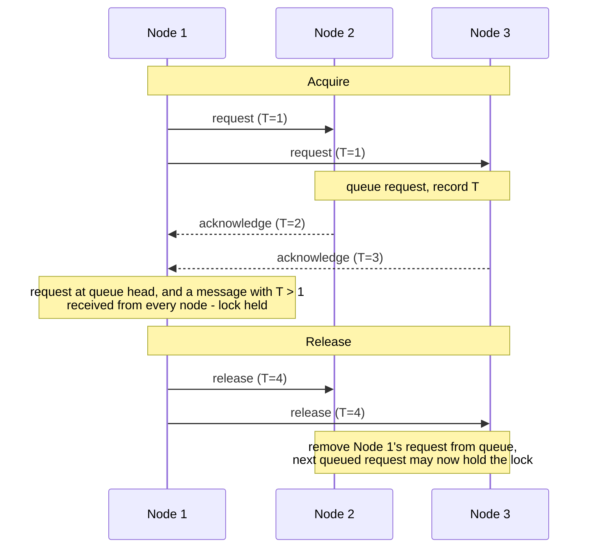

Distributed mutual exclusion is the problem of guaranteeing that at most one of a set of nodes, which share no memory and communicate only by messages, holds a lock at any time, and that every request for the lock is eventually granted. [Lamport's algorithm](https://lamport.azurewebsites.net/pubs/time-clocks.pdf) solves it without a central lock server.

## Core idea

Each node maintains a consistent ordering of locking events, derived from [[systems/distributed-systems/clocks|logical clock]] timestamps. Every node holds the same queue of outstanding requests, ordered by timestamp, so all nodes independently reach the same conclusion about which node holds the lock.

> [!tip] There is no lock server
> No node grants the lock. Every node applies the same deterministic rule to the same totally ordered request queue, so each node *computes* locally which node holds the lock, and all nodes obtain the same result. The construction is a small instance of the replicated state machine approach.

## The algorithm

Each message carries a timestamp $T_m$ and a sequence number. Timestamps are logical clock values with ties broken by node ID, so message ordering is total. The algorithm assumes messages between any two nodes arrive in the order sent.

There are three message types:

- `request`, broadcast to all nodes
- `release`, broadcast to all nodes
- `acknowledge`, sent in reply to a request

Each node maintains:

- a queue of requests ordered by $T_m$
- the timestamp of the last message received from each node in the system

Message handling:

- On receiving `request`: record its $T_m$, add the request to the queue, and reply with an `acknowledge`
- On receiving `release`: record its $T_m$ and remove the sender's request from the queue
- On receiving `acknowledge`: record its $T_m$

To acquire the lock, a node broadcasts a `request`. The node holds the lock once both of these conditions hold:

- its `request` is at the head of its own queue
- it has received from every other node some message timestamped later than its request, so no earlier request can still be in flight

To release the lock, the node broadcasts `release`, and every node removes that node's request from its queue.

## Limits

> [!warning] No fault tolerance
> Acquiring the lock requires a later-timestamped message from *every* other node, so a single crashed node halts all acquisitions in the system.

The algorithm tolerates no failures, since progress requires a message from every other node. Each acquisition also requires a broadcast round trip. The algorithm's significance lies in its use of logical timestamps to make every node compute the same total order of lock events, the same foundation on which replicated state machines are built.

## Related notes

- [[systems/distributed-systems/clocks|clocks]]
- [[systems/distributed-systems/ordering-events-in-distributed-systems|ordering distributed events]]
- [[systems/operating-systems/v2-concurrency/5-synchronizing-access-to-shared-objects|Synchronizing Access to Shared Objects]]
