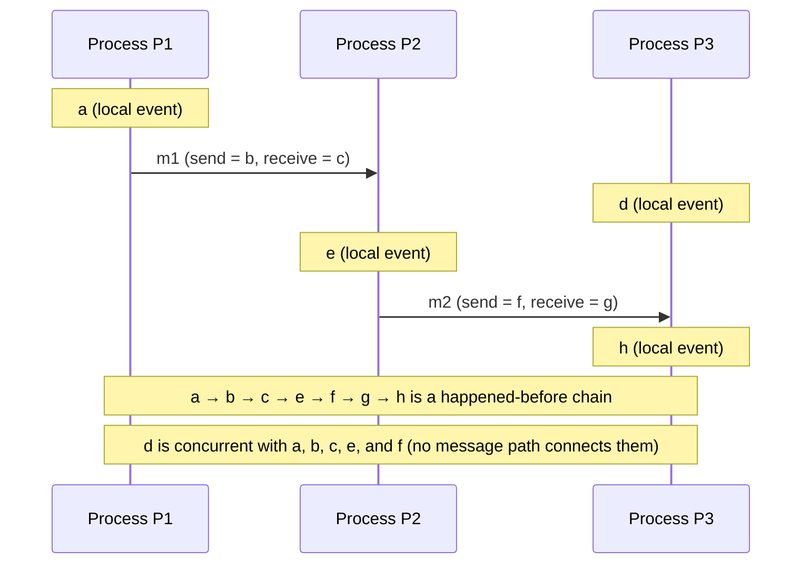
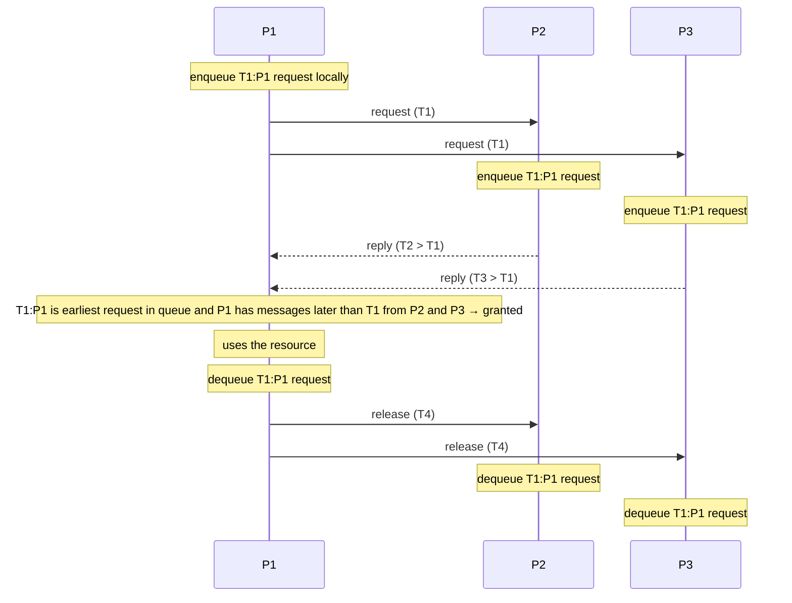

[Lamport's 1978 paper](https://lamport.azurewebsites.net/pubs/time-clocks.pdf) defines the happened-before relation on the events of a distributed system that has no shared clock, and constructs logical clocks consistent with that relation. It then derives how closely physical clocks must be synchronized to avoid ordering anomalies.

## Problem

An ideal ordering of the events in a distributed system would follow the physical times at which they occurred. No process can observe that order directly, since a process observes only its own events and the messages it exchanges. A partial ordering can instead be defined that captures every ordering the system itself could observe, and then extended to a total ordering consistent with the partial one.

A partial ordering of objects is a relation that is reflexive, antisymmetric, and transitive. A total ordering is a partial ordering where every pair is comparable, so for any two objects $a$ and $b$, either $a \leq b$ or $b \leq a$.

## Notation

- $a \rightarrow b$: event $a$ happened before event $b$.
  - $\to$ is an irreflexive, transitive relation that defines a partial order over the events in the system.
  - If $a$ and $b$ are events in the same process and $a$ comes first, then $a \to b$.
  - If $a$ is the sending of a message and $b$ is the receipt of that message, then $a \rightarrow b$.
  - If $a \rightarrow b$ and $b \rightarrow c$, then $a \rightarrow c$.
  - $a \nrightarrow a$.
- $C_i\langle a \rangle$: the clock value of process $P_i$ when event $a$ occurs.
- $a \Rightarrow b$: the total order built from the clocks. Ties are broken by an arbitrary total order $\prec$ on processes (for example, lexicographic order of process identifiers). For $a$ in $P_i$ and $b$ in $P_j$:

$$
a \Rightarrow b \iff C_i\langle a \rangle < C_j\langle b \rangle \lor (C_i\langle a \rangle = C_j\langle b \rangle \land P_i \prec P_j)
$$

Provided the clocks satisfy the clock condition below, $a \to b \implies a \Rightarrow b$, so the total order extends the partial one. The reverse implication fails, since $\Rightarrow$ also orders concurrent events.

The following diagram shows three processes with local events and two messages. Every path along a process line or a message arrow gives a happened-before chain; events with no such path between them are concurrent.

## Clock condition

For any events $a, b$: if $a \to b$, then $C\langle a \rangle < C\langle b \rangle$.

The clock condition holds under two implementation rules. Each process increments its clock between any two of its own events, and when event $a$ sends a message $m$ carrying the timestamp $T_m = C_i\langle a \rangle$, the receiving process sets its clock at the receipt event $b$ to some value greater than $T_m$ (and at least its current value).

## Synchronized access to a shared resource

The paper uses the total order to solve mutual exclusion. The algorithm grants a resource to processes subject to three conditions:

- (I) A process which has been granted the resource must release it before it can be granted to another process.
- (II) Different requests for the resource must be granted in the order in which they are made.
- (III) If every process which is granted the resource eventually releases it, then every request is eventually granted.

### Assumptions

For any two processes $P_i$ and $P_j$, messages sent by $P_i$ are received in the order they were sent. Stop-and-wait or sliding window protocols provide this property. Every message is also assumed to be eventually received.

The protocol requires active participation from every process. If any one process fails the whole system stops, because a request cannot be granted until every process has responded.

### Algorithm

1. To request the resource, process $P_i$ sends a message $T_m:P_i$ *request* to all other processes and puts that message on its own request queue, where $T_m$ is the current clock value of $P_i$.
2. When process $P_j$ receives $T_m:P_i$ *request*, it places it on its request queue and sends a *reply* message to $P_i$ with its current clock value.
3. To release the resource, $P_i$ removes $T_m:P_i$ *request* from its request queue and sends a *release* message with its current clock value to all other processes.
4. When process $P_j$ receives a $P_i$ *release* message, it removes $T_m:P_i$ *request* from its request queue.
5. $P_i$ is granted the resource when both conditions hold:
   - Its own $T_m:P_i$ *request* is ordered by $\Rightarrow$ before every other *request* in its queue.
   - $P_i$ has received a message timestamped later than $T_m$ from every other process.

### State machine perspective

The algorithm is an instance of replicated state machines. Take $C$ to be a set of commands and $S$ a set of states, with a transition function

$$
e: C \times S \to S
$$

where $e(c, s) = s'$ means executing command $c$ in state $s$ moves the machine to state $s'$. Here the state is the request queue and the commands are the request and release messages:

$$
C = \{ P_i \text{ request}, P_i \text{ release} \}
$$

Executing $P_i \text{ request}$ adds the request to the queue, and $P_i \text{ release}$ removes it. Each process runs its own copy of the state machine and executes a command timestamped $T$ only once it has received messages with timestamps at least $T$ from every process, which guarantees it has seen every command ordered before $T$. Since every copy executes the same commands in the same total order, every copy stays in agreement.

## Anomalous behavior of the total ordering

Consider a nationwide system. A person issues request $a$ at node $A$, then phones a friend in another city who issues request $b$ at node $B$. The total ordering can place $b \Rightarrow a$ even though $a$ was issued first, because the message that establishes the real ordering (the phone call) is external to the system.

> [!quote] Lamport on anomalous behavior ([Time, Clocks, §Anomalous Behavior](https://lamport.azurewebsites.net/pubs/time-clocks.pdf))
> Paraphrasing the paper's example: in a nationwide network, a user can issue request $a$ at computer $A$, then telephone a friend in another city who issues request $b$ at computer $B$. It is quite possible for $b$ to receive a lower timestamp and be ordered before $a$, because the causal link between them, the phone call, is invisible to the system. The relevant happened-before relation is the one over *all* events in the world, not just the ones the system can see.

More concretely, let $\mathscr{L}$ be the set of all relevant events in the world and $L$ the set of events inside the system, so $L \subseteq \mathscr{L}$. In the scenario above, $a \to_{\mathscr{L}} b$ but $a \nrightarrow_{L} b$. No algorithm based solely on the events in $L$, without knowledge of $\mathscr{L}$, can be guaranteed to order $a$ before $b$.

The paper gives two remedies.

1. Users manually carry timestamps across the external channel, so the person at $A$ tells the person at $B$ a timestamp $T_a$ and the second request is issued with a later one. This places the burden on users.
2. Clocks are constructed to satisfy a strong clock condition: if $a \to_{\mathscr{L}} b$, then $C\langle a \rangle < C\langle b \rangle$. This requires physical clocks.

## Physical clocks

Let $C_i(t)$ be the value of clock $C_i$ at physical time $t$. Assume $C_i(t)$ is continuous and differentiable except at isolated points where it jumps on reset. A discrete clock fits this model with an error of up to half a tick.

$\frac{dC_i(t)}{dt}$ is the rate the clock runs at time $t$, and a perfect clock runs at rate 1. Assume every clock runs at nearly the correct rate:

$$
\exists \kappa \ll 1 \text{ such that } \forall i, t: \left|\frac{dC_i(t)}{dt} - 1\right| < \kappa
$$

The paper notes $\kappa \le 10^{-6}$ for typical crystal controlled clocks.

Rate accuracy alone is insufficient, since independent clocks drift apart. We also require the clocks synchronized to within some bound $\epsilon$:

$$
\forall i, j, t: |C_i(t) - C_j(t)| < \epsilon
$$

Physical clocks never run at exactly the same rate, so drift accumulates and a synchronization algorithm has to periodically bring them back within $\epsilon$.

Now let $\mu$ be a lower bound on interprocess message delay: if event $a$ occurs at physical time $t$ and event $b$ in another process satisfies $a \to b$, then $b$ occurs after $t + \mu$. To avoid the anomalous behavior above, an event at time $t + \mu$ must get a larger timestamp than any event at time $t$:

$$
\forall i, j, t: C_i(t + \mu) - C_j(t) > 0
$$

The rate bound gives $C_i(t + \mu) - C_i(t) > (1 - \kappa)\mu$, and the synchronization bound gives $C_i(t) > C_j(t) - \epsilon$. Adding these, $C_i(t + \mu) - C_j(t) > (1 - \kappa)\mu - \epsilon$, which is positive whenever

$$
\frac{\epsilon}{1 - \kappa} \le \mu
$$

The required precision of synchronization is therefore bounded by the minimum message delay, and a network with a smaller minimum delay requires more tightly synchronized clocks.

> [!abstract] Synchronization bound
> $\dfrac{\epsilon}{1 - \kappa} \le \mu$: the bound on clock disagreement ($\epsilon$) is limited by the minimum interprocess message delay ($\mu$), scaled slightly by the clock rate error ($\kappa$). If a message can cross the system in less time than the clocks may disagree, anomalous orderings are possible.

### Clock synchronization algorithm

> [!warning] Never set a clock backward
> Clocks must only ever be adjusted forward. Setting a clock backward can violate the clock condition for events the clock has already timestamped, since a later event could receive a smaller timestamp than an earlier one.

Let $m$ be a message sent at time $t$ and received at time $t'$. Let $v_m = t' - t$ be the total delay of the message. The receiver does not know $v_m$, but it knows some lower bound $\mu_m$ on the delay. Define $\zeta_m = v_m - \mu_m$ as the unpredictable delay of the message.

The physical clocks follow two rules.

1. For each $i$, if $P_i$ does not receive a message at physical time $t$, then $C_i$ is differentiable at $t$ and $\frac{dC_i(t)}{dt} > 0$.
2. If $P_i$ sends a message $m$ at physical time $t$, then $m$ contains a timestamp $T_m = C_i(t)$. Upon receiving $m$ at physical time $t'$, $P_j$ sets $C_j(t') = \max(\lim_{\delta \to 0} C_j(t' - \delta), T_m + \mu_m)$.

The paper proves that with these rules, clocks that communicate often enough converge to within an $\epsilon$ determined by the unpredictable delay, so the anomaly-freedom condition above can be met.

## Sources

- [Time, Clocks, and the Ordering of Events in a Distributed System](https://lamport.azurewebsites.net/pubs/time-clocks.pdf)

## Related notes

- [[systems/distributed-systems/clocks|distributed clocks]]
- [[systems/distributed-systems/consistent-global-state|consistent global state]]
- [[systems/distributed-systems/mutual-exclusion|mutual exclusion]]
- [[systems/operating-systems/v2-concurrency/5-synchronizing-access-to-shared-objects|Synchronizing Access to Shared Objects]]
