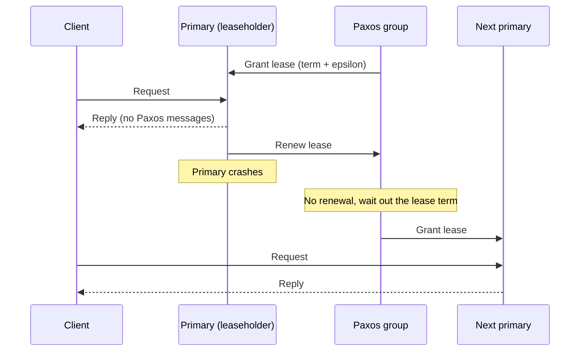

Replication architectures differ in the number of messages exchanged per client request and in the number of simultaneous failures they tolerate. Paxos tolerates the failure of any minority of its replicas, at a higher message cost per request than a single server or primary-backup replication.

One way to keep Paxos off the critical path of each request is to use the Paxos group as a lease server. A leaseholder then serves requests without consulting the group, and Paxos runs only when the lease changes hands.

## Overhead of simple architectures

A single server needs 2 messages per request, the request and the reply. It tolerates no failures.

[[systems/distributed-systems/primary-backup|Primary-backup]] with one backup and a view server needs 4 messages: client to primary, primary forwards to backup, backup acknowledges, primary replies to the client. It handles any one failure.

A Paxos group of size $k$ can make progress as long as a majority of nodes are up. With a stable leader, committing one request costs about $3(k-1) + 2$ messages: the client request and reply account for the 2, and the leader exchanges three rounds with each of the $k-1$ other replicas (accept out, acknowledgment back, commit out).

> [!tip] Choosing an architecture
> Each architecture in this sequence tolerates more failures than the previous one, at a higher message cost per request. The appropriate choice depends on the number of simultaneous failures the system must survive.

## Paxos as a lease server

A lease is a time-limited right to do something, for example to act as primary. Leases rely on loosely synchronized clocks. A typical lease term is a few seconds, padded by some epsilon to absorb clock drift. A lease avoids incurring the Paxos message cost on every operation. If a leaseholder fails, the system waits for the lease to expire rather than running a failure detector.

Failover proceeds in three steps.

1. The Paxos group grants the lease to a primary
2. The primary serves requests until the lease expires, forwarding writes to its backup
3. If the primary fails to renew the lease, the group grants a lease to the next primary

[Chubby](https://static.googleusercontent.com/media/research.google.com/en//archive/chubby-osdi06.pdf), the lock service behind Bigtable at Google, uses this design, and ZooKeeper fills the same role in many open source systems. As long as clock drift stays within the epsilon padding, at most one node holds the lease at a time, which rules out split brain. Since the leaseholder is the unique primary, it can serve reads locally and manage cache invalidation without consulting the group. With write ahead logging, the explicit backup can be omitted, and recovery replays the log on a fresh primary.

> [!warning] Safety depends on the drift bound
> Split brain is ruled out only while clock drift stays within the epsilon padding. A leaseholder whose clock runs slow can continue to act as primary after the group has granted the lease to a successor, so correctness depends on the drift bound holding.

## Related notes

- [[systems/distributed-systems/paxos-intro|Paxos introduction]]
- [[systems/distributed-systems/paxos-made-simple|Paxos Made Simple]]
- [[systems/distributed-systems/primary-backup|primary backup]]
