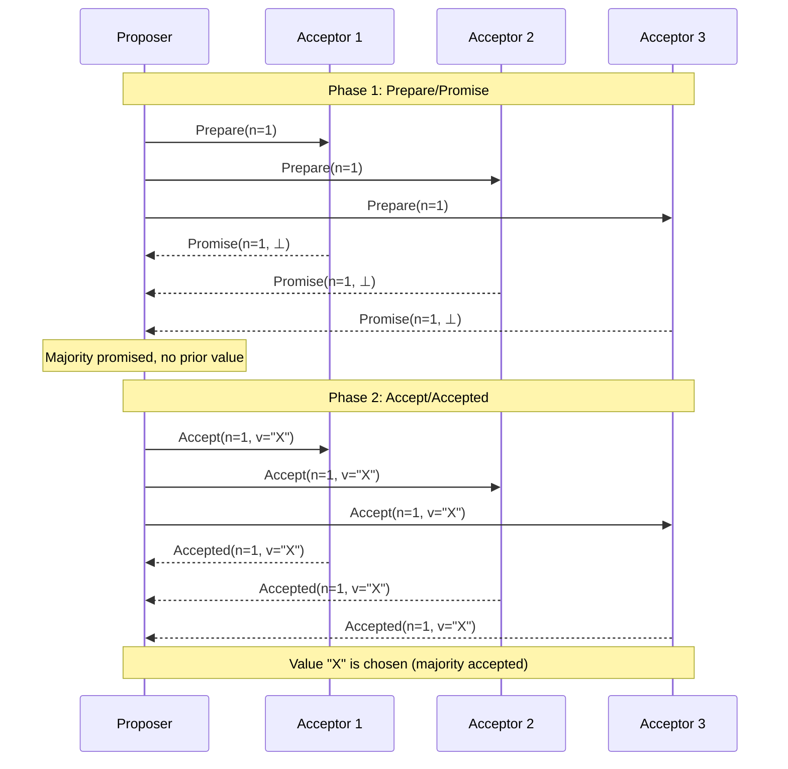

Paxos is a consensus protocol for processes that communicate over an asynchronous network and may crash. It guarantees that at most one value is chosen, and it chooses a value whenever a majority of its acceptors can communicate for long enough.

The protocol is used chiefly for state machine replication, in which a separate instance of Paxos chooses the command in each slot of a replicated log. The full derivation is given in [[systems/distributed-systems/paxos-made-simple|Paxos Made Simple]].

## FLP impossibility result

The [FLP result](https://groups.csail.mit.edu/tds/papers/Lynch/jacm85.pdf) shows that in an asynchronous system where even one process may fail, no deterministic protocol can guarantee consensus terminates. A consensus protocol therefore cannot guarantee both safety and progress, and its design must choose which of the two it preserves under all conditions.

Paxos preserves safety under all conditions. It makes progress in practice as long as a majority of nodes are available and failures cease for long enough for a round to complete.

> [!abstract] FLP in one sentence
> No deterministic protocol can guarantee both safety and liveness in an asynchronous system with even one faulty process, so every such consensus protocol must choose which property it sacrifices under adversarial conditions.

## State machine replication

State machine replication orders client operations into an append-only log, and every replica applies the log in order. Consensus is simpler when only one request is in flight at a time, so a common structure elects a leader, sends all client requests to it, and lets the leader define the ordering. If the leader fails or becomes slow, a new leader is elected, as many times as necessary. Each log slot then requires all nodes to agree on one value, and Paxos provides that per-slot agreement. Paxos also makes leader election safe, since competing would-be leaders cannot commit conflicting values.

> [!info] State machine replication
> Each log slot is decided by its own Paxos instance. The value chosen for slot i is the ith command that every replica executes.

## Paxos, the algorithm



```plaintext
Proposer:
  Prepare(n) -> Promise(n, n', v')
  Accept(n, v) -> Accepted(n, v)

Acceptor:
  Promise(n, n', v') -> Prepare(n)
  Accepted(n, v) -> Accept(n, v)
```

### Phase 1: Prepare

- The proposer selects a proposal number $n$ and sends `Prepare(n)` to all (or a majority) of the acceptors.
- An acceptor that has seen nothing higher than $n$ responds with `Promise(n, n', v')`, where $n'$ is the highest proposal number it has accepted and $v'$ is the value of that proposal. The promise means the acceptor will never accept a proposal numbered less than $n$.
- The proposer waits for a majority of promises before proceeding.

### Phase 2: Accept

- Once the proposer has a majority of promises, it sends `Accept(n, v)` to the acceptors, where $v$ is the value of the highest-numbered proposal reported in the promises, or the proposer's own value if no promise reported one. Adopting the highest-numbered reported value prevents an already-chosen value from being overwritten.
- Each acceptor that has not promised a higher number accepts and responds with `Accepted(n, v)`.
- Once a majority of acceptors accept, the value is chosen.

## Related notes

- [[systems/distributed-systems/paxos-made-simple|Paxos Made Simple]]
- [[systems/distributed-systems/paxos-architecture|Paxos architecture]]
- [[systems/distributed-systems/ordering-events-in-distributed-systems|event ordering]]
