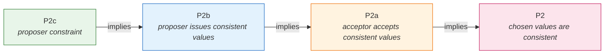
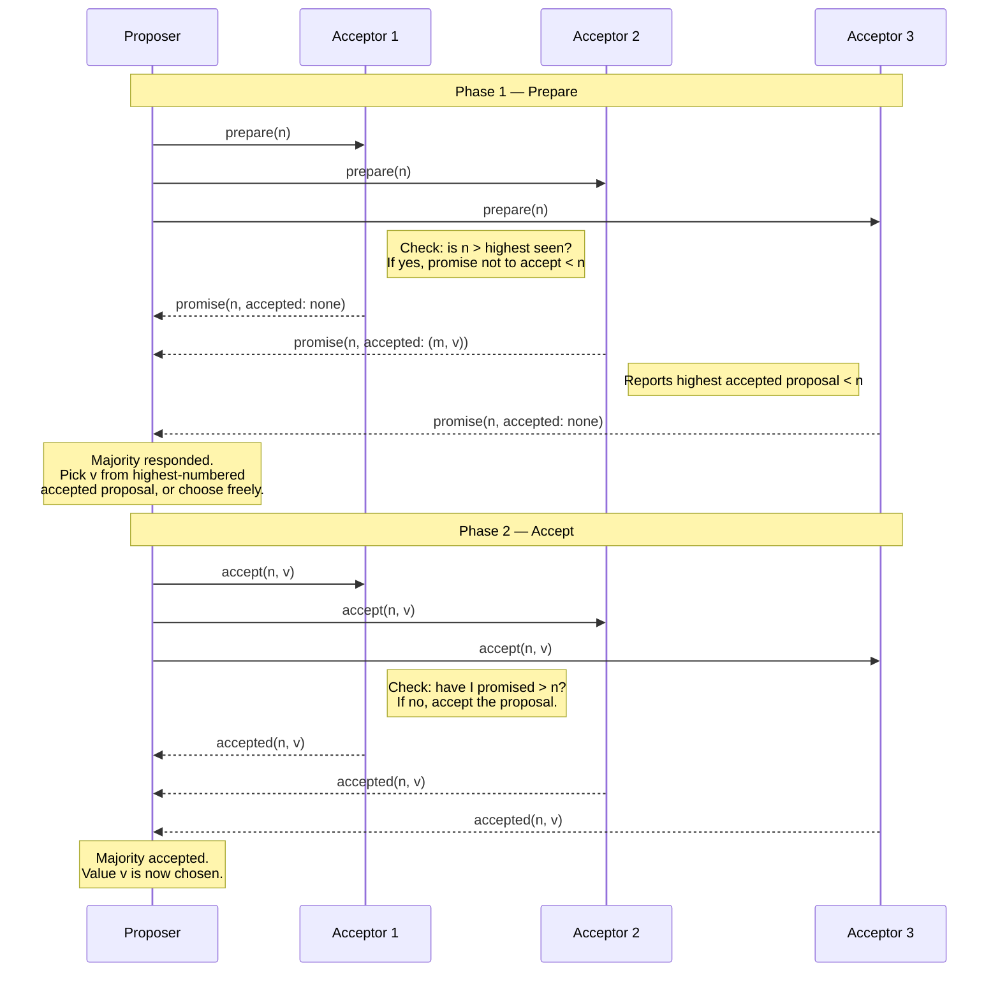

[Paxos Made Simple](https://lamport.azurewebsites.net/pubs/paxos-simple.pdf) (Lamport, 2001) derives the Paxos consensus algorithm from the safety requirements of consensus, strengthening a chain of constraints until each can be enforced by a local rule of a proposer or an acceptor. The chain of constraints shows why each step of the protocol is necessary. The paper then treats learners, progress, and the implementation of a replicated state machine.

## The problem

Consider a set of processes that can propose values. A consensus algorithm ensures that a single value is chosen and agreed upon. Safety requires the following:

- Only proposed values are chosen
- Only a single value is chosen
- Processes only learn values that are actually chosen

The setting is an asynchronous, non-Byzantine network in which nodes fail by stopping and may restart, and messages may be lost or duplicated but are never corrupted.

## Choosing a value

Paxos has three agent roles, and a single process can play several at once:

- *proposers*
- *acceptors*
- *learners*

A value is chosen when a majority of acceptors accept a proposal with that value. Any two majorities intersect, and the safety argument rests on this fact.

### P1: An acceptor must accept the first proposal it receives

P1 guarantees that some value is accepted whenever a value is proposed, but with multiple proposers it permits splits in which no single proposal is accepted by a majority. Proposals are therefore assigned unique numbers, an acceptor may accept more than one proposal, and a proposal is a (number, value) pair.

### P2: If a proposal with value $v$ is chosen, then every higher-numbered proposal that is chosen has value $v$

P2 is the single-value guarantee, restated to permit multiple chosen proposals provided they all carry the same value. The remainder of the derivation strengthens P2 into a property that can be implemented.

#### P2a: If a proposal with value $v$ is chosen, then every higher-numbered proposal accepted by any acceptor has value $v$

A proposal is chosen only if it is accepted, so P2a implies P2. But P2a conflicts with P1. Suppose an acceptor has received no messages, and so has accepted nothing, when a proposer unaware of the chosen value issues a higher-numbered proposal with a different value. P1 requires that acceptor to accept the proposal, which violates P2a. The constraint is therefore placed on the proposers.

#### P2b: If a proposal with value $v$ is chosen, then every higher-numbered proposal issued by any proposer has value $v$

A proposer must now issue only proposals consistent with any value already chosen. We have:

$$
\text{P2b} \implies \text{P2a} \implies \text{P2}
$$

P2b is implemented by constraining how a proposer selects its value.

#### P2c: For any $v$ and $n$, if a proposal with value $v$ and number $n$ is issued, there is a set $S$ consisting of a majority of acceptors such that either (a) no acceptor in $S$ has accepted any proposal numbered less than $n$, or (b) $v$ is the value of the highest-numbered proposal among all proposals numbered less than $n$ accepted by the acceptors in $S$

Maintaining P2c as an invariant satisfies P2b. To keep the invariant, a proposer issuing proposal $n$ must learn the highest-numbered accepted proposal below $n$ from some majority, and propose that value if one exists. Learning which proposals have been accepted is straightforward. The difficulty is preventing later acceptances from invalidating that information, and the promise in the prepare phase prevents them.

> [!tip] Why adopt the highest-numbered value?
> When a proposer gathers promises from a majority, any previously chosen value must appear in those responses, because "chosen" means accepted by a majority, and any two majorities share at least one acceptor. By adopting the highest-numbered accepted value, the proposer guarantees it will not propose anything that conflicts with an already-chosen value, preserving safety even without knowing whether that value was actually chosen.

### Proposition algorithm

1. A proposer chooses a new proposal number $n$ and sends a *prepare* request to each member of some set of acceptors, awaiting a response containing:
    - A promise that this acceptor will never accept a proposal numbered less than $n$
    - The highest-numbered proposal below $n$ that it has accepted, if any
2. If the proposer receives responses from a majority of acceptors, it issues an *accept* request with number $n$ and value $v$, where $v$ is the value of the highest-numbered proposal among the responses, or a value of the proposer's choice if the responses reported no proposals.

### Acceptor behavior

Acceptors receive only *prepare* and *accept* requests, and can ignore any request without compromising safety (at the cost of liveness). Acceptors require a single rule.

#### P1a: An acceptor can accept a proposal numbered $n$ iff it has not responded to a *prepare* request numbered greater than $n$

P1a implies P1.

### The two phases

#### Phase 1

- (a) A proposer selects a proposal number $n$ and sends a *prepare* request with number $n$ to a majority of acceptors.
- (b) If an acceptor receives a *prepare* request with number $n$ greater than any it has seen, it responds with a promise not to accept any proposal numbered less than $n$, along with the highest-numbered proposal (and value) it has accepted.

#### Phase 2

- (a) If the proposer receives responses from a majority of acceptors, it sends an *accept* request to each acceptor with number $n$ and value $v$, where $v$ is the value of the highest-numbered proposal among the responses, or a value of its choosing if no proposals were reported.
- (b) If an acceptor receives an *accept* request numbered $n$, it accepts the proposal unless it has already responded to a *prepare* request with a number greater than $n$.

As an optimization, an acceptor that ignores a request because it has promised a higher number can send the proposer a *reject*, so that the proposer abandons the proposal. Correctness does not depend on this.

## Learning a chosen value

Each acceptor can notify every learner whenever it accepts a proposal, which requires a number of messages equal to the product of the numbers of acceptors and learners. Alternatively, a set of *distinguished* learners receives the acceptances and relays majority acceptances to the other learners. A larger distinguished set tolerates more failures and requires more communication.

Because messages can be dropped, a value can be chosen without any learner finding out. A learner can determine the chosen value by having a proposer issue a new proposal, since any new proposal must surface the chosen value.

## Progress

Two proposers can issue proposals with increasing numbers indefinitely, each new prepare invalidating the other's pending accept, so that no proposal completes. Progress requires a single *distinguished* proposer, the only one allowed to issue proposals, with a new one elected if it fails. By [FLP](https://groups.csail.mit.edu/tds/papers/Lynch/jacm85.pdf), any such election mechanism must rely on randomness or on real time (timeouts) to guarantee progress.

> [!warning] Livelock
> Suppose proposer A completes phase 1 with proposal number $n$ and is about to send accept requests. Before those messages arrive, proposer B runs phase 1 with number $n+1$, causing acceptors to promise $n+1$ and reject A's accept. Now A retries with $n+2$, invalidating B's pending accept, and the cycle repeats. No value is ever chosen, even though every message is delivered. Paxos therefore requires a leader election mechanism for liveness; safety does not depend on it.

## Implementing a state machine

Consider clients issuing commands to a cluster of single-threaded application servers. Each server is a deterministic state machine, so the servers end in the same state exactly when they execute the same commands in the same order.

A separate instance of Paxos runs for each log slot, and the value chosen by instance $i$ is the $i$th command every server executes. During normal operation one server is elected leader and acts as the distinguished proposer. Clients send requests to the leader, which assigns them to slots. Any individual instance can fail or stall, but no instance can ever choose two different commands for the same slot.

When a new leader takes over, some slots may be undecided. The new leader runs phase 1 for all such instances at once, including the infinitely many slots beyond the current log (one prepare message can cover them all, since phase 1 does not depend on the value). Where phase 1 surfaces an accepted value, the leader proposes it. Slots that remain unconstrained below the highest accepted command are filled with no-op proposals, and the leader must decide them before executing any command that comes after those slots.

Afterwards the leader proposes further client commands with phase 2 alone, which the paper notes is the minimal message cost achievable for consensus once phase 1 is out of the way. If the leader may propose commands $i + 1$ through $i + \alpha$ once commands $1$ through $i$ are chosen, then a failure can leave a gap of up to $\alpha - 1$ undecided commands, which the next leader fills as described above.

If no single leader is elected, safety still holds, and only progress is affected.

## Sources

- [Paxos Made Simple](https://lamport.azurewebsites.net/pubs/paxos-simple.pdf)
- [Impossibility of Distributed Consensus with One Faulty Process](https://groups.csail.mit.edu/tds/papers/Lynch/jacm85.pdf)

## Related notes

- [[systems/distributed-systems/paxos-intro|Paxos introduction]]
- [[systems/distributed-systems/paxos-architecture|Paxos architecture]]
