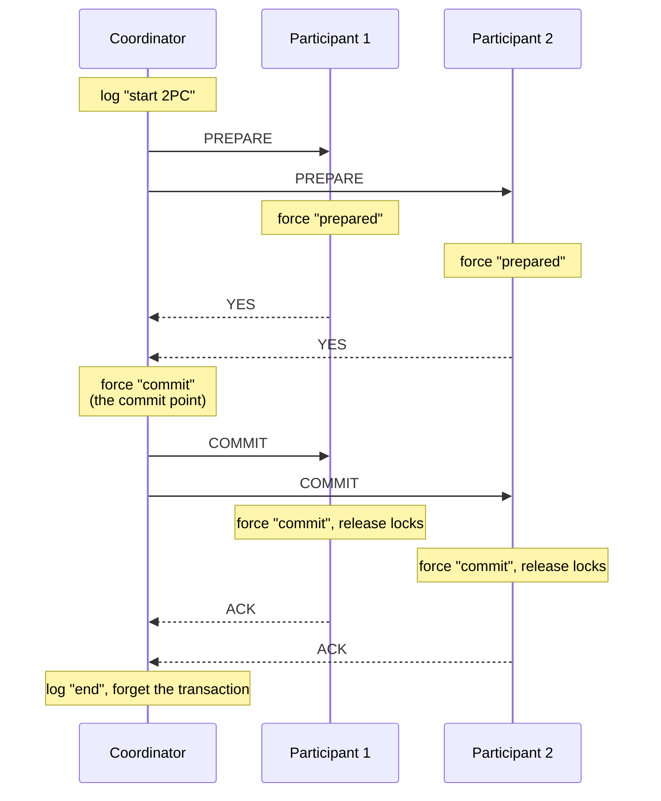

## Purpose

A transaction that writes to two machines, say a transfer that debits an account on one shard and credits it on another, has to land on both or on neither. Each machine can fail on its own: it can crash, lose its network, run out of space, or abort the transaction to break a deadlock. Two-phase commit (2PC) is the protocol that gets every machine to the same outcome anyway. This note covers what 2PC has to guarantee, the log writes that make it survive crashes, where it blocks and why that can't be fully fixed, what it costs when measured, and how production databases change it.

It assumes you know what a transaction is. [[systems/databases/transactions-serializability-isolation|Transactions, serializability and isolation]] covers locking and isolation in more depth, and [[systems/databases/foundations/ch3-storage-and-retrieval|storage and retrieval]] covers write-ahead logging.

## The atomic commitment problem

2PC solves *atomic commitment*. One process, the **coordinator**, runs the protocol. The others, the **participants**, each hold part of the transaction's writes. (The coordinator can also be a participant.) Every participant votes yes or no and later decides commit or abort. [Bernstein, Hadzilacos and Goodman (§7.3)](https://www.microsoft.com/en-us/research/wp-content/uploads/2016/05/chapter7.pdf) state the requirements as five conditions:

- **AC1.** All processes that decide reach the same decision.
- **AC2.** A process can't reverse its decision.
- **AC3.** Commit can only be decided if every process voted yes.
- **AC4.** If there are no failures and everyone votes yes, the decision is commit.
- **AC5.** If every failure is eventually repaired and no new ones occur for long enough, every process eventually decides.

AC3 is where atomic commitment differs from [[systems/distributed-systems/paxos-intro|consensus]]. A consensus protocol needs a majority to agree on some value. Atomic commitment needs every participant's yes, so one participant can veto the whole transaction, and a participant that can't be heard from can hold it up. AC4 rules out the trivial protocol that always aborts. AC5 is a liveness condition, and it is weaker than it looks: it only promises a decision after failures are *repaired*. The rest of this note is mostly about the gap between "eventually, once repaired" and "now".

The transaction's ACID properties map onto this. Atomicity is AC1 to AC3 applied to the transaction's writes. Durability comes from the logging below. The C in ACID, in [Haerder and Reuter's](https://pages.cs.wisc.edu/~nil/764/Trans/17_p287-haerder.pdf) original definition, means a committed transaction leaves the database satisfying its integrity rules, "each successful transaction by definition commits only legal results". That property belongs to the application's transactions and has nothing to do with linearizability or replica consistency, and 2PC doesn't provide it.

## What a participant needs before it can vote yes

A yes vote is a promise: "if you tell me to commit, I will, even if I crash first." Keeping that promise takes two things the participant must already have when it votes.

**Locks held until the outcome.** Between voting yes and learning the decision, a participant doesn't know whether its writes will survive. If it let another transaction read them, and the outcome turned out to be abort, that reader would have seen data that never existed. So the participant holds its locks until it learns the decision. Most systems use strict two-phase locking for this, where a transaction's locks are released only when it commits or aborts ([BHG §3.5](https://www.microsoft.com/en-us/research/wp-content/uploads/2016/05/chapter3.pdf) call this "strict 2PL"; later texts call releasing *every* lock at the end "strong strict" or "rigorous" 2PL, and let plain strict 2PL release read locks earlier). The original two-phase locking rule from [Eswaran et al. (1976)](https://www.csd.uoc.gr/~hy460/pdf/p624-eswaran.pdf) only says a transaction may not take a new lock after releasing one. Note the coincidence of names: two-phase *locking* (a growing then shrinking phase of lock acquisition) and two-phase *commit* (a voting phase then a decision phase) are separate ideas, and 2PC uses the first.

**A forced log record.** The participant writes a *prepared* record to its log, with enough redo information to finish the transaction's writes after a crash, and *forces* it, meaning it waits for the disk to confirm the write (an `fsync` or `fdatasync`) before sending the vote. If it sent the vote first and then crashed, it could come back with no memory of having promised anything. The same rule applies to the coordinator's decision: the commit record must be on disk before any participant is told to commit. Forced writes are the main cost of 2PC, and the measurements below put a number on that.

## The protocol



In words, following [BHG's log rules (§7.4)](https://www.microsoft.com/en-us/research/wp-content/uploads/2016/05/chapter7.pdf):

1. **Voting.** The coordinator logs a start record and sends PREPARE to every participant. A participant that can commit forces a prepared record and votes YES. One that can't writes an abort record, releases its locks and votes NO. A no voter is done: it has aborted and nothing can change that.
2. **Decision.** If every vote is YES, the coordinator forces a commit record. That write is the commit point; the transaction is committed once it is on disk, whatever happens to messages afterward. If any vote is NO, or a vote doesn't arrive in time, the coordinator writes an abort record instead.
3. **Completion.** The coordinator sends the decision. Each participant logs it, applies or undoes its writes, releases its locks and acknowledges. Once every participant has acknowledged, the coordinator writes an end record and can forget the transaction.

A participant goes through three periods. Before it votes it can abort on its own at any time. After it votes yes and before it hears the decision, it is in its **uncertainty period**: it can neither commit nor abort on its own, and it holds its locks. A transaction in that state is called *in doubt*. After the decision arrives it is done. The coordinator has no uncertainty period, because it makes the decision.

The failure-free cost is three message rounds (PREPARE, votes, decision), plus a fourth for the acknowledgments that let the coordinator forget. With $N$ participants that is $4N$ messages. The forced writes are one prepared record per participant, the coordinator's commit record, and in the [R* implementation](https://pdos.csail.mit.edu/6.824/papers/rstar.pdf) one commit record per participant, $2N + 1$ in all. [Gray and Lamport (figure 4)](https://www.microsoft.com/en-us/research/wp-content/uploads/2016/02/tr-2003-96.pdf) count it differently, as $3N - 1$ messages and $N + 1$ writes, because they start the clock when the first participant sends its prepared vote and count only the writes needed to reach the decision. Both agree on the part that sets latency: two forced writes in sequence, a participant's prepared record and then the coordinator's commit record.

## Breaking it yourself

The simulator runs one coordinator and three participants through the protocol above, one event at a time. Each card shows a node's state, whether it holds locks, and its log, with forced records marked. The diagram shows the messages in flight. Every state, log record and verdict comes from a model of the protocol whose tests check AC1 to AC5 over 3,000 random runs of crashes, recoveries, lost and reordered messages and cut links.

Things to try:

- **Press Next until it finishes.** A clean commit sends 12 messages and forces 7 log records, the $4N$ and $2N + 1$ above with $N = 3$.
- **Tick "votes no" on P2, then Reset.** P2 aborts the moment it sees PREPARE, and one no vote aborts everyone.
- **Start from "C crashes while votes are in flight".** All three participants have voted yes and nobody else knows the outcome. Press Next: the votes are lost, the timers fire, the participants ask around, and they stay stuck with their locks held. Recover C and it finds no decision in its log, so it aborts.
- **Start from "C crashes after telling only P1".** P2 and P3 ask P1, which committed, and finish. Untick "Uncertain participants also ask each other" and do it again: now they only ask C, and they are blocked until it comes back.
- **Cut a link or lose a message.** Click a line in the diagram to cut it, and use Deliver or Lose to reorder or drop individual messages. Back undoes one step.

<CommitSim scenario="fresh" />

## Failures and recovery

Every failure case reduces to two mechanisms: a timeout while waiting for a message, and recovery from the log after a crash. The coordinator attaches the list of participants to PREPARE, so each participant knows whom it can ask.

| Waiting for | Who | What it does on timeout |
| --- | --- | --- |
| PREPARE | Participant | Aborts on its own. It hasn't voted, so nothing depends on it. |
| Votes | Coordinator | Decides abort. No participant can have committed without its decision. |
| The decision | Participant (uncertain) | Asks for it. It can't decide alone. |
| ACKs | Coordinator | Resends the decision. |

| Log contents at recovery | Who | What it does |
| --- | --- | --- |
| Commit or abort record | Either | Finishes the decision it logged and resends it if it is the coordinator. |
| Prepared record, no decision | Participant | Retakes its locks, is uncertain, asks for the decision. |
| Nothing for this transaction | Participant | Aborts. It never voted yes. |
| Start record, no decision | Coordinator | Aborts and tells the participants. |

The last row corrects a common description in which a recovering coordinator resends PREPARE. Resending is safe, but aborting is what [BHG](https://www.microsoft.com/en-us/research/wp-content/uploads/2016/05/chapter7.pdf) specify, and it is the property presumed abort, below, is built on: with no commit record on disk, nobody can have committed, so the coordinator may abort.

### Cooperative termination

An uncertain participant that times out asks for the decision. In the basic protocol it asks only the coordinator. In the **cooperative termination protocol** ([BHG §7.4](https://www.microsoft.com/en-us/research/wp-content/uploads/2016/05/chapter7.pdf)) it asks every other participant too, and each one answers according to its state:

- If it has decided, it says commit or abort.
- If it hasn't voted yet, it aborts on the spot and says abort. That's allowed, because it hadn't promised anything, and it settles the transaction.
- If it is uncertain too, it can't help.

So an uncertain participant is **blocked** exactly when every process it can reach is also uncertain. It then has to keep its locks and wait for a failure to be repaired.

Cooperative termination doesn't close the main hole. If every participant has voted yes and the coordinator crashes before any of them hears the decision, all of them are uncertain and none can help another. In the simulator, a coordinator crash at any of the six steps between sending PREPARE and receiving the last YES leaves all three participants blocked, with or without cooperative termination; a crash after the commit record is forced never does, because the COMMIT messages are already on their way. What cooperative termination fixes is the partial case, where the decision reached some participants and not others, or where the coordinator is cut off and the participants aren't.

> [!warning] What blocking costs
> A blocked participant holds its locks for as long as the failure lasts, which can be hours if the coordinator needs an operator. Every transaction that touches those rows waits behind it. PostgreSQL's [`PREPARE TRANSACTION`](https://www.postgresql.org/docs/current/sql-prepare-transaction.html), its participant side of 2PC, warns that a prepared transaction "continues to hold whatever locks it held" and that leaving one prepared for long stops `VACUUM` from reclaiming storage, so the feature is off by default (`max_prepared_transactions = 0`). The [XA standard](https://pubs.opengroup.org/onlinepubs/009680699/toc.pdf) lets a prepared participant make a *heuristic* decision, committing or rolling back on its own to free its locks, at the price of possibly disagreeing with the coordinator. The participant must remember what it did and report it, and the coordinator learns of any mismatch (`XA_HEURMIX`, `XA_HEURHAZ`) but can't undo it. A heuristic decision gives up AC1 to get the data back.

### Why blocking can't be designed away

Blocking is not a defect of 2PC that a cleverer protocol fixes in general. [BHG (Proposition 7.1)](https://www.microsoft.com/en-us/research/wp-content/uploads/2016/05/chapter7.pdf) state that "if communication failures or total failures are possible, then every ACP may cause processes to become blocked". [Skeen and Stonebraker (1983)](https://www.cs.purdue.edu/homes/bb/cs542-16Spr/TSE83_SS.pdf) prove the network-partition half: no commit protocol is resilient to a partition when messages can be lost. The reason is the same one behind the [[systems/distributed-systems/RPC|two generals problem]]: a process on one side of a partition can't tell whether the other side has already committed or aborted, and any rule that lets it decide anyway lets the two sides decide differently.

What *can* be done is to make blocking need more failures at once, and that is what the alternatives below do.

> [!note]- Deep dive: three-phase commit, and why it isn't used
> [Skeen (1981)](https://www.cs.purdue.edu/homes/bb/cs542-06Spr-bb/Nonblock-Skeen-81.pdf) proved what a non-blocking protocol needs, assuming the network never partitions: no process may be in a state that can coexist with both a committed process and an aborted one, and no process that hasn't yet learned that everyone voted yes may be in a state that can coexist with a committed process. 2PC breaks the second condition, because an uncertain participant can coexist with a participant that has already committed.
>
> Three-phase commit (3PC) adds a phase to fix that. After every YES, the coordinator sends PRE-COMMIT. A participant that receives it leaves its uncertainty period, knowing everyone voted yes, and acknowledges. Only after every acknowledgment does the coordinator send COMMIT. This gives BHG's property NB: if any operational process is uncertain, no process can have decided commit. A group of surviving participants that finds one of them uncertain can therefore safely abort, and one that finds a pre-committed process can safely commit. [BHG (Theorem 7.4)](https://www.microsoft.com/en-us/research/wp-content/uploads/2016/05/chapter7.pdf) show 3PC never blocks in the absence of total failures.
>
> The catch is the model. 3PC assumes there are no communication failures, so that a timeout reliably means the other process crashed. Under a partition, each side can conclude the other side is dead, run the termination protocol, and reach opposite decisions (BHG p.256). [Gray and Lamport](https://www.microsoft.com/en-us/research/wp-content/uploads/2016/02/tr-2003-96.pdf) make the same point about the published 3PC variants: they assume two processes can never both believe they are the coordinator, "an assumption that cannot be implemented in a purely asynchronous system". BHG's own survey concludes that "3PC is not used in practice". Real systems took the other route below and replicated the coordinator instead.

> [!note]- Deep dive: Paxos Commit, and 2PC as its special case
> [Gray and Lamport (2006)](https://www.microsoft.com/en-us/research/wp-content/uploads/2016/02/tr-2003-96.pdf) observe that the only thing that has to be agreed fault-tolerantly is each participant's vote. Paxos Commit runs one [[systems/distributed-systems/paxos-made-simple|Paxos]] instance per participant, each deciding "prepared" or "aborted" for that participant, with $2F + 1$ acceptors shared by all instances. The transaction commits iff every instance chose prepared. Any $F$ acceptors can fail and a new leader can still read the outcome, so no single crash blocks the transaction.
>
> Their figure 4 compares the failure-free costs for $N$ participants:
>
> | | 2PC | Paxos Commit | Faster Paxos Commit |
> | --- | ---: | ---: | ---: |
> | Message delays | 4 | 5 | 4 |
> | Messages | $3N - 1$ | $(N+1)(F+3) - 4$ | $N(2F+3) - 1$ |
> | Forced writes | $N + 1$ | $N + F + 1$ | $N + F + 1$ |
> | Forced-write delays | 2 | 2 | 2 |
>
> With $F = 0$ there is one acceptor, and Paxos Commit becomes 2PC with that acceptor playing the coordinator. In their words, 2PC "is thus the degenerate case of the Paxos Commit algorithm with a single acceptor". For large $N$ they put the message counts at about $3N$, $4N$ and $5N$. Tolerating faults costs Paxos Commit one extra message delay, and Faster Paxos Commit avoids even that by having the acceptors tell the participants directly, at the price of more messages.
>
> The design most production systems use is slightly different: keep 2PC, but make the coordinator and each participant a replicated Paxos or Raft group, so that every forced write is a replicated log entry. [[systems/distributed-systems/non-blocking-two-phase-commit|Non-blocking two-phase commit]] walks through it. The coordinator group can lose a minority of replicas without blocking anyone. Participants still wait while the group elects a new leader, so blocking becomes bounded by failover time instead of by repair time.

## What it costs, measured

The counts above say how many messages and forced writes 2PC needs. The experiment measures what they cost on real hardware. [`commit_bench.py`](two-phase-commit-experiments/commit_bench.py) runs a coordinator and $N$ participants as separate OS processes on one machine. They talk over TCP on localhost, and every process keeps its own log file, where a forced write is a `pwrite` followed by `fdatasync`. It runs transactions one at a time, every participant votes yes, and it compares four variants of the commit path:

- **2PC**, as above. Presumed abort, below, is identical on the commit path.
- **Presumed commit**, below: the coordinator forces a record before PREPARE, and participants write their commit record without forcing it and send no ACK.
- **Implicit commit**, the idea behind [CockroachDB's parallel commits](https://www.cockroachlabs.com/blog/parallel-commits/): the coordinator forces a record listing the participants *while* the PREPAREs are in flight, and the transaction counts as committed once that record is durable and every participant has voted yes. The coordinator's separate commit record leaves the critical path.
- **2PC without fsync**, the same messages with no forced writes, to separate the network and CPU cost from the disk.

Commit latency is the time from the start of a transaction to its commit point, when the coordinator could tell the client. Lock hold is measured inside each participant, from receiving PREPARE to releasing its locks. Each cell is the mean ± standard deviation over 5 repetitions of 2,000 transactions, with configurations shuffled within each repetition; a single `fdatasync` on this disk takes a median of 95 µs.

| Variant | $N$ | Messages | Forced writes | Commit latency, median | 99th percentile | Lock hold, median |
| --- | ---: | ---: | ---: | ---: | ---: | ---: |
| 2PC | 1 | 4 | 3 | 260 ± 14 µs | 742 ± 52 µs | 366 ± 21 µs |
| 2PC | 4 | 16 | 9 | 424 ± 17 µs | 945 ± 138 µs | 615 ± 24 µs |
| 2PC | 16 | 64 | 33 | 856 ± 27 µs | 1,810 ± 273 µs | 1,288 ± 43 µs |
| Presumed commit | 1 | 3 | 3 | 354 ± 19 µs | 921 ± 57 µs | 254 ± 12 µs |
| Presumed commit | 4 | 12 | 6 | 542 ± 29 µs | 1,340 ± 196 µs | 419 ± 23 µs |
| Presumed commit | 16 | 48 | 18 | 1,009 ± 75 µs | 2,342 ± 483 µs | 831 ± 59 µs |
| Implicit commit | 1 | 4 | 3 | 187 ± 13 µs | 500 ± 113 µs | 294 ± 19 µs |
| Implicit commit | 4 | 16 | 9 | 312 ± 11 µs | 842 ± 280 µs | 503 ± 17 µs |
| Implicit commit | 16 | 64 | 33 | 728 ± 12 µs | 1,836 ± 261 µs | 1,161 ± 25 µs |
| 2PC without fsync | 1 | 4 | 0 | 45 ± 3 µs | 82 ± 7 µs | 46 ± 3 µs |
| 2PC without fsync | 4 | 16 | 0 | 68 ± 1 µs | 173 ± 44 µs | 69 ± 1 µs |
| 2PC without fsync | 16 | 64 | 0 | 246 ± 10 µs | 490 ± 76 µs | 248 ± 11 µs |

[`results.txt`](two-phase-commit-experiments/results.txt) has every participant count from 1 to 16.

What the numbers show:

- **The disk sets the latency.** With one participant, 2PC commits in 260 µs, and the same messages without `fdatasync` take 45 µs. Adding two median forced writes to the no-sync time predicts 237 µs, close to what was measured, so the two sequential forced writes account for most of a commit. Across real machines each round trip adds network time on top; inside one machine the cost is almost all disk.
- **Taking one forced write off the critical path pays.** Implicit commit is 28% faster at $N = 1$ (187 µs against 260 µs) and 15% faster at $N = 16$. It sends the same messages and forces the same number of records; it only overlaps the coordinator's write with the votes. CockroachDB reports the same effect over consensus writes: commit latency drops from two rounds of consensus to one.
- **Presumed commit trades latency for messages.** It forces fewer records ($N + 2$ against $2N + 1$) and sends $3N$ messages instead of $4N$, but its extra forced write comes before PREPARE, so commits are 18 to 36% slower. Its lock hold is shorter, by about a third at $N = 1$, because participants don't wait for a forced commit record before releasing their locks.
- **More participants cost more than the slowest disk.** If the $N$ participants' forced writes were independent, 2PC's median at $N = 16$ would be the no-sync time plus the slowest of 16 forced writes plus one more: about 506 µs. The measured 856 µs is higher because all 17 processes share one disk and four CPU cores here; the no-sync latency alone grows from 45 to 246 µs. On separate machines that contention goes away, but the slowest-of-$N$ effect stays. [Spanner's own measurement (table 4)](https://static.googleusercontent.com/media/research.google.com/en//archive/spanner-osdi2012.pdf), across three zones with Paxos-replicated participants, shows mean 2PC latency growing from 17.0 ms with 1 participant to 35.5 ms with 25 and 150.5 ms with 200.

> [!note]- Measurement record
> - Machine: 4-vCPU Intel Xeon at 2.10 GHz (cloud VM), Linux 6.18, ext4 on a virtio disk; Python 3.13.18.
> - Log files are preallocated with `posix_fallocate` and written with `pwrite` at increasing offsets, so `fdatasync` doesn't have to update file metadata. Records are 64 bytes.
> - Each repetition first times 2,000 single-process `fdatasync` calls (median 95 ± 12 µs, 99th percentile 269 ± 36 µs across repetitions), then runs every variant at $N \in \{1, 2, 4, 8, 16\}$ in shuffled order, each with 200 warmup transactions and 2,000 measured ones.
> - Medians and 99th percentiles are computed per repetition; the table gives their mean ± standard deviation over 5 repetitions. Total run time was 152 seconds.
> - The prediction in the last finding resamples the same repetition's single-process `fdatasync` times (20,000 draws), so it assumes the participants' writes don't slow each other down.
> - The implicit-commit variant only times the commit path. It doesn't implement the recovery that makes it correct, where anyone finding the participant list must ask every participant whether it prepared before declaring the transaction committed.
>
> Reproduce with:
>
> ```sh
> cd notes/content/systems/distributed-systems/two-phase-commit-experiments
> python3 commit_bench.py --txns 2000 --warmup 200 --reps 5 --out results.json
> python3 summarize.py results.json > results.txt
> ```

## Cheaper variants

> [!note]- Deep dive: presumed abort and presumed commit
> [Mohan, Lindsay and Obermarck (1986)](https://pdos.csail.mit.edu/6.824/papers/rstar.pdf) noticed that a coordinator with no record of a transaction has to answer participants' questions somehow, and that choosing the answer in advance saves log writes and messages.
>
> **Presumed abort (PA).** No information means abort. The coordinator never needs to force an abort record, and participants don't acknowledge aborts, because a coordinator that has forgotten the transaction will answer "abort" anyway. On the commit path PA costs the same as basic 2PC. The paper argues that PA is never worse than basic 2PC. It also makes read-only participants cheap: a participant that only read can vote READ, release its locks, write nothing, and drop out of the second phase.
>
> **Presumed commit (PC).** No information means commit. Participants then needn't force their commit records or acknowledge commits. The trap is the coordinator crashing before it decides: on recovery it would have no record and would presume commit for a transaction some participant may have voted no on. So before sending PREPARE the coordinator forces a *collecting* record naming the participants, and on recovery it aborts any transaction with a collecting record and no decision. That is the extra forced write in the measurement above, and it lands on the critical path.
>
> The paper's comparison: with $n > 1$ updating participants on a commit, PA forces $n - 1$ more records than PC and sends $n$ more acknowledgments; for read-only transactions PA saves the coordinator two log writes. It suggests choosing between them per transaction.

**One participant.** When a transaction touches only one participant, there is nothing to agree on, and systems skip the voting phase and commit locally. Spanner's F1 workload shows the gap: a single-site commit averaged 72.3 ms and a multi-site commit 103.0 ms ([Spanner, table 6](https://static.googleusercontent.com/media/research.google.com/en//archive/spanner-osdi2012.pdf)). Keeping data that is written together on one shard is the cheapest commit optimization there is.

## 2PC in production systems

Every system below still runs some form of two phases. They differ in what plays the coordinator, what is forced and where, and how a crashed coordinator's transactions get finished.

- **[Spanner](https://static.googleusercontent.com/media/research.google.com/en//archive/spanner-osdi2012.pdf)** runs 2PC between Paxos groups. The client picks one participant group as coordinator. The other participant leaders take write locks, choose a prepare timestamp, log a prepare record through Paxos and report it. The coordinator leader picks a commit timestamp at least as large as every prepare timestamp, logs the commit through Paxos, then waits out the clock uncertainty (*commit wait*, about 2ε, with ε averaging 4 ms) before anyone may see the result. Participants then apply at that timestamp and release their locks. Deadlocks are avoided with wound-wait. The paper says running 2PC over Paxos "mitigates the availability problems"; prepared participants still wait while a failed coordinator group elects a new leader, which in its zone-failure experiment took about 10 seconds. [[systems/distributed-systems/clocks|Clocks]] covers TrueTime and commit wait.
- **[CockroachDB](https://www.cockroachlabs.com/blog/parallel-commits/)** used to commit with two sequential rounds of consensus writes. *Parallel commits* writes the transaction record in a STAGING state, listing the transaction's in-flight writes, at the same time as those writes. The transaction is committed if the record is COMMITTED, or if it is STAGING and every listed write succeeded. The client gets its answer after one round. If the coordinator dies, a transaction that runs into the STAGING record checks each listed write and, to make the answer final, prevents any missing one from ever succeeding, then commits or aborts accordingly.
- **[Percolator](https://research.google/pubs/pub36726/)** has no separate coordinator. The client runs 2PC on Bigtable itself: it locks every cell it writes, one lock designated primary, and commits by replacing the primary lock with a write record. That single write is the commit point. A crashed client's locks are cleaned up lazily by whichever transaction runs into them: if the primary has a write record, the lock is rolled forward, and otherwise it is rolled back.
- **[DynamoDB transactions](https://www.usenix.org/system/files/atc23-idziorek.pdf)** use a transaction coordinator that runs a prepare and a commit phase against the storage nodes for each item, with timestamp ordering instead of locks, so there are no deadlocks. Coordinators record each transaction in a persistent ledger; recovery managers hand stalled transactions to a new coordinator, and since storage nodes ignore duplicate writes, two coordinators finishing the same transaction is harmless. The paper reports write transactions at about 4 times the latency of plain writes.
- **[Kafka transactions](https://cwiki.apache.org/confluence/spaces/KAFKA/pages/66854913/KIP-98+-+Exactly+Once+Delivery+and+Transactional+Messaging)** follow the same shape: the transaction coordinator writes PREPARE_COMMIT to its replicated transaction log (the decision), writes commit markers into every partition the transaction touched, then logs COMMITTED. A transaction that runs past its timeout is aborted by the coordinator.
- **[Calvin](https://www.cs.princeton.edu/courses/archive/fall19/cos418/papers/calvin.pdf)** removes the commit protocol instead. Replicas agree on the order of transactions *before* executing them, and execution is deterministic, so a node failure can't force an abort and there is nothing left to vote on. The cost is that every transaction must declare its read and write sets in advance, and transactions whose writes depend on what they read need a reconnaissance query first.
- **[Cornus](https://www.vldb.org/pvldb/vol16/p379-guo.pdf)** applies the implicit-commit idea to databases whose logs live in shared cloud storage: a transaction commits iff every participant logged a yes vote, so the coordinator needn't log a decision. An uncertain participant settles the outcome by writing ABORT into an undecided participant's log with a conditional write, so it never waits for the coordinator. It reports up to 1.9 times lower commit latency than 2PC, and it can still block if the storage service itself is down.

## Deadlocks across participants

Participants holding locks across machines can deadlock in ways no single participant can see: T1 waits on a lock T2 holds on shard A while T2 waits on one T1 holds on shard B. Single-node databases detect deadlocks by looking for cycles in their waits-for graph. PostgreSQL checks after a lock wait exceeds [`deadlock_timeout`](https://www.postgresql.org/docs/current/runtime-config-locks.html) (1 second by default) and aborts one transaction in the cycle; acquiring locks in a consistent order is advice to application developers, not something the engine enforces. Across machines, building a global waits-for graph is expensive, so distributed systems usually prevent cycles instead. Wound-wait, from [Rosenkrantz, Stearns and Lewis (1978)](https://doi.org/10.1145/320251.320260), gives each transaction a timestamp: an older transaction that wants a younger one's lock aborts ("wounds") it, and a younger one waits for an older one. Waits only ever go from young to old, so no cycle can form. Spanner uses it. Timeouts are the blunt fallback, and in 2PC the coordinator's vote timeout already turns a deadlock during the first phase into an abort.

## History

[BHG](https://www.microsoft.com/en-us/research/wp-content/uploads/2016/05/chapter7.pdf) credit 2PC to Jim Gray's 1978 "Notes on Data Base Operating Systems" and to Lampson and Sturgis's [crash recovery report](https://bwlampson.site/21-CrashRecovery/WebPage.html) from Xerox PARC, which BHG date to 1976 and which circulated in drafts without being formally published; its 1979 version takes the name "two-phase commit" from Gray. IBM's R* project described presumed abort and presumed commit in 1986, Skeen formalized non-blocking protocols in 1981, and Gray and Lamport tied atomic commitment back to consensus in 2006.

## Related notes

- [[systems/distributed-systems/non-blocking-two-phase-commit|Non-blocking two-phase commit]], for 2PC over Paxos groups
- [[systems/distributed-systems/paxos-intro|Paxos]] and [[systems/distributed-systems/paxos-made-simple|Paxos Made Simple]]
- [[systems/databases/transactions-serializability-isolation|Transactions, serializability and isolation]]
- [[systems/distributed-systems/clocks|Clocks]], for Spanner's commit wait
- [[systems/distributed-systems/RPC|RPC]], for the two generals problem
- [[systems/distributed-systems/consistent-global-state|Consistent global state]]
