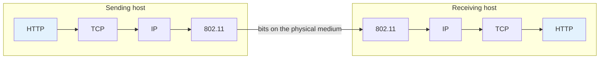

A computer network is a set of hosts connected by links and routers, over which applications exchange messages according to protocols organized in layers.

The later networking notes, beginning with [[systems/networks/0-foundation/2-physical-layer|the physical layer]], use the terms and the layering model defined in the following sections.

## Parts of a network

**Application** (app, user). The program that uses the network to communicate with other machines. Browsers and email clients are applications.

**Host** (end system, edge device, node). The computer the application runs on. Desktops, laptops, and phones are hosts.

**Router** (switch, node, hub). A device that relays messages between links and connects networks together. A home access point and a cable modem both do this job.

**Link** (channel). A connection between nodes, such as an Ethernet cable, a fiber strand, or a wireless channel.

### Types of links

- **Full-duplex**: both ends can send and receive at the same time, so the link is bidirectional. Ethernet is full-duplex.
- **Half-duplex**: bidirectional, but only one end can send at a time. WiFi is half-duplex.
- **Simplex**: data flows in one direction only, from a single sender. Broadcast radio works this way.

### Wireless links

Wireless messages are **broadcast**. Every node in range receives them, whether or not it is the intended destination. Graph diagrams of wireless networks conventionally show only the logical links, since a drawing of every possible link would obscure the diagram.

## Network names by scale

| Name | Reach | Examples |
|------|-------|----------|
| Personal Area Network (PAN) | one person's vicinity | Bluetooth, USB, FireWire |
| Local Area Network (LAN) | one building | Ethernet, WiFi |
| Metropolitan Area Network (MAN) | one city | cable TV, DSL |
| Wide Area Network (WAN) | a country or region | a large ISP, 3G/4G |
| Internet | global | the Internet |

A set of interconnected networks is an **internetwork**, or **internet**. The Internet with a capital I is the global internet.

### Switched networks

**Switched networks** forward messages node to node until they reach their destination. The two principal kinds are **circuit-switched** networks (telephony) and **packet-switched** networks (most computer networks).

```txt
    +-- (Host)      --+
    |                 |
(Link)                |
    |                 |  logical
    +-- (Host)        |    link
    |                 |
(Link)                |
    |                 |
    +-- (Host)      --+
```

A packet-switched network sends data in discrete chunks called **packets**. It typically uses **store-and-forward** switching, where each node receives the whole packet into memory before forwarding it to the next node. A circuit-switched network instead maintains a dedicated connection and sends a continuous stream over it.

Networks use an **address** to identify the destination of a packet. A packet can go to one node (**unicast**), to all nodes (**broadcast**), or to a chosen subset (**multicast**).

## Network boundaries

```txt
(Router) --- (Host) --- client
   |
(Link)
   |
(Router) --- (Host) --- server
```

The network comprises everything below the application. Some treatments exclude the hosts; CSE 461, the course from which this material comes, includes them.

When its internals are irrelevant, the middle of the network can be drawn as a generic cloud:

```txt
   +-- (Host) --- client
   |
(Cloud)
   |
   +-- (Host) --- server
```

## Key interfaces

The network is modular. Well-defined interfaces separate applications from the network and the network components from each other. **Protocols** and **layering** provide that modularity.

- Each instance of a protocol communicates with its peer using the same protocol.
- Each instance of a protocol uses only the services of the layer below it.

In the conventional diagram, a protocol connects peers horizontally, and layers are stacked vertically.

```txt
#define protocols X, Y,
#where Y is a layer below X

   (comm using X)
X <---------------> X  <- (peers)
^                   ^
| <- (Y service) -> |
|                   |
Y <---------------> Y  <- (peers)
    (comm using Y)
```

Examples of protocols: TCP, UDP, HTTP, FTP, SMTP, POP3, IMAP, DNS, DHCP, ARP, ICMP, IP, Ethernet, WiFi, Bluetooth, USB, DSL.

A browser fetching a page over WiFi runs this stack:

```txt
 (browser)
    ||
+--------+
| HTTP   |
+--------+
| TCP    |
+--------+
| IP     |
+--------+
| 802.11 |
+--------+
    ||
    ++==>
```

### Encapsulation

Layering is implemented by encapsulation. Each lower protocol wraps the higher protocol's data in its own format with additional information, much as a letter is placed in an envelope before it is mailed.

For the stack above, the message is built up as it descends:

```txt
                    +------+
                    | HTTP |
                    +------+
              +-----+------+
              | TCP | HTTP |
              +-----+------+
         +----+-----+------+
         | IP | TCP | HTTP |
         +----+-----+------+
+--------+----+-----+------+
| 802.11 | IP | TCP | HTTP |
+--------+----+-----+------+
```

The sender builds these layers up until the data is ready for the physical medium. The receiver peels them back until it reaches the application layer. Real traffic is more complex than the diagram. Protocols add trailers as well as headers, content is encrypted or compressed, and messages are segmented and reassembled along the way.

The full round trip runs down the sending host's stack, across the physical medium, and back up the receiver's:



Each layer on the way down adds its header, and each layer on the way up strips the matching header and hands the payload to the protocol its demultiplexing key names.

### Demultiplexing

A received message must be handed to exactly the protocols that should process it. **Demultiplexing keys** in each header make this possible. The IP protocol field and the TCP port number are demultiplexing keys.

### Advantages of layering

- **Modularity**: a layer can change without affecting the others, as long as its interface stays the same.
- **Abstraction**: each layer is a black box, so systems with different internals can interoperate.
- **Standardization**: each layer can be standardized and implemented by many vendors.

Layering is visible in ordinary traffic. When a home router forwards a request from WiFi to a wired uplink, it strips the WiFi header and adds an Ethernet header, and no layer above the link layer is affected.

### Disadvantages of layering

- **Overhead**: every layer adds header bytes. The relative overhead is largest for small messages, since the headers are large relative to the payload.
- **Hidden information**: each layer hides detail from the layer above. That complicates debugging, and it prevents one layer from using information held by another, for example an application that requires the network latency, or a network that requires application priorities for QoS.

## OSI layers

The OSI model splits the stack into seven layers.

- **Application**: services for end-user programs. HTTP, FTP, SMTP, POP3, IMAP, DNS, DHCP.
- **Presentation**: formats data for the application layer, including encryption and compression. JPEG, MPEG, ASCII.
- **Session**: manages the connection between two nodes. NetBIOS, PPTP.
- **Transport**: transport protocol and error handling. TCP, UDP.
- **Network**: routing and addressing, reads the IP address of a packet. Routers and layer 3 switches operate at this layer.
- **Data link**: physical addressing, reads the MAC address of a frame. Switches and bridges operate at this layer.
- **Physical**: moves bits over a physical medium. Hubs, NICs, cables.

## The Internet protocol stack

The Internet collapses OSI's top three layers into one.

```txt
+-------------+---------------+
| Application | SMTP, HTTP,   |
|             | RTP, DNS      |
+-------------+---------------+
| Transport   | TCP, UDP      |
+-------------+---------------+
| Internet    | IP            |
+-------------+---------------+
| Link        | Ethernet, DSL,|
|             | 3G/4G, WiFi   |
+-------------+---------------+
```

## Course reference model

- **Application**: programs that use network services
- **Transport**: end-to-end data delivery
- **Network**: data delivery across multiple networks
- **Link**: sends frames over one or more links
- **Physical**: sends bits using physical signals

## Related notes

- [[systems/networks/0-foundation/2-physical-layer|the physical layer]]
- [[systems/networks/0-foundation/3-performance|performance]]
