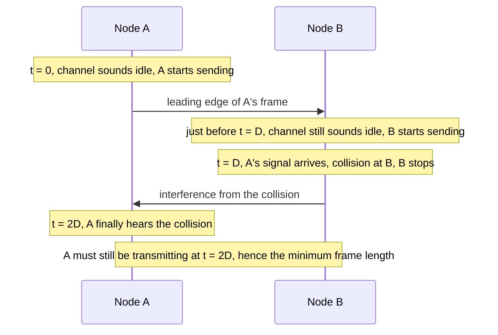

A multiple-access protocol determines how several senders share a single transmission channel. Access may follow a fixed allocation of time or frequency (TDM, FDM), a schedule set by a central controller, or a distributed random-access rule (ALOHA, CSMA) under which senders transmit independently and recover from collisions.

Classic Ethernet combined carrier sensing, collision detection and binary exponential backoff into one such rule.

## Multiplexing

**Multiplexing** shares one resource among multiple clients. Network traffic is bursty, so the shared capacity can be much smaller than the sum of the peaks. Two users who each send bursts at 1 Mbps can share a 1.5 Mbps link with little contention.

### Time division multiplexing (TDM)

Users take turns on a fixed schedule, often round-robin. Each user sends at a high rate for a short time.

### Frequency division multiplexing (FDM)

Users are assigned different frequency bands and transmit simultaneously with minimal interference. Each user sends continuously at a low rate.

### TDM vs. FDM

For a fixed set of users, TDM suits bursty traffic and FDM suits constant traffic. TV and radio use FDM. GSM (2G cellular) uses TDM inside FDM.

## Controlling access

A fixed schedule must be set by some party. There are two classes of access control, centralized and distributed.

### Centralized

A privileged scheduler allocates the resource. Overhead is low and the scheduler can enforce policy like QoS, but it is a single point of failure and a bottleneck at scale. Cellular networks work this way, with the base station scheduling access to the channel.

### Distributed

The participants coordinate access among themselves. Distributed access performs well under low load, requires little setup, and tolerates faults, but it is difficult to scale. WiFi and Ethernet work this way.

## Random access protocols

Random access protocols assume no central controller and accept that collisions occur.

In **ALOHA**, a node sends whenever it has a frame. If a collision occurs (no ACK arrives), the node waits a random time and retries. ALOHA is simple and wastes capacity under load. The classic analysis puts pure ALOHA's peak utilization at about 18% of capacity, and slotting time (senders start only on slot boundaries) doubles that to about 36%.

### Carrier sense multiple access (CSMA)

A CSMA sender listens to the channel before sending and waits if it is busy. Carrier sensing works reliably only on wired links (see [[systems/networks/2-direct-links/wireless|wireless]] for why it fails over the air). CSMA achieves higher utilization than ALOHA, but collisions still occur because a competing transmission becomes audible only after a propagation delay. CSMA is therefore effective only when the bandwidth-delay product is small, so that the vulnerable window is short.

#### CSMA/CD (collision detection)

Classic Ethernet adds collision detection. A sender that detects a collision stops immediately and retries after a random wait. Every node involved in the collision must be able to detect it.

A collision can take up to $2 \cdot D_{\text{propagation}}$ to detect (the signal crosses the wire, collides at the far end, and the interference crosses back). If a sender could finish its frame before that window closes, it would not detect the collision. So the standard imposes a minimum frame length that takes at least $2 \cdot D_{\text{propagation}}$ to transmit, plus a maximum network length. These constraints account for Ethernet's 64-byte minimum frame, a 500 m limit for coaxial Ethernet, and a 100 m limit for twisted pair.

The worst case, with D standing for the one-way propagation delay:



#### CSMA persistence

Sending immediately once the channel becomes free leads to repeated collisions, because every queued sender does the same and all of them collide as soon as the channel clears. The design goal is instead that with $N$ queued senders, each sends with probability about $1/N$.

### Binary exponential backoff

Ethernet approximates that probability, with $N$ unknown, by widening the retry window after each collision. Given a base time quantum $q$, after collision $i$ the sender waits

$$t_i = q \cdot \text{rand}(0, 2^i - 1)$$

```python
Q = 1 # seconds
def send(frame):
    t = 1
    while not send_frame(frame):
        time.sleep(Q * randint(0, t))
        t *= 2
```

The expected wait after the $k$-th collision follows. $W_k$ is uniform over $\{0, q, 2q, \dots, (2^k - 1)q\}$, and the mean of a uniform distribution over $0$ to $M$ is $M/2$, so

$$E[W_k] = \frac{q(2^k - 1)}{2}$$

Each collision approximately doubles the expected wait, which reduces the rate at which contending senders retry.

## Ethernet

Classic Ethernet (IEEE 802.3) ran at 10 Mbps over shared coaxial cable and was widely deployed in the 1980s and 1990s. Its multiple access scheme is 1-persistent CSMA/CD with binary exponential backoff. Modern Ethernet is built on [[systems/networks/2-direct-links/switching|switches]], which give each host a point-to-point link and remove the need for CSMA/CD.

### Ethernet frames

- Source and destination addresses identify sender and receiver.
- A CRC-32 checksum detects errors. There is no ACK or retransmission.
- A physical-layer preamble marks the start of the frame.

```plaintext
+----------------+
| Preamble (8B)  |
|                |
+----------------+
| Destination    |
| Address (6B)   |
+----------------+
| Source Address |
| (6B)           |
+----------------+
| Type (2B)      |
+----------------+
| Data (0-1500B) | --->
|                | ---> network layer (IP packet)
|      ...       | --->
+----------------+
| Padding (0-46B)|
+----------------+
| Checksum (4B)  |
+----------------+
```

## Related notes

- [[systems/networks/2-direct-links/wireless|wireless]]
- [[systems/networks/2-direct-links/switching|switching]]
- [[systems/networks/2-direct-links/framing|framing]]
