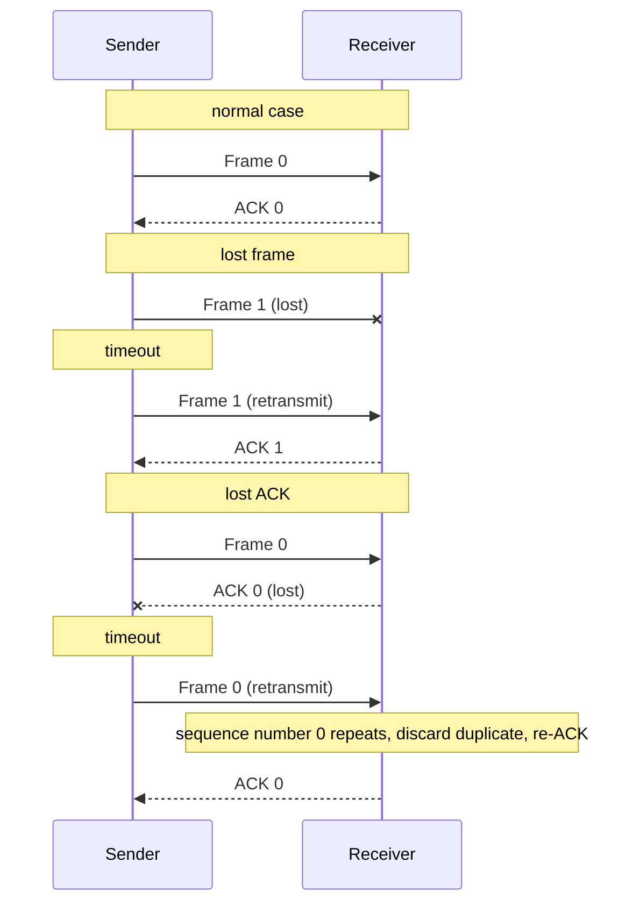
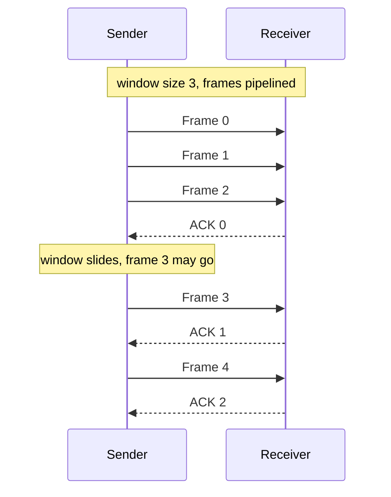

Automatic Repeat reQuest (ARQ) is a family of error-control protocols in which the receiver acknowledges frames that arrive intact and the sender retransmits frames that are not acknowledged, so that a lossy link delivers every frame.

Frames are lost or corrupted in transit, and [[systems/networks/2-direct-links/errors|error detection]] only identifies that a frame is damaged. Retransmission is the mechanism by which the link recovers from such losses.

## Automatic Repeat reQuest (ARQ)

ARQ is used when errors are frequent or must be corrected, as on wireless links. The receiver acknowledges each correctly received frame, and the sender retransmits any frame that is not acknowledged before a timeout.

- **Stop-and-wait ARQ**: send one frame, wait for its ACK, send the next.
- **Sliding window ARQ**: send up to $n$ frames before requiring an ACK. With window size $n$, the sender transmits up to $n$ frames per RTT.
- **Go-back-N ARQ**: a sliding window where a lost frame forces the sender to retransmit that frame and everything after it.

The diagram shows stop-and-wait in the normal case and in the two failure cases that every ARQ scheme must handle:



> [!warning] Duplicate frames
> A lost ACK and a lost frame are indistinguishable to the sender, which retransmits in either case. Without sequence numbers the receiver would accept the retransmission as new data. The sequence number allows the receiver to discard the duplicate and acknowledge it again.

### Timeouts

A timeout that is too long leaves the link idle after a loss, and one that is too short causes the sender to retransmit frames that arrived correctly. Timeouts are straightforward to set on a LAN, where latency is predictable, and difficult to set over the Internet, where latency varies widely.

### Sequence numbers

Frames and ACKs both carry sequence numbers so that the sender can determine which frames were received. Stop-and-wait requires only a single bit, 0 or 1, since one frame is in flight at a time. Sliding window and go-back-N number frames modulo $2^k$.

### Limitations of stop-and-wait

Only one frame is outstanding at a time, so the link carries at most one frame per RTT regardless of its rate. This is adequate on a LAN and wasteful on any link with a high [[systems/networks/1-physical/coding-and-modulation|bandwidth-delay product]], where full utilization requires many frames in flight.

Sliding window addresses this by pipelining. New frames are sent as ACKs return, so the window remains full:



## Pseudocode sketches

These are illustrative sketches; real implementations track timers and sequence numbers per frame.

```python
# Stop and Wait ARQ
def sender():
    while True:
        frame = create_frame()
        send_frame(frame)

        ack_received = wait_for_ack()

        if ack_received:
            break

def receiver():
    while True:
        frame = receive_frame()
        process_frame(frame)

        send_ack()
```

```python
# Sliding Window ARQ
def sender():
    window_size = 3
    frames = [create_frame() for _ in range(window_size)]
    send_frames(frames)

    acknowledged_frames = wait_for_acknowledgment()

    # Move window forward
    frames = frames[len(acknowledged_frames):] + [create_frame()]
    send_frames(frames)

def receiver():
    while True:
        frames = receive_frames()
        process_frames(frames)

        send_acknowledgment()
```

```python
# Go-Back-N ARQ
def sender():
    window_size = 3
    frames = [create_frame() for _ in range(window_size)]
    send_frames(frames)

    while True:
        acknowledged_frames = wait_for_acknowledgment()

        if not acknowledged_frames:
            resend_frames(frames)

def receiver():
    expected_frame = 0

    while True:
        frames = receive_frames()

        for frame in frames:
            if frame.sequence_number == expected_frame:
                process_frame(frame)
                expected_frame += 1

        send_acknowledgment()
```

## Related notes

- [[systems/networks/2-direct-links/errors|error detection]]
- [[systems/networks/2-direct-links/framing|framing]]
