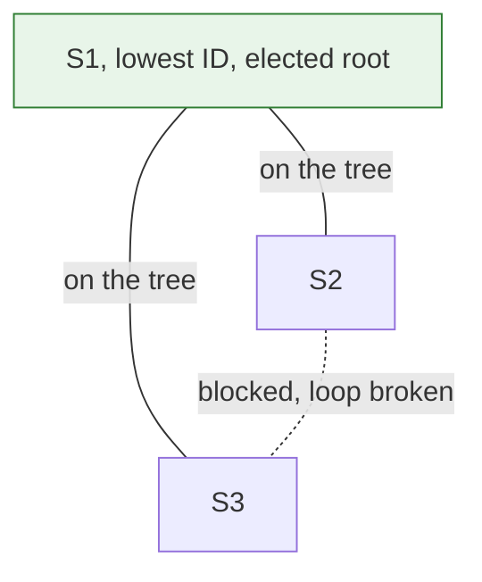

An Ethernet switch is a link-layer (L2) device that forwards each frame from the port on which it arrives to the port associated with the frame's destination MAC address.

Modern Ethernet is switched. Each host has a point-to-point link to a switch, in place of a shared cable on which hosts arbitrate access with [[systems/networks/2-direct-links/multiple-access|CSMA/CD]].

## Learning switches

**L2 switches** connect devices inside enterprise and university networks. Historically a switch acted as a *bridge* joining multiple Ethernet segments. Today switches typically connect hosts point-to-point.

A **learning switch** builds its forwarding table from traffic. When a frame arrives, the switch records the source MAC address and the arrival port. When it needs to forward a frame, it looks up the destination MAC address in the table and sends the frame out the recorded port. If the destination is not in the table, it floods the frame out every port except the one it arrived on. Flooding always delivers the frame, at the cost of bandwidth on every other port, so the table is an optimization that the switch can rebuild at any time.

The following table-update code is adapted from [Peterson and Davie](https://book.systemsapproach.org/):

```c
#define BRIDGE_TAB_SIZE   1024  /* max size of bridging table */
#define MAX_TTL           120   /* time (in seconds) before an entry is flushed */

typedef struct {
    MacAddr     destination;    /* MAC address of a node */
    int         ifnumber;       /* interface to reach it */
    u_short     TTL;            /* time to live */
    Binding     binding;        /* binding in the Map */
} BridgeEntry;

int     numEntries = 0;
Map     bridgeMap = mapCreate(BRIDGE_TAB_SIZE, sizeof(BridgeEntry));

void
updateTable (MacAddr src, int inif)
{
    BridgeEntry       *b;

    if (mapResolve(bridgeMap, &src, (void **)&b) == FALSE )
    {
        /* this address is not in the table, so try to add it */
        if (numEntries < BRIDGE_TAB_SIZE)
        {
            b = NEW(BridgeEntry);
            b->binding = mapBind( bridgeMap, &src, b);
            /* use source address of packet as dest. address in table */
            b->destination = src;
            numEntries++;
        }
        else
        {
            /* can't fit this address in the table now, so give up */
            return;
        }
    }
    /* reset TTL and use most recent input interface */
    b->TTL = MAX_TTL;
    b->ifnumber = inif;
}
```

## Distributed spanning tree algorithm

Flooding fails in a topology with loops, because flooded frames circulate indefinitely. The switches therefore agree on a spanning tree of the topology and forward only along it. The algorithm is Radia Perlman's, and it runs without any central coordination.

Initially every switch assumes it is the root. Switches broadcast **configuration messages** containing:

- the ID of the sender
- the ID of what the sender believes is the root
- the sender's distance (in hops) from that root

Each switch records the best configuration it has received, compared in this order:

- lowest root ID
- equal root IDs, lower distance
- equal root IDs and distances, lower sender ID

When a switch adopts a better root, it adds one to the advertised distance and rebroadcasts. A switch that determines it is not the root stops originating configuration messages and only forwards the root's (still adding 1 to the distance). A switch that hears a better path over a port stops sending messages out that port. When the system stabilizes, only the root originates configuration messages, and every other switch only forwards them along the tree.

On the smallest topology with a loop, a triangle of switches, the algorithm elects the switch with the lowest ID as root and blocks one link to break the cycle:



Frames between S2 and S3 are then forwarded through the root, which is the cost of a loop-free topology. The blocked port continues to receive configuration messages, so if a tree link fails the algorithm reconverges and reopens it.

```c
// Pseudocode for the distributed spanning tree algorithm

#define MAX_BRIDGES 1024

struct bridge {
    macaddr     root;       // ID of the root
    int     distance;       // distance to the root
    int     port;           // port to reach the root
    int     TTL;            // time to live
};

struct message {
    macaddr root;           // ID of the root (mac address)
    int     distance;       // distance to the root
    macaddr     sender;     // ID of the sender (mac address)
};

struct bridge bridges[MAX_BRIDGES];
struct message state;

void
update(struct message* m, int port)
{
    if (m->root < state.root || (m->root == state.root && m->distance < state.distance))
    {
        state.root = m->root;
        state.distance = m->distance + 1;
        state.sender = m->sender;
        state.port = port;
    }
    else if (m->root == state.root && m->distance == state.distance && m->sender < state.sender)
    {
        state.sender = m->sender;
        state.port = port;
    }
}

void
broadcast(struct message* m)
{
    for (int i = 0; i < MAX_BRIDGES; i++)
        if (i != state.port)
            send(i, m);
}
```

## Implementation

A switch can be as simple as a general-purpose processor with multiple network interfaces. High-end switches add hardware acceleration and are called hardware switches, though every switch combines hardware and software. Switches and routers share enough implementation that a network administrator can buy one forwarding device and configure it as an L2 switch, an L3 router, or both. Peterson and Davie treat switch implementation in detail in [their chapter on switching](https://book.systemsapproach.org/).

### Software switches

A software switch is limited by the cost of passing every packet through main memory, which matters most for short packets. Per-packet processing costs such as header parsing also accumulate, and the table lookup is typically the most expensive per-packet operation. Control logic such as the spanning tree algorithm runs outside the per-packet path.

### Bare-metal switches

The split between the **control plane** (background processing) and the **data plane** (per-packet processing) is the organizing principle of modern switch design. Domain-specific processors now deliver ASIC-level forwarding performance with software-level programmability, so one box can be programmed as an L2 switch, an L3 router, or a hybrid.

Bare-metal switches built on Network Processing Units (NPUs) are a common form. An NPU is optimized for parsing packet headers and making forwarding decisions, at rates measured in Tbps. Internally it combines fast SRAM, TCAM for bit-pattern matching, and a multi-stage forwarding pipeline that keeps many packets in flight at once. Programming details vary by chip vendor.

### Software defined networking

SDN decouples the control plane from the data plane. Routing algorithms run as software on servers, and the forwarding decisions they compute are installed in bare-metal switches. OpenFlow standardized the interface between the two planes, so controllers and switches from different vendors interoperate.

Splitting the planes also means a logically centralized control plane can drive a distributed data plane, and each side can scale independently. Cloud providers run SDN inside their datacenters and across their backbones for this reason. The Network Operating System (NOS) makes the model practical. It detects network changes and exposes an abstract network map, so control applications can compute globally optimized behavior on a graph rather than programming individual devices.

## Related notes

- [[systems/networks/2-direct-links/multiple-access|multiple access]]
- [[systems/networks/2-direct-links/framing|framing]]
