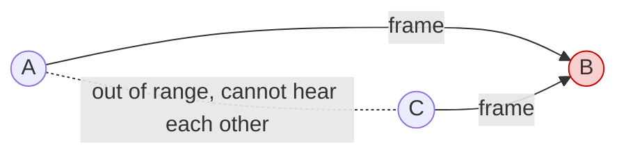
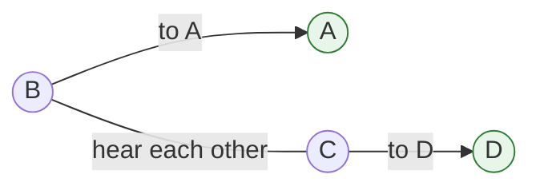
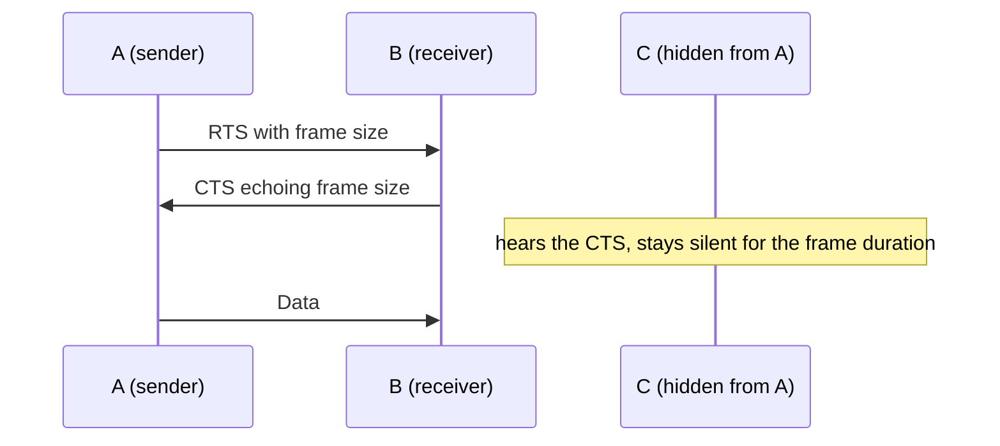

Wireless multiple access is the coordination of transmissions among nodes that share a radio channel. Wired [[systems/networks/2-direct-links/multiple-access|multiple access]] relies on carrier sense, which is unreliable over the air because a sender cannot observe the channel at the receiver.

The resulting failures are the hidden and exposed terminal problems. MACA and 802.11 address them with an RTS/CTS handshake, and cellular networks avoid them by scheduling transmissions centrally.

## Why wireless is different

The wireless medium is an unbounded region of space rather than a wire with two ends, so the signal conditions at the sender indicate little about those at the receiver. Collisions occur at the receiver, where the sender cannot observe them. In addition, a node cannot receive while it transmits, so Ethernet-style collision detection is not possible.

## Hidden terminal problem

Two nodes are out of range of each other and both in range of a third node between them. Each sender senses an idle channel, so both transmit, and their frames collide at the middle node. Carrier sense reports the channel as idle although it is busy at the receiver.

A and C each sense an idle channel, both send, and the frames collide at B.

## Exposed terminal problem

Two nearby nodes send to different receivers that are out of each other's range. Each sender detects the other and defers, even though both transmissions would have succeeded. Carrier sense here errs in the opposite direction and wastes capacity rather than causing collisions.

Both transmissions would succeed at their receivers, but B and C hear each other and defer unnecessarily.

## Multiple Access with Collision Avoidance (MACA)

MACA replaces carrier sense with a short handshake. Collisions remain possible during the handshake itself but become much less likely.

1. **Request to Send (RTS)**: the sender asks the receiver for the channel.
2. **Clear to Send (CTS)**: the receiver grants it, echoing the frame size.
3. **Data**: the sender transmits while nodes that heard the CTS stay silent for the frame's duration.

The handshake addresses both the hidden and the exposed terminal problem. A hidden terminal hears the receiver's CTS even though it cannot hear the sender, and defers. An exposed terminal hears the RTS but no CTS, which indicates that its own transmission will not interfere at that receiver.

## 802.11 (WiFi)

Clients connect to the network through an **access point (AP)**.

### Physical layer

- 20/40 MHz channels on unlicensed ISM bands. 802.11b/g/n run on 2.4 GHz, 802.11a/n on 5 GHz.
- OFDM modulation, except legacy 802.11b. Amplitude and phase choices adapt to the SNR, giving rates from 6 to 54 Mbps plus error correction.
- 802.11n adds multiple antennas.

### Link layer

- Multiple access is CSMA/CA. The RTS/CTS handshake is optional.
- Frames are ACKed and retransmitted with [[systems/networks/2-direct-links/retransmission|ARQ]].
- Frames carry three addresses because traffic is relayed through the AP.
- A 32-bit CRC detects errors.
- The standard also covers encryption and power saving.

## Centralized MAC: cellular

Cellular runs on licensed spectrum, which is scarce and heavily regulated, so control is centralized. The base station coordinates the mobiles' transmissions, which allows QoS guarantees and robustness that distributed access cannot provide.

GSM's MAC uses FDMA/TDMA with random access plus backoff for channel requests. One channel carries coordination traffic, the rest carry data, and a dedicated channel supports QoS.

## Related notes

- [[systems/networks/2-direct-links/multiple-access|multiple access]]
- [[systems/networks/1-physical/media|media]]
