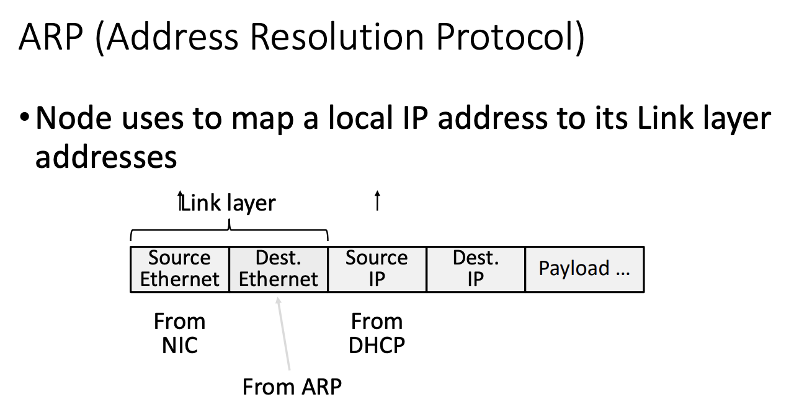
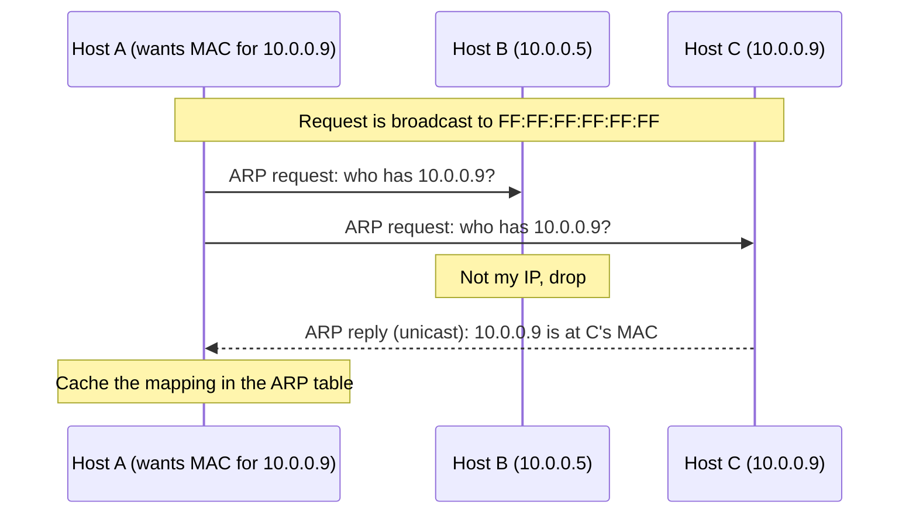

The Address Resolution Protocol (ARP, [RFC 826](https://datatracker.ietf.org/doc/html/rfc826)) maps an IP address to the MAC address of the interface on the local link that holds it, so that a host can address the link-layer frame that carries an IP packet. Hosts cache the mappings in an ARP table, which they fill by broadcasting requests and receiving unicast replies.

## Core idea

IP forwarding determines which machine on the local network should receive the packet, and ARP supplies the link-layer address the frame needs to reach it (see [[systems/networks/3-network/internetworking|internetworking]] for the forwarding side). ARP runs directly over the link layer and uses no servers or routers. It could not depend on them, since a host needs ARP before it can communicate with anything by IP.

ARP is one example of a discovery protocol, meaning a protocol for finding devices on a network. Zeroconf and Apple's Bonjour are others. Discovery protocols typically rely on broadcast, because broadcast is the only means of reaching a device whose address is not yet known.

The figure shows the origin of each field of an outgoing frame. The NIC provides the source MAC, ARP provides the destination MAC, and [[systems/networks/3-network/DHCP|DHCP]] assigned the host's own IP address.



## ARP table

Each host caches the mappings it has learned in an ARP table held in memory. The table can be inspected with:

```bash
arp -a
```

## ARP request

When a device has a packet for another device on the same network, it first checks its ARP table for the destination IP. On a miss, it broadcasts an ARP request to the MAC address `FF:FF:FF:FF:FF:FF`, asking who owns the destination IP.

## ARP reply

The request reaches every node on the link, but only some nodes act on it. The node that owns the requested IP sends back an ARP reply carrying its MAC address. Nodes that already have an entry for the sender can use the request to refresh that entry. All other nodes drop the request.

In the full exchange the request is broadcast to the link and the reply is unicast back:



## Related notes

- [[systems/networks/3-network/internetworking|internetworking]]
- [[systems/networks/3-network/DHCP|DHCP]]
