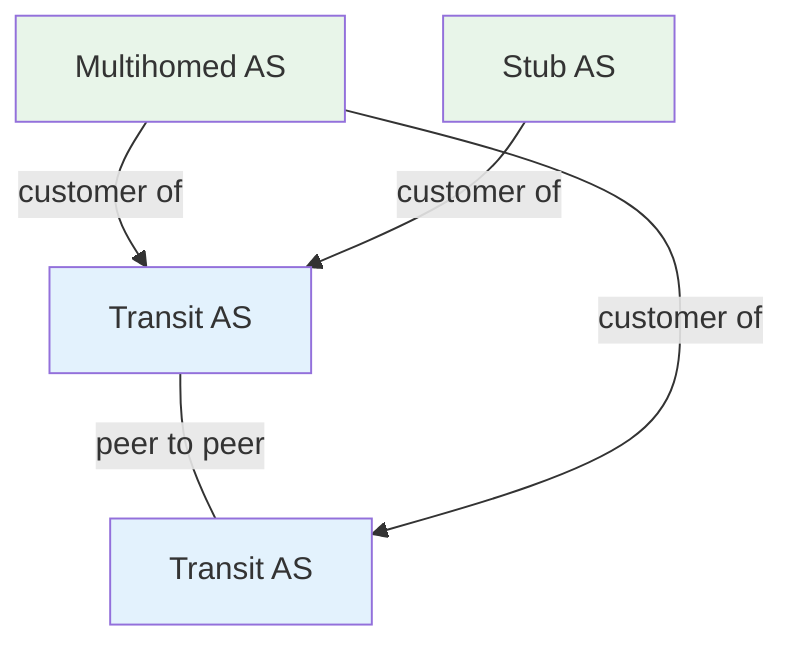

The Border Gateway Protocol (BGP, [RFC 4271](https://datatracker.ietf.org/doc/html/rfc4271)) is the inter-domain routing protocol of the internet. It exchanges reachability information between autonomous systems as paths of ASes, and each AS selects and exports routes according to its own policy rather than by minimizing a link cost.

In practice an AS's policy follows its business relationships with its neighbors, each of which is a customer, a provider or a peer.

## Core idea

The internet can be viewed as a graph of interconnected Autonomous Systems (ASes). Each AS is administered independently and handles routing within itself. The routers inside an AS connect to each other over high-speed links and reach other ASes through border routers. See [[systems/networks/3-network/global-internet|the global Internet]] for why the internet is organized this way.

From the perspective of an AS, traffic is of two kinds. Transit traffic passes through the AS on its way somewhere else. Local traffic is destined for a device inside the AS. The distinction yields three types of AS:

- **Stub AS**: has one connection to another AS and carries no transit traffic.
- **Multihomed AS**: connects to more than one other AS but does not carry transit traffic.
- **Transit AS**: connects to more than one other AS and carries both local and transit traffic.

Intra-domain protocols such as OSPF and RIP optimize a cost metric. BGP has no cost metric to optimize, since cost is not well defined across independently run ASes. It advertises reachability and lets each AS choose among reachable paths according to its own policies.

## Mechanism

Each AS has one or more border routers that handle ingress and egress traffic. It also has at least one BGP speaker that exchanges routing information with other ASes. Border routers and BGP speakers are often the same device, but they need not be.

BGP is a path vector protocol. An advertisement carries the entire path to a destination as a sequence of ASes rather than a single next hop. An AS that finds itself in an advertised path rejects it, since accepting it would form a loop, and the full path gives each AS enough information to apply policy to the whole route a packet would take.

A BGP speaker is never obligated to advertise a given path. When it does advertise, it advertises the path that ranks highest under its own policies. It can retract an earlier advertisement with a withdraw route message.

BGP runs over TCP and uses keep-alives. If a speaker receives no keep-alives from a neighbor within the configured window, it declares the neighbor down and stops advertising the routes it learned from that neighbor.

## Relationships between ASes

An AS pairs with its neighbors in one of two arrangements, and the arrangement determines which routes are advertised:

- **Provider and customer**: the customer pays the provider to carry its traffic. The provider advertises all routes it has learned to the customer, and advertises the customer's routes to everyone, since it is paid to carry traffic to the customer.
- **Customer toward its provider**: the customer advertises its own prefixes and any routes learned from its own customers. It advertises routes learned from the provider down to its customers. It never advertises routes learned from one provider to another provider, because it would then carry transit traffic without payment.
- **Peer and peer**: two ASes exchange traffic between their respective customers without money changing hands. Each peer advertises customer routes to the other and advertises the peer's routes to its own customers. Routes learned from a peer are never advertised to a provider or to another peer.

## Route selection

> [!tip] Economic basis of the rules
> The selection and export rules follow from the economics of the relationships. Customer paths earn revenue, peer paths carry no charge, and provider paths cost money, so an AS prefers customer over peer over provider routes, and it advertises a route only when carrying the resulting traffic earns revenue or costs nothing.

When an AS has several paths to the same destination, it prefers a path through a customer over a path through a peer, and a path through a peer over a path through a provider. Customer paths earn money, peer paths carry no charge, and provider paths cost money. Among paths of the same class it selects the one with the fewest AS hops.

The same economics explain the export rules. Customer paths are advertised to customers, peers, and providers, since more traffic toward a customer means more revenue. Peer paths and provider paths are advertised only to customers, because traffic from a peer or another provider over them earns nothing and can cost money.

## Related notes

- [[systems/networks/3-network/routing|routing]]
- [[systems/networks/3-network/global-internet|the global Internet]]
