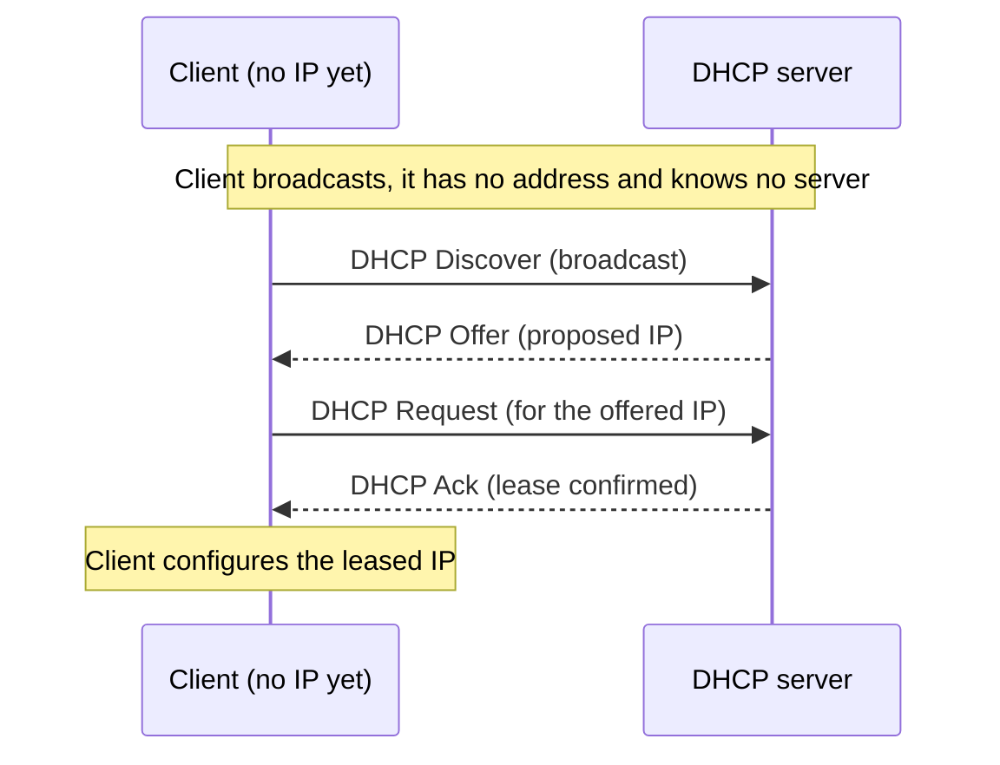

The Dynamic Host Configuration Protocol (DHCP, [RFC 2131](https://datatracker.ietf.org/doc/html/rfc2131)) assigns IP addresses to devices that join a network, so that a host obtains an address without manual configuration. A server leases addresses from a pool, clients request and renew leases, and relays forward requests to servers on other networks.

## Core idea

A MAC address is burned into the device. An IP address is assigned, and the assignment can move to a different device over time. This allows networks to renumber and reuse addresses, and DHCP manages the assignments.

DHCP runs on top of UDP, with the server on port 67 and the client on port 68. It must operate before the client has an address, which is why the exchange begins with a broadcast.

## DHCP server

The DHCP server assigns IP addresses on the network. It is typically a router or a server, and it manages a pool of addresses. A device joining the network performs the following exchange:

1. The device broadcasts a **DHCP Discover** to the all-ones address, since it does not yet have the server's address or its own.
2. The server answers with a **DHCP Offer** containing an IP address available for assignment.
3. The device sends a **DHCP Request** for that address.
4. The server confirms with a **DHCP Ack**.

A network can run more than one DHCP server for fault tolerance. If one server fails, a client can get an address from another.

## DHCP client

DHCP clients are built into most devices that connect to a network. Assignments are leases, and a client renews by sending a **DHCP Request** to the server, which confirms the renewal with a **DHCP Ack**.

## DHCP relay

Some networks have no DHCP server of their own. A **DHCP relay** on the local network listens for **DHCP Discover** broadcasts and forwards them to a server on another network. The server's **DHCP Offer** comes back through the relay to the client.

## Related notes

- [[systems/networks/3-network/ARP|ARP]]
- [[systems/networks/3-network/internetworking|internetworking]]
