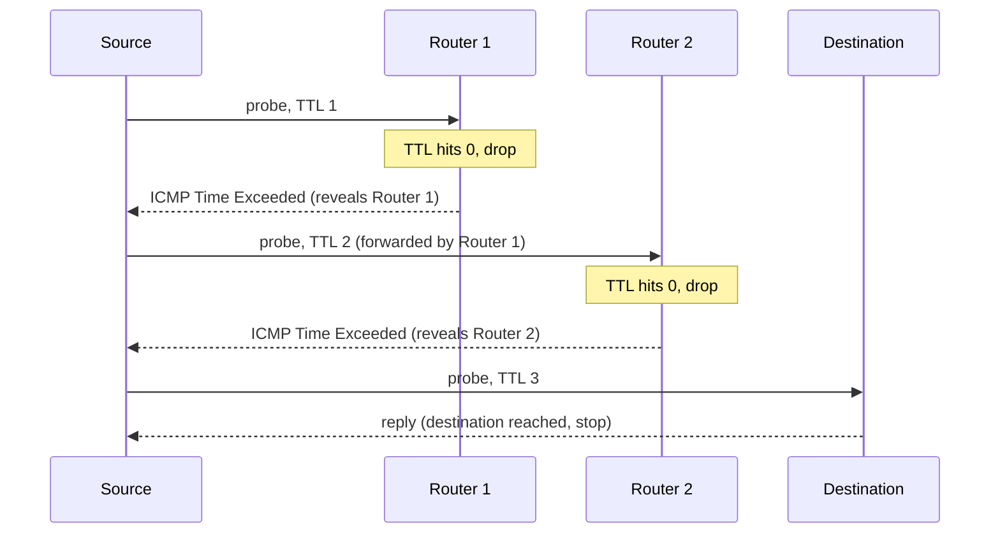

The Internet Control Message Protocol (ICMP, [RFC 792](https://datatracker.ietf.org/doc/html/rfc792)) is a network-layer protocol for reporting errors and exchanging control messages. IP itself provides no feedback when a packet is dropped in the network, so ICMP carries error reports and control messages back to the sender. The diagnostic tools `ping` and `traceroute` are built on ICMP messages.

## Core idea

When a router drops a datagram or a TTL expires (see [[systems/networks/3-network/internetworking|internetworking]] for the TTL field in the IP header), an ICMP message informs the source of the event.

The **ICMP Redirect** control message informs a host that a better route exists for a given destination. A host that receives one updates its routing table to use the new route.

## Traceroute

`traceroute` sends packets with increasing TTLs and listens for ICMP Time Exceeded messages. Each router along the path decrements the TTL, and the router at which it reaches 0 sends a Time Exceeded message back to the source. That message carries the router's IP address as its source, so a packet with TTL $n$ identifies the $n$-th router on the path. `traceroute` records the round-trip time to each router itself, prints the router's address and the timing, and continues to increase the TTL until packets reach the destination.

## Ping

`ping` sends ICMP Echo Request messages to the destination and listens for ICMP Echo Reply messages. A host that receives an Echo Request answers with an Echo Reply, which gives the sender a connectivity check and a round-trip time. `ping` repeats until the user stops the command.

## Related notes

- [[systems/networks/3-network/internetworking|internetworking]]
- [[systems/networks/3-network/routing|routing]]
