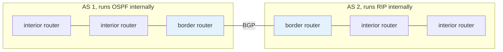

Routing in the global internet is hierarchical. The internet is divided into autonomous systems, each of which routes traffic internally with a protocol of its own choosing, and the autonomous systems exchange reachability information with an inter-domain routing protocol.

Intra-domain protocols such as RIP and OSPF require every router to hold a route to every network it can reach, and no router can hold a complete list of all the networks in the internet. The hierarchy limits the routing state that each router must hold.

## Structure of the internet

The modern internet is mainly composed of end-user sites and service providers. An end-user site is a collection of devices reaching the internet through a single IP address (NAT in home networks) or through switched ethernet in an enterprise LAN. Service providers build the infrastructure and route traffic between end-user sites. A provider runs many high-performance routers in metro areas, connected to each other and to other providers over high-speed links.

## Routing areas

OSPF already divides a network into areas to shrink routing tables (see [[systems/networks/3-network/routing|routing]]). The global internet applies the same principle at a much larger scale. It is divided into routing domains called **Autonomous Systems** (ASes). An AS is a collection of routers and networks under the control of a single organization. Each AS chooses its own routing protocol and handles routing within itself. Routers inside an AS connect to each other over high-speed links and reach other ASes through border routers.

## Inter-domain routing

Routing between ASes is a separate problem from routing within one, because ASes are independently managed and do not share a cost metric. The interior routers handle traffic within the AS, the border routers handle traffic between ASes, and the protocol the border routers speak is [[systems/networks/3-network/BGP|BGP]].

Each AS chooses its own interior protocol and metric, and the ASes need to agree only on BGP between their border routers.

## Related notes

- [[systems/networks/3-network/BGP|BGP]]
- [[systems/networks/3-network/routing|routing]]
