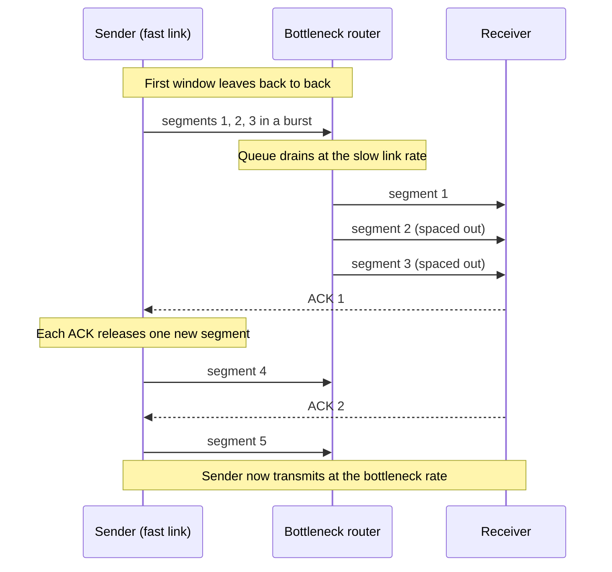

The ACK clock is the mechanism by which a sliding window sender comes to transmit at the rate of the slowest link on its path, because each returning acknowledgment permits one new segment to enter the network.

The ACK clock matches the sender to the path and does not address a receiver whose application consumes data more slowly than the network delivers it.

## Core idea

Each in-order ACK advances the [[algorithms/patterns/sliding-window|sliding window]] and lets one new segment enter the network. New data is sent exactly as fast as ACKs return, and ACKs return at the rate at which the bottleneck link delivers data, so the network itself sets the sender's timing.

## Intuition

Suppose the sender is attached to a fast link and the path crosses a slow link downstream. The first burst of segments arrives at the slow link faster than it can forward them, so they queue there and leave spaced out in time. The receiver generates ACKs with that same spacing, and the spacing is preserved on the return path because ACKs are small. When those ACKs arrive, the sender releases new segments one per ACK, already spread out to match the bottleneck rate. The bottleneck spreads out the first burst once, and the ACK clock preserves that spacing at the sender for the rest of the transfer.

The ACK clock keeps queues at the slow link small, which keeps loss and queueing delay low. TCP depends on this behavior. The window bounds the number of segments in the network at once, and the ACK clock prevents later segments from arriving in bursts that would refill the queue.

## Problem at the receiver

The ACK clock matches the sender to the network path. It carries no information about whether the receiving application consumes the data. Consider a receiver with $w$ buffers. The application is expected to call `recv` to drain them, but nothing requires it to. If it stops, the buffers fill with segments the network delivered successfully, and every subsequent segment is dropped at the receiver. The sender then retransmits data that was never lost in the network.

Addressing this requires an explicit mechanism by which the receiver informs the sender of the remaining buffer space. TCP does this with the receive window, covered in [[systems/networks/4-transport/flow-control|flow control]].

## Related notes

- [[systems/networks/4-transport/flow-control|flow control]]
- [[systems/networks/4-transport/TCP|TCP]]
- [[algorithms/patterns/sliding-window|Sliding Window Pattern]]
