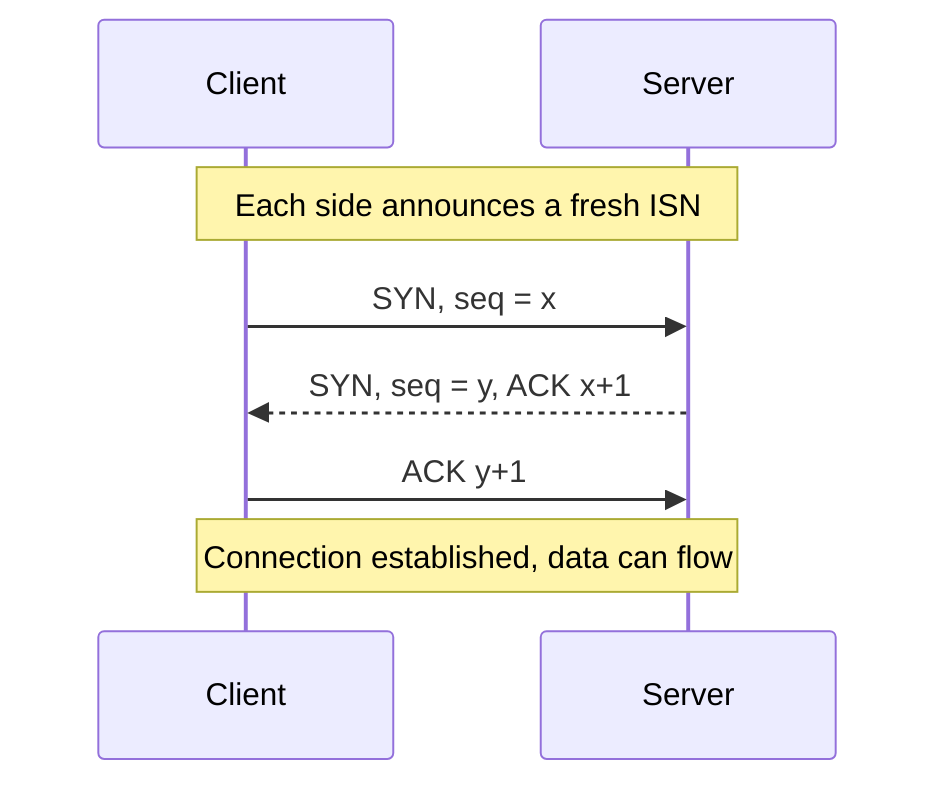
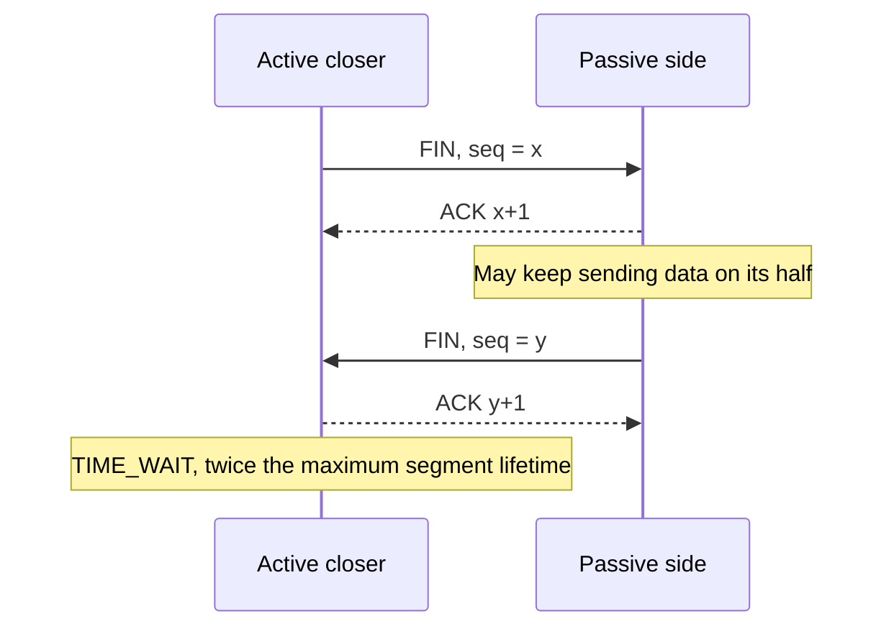
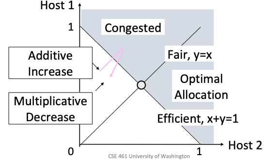
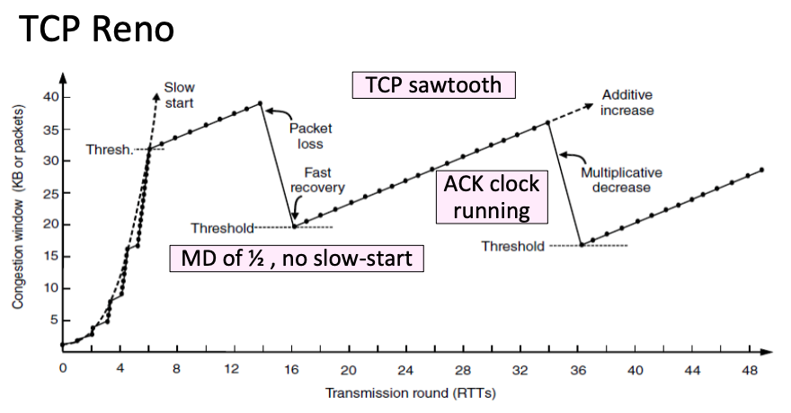
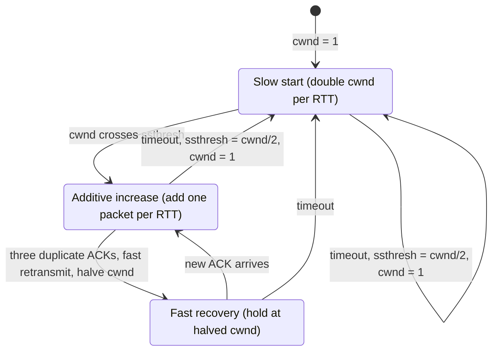

The Transmission Control Protocol (TCP), specified in [RFC 9293](https://datatracker.ietf.org/doc/html/rfc9293), is the connection-oriented transport protocol of the internet. It sets up and releases connections explicitly, retransmits lost segments under an adaptive timeout, and limits each sender's rate through congestion control.

## Connection establishment

Both sides must be ready to transfer data and must agree on parameters like the maximum segment size before any data flows.

### Three-way handshake

Each side chooses a fresh Initial Sequence Number (ISN). A side announces its ISN in a SYNchronize segment, and the peer acknowledges it in an ACKnowledge segment.

1. Client sends SYN(x)
2. Server replies with SYN(y)ACK(x+1)
3. Client replies with ACK(y+1)

Lost SYNs are retransmitted. The fresh ISNs make the handshake robust against stale segments from earlier connections, at the cost of one extra round trip before data can flow.

### Connection release

TCP closes in two halves. Each side finishes sending its data and sends a FIN segment, and each FIN closes one direction of the connection.

1. The active closer sends FIN(x), the passive side ACKs
2. The passive side sends FIN(y), the active side ACKs

Lost FINs are retransmitted, as SYNs are.

### TIME_WAIT state

After the final exchange, the active closer waits twice the maximum segment lifetime before fully closing. The final ACK may have been lost, in which case the peer retransmits its FIN and the active closer must still be present to acknowledge it. The wait also prevents old segments from this connection from being misinterpreted as part of a new connection on the same port pair.

## Retransmission timeout

Choosing the timeout is difficult because RTT varies widely with queueing and routing. A timeout that is too small causes retransmission of segments that were only delayed, and one that is too large leaves the sender idle after an actual loss.

TCP uses an adaptive timeout that tracks a smoothed RTT estimate and its variance with exponentially weighted moving averages:

$$SRTT_{N+1} = (1 - \alpha) \cdot SRTT_N + \alpha \cdot RTT_{N+1}$$

$$Svar_{N+1} = (1 - \beta) \cdot Svar_N + \beta \cdot |RTT_{N+1} - SRTT_{N+1}|$$

The timeout is the smoothed RTT plus a multiple of the variance as a safety margin. The estimator performs well in practice, although after a sudden change in path RTT the estimate is inaccurate until the averages adjust. The standardized version of this computation is [RFC 6298](https://datatracker.ietf.org/doc/html/rfc6298).

## Congestion

Congestion is the condition in which the traffic offered to some part of the network exceeds the capacity available to carry it. Switches and routers keep internal buffers per output port, and those queues absorb short bursts. When the input rate stays above the output rate for long enough, the queue fills and packets are dropped. Congestion depends on traffic patterns, so it can happen even when the network as a whole has spare capacity.

Ideally throughput would rise toward link capacity as offered load grows. In practice throughput falls sharply beyond a certain load, a phenomenon called congestion collapse. Dropped packets time out, senders retransmit, the retransmissions add load, and more packets are dropped. This feedback can drive a network into a state in which almost no useful data is delivered. TCP congestion control aims to operate each sender as close to the congestion point as possible without exceeding it.

### Bandwidth allocation and fairness

Bandwidth allocation resembles CPU scheduling. Giving every TCP connection an equal share is not obviously fair, since one user or one application can open many connections. In practice TCP allocates per flow.

The bottleneck for a flow is the link that limits its bandwidth. Equal per-flow fairness shares each bottleneck link equally among the flows crossing it. A more precise formalization is max-min fairness, the allocation that maximizes the minimum bandwidth any flow receives. It can be computed by progressive filling, analogous to pouring water into the network. Rates rise together until some link saturates, the flows bottlenecked there are fixed at their share, and the remaining flows continue to rise. When flows start or stop, the allocation must be recomputed.

Allocating bandwidth both fairly and efficiently is difficult, because senders arrive and depart, load shifts continuously, and no single entity observes the whole network. The approach used in practice is for every sender to probe the network continuously and adapt its rate to feedback. The design space has three dimensions:

- Open loop (reserve bandwidth before use) versus closed loop (measure and adjust during use)
- Host support versus network support for setting and enforcing allocations
- Window-based versus rate-based control

TCP is closed-loop, host-driven, and window-based, with packet drops as the feedback signal. Nothing prevents a sender from running a more aggressive algorithm, so the scheme relies on hosts cooperating. Different TCP implementations also use different congestion signals:

| Signal | Protocol | Tradeoff |
| ------ | -------- | -------- |
| Packet loss | TCP NewReno, Cubic (Linux default) | Simple, but the signal arrives late |
| Packet delay | TCP BBR (used by YouTube) | Earlier warning, but congestion must be inferred |
| Explicit notification from routers | TCPs with ECN | Fast and unambiguous, but routers must support it |

### AIMD

Additive Increase, Multiplicative Decrease is the control law by which hosts converge to a fair and efficient allocation. While the network is not congested, each host adds a small constant to its rate. When congestion is detected, it multiplies its rate by a factor less than one.

Consider two hosts sharing a link of capacity 1, with $x$ the bandwidth of H1 and $y$ the bandwidth of H2. Fair allocations satisfy $x = y$ and efficient ones satisfy $x + y = 1$. On this plot, additive increase moves the operating point diagonally, parallel to the fair line, and multiplicative decrease moves it back along the line toward the origin. Each cycle ends closer to the intersection of the fair and efficient lines, so the allocation converges there.

The repeated increase-then-halve cycle produces the sawtooth pattern in TCP's sending rate over time.

## Slow start and TCP Tahoe

The sender maintains a congestion window, cwnd, and sends at roughly cwnd/RTT, using packet loss as the congestion signal. A new connection must reach an appropriate window quickly without sending large bursts into the network.

Slow start achieves this with exponential growth. The sender sends one packet, then two after the first ACK, then four, doubling cwnd each RTT (cwnd increases by 1 per ACK). Growth continues until loss or until cwnd crosses the threshold ssthresh, at which point the sender switches to additive increase, adding about one packet per RTT (cwnd increases by 1/cwnd per ACK).

TCP Tahoe combines these mechanisms:

- Start in slow start with cwnd = 1 (or another small value)
- On crossing ssthresh, switch to additive increase
- On packet loss, set ssthresh = cwnd / 2, reset cwnd = 1, and slow start again

Resetting to cwnd = 1 is necessary in Tahoe because after a timeout no ACKs are returning to clock transmissions, and slow start restarts the ACK clock. The reset is conservative and costs substantial throughput per loss.

### Inferring loss before timeout: fast retransmit

TCP ACKs are cumulative, carrying the highest in-order sequence number received. When a segment goes missing, later segments generate duplicate ACKs for the last in-order sequence number before the gap. Three duplicate ACKs let the sender conclude the segment was lost and retransmit it immediately, without waiting for a timeout. The sender also halves cwnd. This is fast retransmit.

### Fast recovery and Reno

Each duplicate ACK also indicates that a later packet arrived, out of order, so the network is still delivering packets. Fast recovery uses this to keep the ACK clock running after a fast retransmit. Instead of resetting to cwnd = 1, the sender continues at the halved window, sending one new segment per duplicate ACK. The result is the sawtooth pattern without returns to slow start:

Fast recovery only works when duplicate ACKs keep arriving. If several consecutive packets are lost, duplicate ACKs stop arriving, the sender times out, and it returns to slow start at cwnd = 1.

The phases fit together as a state machine. Every timeout leads back to slow start, because the ACK clock has stopped:

### Reno, NewReno, and SACK

- Reno repairs one loss per RTT. Multiple losses in a window typically cause a timeout.
- NewReno repairs multiple losses in a window without timing out.
- Selective ACKs (SACK) let the receiver report received ranges, so the sender can see all the holes and retransmit several lost segments at once.

## Router-assisted schemes

### Explicit Congestion Notification (ECN)

Routers mark packets when congestion builds, before the queue overflows, and the receiver echoes the mark back to the sender. The sender responds as it would to loss, but since no packet was dropped, no retransmission is needed and no timeout can occur. Both routers and hosts must implement ECN. ECN is common in data centers, where the operator controls both.

### Random Early Detection (RED)

Without ECN support in hosts, routers can still signal early by dropping packets at random before the queue is full, with drop probability rising as the queue fills. Senders detect the drops and reduce their rates before severe congestion develops.

## Related notes

- [[systems/networks/4-transport/flow-control|flow control]]
- [[systems/networks/4-transport/ACK-clocking|ACK clocking]]
- [[systems/networks/4-transport/transport-overview|transport layer overview]]
- [[systems/networks/2-direct-links/retransmission|retransmission]]
