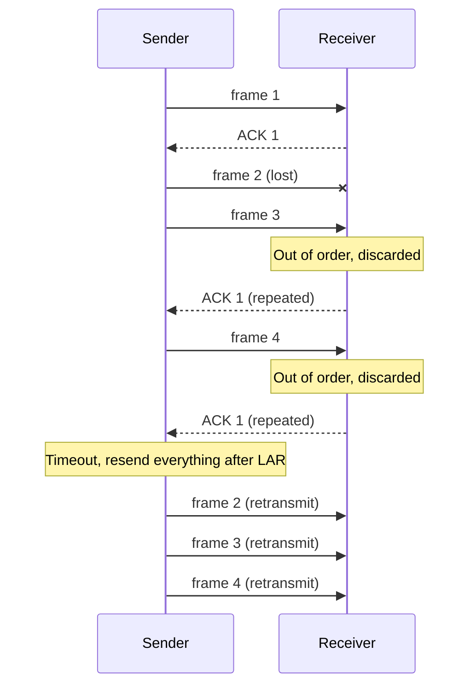
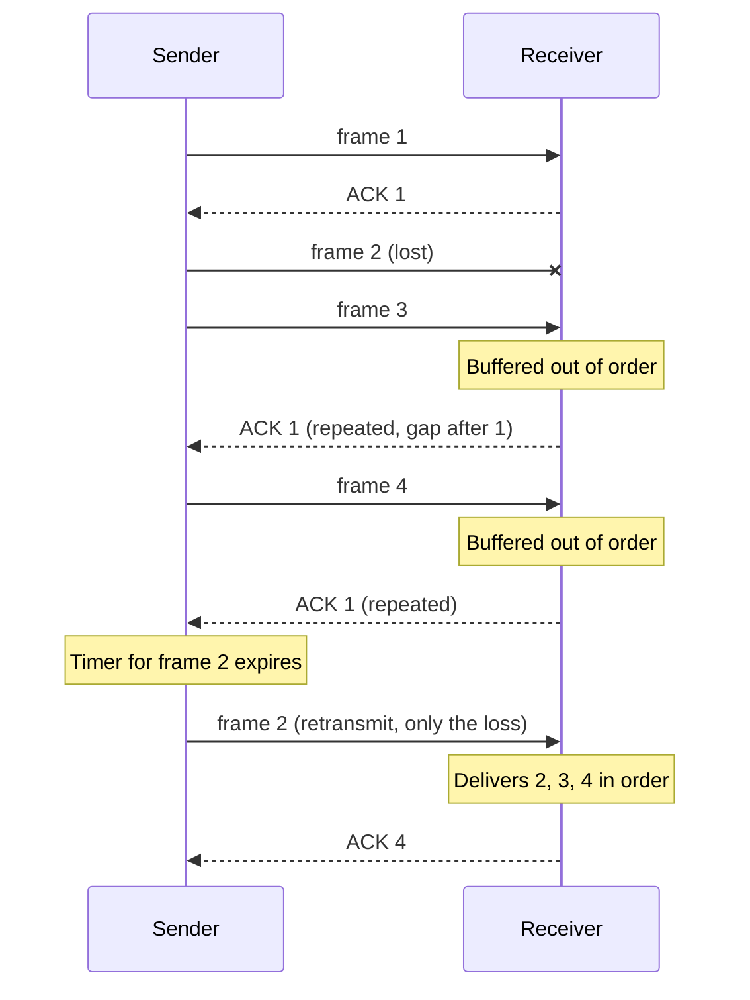

## Purpose

A sender that waits for each acknowledgement before sending again leaves a long path idle most of the time. Letting it run ahead fixes that, and then something has to decide how far ahead it may run. This note covers both halves. Sliding window ARQ keeps several packets in flight and recovers the ones that get lost. TCP's receive window is the number the receiver uses to tell the sender how much more it can take, and it is what "flow control" means in TCP.

The measurements come from the Linux 6.18 TCP stack running between two network namespaces joined by an emulated 200 Mbit/s link. The [measurement record](#measurement-record) has the setup.

## One window, two limits

A sliding window sender may have at most $W$ bytes sent but not yet acknowledged. An acknowledgement takes a round trip to come back, so the sender moves at most one window per round trip:

$$\text{throughput} \le \frac{W}{RTT}$$

In TCP two parties set $W$. The receiver advertises a receive window, rwnd, in every segment it sends: how much buffer it has left. The sender's congestion control keeps a congestion window, cwnd: its estimate of what the network can take. [RFC 5681 §3.1](https://www.rfc-editor.org/rfc/rfc5681#section-3.1) puts it in one line: "The minimum of cwnd and rwnd governs data transmission." Flow control is the rwnd half and protects the receiver. Congestion control is the cwnd half, protects the network, and is covered in the [[systems/networks/4-transport/TCP#Congestion|TCP note]]. Inside whichever window is smaller, the [[systems/networks/4-transport/ACK-clocking|ACK clock]] sets the pace.

## Sizing the window

To keep a path busy, the window has to cover everything the path holds in one round trip, the [[systems/networks/1-physical/coding-and-modulation#Bandwidth-delay product|bandwidth-delay product]] (BDP).

Worked example. Take $10$ kb packets, a rate of $R = 1$ Mbps and a one-way delay of $50$ ms, so $RTT = 100$ ms. The path holds

$$R \times RTT = 10^6 \times 0.1 = 100{,}000 \text{ bits}$$

which is $w = 100{,}000 / 10{,}000 = 10$ packets. With $w \geq 10$ the sender never stalls waiting for ACKs. A smaller window caps throughput at $w \times 10{,}000$ bits per round trip.

The figure runs the same arithmetic as a simulation. Its top chart is a time-sequence plot, the view tcptrace and Wireshark's "Stevens" graph use. Each blue tick is a segment leaving the sender, drawn at the height of the bytes it carries. The green line is the cumulative ACK, and the dashed orange line is the right edge of the window, ACK plus advertised window, which no tick may cross. With a 64 KiB window on a 100 Mbit/s, 40 ms path the sender emits a short burst and then waits, flat, for the rest of the round trip. Pick "Window covers BDP" and the bursts merge into a straight line at link rate.

<WindowSim preset="small" />

The simulation's throughput lands within 3% of $\min(\text{link rate}, W/RTT)$ for every setting its tests check. A real stack does the same. The table is Linux sending as fast as it can to a receiver that set its buffer with `SO_RCVBUF` and read everything at once, over a 200 Mbit/s link at three round-trip times. Each cell is the median of three 6-second runs measured over their last 3 seconds; the three runs of a cell never differed by more than 1%.

| `SO_RCVBUF` asked for | Window Linux advertised | 10 ms RTT | 40 ms RTT | 100 ms RTT |
| --- | --- | --- | --- | --- |
| 16 KiB | 18,824 B | 14.2 Mbit/s | 3.7 Mbit/s | 1.5 Mbit/s |
| 64 KiB | 80,480 B | 60.4 | 15.9 | 6.4 |
| 256 KiB | 326,880 B | 191.7 | 64.3 | 26.0 |
| 1 MiB | 1,309,920 B | 192.9 | 192.7 | 103.7 |
| 4 MiB | 5,241,472 B | 193.0 | 193.0 | 193.1 |
| not set (autotuning) | grew to 4.3, 11.4 and 15.4 MB | 193.1 | 193.1 | 193.1 |

Below the bandwidth-delay product (250 KB at 10 ms, 1 MB at 40 ms, 2.5 MB at 100 ms), goodput is the advertised window divided by the measured round trip. An 80,480-byte window over a 40.4 ms round trip predicts 15.9 Mbit/s, and 15.9 arrived. Above the BDP every run reaches 193 Mbit/s, the 200 Mbit/s link times 1448 payload bytes per 1500-byte packet. The record below has all ten buffer sizes.

Two things in the table are particular to Linux. The window column is not what the application asked for, which [Linux receive buffers](#linux-receive-buffers) explains. And the autotuned windows grew to 6 to 17 times the BDP. That cost no throughput, but the round trip rose from 10 to 13 ms, 40 to 47 ms and 100 to 170 ms. Once rwnd stops binding, the congestion controller (BBR, this kernel's default) decides how much data waits in the bottleneck queue, and the emulated bottleneck had 16 MiB of queue to fill.

## Sliding window ARQ

The sender buffers up to $w$ frames until they are acknowledged. [Peterson and Davie (§2.5.2)](https://book.systemsapproach.org/direct/reliable.html) track it with LFS, the last frame sent, and LAR, the last acknowledgement received. The sender may transmit while

$$LFS - LAR \leq w$$

so at most $w$ frames are unacknowledged at a time. The receiver keeps LFR, the last frame received in order, and LAF, the largest frame it will accept, with $LAF - LFR$ no more than its receive window. What the receiver does with a frame that arrives out of order decides how loss is recovered, and the two classic answers trade receiver memory against retransmissions. [[systems/networks/2-direct-links/retransmission|Retransmission]] covers stop-and-wait, the one-frame case both generalize.

### Go-Back-N

The receiver keeps no out-of-order frames; its window is one frame. When the frame after LFR arrives, the receiver accepts it and ACKs it. Anything else is discarded even though it arrived intact, and the receiver repeats its last ACK.

The sender keeps one timer, for the oldest unacknowledged frame. On timeout it resends every frame from LAR + 1 onward, so one loss can cost a full window of retransmissions. That is the price of the receiver's one-frame buffer.

### Selective Repeat

The receiver buffers any frame inside its window, after LFR and up to LAF. When the frame after LFR arrives, the receiver moves LFR past any buffered frames that are now in order and ACKs the new LFR. An out-of-order frame is buffered, and the receiver repeats its last in-order ACK, which tells the sender where the gap starts.

The sender keeps a timer per frame and resends only the frame whose timer expired. One loss costs one retransmission, paid for with receiver buffering and per-frame bookkeeping.

TCP sits between the two. Its ACKs are cumulative like Go-Back-N's, but receivers keep out-of-order data like Selective Repeat. The sender retransmits after three repeated ACKs instead of waiting for a timer (fast retransmit, [RFC 5681 §3.2](https://www.rfc-editor.org/rfc/rfc5681#section-3.2)), and the SACK option ([RFC 2018](https://www.rfc-editor.org/rfc/rfc2018)) lets the receiver report exactly which blocks it holds. Pick "Lost segment" in the figure. The red mark is the retransmission, and the receiver's buffer (bottom chart) fills with the data that arrived behind the hole. That data is held but cannot be read, so the advertised right edge stops moving until the hole is filled. A loss shrinks the usable window for a round trip even with no congestion control at all.

### Sequence numbers

Sequence numbers wrap, so the receiver has to tell a retransmitted old frame from a new frame carrying the same number. With $k$-bit sequence numbers there are $2^k$ values.

- Stop-and-wait needs one bit, 0 and 1.
- Go-Back-N can use a window of up to $2^k - 1$. Its receiver accepts only the frame it expects next, and one spare value keeps "the next window" distinct from "the same window again".
- Selective Repeat with equal send and receive windows needs $w \le 2^{k-1}$, half the sequence space.

The Selective Repeat limit is easiest to see where it breaks. [Peterson and Davie](https://book.systemsapproach.org/direct/reliable.html) use 3-bit numbers, 0 to 7, and a window of 7. The sender sends 0 through 6. All arrive, so the receiver now accepts 7, 0, 1, 2, 3, 4 and 5. All seven ACKs are lost. The sender times out and resends the old 0 through 6, and the receiver files old frames 0 through 5 as new data. With a window of at most half the space the two possible windows never overlap.

TCP numbers bytes with 32 bits and obeys the same rule at a larger scale. [RFC 7323 §2.3](https://www.rfc-editor.org/rfc/rfc7323#section-2.3) requires the left edge of the sender's window to stay within $2^{31}$ of the right edge of the receiver's, which keeps the window below $2^{30}$ bytes. That is why the window scale shift stops at 14, as [Window scaling](#window-scaling) explains.

## TCP's receive window

Every TCP segment carries a 16-bit Window field: how many bytes, counting from the acknowledgement number, the receiver will accept. The receiver sets it from its free buffer space. The sender's usable window is what remains after the bytes already in flight ([RFC 9293 §3.8.6.2.1](https://www.rfc-editor.org/rfc/rfc9293#section-3.8.6.2.1)):

$$U = SND.UNA + SND.WND - SND.NXT$$

Here SND.UNA is the oldest unacknowledged byte, SND.WND the last advertised window and SND.NXT the next byte to send.

- **The window counts bytes.** A receiver with 3 KB free gets 3 KB, whether that arrives as two segments or thirty small ones.
- **The right edge should not move left.** A receiver that has offered bytes up to some sequence number "SHOULD NOT shrink the window", and a sender "MUST be robust against window shrinking" ([RFC 9293 §3.8.6](https://www.rfc-editor.org/rfc/rfc9293#section-3.8.6)). Linux never shrinks it by default. The `tcp_shrink_window` sysctl, [added by Cloudflare in 2023](https://github.com/torvalds/linux/commit/b650d953cd391595e536153ce30b4aab385643ac), lets it shrink to stay inside the socket's memory limit.
- **A slow reader sets the rate.** Data the application has not read stays in the buffer, so the window opens only as fast as the application reads. In the figure's "Slow reader" scenario the buffer fills, and goodput settles close to the application's 1 MB/s.

### Zero windows and the persist timer

When the application stops reading, the buffer fills and the receiver advertises a window of zero. The sender stops. When the application reads again, the receiver sends a window update, a pure ACK carrying the new window. TCP does not retransmit pure ACKs, so if that update is lost the receiver waits for data and the sender waits for a window, forever.

The persist timer breaks that deadlock. Probing a zero window "MUST be supported": the sender probes after one retransmission timeout and "SHOULD increase exponentially the interval between successive probes" ([RFC 9293 §3.8.6.1](https://www.rfc-editor.org/rfc/rfc9293#section-3.8.6.1)). Each probe makes the receiver answer with its current window, so a lost update costs at most one probe interval. While the probes are answered the connection stays open indefinitely, even if the window never opens.

Linux's probe ([`tcp_xmit_probe_skb`](https://github.com/torvalds/linux/blob/v6.18/net/ipv4/tcp_output.c)) carries no data and uses sequence number SND.UNA − 1, a byte already acknowledged, which the receiver has to answer with an ACK. Here is a captured one: a receiver with a 64 KiB `SO_RCVBUF` stopped reading for 20 seconds on a 40 ms path.

| Event | Time after the window closed |
| --- | --- |
| window down to 1,240 bytes, under one segment; the sender holds those bytes back | about 0.27 s before |
| sender's timer fires and it sends the 1,240 bytes | 0.04 s before |
| receiver answers with window 0, having taken 82,328 bytes | 0 |
| probe 1 | 0.28 s |
| probes 2 to 6 | 0.86, 1.91, 3.99, 8.09 and 16.28 s |
| each probe answered with window 0 | 40 ms after the probe |
| application reads; window update to 76,160 bytes | 19.51 s |
| sender resumes | as the update arrives |

The gaps between probes were 0.58, 1.06, 2.08, 4.10 and 8.19 s. Linux's `tcp_probe0_when` doubles the timeout per probe and caps it at 120 s. The next probe was due at 32.7 s, so the update saved 13 seconds; had it been lost, the transfer would have sat idle that long. The run was repeated and the probe times matched to within 4 ms.

The first row shows the sender half of silly window avoidance, covered next: with less than a segment of window open, Linux's sender waited, and when the persist timer fired, [`tcp_write_wakeup`](https://github.com/torvalds/linux/blob/v6.18/net/ipv4/tcp_output.c) sent the partial window as data instead of an empty probe.

This copy of the figure starts with the reader paused for the middle second. Pick "Lost window update" to watch the flow wait for a probe instead.

<WindowSim preset="pause" />

> [!note]- Deep dive: when does Linux give up on a zero window?
> Never, while probes are answered. The comment in [`tcp_timer.c`](https://github.com/torvalds/linux/blob/v6.18/net/ipv4/tcp_timer.c) says "RFC 1122 4.2.2.17 requires the sender to stay open indefinitely as long as the receiver continues to respond probes", and every incoming ACK resets the probe count. Linux aborts the connection only after `tcp_retries2` (default 15) probes in a row go unanswered, or sooner if the application set `TCP_USER_TIMEOUT`. A peer that is alive but never reads can therefore hold a connection, and the sender's buffered data, as long as it likes. Servers that care put their own idle timeout above TCP.

### Silly window syndrome

Suppose the buffer is full and the application reads 200 bytes. A naive receiver advertises a 200-byte window, and a naive sender fills it with a 200-byte segment carrying 40 bytes of headers. The buffer is full again, the next read frees another 200 bytes, and the transfer settles into tiny segments for good. [Clark (1982)](https://www.rfc-editor.org/rfc/rfc813) named this silly window syndrome, "a degeneration in the throughput which develops over time". The figure's "Silly window" scenario runs it with avoidance turned off, and segments average about 250 bytes. Turn on "Silly window avoidance" and they are full-sized, with the same goodput.

The fix has a rule at each end, both required by [RFC 9293 §3.8.6.2](https://www.rfc-editor.org/rfc/rfc9293#section-3.8.6.2).

- **Receiver.** Keep the right edge where it is until it can move by at least $\min(\tfrac12 \times \text{buffer}, \text{MSS})$, and until then advertise only what is left of the old window.
- **Sender.** Send a segment only if it is a full MSS, or at least half the largest window the receiver has offered, or the application pushed and nothing is outstanding. That last condition is [Nagle's algorithm (RFC 896)](https://www.rfc-editor.org/rfc/rfc896), which also coalesces small writes on interactive connections.

Linux's receiver rule ([`__tcp_select_window`](https://github.com/torvalds/linux/blob/v6.18/net/ipv4/tcp_output.c)) is stricter: while less than half the buffer is free, it advertises zero unless at least one MSS and one sixteenth of the buffer are free. On the real stack, with a full 32 KiB buffer and a reader taking 200 bytes every 20 ms, every advertised window was either 0 or exactly 1,448 bytes, and all 39 data segments sent after the buffer filled carried a full 1,448 bytes. A one-segment window opened about every 140 ms, the time the reader needed to free 1,448 bytes at 10 kB/s.

### Window scaling

The Window field is 16 bits, so the largest window it can express is 65,535 bytes. At a 100 ms round trip that caps a connection at 5.2 Mbit/s however fast the path is. [RFC 1323](https://www.rfc-editor.org/rfc/rfc1323) called such paths "long, fat" networks and added the window scale option, now in [RFC 7323](https://www.rfc-editor.org/rfc/rfc7323). Each side announces a shift count, and the other side multiplies every later window from it by $2^{\text{shift}}$. The shift is capped at 14, so the largest window is $65{,}535 \times 2^{14}$, about 1 GiB, which stays below the $2^{30}$ limit from [Sequence numbers](#sequence-numbers).

The option "is sent only in a &lt;SYN&gt; segment" ([§2.1](https://www.rfc-editor.org/rfc/rfc7323#section-2.1)), so the shift is fixed for the life of the connection. Linux picks it from the buffer it expects to need. In the experiment, a receiver that set `SO_RCVBUF` to 64 KiB before `listen()` announced a shift of 1 and sent its 80,480-byte window as 40,240 in the header. That connection can never advertise more than $65{,}535 \times 2$ bytes, whatever the buffer grows to later. Set the buffer before `connect()` or `listen()`.

## Linux receive buffers

The table's `SO_RCVBUF` column and window column disagree because of three Linux behaviors.

- **The kernel doubles the request.** [socket(7)](https://man7.org/linux/man-pages/man7/socket.7.html): "The kernel doubles this value (to allow space for bookkeeping overhead)". The request is first capped at `net.core.rmem_max`, 4 MiB on the test machine.
- **The window is a fraction of the buffer.** The buffer pays for each packet's kernel memory as well as its payload, so Linux advertises only part of it. Since Linux 6.6 the fraction is measured per socket from the packets actually received (`scaling_ratio`, from [Dumazet's 2023 patch](https://github.com/torvalds/linux/commit/dfa2f0483360d4d6f2324405464c9f281156bd87), which replaced the fixed `tcp_adv_win_scale`). Here the window was 57 to 62% of the doubled buffer, so the application got about 1.2 times what it asked for.
- **Setting `SO_RCVBUF` turns off autotuning.** The [kernel's sysctl documentation](https://docs.kernel.org/networking/ip-sysctl.html) says so under `tcp_rmem`: "Calling setsockopt() with SO_RCVBUF disables automatic tuning of that socket's receive buffer size". Every fixed row of the table kept its window for the whole run.

Autotuning (`tcp_moderate_rcvbuf`, on by default) starts the buffer at `tcp_rmem[1]`, 128 KiB, and grows it up to `tcp_rmem[2]`, 32 MiB here. Each round trip it measures how much the application consumed and sizes the buffer to twice that, an idea from [Fisk and Feng's Dynamic Right-Sizing](https://www.osti.gov/servlets/purl/786912), which `tcp_input.c` credits. With a fast reader that gives the table's last row, full link rate at every round-trip time. On long real paths the ceiling matters: [Cloudflare (2022)](https://blog.cloudflare.com/optimizing-tcp-for-high-throughput-and-low-latency) raised `tcp_rmem[2]` to 512 MiB and measured a 121 ms path go from 276 to 6600 Mbit/s and a 282 ms path from 120 to 3800 Mbit/s.

On Linux, then, leave `SO_RCVBUF` alone unless you mean to cap a connection's memory, and raise `tcp_rmem[2]` to raise the ceiling.

> [!note]- Deep dive: why the window is a fraction of the buffer
> A receive buffer holds packets, not bytes. Each received segment sits in an `sk_buff`, and the socket is charged its `truesize`: the payload plus the structure and the memory block the driver allocated for it. `scaling_ratio` is payload over `truesize` for recent packets, and Linux advertises the buffer times that ratio, so a full window of data fits in the memory the buffer allows. The 57 to 62% measured here belongs to this path's TUN device; drivers allocate packet memory differently, so other NICs give other ratios. Before 6.6 the kernel assumed a fixed fraction from `tcp_adv_win_scale` (by default, half). Dumazet's patch says the measured ratio "can double TCP receive performance when receivers are too slow to drain their receive queue". A [2024 follow-up](https://github.com/torvalds/linux/commit/697a6c8cec03c2299f850fa50322641a8bf6b915) raised the starting ratio from about 25% to 50% after it found a 10 MB transfer into a 64 KiB `SO_RCVBUF` taking 40 s instead of 22 s.

## The same idea above TCP

QUIC and HTTP/2 run their own flow control because they carry many streams over one connection, and one stream's slow reader should not stall the rest.

- **QUIC** ([RFC 9000 §4](https://www.rfc-editor.org/rfc/rfc9000#section-4)) gives the receiver two limits, per stream (`MAX_STREAM_DATA`) and per connection (`MAX_DATA`). A limit is an absolute byte offset rather than a window relative to an ACK, so a smaller limit than one already sent has no effect and a stale update cannot shrink anything. A sender stuck at a limit should say so with `DATA_BLOCKED` or `STREAM_DATA_BLOCKED`, and lost limit updates are sent again ([§13.3](https://www.rfc-editor.org/rfc/rfc9000#section-13.3)), so the lost-update deadlock TCP needs a persist timer for cannot happen.
- **HTTP/2** ([RFC 9113 §5.2](https://www.rfc-editor.org/rfc/rfc9113#section-5.2)) is credit-based too, per stream and per connection, and applies only to DATA frames. Both windows start at 65,535 bytes and grow through `WINDOW_UPDATE` frames. HTTP/2 runs on TCP, so a transfer is limited by whichever of its own window and TCP's receive window is smaller. A receiver that never raises the HTTP/2 window past its default caps each stream at 65,535 bytes per round trip, the same ceiling window scaling removed from TCP.

The [[systems/networks/5-application/quic-http2-http3|QUIC and HTTP/2 note]] covers the rest of those protocols.

## Measurement record

> [!note]- Setup, method and raw results
> - **Code**: [`linkem.c`](flow-control-lab/linkem.c) is the link emulator, [`endpoint.py`](flow-control-lab/endpoint.py) the sender and receiver, [`run_experiments.py`](flow-control-lab/run_experiments.py) the driver, and [`summarize.py`](flow-control-lab/summarize.py) prints the buffer table. Run as root from `flow-control-lab`: `cc -O2 -Wall -o linkem linkem.c`, then `python3 run_experiments.py window`, `zero` or `trickle`. Raw results are in [`results_window.json`](flow-control-lab/results_window.json), [`results_zero.json`](flow-control-lab/results_zero.json) and [`results_trickle.json`](flow-control-lab/results_trickle.json).
> - **Path**: the test kernel has no netem, so the link is emulated in user space. Each endpoint lives in its own network namespace with a TUN device. `linkem` reads every IP packet from one device, holds it for its serialization time at 200 Mbit/s plus a fixed one-way delay, and writes it into the other. Both TCP stacks are the kernel's own; only the wire is emulated. The bottleneck queue was 16 MiB and dropped nothing in any run. MTU 1500, MSS 1448 with timestamps.
> - **Buffer sweep**: round trips of 10, 40 and 100 ms; receiver `SO_RCVBUF` from 16 KiB to 4 MiB in powers of two, plus no setting (autotuning); three runs each, slowest round trip first. Each run sent for 6 s. Goodput is the bytes acknowledged between 3 s and 6 s, from the sender's `TCP_INFO` sampled every 50 ms, which also gave the advertised window (`tcpi_snd_wnd`) and smoothed RTT. The three runs of a setting differed by under 1%.
> - **Zero window**: 40 ms round trip, receiver `SO_RCVBUF` 64 KiB, receiver reads nothing for 20 s and then drains. tcpdump on the sender's side. Run twice.
> - **Silly window**: 40 ms round trip, receiver `SO_RCVBUF` 16 KiB, reads nothing for 2 s, then 200 bytes every 20 ms for 6 s. One run.
> - **Environment**: Linux 6.18.44, BBR congestion control (the machine's default), `tcp_rmem` 4096 131072 33554432, `rmem_max` 4 MiB, Intel Xeon at 2.10 GHz with 4 cores, Python 3.13.
> - **Limits**: one machine and one emulated path, with no loss and no competing traffic. The window-to-buffer ratio depends on how packets are allocated, which differs between a TUN device and a real NIC.
>
> | Request | Buffer | Window (B) | 10 ms: RTT, goodput | 40 ms: RTT, goodput | 100 ms: RTT, goodput |
> | --- | --- | --- | --- | --- | --- |
> | 16 KiB | 32 KiB | 18,824 | 10.5 ms, 14.15 | 40.9 ms, 3.68 | 101.6 ms, 1.48 |
> | 32 KiB | 64 KiB | 39,096 | 10.4 ms, 29.46 | 40.4 ms, 7.71 | 100.6 ms, 3.11 |
> | 64 KiB | 128 KiB | 80,480 | 10.4 ms, 60.40 | 40.4 ms, 15.89 | 100.3 ms, 6.42 |
> | 128 KiB | 256 KiB | 163,040 | 10.6 ms, 118.77 | 40.3 ms, 32.16 | 100.3 ms, 12.92 |
> | 256 KiB | 512 KiB | 326,880 | 13.0 ms, 191.72 | 40.4 ms, 64.32 | 100.3 ms, 26.02 |
> | 512 KiB | 1 MiB | 653,920 | 16.9 ms, 192.87 | 40.6 ms, 127.57 | 100.4 ms, 51.99 |
> | 1 MiB | 2 MiB | 1,309,920 | 23.4 ms, 192.89 | 42.9 ms, 192.72 | 100.5 ms, 103.70 |
> | 2 MiB | 4 MiB | 2,620,032 | 20.1 ms, 193.06 | 42.6 ms, 193.06 | 108.0 ms, 193.06 |
> | 4 MiB | 8 MiB | 5,241,472 | 15.1 ms, 192.97 | 42.9 ms, 192.96 | 169.5 ms, 193.07 |
> | autotuning | grows | 4.3, 11.4, 15.4 MB | 13.3 ms, 193.06 | 46.7 ms, 193.06 | 169.6 ms, 193.06 |
>
> Goodput in Mbit/s, the median of three runs. Window is the median `tcpi_snd_wnd`; the 128 KiB request at 100 ms advertised 162,400 bytes rather than 163,040.

## Related notes

- [[systems/networks/4-transport/TCP|TCP]], for congestion control, the other half of the window
- [[systems/networks/4-transport/ACK-clocking|ACK clocking]]
- [[systems/networks/2-direct-links/retransmission|Retransmission]], for stop-and-wait
- [[systems/networks/1-physical/coding-and-modulation|Coding and modulation]], for the bandwidth-delay product
- [[systems/networks/5-application/quic-http2-http3|QUIC, HTTP/2 and HTTP/3]]
- [[systems/networks/sockets|Sockets]]
- [[algorithms/patterns/sliding-window|Sliding window pattern]]
