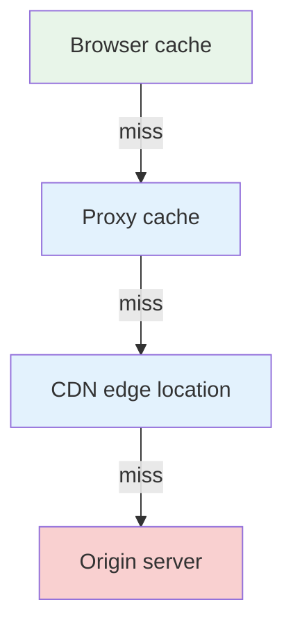

A content delivery network (CDN) is a system of geographically distributed servers that caches content from an origin server and delivers it to each client from a nearby location. It is the outermost of three layers of caching that place web content close to clients, after the browser cache and proxy caches, each layer farther from the user than the one before.

Each layer serves the requests it can satisfy from its cache and forwards only misses to the next layer.

## Browser cache

The cache closest to the user is in the browser itself. Browsers cache static content such as stylesheets, scripts, images, and some AJAX responses, which reduces load time on repeat visits.

The server controls this with the `Cache-Control` header on its responses, which states how long the file may be cached. Until that time expires, the browser serves the file locally without contacting the server at all.

## Proxy caches

A proxy server sits between a client application and the real server. It intercepts requests and checks whether it can fulfill them from its own cache, forwarding to the real server only on a miss. One proxy serves a pool of clients, so a file fetched for one user can be served from the proxy to everyone behind it. The caching mechanics and their limits are covered in [[systems/networks/5-application/HTTP|HTTP]].

## CDNs

A CDN applies the same caching at global scale and selects the serving location according to where the user is. Each region has edge locations, data centers that cache content from the origin server.

The redirect to a nearby copy happens during name resolution. Resolving a CDN URL directs the user to the nearest edge location, which serves the cached content. Load on the origin server falls, and the user receives content from a server that is physically close, so round trips are short. How DNS supports this kind of location-dependent answer is covered in [[systems/networks/5-application/DNS|DNS]].

## Related notes

- [[systems/networks/5-application/HTTP|HTTP]]
- [[systems/networks/5-application/DNS|DNS]]
- [[systems/networks/5-application/overview|application layer overview]]
