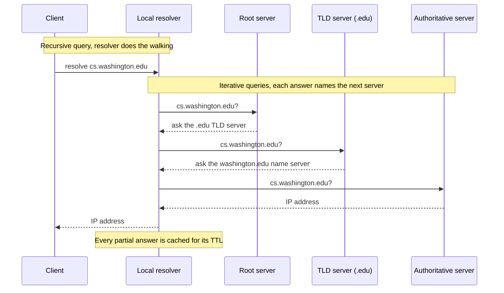

The Domain Name System (DNS) is a distributed, hierarchical database that maps human-readable names to IP addresses. Its namespace is a tree of labels whose subtrees are administered separately, and its name servers form a matching hierarchy. The hierarchy, together with caching of answers at every level, allows resolution to operate at internet scale.

## Namespaces

Names are high-level, human-readable identifiers for resources. Addresses are low-level, machine-readable identifiers. Resolution, or lookup, maps names to addresses.

## Before DNS

Machines fetched a file called `hosts.txt` from a centralized server and resolved names against it locally. Every name change meant redistributing the file to every machine on the network, which became impractical as the internet grew. DNS ([RFC 1034](https://datatracker.ietf.org/doc/html/rfc1034)) replaced it.

## The DNS hierarchy

DNS maps names to IP addresses and back. It is a distributed database implemented as a hierarchy of name servers, and the namespace itself is hierarchical.

- Every fully qualified DNS name ends with a dot, the root of the hierarchy.
- The rightmost label is the top-level domain (TLD), such as `.edu` or `.com`.
- Each TLD is managed by a registry.

### Zones

Zones divide the namespace into manageable pieces. A zone is a contiguous portion of the global namespace under one administrator. For example, the EDU registry runs the `.edu` TLD, UW runs `washington.edu`, and the Allen School runs `cs.washington.edu`. Each zone has one or more authoritative name servers that maintain its records. Authority can be delegated, so the servers for `washington.edu` delegate `cs.washington.edu` to the Allen School's servers.

## Resolution

A client resolving an unknown name sends the query to a DNS resolver. The resolver asks a root name server, which answers with the address of the right TLD name server. The TLD server answers with the authoritative name server for the domain, and that server finally answers with the IP address.

### Iterative vs. recursive queries

In a recursive query, the resolver asks a server to return the final answer directly, and that server performs the remaining steps. In an iterative query, each server returns only the next server to ask.

Recursive service relieves the client of the work of resolution and lets the server build a cache shared across its whole pool of clients. Iterative service keeps the server simple, which makes high-load servers easier to build, and leaves the client in control of the process. Root and TLD servers answer iteratively, and local resolvers typically offer recursion to their clients.

A typical lookup uses both modes. The client asks its resolver recursively, and the resolver walks the hierarchy iteratively:

### Caching

Resolution lies on the critical path of nearly every connection, so its latency matters, and caching is the principal means of reducing it. Nameservers cache query results, including the partial answers from iterative resolution, for the duration of each record's TTL. The caching follows the hierarchy. Answers near the root change rarely and are cached widely, which keeps the query load on the root servers far below the total volume of lookups.

### Local nameservers

The local nameserver is the first server a client queries. It is usually run by the ISP, though it can run on the host itself or at an access point, and public resolvers such as Google's 8.8.8.8 are an alternative. Clients typically learn their local nameserver via DHCP.

### Root name servers

The root is served by 13 named servers, `a.root-servers.net` through `m.root-servers.net`, operated by 12 independent organizations. Each name in fact designates hundreds of server instances spread around the world, reached by IP anycast, where the same IP address is advertised from many locations and routing delivers the query to a nearby one. Current instance counts and operators are listed at [root-servers.org](https://root-servers.org/).

## Protocol

DNS runs over [[systems/networks/4-transport/UDP|UDP]] on port 53. Reliability comes from the client retransmitting on timeout, with a 16-bit ID field linking each response to its query. Servers are replicated for load and availability, queries can return multiple records, and the client picks which to use.

Plain DNS has no authentication, so responses can be spoofed. DNSSEC adds signatures over DNS data to address this, but its adoption is limited.

## Related notes

- [[systems/networks/5-application/HTTP|HTTP]]
- [[systems/networks/5-application/CDNs|content delivery networks]]
- [[systems/networks/3-network/global-internet|the global Internet]]
- [[systems/research/development-of-the-dns|Development of the Domain Name System]]
