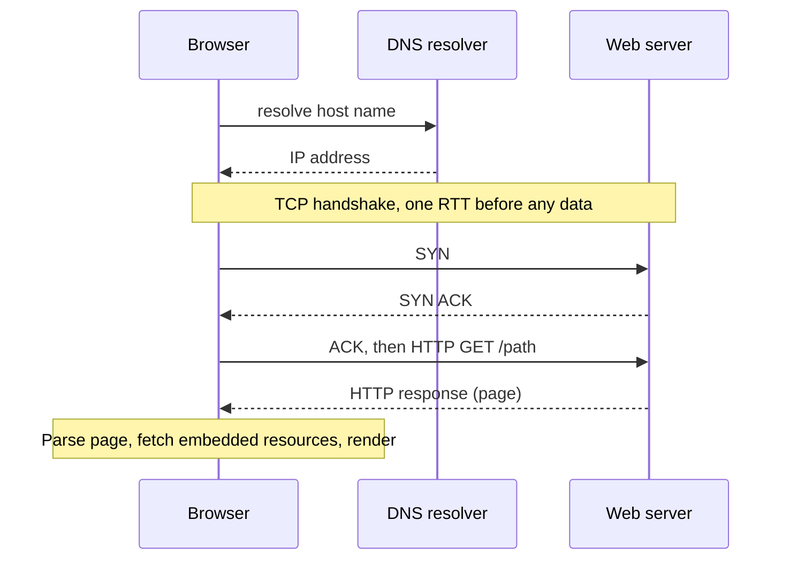

The Hypertext Transfer Protocol (HTTP) is the request-response protocol of the web. A web page is a set of related HTTP transactions. Each transaction is a request and a response, carried over TCP, typically on port 80. Protocol semantics, methods, and status codes are specified in [RFC 9110](https://datatracker.ietf.org/doc/html/rfc9110).

Much of HTTP's evolution has aimed to reduce [page load time](#page-load-time).

## Fetching a web page

URLs name the resource to fetch:

```text
protocol://host:port/path
```

1. Resolve the host to an IP address using [[systems/networks/5-application/DNS|DNS]]
2. Establish a [[systems/networks/4-transport/TCP|TCP]] connection to the server
3. Send an HTTP request for the page
4. Await the HTTP response
5. Fetch embedded resources, execute scripts, and render the page
6. Close the TCP connection



Static pages are pre-built and served as-is. Dynamic pages are built on the server per request, or shipped as code, usually JavaScript, that runs in the client.

## Methods

| Method | Description |
| --- | --- |
| GET | Read a web page |
| HEAD | Read a web page's header |
| POST | Append to a web page |
| PUT | Store a web page |
| DELETE | Remove the web page |
| TRACE | Echo the incoming request |
| CONNECT | Connect through a proxy |
| OPTIONS | Query options for a page |

## Status codes

| Code | Description | Example |
| --- | --- | --- |
| 1xx | Informational | 100 Continue, server agrees to handle the client's request |
| 2xx | Success | 201 Created, resource created from posted data |
| 3xx | Redirection | 304 Not Modified, client should use its cached version |
| 4xx | Client error | 404 Not Found |
| 5xx | Server error | 503 Service Unavailable, server overloaded |

## Performance

### Page load time

Page load time (PLT) is the time from request to the full page being displayed in the browser. Small increases in PLT measurably reduce user satisfaction, which motivates much of the engineering effort spent on it. PLT depends on the page's content, the network RTT and bandwidth, and how efficiently HTTP and TCP are used.

### Why HTTP/1.0 was slow

HTTP/1.0 opened one TCP connection per request and issued requests sequentially. Every resource incurred a new connection setup, and fetches to the same server could not overlap, so the number of RTTs grew linearly with the number of resources.

### Cutting PLT

- Shrink the content, by minifying and compressing
- Use TCP more efficiently, which is what HTTP/2 does with multiplexing
- Cut round trips, with DNS prefetching, caching, and proxies
- Move content closer to the client, with CDNs and edge caching

Browsers first addressed this by opening several parallel HTTP connections to fetch resources. Under load this is counterproductive, since the parallel connections amplify network bursts and loss. The alternative is one TCP connection to the server with multiple HTTP requests multiplexed over it. This raises the question of how long to keep the connection open, and for some access patterns it is slower than parallel connections.

> [!tip] Where this leads
> HTTP/2 multiplexes requests over one connection, which exposes head-of-line blocking at the TCP layer, and QUIC and HTTP/3 remove that blocking. [[systems/networks/5-application/quic-http2-http3|QUIC, HTTP/2, and HTTP/3]] treats that evolution.

## Caching and proxies

Users revisit pages, so many fetches can be answered without contacting the server. A cache decides whether a stored copy can be used in three ways.

- The `Expires` header gives a date after which the resource is stale
- Heuristic expiration treats resources as fresh when they are cacheable, currently valid, and were not modified recently
- Revalidation asks the server whether the cached copy is still valid, and a 304 means yes without resending the body

A proxy caches on behalf of a pool of clients. The client sends its request to the proxy, and the proxy checks whether it holds a fresh copy. If it does, it serves the copy directly. Otherwise it fetches from the server, updates its cache using response metadata such as Not-Modified, and returns the resource to the client.

Putting an intermediary between clients and servers also helps with load balancing, security, and privacy, and it moves cached data physically closer to clients. The benefits are limited by secure and dynamic content, which cannot be shared or stored, and by the long tail of resources that are rarely requested twice. [[systems/networks/5-application/CDNs|Content delivery networks]] apply the same caching at global scale.

## Related notes

- [[systems/networks/5-application/DNS|DNS]]
- [[systems/networks/5-application/CDNs|content delivery networks]]
- [[systems/networks/5-application/overview|application layer overview]]
- [[systems/networks/4-transport/TCP|TCP]]
