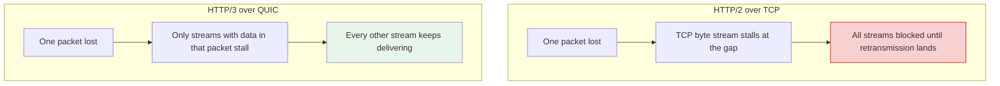

HTTP/2, QUIC and HTTP/3 are the successors to HTTP/1.1 in the web's protocol stack. HTTP/2 multiplexes concurrent requests as streams over one TCP connection. QUIC is a connection-oriented, encrypted, multiplexed transport over UDP, and HTTP/3 maps HTTP onto QUIC streams. [[systems/networks/5-application/HTTP|HTTP]] and [[systems/networks/4-transport/TCP|TCP]] describe the protocols they extend or replace.

Their design is organized around one recurring problem, head-of-line (HOL) blocking, in which a lost or delayed unit of data delays delivery of the data queued behind it. HTTP/2 removed HOL blocking at the application layer, which exposed it one layer down in TCP, and QUIC removed it by redesigning the transport. The three stacks are layered as follows.

```text
HTTP/1.1        HTTP/2          HTTP/3
   |               |               |
  TLS             TLS            QUIC   (streams, loss recovery,
   |               |               |     TLS 1.3 built in)
  TCP             TCP             UDP
```

## What HTTP/1.1 costs

HTTP/1.1 processes one request at a time per connection, and a response must complete before the next request is served. Pipelining is specified in the RFC but was never reliably deployed, because broken intermediaries and HOL issues led browsers to disable it. Browsers compensate by opening about 6 parallel TCP connections per origin, which multiplies handshake and slow-start costs and still serializes requests within each connection. Every new connection incurs a setup latency of 1 RTT for the TCP handshake plus 2 RTT for TLS 1.2 (1 RTT with TLS 1.3) before the first byte of the request is sent. On a 100 ms path, that is 200-300 ms of protocol overhead per connection before any content is transferred. The load time of a page composed of many small objects is dominated by these fixed costs, as the page-load-time section of [[systems/networks/5-application/HTTP|HTTP]] argues.

## HTTP/2: multiplexing above TCP

[HTTP/2 (RFC 7540)](https://www.rfc-editor.org/rfc/rfc7540) replaced the textual protocol with binary framing and made one TCP connection carry many concurrent **streams**, each an independent request/response. Frames from different streams interleave on the connection (§5.1); HPACK compresses headers statefully across requests; stream priorities and server push completed the design. Server push has since been effectively retired (Chrome removed it) because its hit rates did not justify its complexity. One connection per origin replaces six, so a page load incurs one handshake and one slow-start ramp and maintains one congestion-control state.

HTTP/2 eliminates application-layer HOL blocking, since a slow response no longer blocks the connection and frames of other streams continue to flow between its frames. The remedy does not extend below the TCP boundary. **TCP delivers a single ordered byte stream**, so a single lost segment stalls delivery of *all* data behind it, including frames of streams whose own packets all arrived, until the retransmission arrives. Because multiplexing places every stream on one connection, one lost packet stalls all of them, and under loss HTTP/2 can perform *worse* than HTTP/1.1's six independent connections, which confine each loss to one-sixth of the traffic. HTTP/2 inherits two further limits from TCP. The handshake latency remains (TCP, then TLS, sequentially), and a connection is identified by its 4-tuple, so a change of network, such as from WiFi to cellular, terminates every connection.



## QUIC: rebuilding the transport on UDP

[QUIC (RFC 9000)](https://www.rfc-editor.org/rfc/rfc9000) is a connection-oriented, encrypted, multiplexed transport that runs over UDP. UDP serves as the means of deployment. Middleboxes drop or mangle unknown IP protocols, so a new transport must be carried inside an existing one, and user-space implementation lets endpoints ship protocol changes at the pace of application updates rather than OS kernel releases ([Langley et al.](https://dl.acm.org/doi/10.1145/3098822.3098842) cite both ossification and iteration velocity as the design drivers; Google shipped multiple QUIC versions per year this way). The design addresses each TCP limitation directly.

- **Streams are transport objects** (§2). A QUIC connection carries many streams, each with its own flow control and its own ordering. Loss recovery is per-packet, and data delivery is per-stream, so a lost packet stalls only the streams that had data in that packet (§2.2). Transport-level HOL blocking is therefore absent by construction.
- **One combined handshake** (§7). The transport and TLS 1.3 handshakes are combined, so a new connection completes in 1 RTT, and resumption can send application data in the first flight (0-RTT). 0-RTT data is exposed to replay. An attacker can record and replay early data, so it must carry only idempotent requests (§9.2 of RFC 9001's threat model; HTTP clients restrict 0-RTT to safe methods).
- **Connection IDs in place of 4-tuples** (§5.1). A connection is named by IDs chosen by each endpoint, so it survives NAT rebinding and network migration (§9). A phone that moves from WiFi to LTE keeps its QUIC connections, whereas every TCP connection would reset.
- **Loss recovery without ambiguity.** Packet numbers increase monotonically and are never reused; a retransmission carries the old data in a *new* packet number (§17.2, RFC 9002). This eliminates TCP's retransmission ambiguity in RTT measurement. ACK frames carry large ranges and receiver delay measurements, giving the sender more precise information than TCP's cumulative ACK + SACK.
- **Encryption covers the transport headers.** Almost everything except the connection ID is encrypted, including ACKs, partly for privacy and partly to prevent ossification, since middleboxes cannot come to depend on fields they cannot parse.

## HTTP/3: HTTP on QUIC

[HTTP/3 (RFC 9114)](https://www.rfc-editor.org/rfc/rfc9114) changes how HTTP is mapped onto the transport and leaves its semantics as they were. Methods, status codes, and header fields are unchanged, and the specification is largely about which QUIC stream carries what. Each request/response pair is carried on its own bidirectional QUIC stream (§4.1). Request concurrency is delegated to the transport, and unlike HTTP/2, HTTP/3 has no stream layer of its own. Header compression changes because of HOL blocking. HPACK requires every endpoint to process header blocks in the same total order to keep dynamic tables synchronized, which QUIC's independent streams cannot guarantee. **QPACK** (RFC 9204) sends dynamic-table updates on a dedicated unidirectional stream, and header blocks reference table state only once it is acknowledged. It gives up a small amount of compression efficiency to remove every ordering dependency between streams (§4.2). Prioritization was dropped from the core spec (HTTP/2's dependency-tree scheme was complex and rarely used) and delegated to the Extensible Priorities extension (RFC 9218). Discovery is via `Alt-Svc` headers or DNS HTTPS records, since a client has no other means of learning that an origin accepts QUIC over UDP.

In practice the protocols differ most under failure. With 1% packet loss, each loss in HTTP/2 stalls all streams for at least an RTT while TCP retransmits in order. Under the same loss in HTTP/3, each lost packet delays only its own streams' data, and a browser loading 50 resources sees 49 progress normally. When the network changes, HTTP/2 connections all reset and repeat the handshake, while HTTP/3 connections migrate and continue.

## Measured impact

Google's deployment paper ([Langley et al. 2017](https://dl.acm.org/doi/10.1145/3098822.3098842)) reports the largest published QUIC dataset. At publication, QUIC carried over 30% of Google's egress traffic (an estimated 7% of the whole Internet). Mean search latency improved 8% for desktop and 3.6% for mobile users; YouTube rebuffer rates dropped 18% for desktop and 15.3% for mobile. The gains are concentrated where the protocol arguments predict, on slower and lossier network paths (the worst-latency deciles improved the most, and users in high-RTT countries saw multiples of the average gain), and the 0-RTT handshake accounts for the largest share of the latency reduction. The paper also reports that on fast networks without loss the differences approach zero. QUIC's benefit lies mainly in the tail of the latency distribution and on poor networks rather than on the fast path, the same statistical pattern as in [[systems/performance/tail-latency-percentiles|Tail Latency and Percentiles]].

## Related notes

- [[systems/networks/5-application/HTTP|HTTP]]
- [[systems/networks/4-transport/TCP|TCP]]
- [[systems/networks/4-transport/UDP|UDP]]
- [[systems/networks/5-application/CDNs|CDNs]]
- [[systems/performance/tail-latency-percentiles|Tail Latency, Percentiles, and Queueing Distributions]]

## Sources

- [RFC 9000, QUIC: A UDP-Based Multiplexed and Secure Transport](https://www.rfc-editor.org/rfc/rfc9000)
- [RFC 9114, HTTP/3](https://www.rfc-editor.org/rfc/rfc9114)
- [RFC 7540, HTTP/2](https://www.rfc-editor.org/rfc/rfc7540)
- [RFC 9204, QPACK](https://www.rfc-editor.org/rfc/rfc9204), [RFC 9002, QUIC Loss Detection](https://www.rfc-editor.org/rfc/rfc9002)
- [Langley et al. (2017), The QUIC Transport Protocol: Design and Internet-Scale Deployment, SIGCOMM](https://dl.acm.org/doi/10.1145/3098822.3098842)
