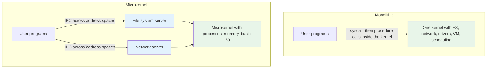

An operating system consists of the services its kernel provides to programs, for processes, memory, I/O, and files, and of a structure that determines how those services are arranged and how they communicate. Kernel structures range from a single monolithic kernel through layered designs to microkernels that move most services into user space.

## Process operations

The OS provides operations to:

- create and delete a process
- suspend and resume a process
- clone a process
- communicate and synchronize between processes
- create and delete child processes (subprocesses)

## Memory management

Primary memory is the only storage the CPU can access directly. A program has to be in memory to execute, access is fast, and the contents are lost when power is removed.

The OS allocates memory for a process, deallocates it when the process terminates, maintains the mapping between virtual and physical memory through page tables, and decides how much memory each process gets.

## I/O

A large part of the kernel handles I/O. This part connects devices to the rest of the system and must present a uniform interface over widely varying hardware.

### Device drivers

Drivers are the routines that control a specific device type. They encapsulate the device's details, e.g. how to initialize it, how to request I/O, and how to handle its interrupts. SCSI drivers, Ethernet card drivers, and video card drivers are all examples. The lecture put the number of device drivers written for Windows at around 35,000.

### File systems

The file system is an abstraction on top of the physical storage drivers. It provides the common per-file operations (open, close, read, write, seek) plus higher level operations on the file system itself:

- create and delete files and directories
- accounting and quotas
- backup and restore
- sometimes indexing, search, and file versioning

## Kernel structure

### Monolithic

```text
+----------------------+
|    User Programs     |
+----------------------+
|      Everything      |
|      Else in OS      |
+----------------------+
|     Device Driver/   |
|     hardware stuff   |
+----------------------+
```

All services reside in one kernel, so a call from one module to another costs only a procedure call, which is the structure's main advantage. Its main disadvantage is a codebase that is difficult to change, since every module can access every other module.

### Layering

Dijkstra's ["THE" multiprogramming system](https://dl.acm.org/doi/10.1145/363095.363143) structured the OS as layers. Each layer presents a virtual machine to the layer above it and uses only the services of the layer below it:

- Layer 5: job managers, execute user programs
- Layer 4: device managers, handle devices and provide buffering
- Layer 3: console manager, implements virtual consoles
- Layer 2: page manager, implements virtual memory
- Layer 1: kernel, implements a virtual processor for each process
- Layer 0: hardware

Each layer can be tested and verified independently.

### Hardware abstraction layer

A HAL separates hardware-specific routines from the core OS, which makes the core portable and isolates hardware details from readers of the core code.

### Microkernels

Microkernels appeared in the late 1980s and early 1990s. The design reduces the kernel to a minimum and moves as much as possible into user space. The microkernel keeps basic services such as process management, memory management, and I/O. Higher level services (file system, networking, scheduling policy) run as user-space server processes.

The isolation between components improves reliability, and a smaller kernel means less code to port to new hardware. The system is extended by adding a server rather than by patching the kernel. Requests that a monolithic kernel would handle with a procedure call cross address space boundaries in a microkernel, so a microkernel is probably slower.

The two structures differ in where services reside and in the cost of a request that crosses between components.



## Related notes

- [[systems/operating-systems/lecture-notes/kernel-abstraction|hardware modes]]
- [[systems/operating-systems/lecture-notes/processes|processes]]
- [[systems/operating-systems/lecture-notes/file-systems|file systems]]
- [[systems/research/unix-timesharing-system|Unix timesharing system]]
- [[systems/operating-systems/reference|operating systems reference]]
- [[systems/research/barrelfish|multikernel]]
