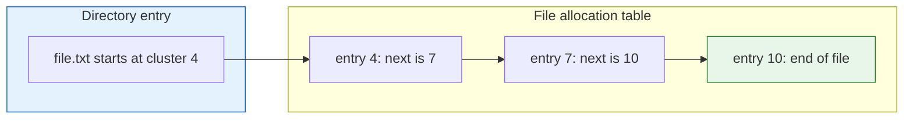

A file system reads and writes blocks (sectors) on a per-volume basis and organizes them into files and directories. It is a thick layer of abstraction over the raw storage device.

## Programming interface

Naming is hierarchical: files reside in directories, and directories nest. The principal operations in each system are as follows.

| Windows | Unix |
|---------|------|
| `CreateFile(name, CREATE)` | `open(name, O_CREAT)` |
| `CreateFile(name, OPEN)` | `open(name, O_RDONLY)` |
| `ReadFile(handle, buffer, size)` | `read(fd, buffer, size)` |
| `WriteFile(handle, buffer, size)` | `write(fd, buffer, size)` |
| `CloseHandle(handle)` | `close(fd)` |
| `FlushFileBuffers(handle)` | `fsync(fd)` |
| `SetFilePointer(handle, offset, whence)` | `lseek(fd, offset, whence)` |
| `GetFileSize(handle)` | `fstat(fd, &buf)` |
| `DeleteFile(name)` | `unlink(name)` |
| `MoveFile(old, new)` | `rename(old, new)` |

### Moving files

Unix moves a file with the `rename` system call. Windows renames only when the file stays on the same volume; a move across volumes becomes a copy followed by a delete.

> [!warning] Atomicity
> `rename` within a volume is atomic on Unix, and editors use this property to save by writing a temporary file and renaming it over the original; a cross-volume rename fails with `EXDEV` rather than silently falling back to a copy. Windows' copy-then-delete across volumes is not atomic, so a failure partway can leave the file in both places or split between them.

### Deleting files

Unix separates a file's name from the file itself. [`unlink`](https://man7.org/linux/man-pages/man2/unlink.2.html) removes the name, and the storage is reclaimed only after the last reference to the file (an open descriptor or a remaining hard link) goes away, so a file that a process still has open can be deleted. Windows ties deletion to open handles instead. By default a file cannot be deleted while a process has it open, which is the source of "file in use" errors.

## Files

A file is logically a sequence of bytes, plus properties and metadata. Some file systems also track a type (regular file, directory, symbolic link, device). Some files are understood to be executable by the OS. Windows determines a file's type by its extension, while Unix records the type in the file's metadata.

Shared file handles share the file's offset. Multiple threads or processes reading and writing through the same handle therefore change each other's position.

## Directories

A directory is typically a file whose contents are **directory entries**: a mapping from file names to file metadata.

## Design constraints

- Support small and large files efficiently. Small files require small blocks for storage efficiency, while large files benefit from contiguity.
- File data lives in **blocks**, so an indexing structure has to locate the blocks of a file. Unix calls it an **inode**, Windows a **file control block**.
- Free space must be locatable quickly, commonly with a **bitmap** or a **free list** on disk.
- Placement should maximize spatial locality while keeping seek time and fragmentation down.
- The file system must tolerate crashes and disk errors. **Journaling** recovers from crashes, and error detection/correction codes plus redundancy (RAID) recover from disk errors.

## On-disk structure

The file system has two representations. One is persisted on disk, and a separate in-memory representation is the one the OS manipulates.

### FAT

The **File Allocation Table** file system from DOS and early Windows keeps its on-disk structure simple. The volume splits into a reserved area, one or more FAT areas, and a data area:

```text
+-----------------+-----------------+-----------------+-----------------+
| Reserved Area   | FAT Area 1      | FAT Area 2      | Data Area       |
+-----------------+-----------------+-----------------+-----------------+
```

The reserved area holds the boot sector and metadata about the file system and disk layout. Each FAT area holds a copy of the file allocation table, which has one entry per data cluster, and each entry points to the next cluster of the file it belongs to, so a file is a linked chain through the table. Directory entries in the data area map file names to a file's starting cluster and metadata. The data area holds the file contents.



## Related notes

- [[systems/operating-systems/lecture-notes/io-systems-secondary-storage|I/O systems and secondary storage]]
- [[systems/research/unix-timesharing-system|Unix timesharing system]]
- [[systems/operating-systems/v4-persistent-storage/11-file-systems-overview|file systems overview]]
