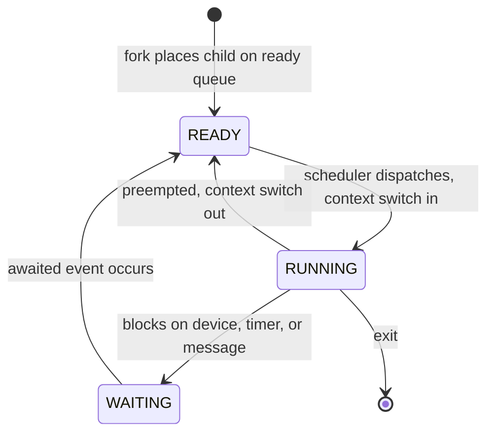

A process control block (PCB) is the per-process kernel data structure that holds a process's state while the process is not running. The scheduler keeps these structures on state queues, and a context switch saves and restores process state through them. Handles are the means by which user code names kernel objects: each process has a local handle table, and the kernel keeps a global handle table.

## Process control block

The PCB tracks a process's state, with each entry identified by PID. While a process is not running, the OS keeps all of its state in a `proc` structure within the PCB.

`proc` has many fields: the PID, a pointer to the parent's proc, execution state, and so on. Linux defines it as [`task_struct` in `include/linux/sched.h`](https://elixir.bootlin.com/linux/latest/source/include/linux/sched.h), and it is large; the lecture counted over 95 fields.

### proc and CPU state

A **context switch** removes the running process's state from the CPU, saves it into the PCB, then retrieves the next scheduled process's `proc` and loads it onto the CPU to run. Choosing which process runs next is called **scheduling**.

The kernel itself has no process of its own; it is a block of code. The CPU is always executing in the context of some process, and that code can be in either kernel or user mode.

### State queues

The OS typically keeps a queue of `proc`s for each state a process can be in (`WAITING`, `READY`, and so on). There can be many wait queues, one for each kind of wait: a particular device, a timer, a message.

The queues implement the canonical process state machine, with each transition moving the proc between queues:

procs are plain data structures, dynamically allocated in OS memory. Existing processes create new ones. The creator is the parent, and the created process is the child.

## Creating processes

[`fork`](https://man7.org/linux/man-pages/man2/fork.2.html) clones the calling process. `exec` keeps the process and replaces its program: it loads a new program into the address space (overwriting the old one), initializes the hardware state and arguments for the program, and places the process on the ready queue. `exec` does not create a new process.

To start a program from a shell, the shell forks itself and the child execs the program.

### Making creation faster

`fork` copies the whole address space, which is unnecessary work when the child immediately calls `exec`. Two optimizations address this.

[`vfork`](https://man7.org/linux/man-pages/man2/vfork.2.html) is the older approach, now uncommon. The child's address space is a pointer to the parent's rather than a copy, so the child uses the parent's page table, and the child is expected, without enforcement, not to modify it.

Copy-on-write is the modern approach. The child gets its own page table, but every entry maps to the parent's frames and both mappings are marked read-only. The first write to a page faults, and the OS copies only that page and makes it writable. Pages that neither process writes are never copied.

## Related notes

- [[systems/operating-systems/lecture-notes/processes|processes]]
- [[systems/operating-systems/lecture-notes/windows-objects-handles-refcounts|Windows objects, handles, and reference counts]]
- [[systems/operating-systems/lecture-notes/page-faults|page faults]]
- [[systems/operating-systems/lecture-notes/windows-memory-management|Windows Memory Management]]
