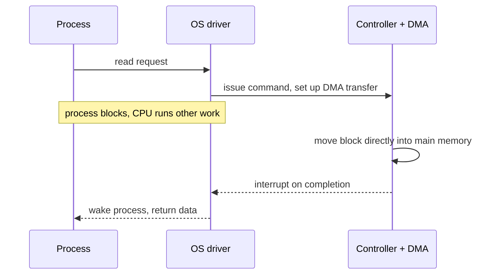

The I/O system of an operating system comprises the hardware that connects the CPU to peripheral devices (device controllers, buses and DMA engines) and the software that drives those devices on behalf of processes. Secondary storage is the class of devices outside primary memory that holds data persistently, and the OS reaches it through the I/O system.

The storage prices under [Secondary storage](#secondary-storage) were given in lecture without a source.

## I/O hardware

I/O devices are typically **block devices**, which transfer data in fixed-size blocks, or **character devices**, which transfer data one character at a time as a stream.

A **device controller** is the hardware that connects the CPU to a device, and it is itself a small special-purpose computer. It sends commands to the device and moves data in both directions. The CPU communicates with controllers through controller registers or memory-mapped I/O, or hands transfers off to direct memory access (DMA).

Early computers attached the CPU, memory and I/O devices to a single bus (the **system bus**), a topology analogous to early Ethernet networks with a single broadcast domain. Modern systems use multiple buses. The **PCI** bus serves as a high-speed backbone, and the other buses (**memory**, **SCSI**, **USB** and others) branch from it.

The I/O system must support a wide variety of devices that differ in transfer rate, data format and control mechanism.

## What the OS I/O system provides

- A uniform interface across many devices, plus device-specific interfaces where necessary.
- Device communication and interaction through device drivers.
- A unique ID per device so applications can refer to it.

### Ways to drive a device

- **Programmed I/O with polling**: the CPU issues an I/O command for the process, and the process busy-waits until the I/O completes. The CPU is occupied for the entire duration of the transfer.
- **Interrupt-driven I/O**: the CPU issues the command and keeps executing. When the I/O completes, the device interrupts the CPU, which then handles the completion. The process may or may not block while waiting, and the processor remains available for other work.
- **Direct Memory Access (DMA)**: the DMA module moves a block of data between the I/O module and main memory using physical addresses. The processor requests the transfer and receives an interrupt when it completes, and it does not handle the data during the transfer.

> [!tip] CPU time under each method
> Each method in the list leaves more CPU time for other work than the one before it. Polling occupies the CPU for the whole transfer, interrupt-driven I/O leaves it free between transfers, and DMA leaves it free during them as well.

## Secondary storage

**Secondary storage** comprises the storage devices outside primary memory (RAM), such as hard drives and SSDs. Secondary storage does not allow direct execution of instructions or data access via load/store instructions; access goes through I/O operations.

Secondary storage is non-volatile, so data survives power loss. Its access latency is much higher than that of primary storage, it is more prone to failure, and its capacity per dollar is much greater. Approximate 2024 retail prices, from lecture:

- 2 TB HDD for $73, about $0.04/GB
- 30 TB HDD for $700
- 500 GB SSD for $50, about $0.10/GB
- 100 TB SSD for $40,000

### Memory hierarchy

| Level | Speed | Cost | Size | Volatility |
|-------|-------|------|------|------------|
| Registers | Fastest | Most Expensive | Smallest | Volatile |
| L1 Cache | Fast | Expensive | Small | Volatile |
| L2 Cache | Fast | Less Expensive | Still not a lot | Volatile |
| Main Memory | Slower | Less Expensive | Larger | Volatile |
| Secondary Storage | Slow | Cheap | Largest | Non-Volatile |
| Tertiary Storage | Slowest | Least Expensive | Largest | Non-Volatile |

### HDDs and SSDs

**HDDs** are mechanical devices that store data on spinning disks, with a read/write head that seeks across the disk. Their access latency is high, and their cost per byte is low. **SSDs** store data in flash memory. They are much faster than HDDs and cost more per byte. They are also more reliable and draw less power.

### Disks and the OS

Disks are slow, error-prone devices with irregular physical structure, and the OS presents them to its clients as uniform, reliable storage and reduces the latency those clients observe.

The OS exposes disk access at several levels to different clients:

- **Physical block access**: read and write blocks at physical locations on the disk.
- **Logical block access**: read and write by disk block number, without knowing the physical location of the block.
- **File system**: read and write files at a specified offset, block, or byte.

Early disks offered only physical block access. Modern disk controllers map the physical geometry (cylinders, sectors, and so on) to logical block numbers $0$ through $n-1$, so the OS sees one contiguous range of blocks.

### Performance

HDD performance is dominated by the latency of its moving parts. Reducing the number of seeks improves it, as does **defragmenting**, within the limit set by the remaining mechanical latency.

## Related notes

- [[systems/operating-systems/lecture-notes/file-systems|file systems]]
