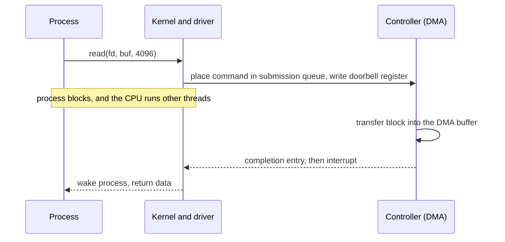

The **I/O system** of an operating system is the hardware that connects the CPU and memory to peripheral devices (device controllers, interconnects and DMA engines) together with the kernel software (device drivers, the block layer and the file systems above it) that operates those devices on behalf of processes. **Secondary storage** is the class of devices outside main memory that retain data without power, such as hard disk drives (HDDs) and flash solid-state drives (SSDs). The CPU cannot address secondary storage with load and store instructions; the kernel reaches it by issuing commands to a controller, which moves whole blocks between the device and memory.

Two properties of devices shape this software. Devices are slow relative to the CPU: a dependent load from DRAM took 136 ns on the machine [[#Measurements on a virtual disk|measured below]], a 4 KiB read from its virtual disk 34.7 µs, and a random 4 KiB read from a 7,200 RPM disk takes about 13 ms. And devices operate concurrently with the CPU: a controller carries out a transfer while the CPU runs other code, and current storage devices accept many commands at once. Interrupts, DMA, command queues and disk scheduling exist to overlap the CPU with the device and to keep the device busy.

## I/O hardware

### Device classes

Unix-like kernels group devices by the interface they offer. A **block device** stores fixed-size blocks that can be read or written in any order by block number, so it can hold a file system; disks and SSDs are block devices. A **character device** delivers or accepts a stream of bytes with no addressable position, as a serial port or a terminal does. Linux treats **network interfaces** as a third class, reached through sockets rather than device files.

### Controllers and how the CPU reaches them

A **device controller** is the hardware between the interconnect and the device. It accepts commands, moves data and reports status. A simple controller, such as a UART's, is a handful of registers and a state machine. Storage controllers are computers in their own right: an SSD controller runs firmware that maps logical blocks to flash pages, and an HDD controller schedules commands and caches data in its own DRAM ([OSTEP ch. 37](https://pages.cs.wisc.edu/~remzi/OSTEP/file-disks)).

The CPU communicates with a controller through its registers, typically a status register, a command register and one or more data registers. Two addressing schemes exist. **Port-mapped I/O** places the registers in a separate address space reached with dedicated instructions (`in` and `out` on x86). **Memory-mapped I/O** (MMIO) assigns the registers physical addresses, so ordinary loads and stores reach them; the kernel maps those addresses uncached. PCI Express devices expose their registers through MMIO windows described by base address registers.

### Interconnects

Early machines attached the CPU, memory and every controller to one shared **system bus**, a single medium that carries one transfer at a time, analogous to a shared Ethernet segment. Current systems separate the paths. DRAM attaches to memory controllers integrated in the CPU, and peripherals attach through **PCI Express**, which replaced the shared parallel PCI bus with point-to-point serial links joined by switches. An NVMe SSD sits directly on PCIe lanes. SATA and SAS disks attach to a host bus adapter that is itself a PCIe device, and USB devices attach to a USB host controller on PCIe. Inside a virtual machine the hardware is emulated or paravirtualized: the disk measured below is a [virtio](https://docs.oasis-open.org/virtio/virtio/v1.2/virtio-v1.2.html) block device, a PCI device whose request queues reside in guest memory and are served by the hypervisor.

## How the OS drives a device

The OS presents a small set of uniform interfaces (block devices, character devices, sockets) over thousands of device types. Each **device driver** translates the uniform interface into the register protocol of one controller family, and the kernel names each device so that processes can open it (`/dev/vda`, for example).

A driver can learn that a transfer has finished, and can move the data, in three ways.

- **Programmed I/O with polling.** The CPU writes a command, then repeatedly reads the status register until the device reports completion, and moves each word of data itself with loads and stores. The CPU does no other work for the duration.
- **Interrupt-driven I/O.** The CPU writes a command and continues running other threads. The device raises an interrupt on completion, and the interrupt handler finishes the operation and wakes the waiting thread. Without DMA, the CPU still moves the data.
- **Direct memory access (DMA).** The driver gives the controller the memory addresses of a buffer, and the controller transfers the whole block between the device and memory without the CPU, then interrupts once. On systems with an IOMMU, the addresses the device uses are I/O virtual addresses that the IOMMU translates and checks, which confines a device to the buffers the kernel mapped for it.



The ordering in which each method leaves the CPU more time than the previous one holds when the device is slow relative to an interrupt. An interrupt costs an entry into the handler, a wake-up of the sleeping thread and a context switch, several microseconds in total. When the device completes in a comparable time, polling has lower latency. [Yang, Minturn and Hady (2012)](https://usenix.org/event/fast/tech/full_papers/Yang.pdf) measured a DRAM-based PCIe device completing a 4 KiB read in 4.4 µs with synchronous polling against 7.6 µs through the interrupt-driven path. Linux supports polled completion for NVMe through `io_uring` with `IORING_SETUP_IOPOLL`, and user-space drivers such as SPDK poll exclusively.

### Command queues

A controller that accepts one command at a time leaves the device idle while the next command is prepared. Storage interfaces therefore accept many outstanding commands. AHCI, the SATA host interface, provides 32 command slots per port ([Intel, AHCI 1.3.1](https://www.intel.com/content/www/us/en/io/serial-ata/serial-ata-ahci-spec-rev1-3-1.html)), and SATA's native command queuing lets the drive execute them in an order of its choosing. NVMe supports "65,535 I/O queues each with 65,535 commands" ([NVM Express FAQ](https://archive.nvmexpress.org/?p=717)), so each CPU can own a submission and completion queue pair and submit without locking. Linux's multi-queue block layer, blk-mq, mirrors this structure with per-CPU software queues mapped onto the device's hardware queues ([Bjørling et al., 2013](https://pure.itu.dk/en/publications/linux-block-io-introducing-multi-queue-ssd-access-on-multi-core-s/)). For applications, `io_uring`, merged in Linux 5.1, shares a submission ring and a completion ring between the process and the kernel, so that many I/Os can be submitted and reaped per system call ([Axboe, 2019](https://archives.kernel-recipes.org/wp-content/uploads/2025/01/kernel-recipes-2019-axboe.pdf)).

The number of commands outstanding at once is the **queue depth**. By [[systems/scheduling/0-foundations/littles-law-and-bottleneck-analysis|Little's law]], a closed loop that keeps $Q$ requests outstanding, each taking mean time $W$ from submission to completion, completes $X = Q / W$ requests per second. Throughput rises with queue depth as long as the device serves the additional requests concurrently, so that $W$ grows more slowly than $Q$. Once the device's internal parallelism is exhausted, $W$ grows in proportion to $Q$ and each additional request only waits. The [[#Queue depth|measurements]] show both regimes.

## Secondary storage

Secondary storage is non-volatile and addressed in blocks. Its access latency is three to five orders of magnitude above DRAM's, and its cost per byte is far lower: Backblaze paid about 0.014 US dollars per gigabyte for 16 TB hard drives in November 2022 ([Klein, 2022](https://www.backblaze.com/blog/hard-drive-cost-per-gigabyte/)), and in January 2026 a storage vendor put enterprise SSD capacity at 16 times the cost per terabyte of HDD capacity ([Blocks and Files](https://blocksandfiles.com/2026/01/20/vdura-sssds-now-16-times-more-expensive-than-disk-drives/)). Tertiary storage (tape libraries, optical media) costs less per byte still and is reached by mounting a medium, with latencies of seconds to minutes.

### The memory hierarchy, measured on one machine

The table gives the latency of one access at each level on the 4-vCPU cloud VM used for the [[#Measurements on a virtual disk|disk measurements]], except the last row, which is computed for a 7,200 RPM disk from its datasheet parameters. The cache and DRAM rows are dependent loads through a random cyclic permutation of 64-byte lines in a working set of the stated size, which defeats the hardware prefetchers; the other rows are fio measurements.

| Level | Access | Latency |
| --- | --- | --- |
| L1 cache | load, 32 KiB working set | 1.8 ns |
| L2 cache | load, 1 MiB working set | 5.7 ns |
| L3 cache | load, 16 MiB working set | 35 ns |
| DRAM | load, 1 GiB working set | 136 ns |
| Kernel page cache | 4 KiB `pread` of a cached file | 0.90 µs |
| Virtual disk, recently written blocks | 4 KiB `O_DIRECT` read, queue depth 1 | 34.7 µs |
| Virtual disk, cache flush | `fdatasync` after an `O_DIRECT` write | 59 µs |
| Virtual disk, boot-image blocks not yet read | 4 KiB `O_DIRECT` read | median 163 µs, 90th percentile 42 ms |
| 7,200 RPM HDD (computed) | 4 KiB random read | 13.2 ms |

The [[systems/operating-systems/benchmarks/bandwidth|memory bandwidth]] and [[systems/operating-systems/benchmarks/tlb|TLB]] benchmarks measure the upper rows in more detail on a similar VM.

### Logical block addressing

The OS exposes storage at three levels of abstraction. **Physical block access** names a block by its location on the medium. **Logical block access** names it by a number from $0$ to $n - 1$, and the controller maps numbers to locations. A **file system** names data by file and byte offset and maps those to logical blocks ([[systems/operating-systems/lecture-notes/file-systems|file systems]]).

Early disk interfaces addressed sectors by cylinder, head and sector (CHS). Logical block addressing (LBA) replaced CHS because physical geometry stopped being uniform: disks use **zoned recording**, which places more sectors on the longer outer tracks than on inner ones, and skew sector positions between adjacent tracks so that a sequential transfer continues across a track switch without a full rotation ([OSTEP ch. 37](https://pages.cs.wisc.edu/~remzi/OSTEP/file-disks)). The controller also remaps defective sectors to spares. On an SSD the mapping is entirely indirect, since the flash translation layer places each write of a logical block on a new physical page.

### Hard disk drives

An HDD stores data on rotating platters, read and written by heads on an arm that moves radially. A request is served in three phases. The arm **seeks** to the target track, the drive waits for the target sector to rotate under the head (**rotational latency**), and the data is **transferred**:

$$
T_{I/O} = T_{seek} + T_{rotation} + T_{transfer}.
$$

For a request at a random position, the expected rotational latency is half a revolution, and the expected seek is the drive's average seek time. OSTEP's example Seagate Barracuda turns at 7,200 RPM (8.33 ms per revolution), with a 9 ms average seek and a 105 MB/s maximum transfer rate. A random 4 KiB read therefore takes $9 + 4.17 + 0.04 \approx 13.2$ ms, about 76 reads per second or 0.31 MB/s, while a 100 MB sequential read approaches the full 105 MB/s ([OSTEP ch. 37](https://pages.cs.wisc.edu/~remzi/OSTEP/file-disks)). The 340-fold difference between random and sequential throughput is positioning time: a sequential stream incurs a seek and a rotational delay once per track or less often, and a random stream incurs both on every request.

Seek time is not linear in distance. The arm accelerates, coasts and settles, so short seeks take roughly a constant settle time plus a term proportional to the square root of the distance, and long seeks grow linearly with distance. [Ruemmler and Wilkes (1994)](https://pages.cs.wisc.edu/~dusseau/Classes/CS537-F05/Readings/ruemmler94introduction.pdf) fit an HP C2200A with $3.45 + 0.597\sqrt{d}$ ms below 616 cylinders and $10.8 + 0.012d$ ms above. They also found that a model must include the drive's read cache: with read-ahead into the drive's buffer, sequential reads "proceed at the full disk bandwidth," because the next sectors are already in the buffer when the host requests them.

The figure simulates one such drive serving 4 KiB random reads. The plot shows the arm's track over time: each slanted blue segment is a seek, each dashed orange segment is time spent waiting for the sector to rotate under the head, and each dot is a completed request. At queue depth 1 every policy behaves identically, because there is only one request to choose, and rotational waiting accounts for 4.2 of the 13.2 ms.

<DiskQueue policy="fcfs" qd={1} />

Defragmentation reduces positioning time by placing a file's blocks contiguously, so that reading the file requires fewer seeks. It does not reduce read latency on an SSD, whose reads cost the same at any physical address.

### Disk scheduling

When several requests are queued, the order of service determines the positioning time between them. The classical policies are the following.

- **FCFS** serves requests in arrival order. Positioning time per request stays at its single-request value at any queue depth.
- **SSTF** (shortest seek time first) serves the request on the nearest track. It shortens seeks, and a request far from the arm can wait indefinitely while nearer requests keep arriving.
- **SCAN** and **C-LOOK** sweep the arm across the disk and serve requests in track order along the sweep. C-LOOK sweeps in one direction only and then returns to the lowest pending track, which bounds the wait of any request to about two sweeps.
- **SPTF** (shortest positioning time first) serves the request with the smallest seek plus rotational delay, computed from the arm's position and the platter's current angle. Only the drive has its exact geometry and angular position, so SPTF runs in the drive's firmware ([OSTEP ch. 37](https://pages.cs.wisc.edu/~remzi/OSTEP/file-disks)).

[Worthington, Ganger and Patt (1994)](https://users.ece.cmu.edu/~ganger/papers/sigmetrics94_abs.html) found that algorithms reducing total positioning delay "produce the highest performance provided that they recognize and exploit a prefetching cache," and that among seek-reducing algorithms C-LOOK performs best on workloads with sequential reads. The second copy of the figure opens on SPTF at queue depth 16. In the simulation, raising the depth from 1 to 64 raises throughput from 76 to 153 requests per second under SSTF or C-LOOK and to 214 under SPTF, because a deeper queue offers the scheduler closer requests. SSTF and C-LOOK shorten only the seek, from 9.0 ms to 2.3 ms at depth 64, and leave the rotational wait at 4.2 ms; SPTF also shortens the rotational wait, to 1.2 ms. The 99th-percentile response time at depth 64 is 866 ms under C-LOOK against 1,211 ms under SSTF and 1,491 ms under SPTF, since the two greedy policies can pass over a distant request for many rounds.

<DiskQueue policy="sptf" qd={16} />

The division of labor in practice follows from where the information resides. The OS cannot compute rotational positions, so it issues a batch of requests (OSTEP gives 16 as an example) and lets the drive reorder them through command queuing. Linux's block layer offers the `mq-deadline`, `bfq` and `kyber` schedulers, which merge adjacent requests and bound waiting time, and `none`, which passes requests to the device unchanged; the virtual disk measured below uses `none`.

### Solid-state drives

A flash SSD stores data in NAND flash chips. Flash is read and programmed in pages of a few kilobytes (4 KiB, for example) but erased only in blocks, typically of 128 or 256 KiB, and a page cannot be programmed again until its block has been erased. Single-level-cell flash reads a page in about 25 µs, programs one in 200 to 300 µs and erases a block in 1.5 to 2 ms, and cells storing more bits per cell are slower ([OSTEP ch. 44](https://www.ece.villanova.edu/~rperry/os/ostep/Chapters/44-file-ssd.pdf)). The **flash translation layer** (FTL) in the controller therefore writes each logical block to the next free page of a block being filled, records the new location in a mapping table, and later reclaims blocks that hold mostly stale pages by copying their live pages elsewhere and erasing them (garbage collection). The copying makes the device write more bytes to flash than the host sent, a ratio called write amplification, and the FTL spreads erasures across blocks (wear leveling) because each block endures a limited number of program-erase cycles.

An SSD contains many flash chips that operate in parallel, and OSTEP notes that "all modern SSDs use multiple chips internally to obtain higher performance." A single small read occupies one chip, so the drive reaches its rated random-read throughput only when the host keeps enough requests outstanding to occupy many chips at once. Queue depth affects an SSD differently from a disk: on a disk, additional queued requests shorten positioning time, and on an SSD they occupy idle chips.

On reliability, a six-year study of Google's fleet found that flash drives have "a significantly lower replacement rate in the field" than hard disks and "a higher rate of uncorrectable errors" ([Schroeder, Lagisetty and Merchant, 2016](https://lafibre.info/images/doc/201602_google_etude_fiabilite_ssd.pdf)).

### Durability and the write cache

Disks and SSDs with a volatile write cache acknowledge a write when the data reaches the cache, before it is on the medium. Data survives a power failure only after the host issues a **cache flush**, or writes with forced unit access (FUA), which bypasses the cache for one command. The `fsync` system call writes a file's modified pages and metadata to the device, which "includes writing through or flushing a disk cache if present"; `fdatasync` omits metadata not needed to read the data back, such as the modification time, but must still write a changed file size ([fsync(2)](https://www.man7.org/linux/man-pages/man2/fsync.2.html)). On a journaling file system such as ext4, a write that extends a file changes the inode's size, so either call commits a journal transaction in addition to writing the data and flushing. The [[#Durability|measurements]] separate these costs. Databases and consensus protocols incur them on every commit; in [[systems/distributed-systems/two-phase-commit|two-phase commit]], forced log writes account for most of the protocol's latency.

## Measurements on a virtual disk

The disk measured here is the root disk of a 4-vCPU cloud VM: a virtio block device (`/dev/vda`, 256 GB, ext4) with one request queue, the `none` I/O scheduler, a reported write-back cache and no FUA support. The guest cannot observe what serves its requests. The hypervisor may back the disk with a local file on NVMe, a network volume or a copy-on-write layer over a base image, with caching at each layer. The kernel's `rotational` flag reads 1, but that value is the virtio driver's default and says nothing about the medium; the latencies below are incompatible with a spinning disk.

**Two tiers.** 2,000 random 4 KiB `O_DIRECT` reads of files in `/usr` and `/opt` that had not been read since boot had a median latency of 163 µs, a 90th percentile of 41.8 ms and a 99th percentile of 62.0 ms; 26.6% took longer than 1 ms, and the slowest took 1.21 s. Reading the same blocks a second time gave a median of 33.6 µs and a 99th percentile of 84 µs. The base image is therefore fetched from slower storage on first access and served from a faster tier afterwards. All other measurements use an 8 GiB file written in full just before the runs, so they describe the faster tier only.

### Sequential and random reads

At queue depth 1, 4 KiB reads ran at 28,585 IOPS sequentially and 27,608 IOPS at random offsets (medians of three 10 s runs, with ranges of 28,078 to 30,533 and 26,704 to 30,396). The two access patterns are indistinguishable at 4 KiB and 16 KiB, and random reads were faster at 64 KiB and 256 KiB:

| Block size | Sequential, MiB/s | Random, MiB/s | Mean latency, sequential | Mean latency, random |
| --- | --- | --- | --- | --- |
| 4 KiB | 112 | 108 | 34.6 µs | 35.8 µs |
| 16 KiB | 394 | 383 | 39.3 µs | 40.4 µs |
| 64 KiB | 991 | 1,084 | 62.7 µs | 57.2 µs |
| 256 KiB | 1,578 | 1,770 | 158.0 µs | 140.7 µs |
| 1 MiB | 1,898 | 1,784 | 525.4 µs | 558.8 µs |

A least-squares fit of mean latency against request size over all ten points gives a fixed cost of 29.1 µs per request plus a transfer rate of 2.05 GB/s. The fixed cost includes the guest's system call and block layer, the virtqueue notification to the hypervisor, the hypervisor's own I/O and the completion interrupt. It dominates below about 64 KiB, which is why 4 KiB requests reach only 6% of the 1 MiB bandwidth. On this device the request size determines throughput and the access order does not. On the Barracuda modeled above, random 4 KiB reads would run at 0.31 MB/s against the 113 MB/s (108 MiB/s) measured here, a factor of about 360.

### Queue depth

Raising the queue depth of 4 KiB random reads with `io_uring` raised throughput ninefold before it leveled off:

| Queue depth | Read IOPS | Read mean latency | Read p99 completion latency | Write IOPS | Write mean latency |
| --- | --- | --- | --- | --- | --- |
| 1 | 28,465 | 34.7 µs | 50 µs | 23,861 | 41.4 µs |
| 4 | 83,162 | 47.7 µs | 92 µs | 62,638 | 63.5 µs |
| 16 | 141,935 | 112.4 µs | 293 µs | 110,335 | 144.7 µs |
| 64 | 205,566 | 311.0 µs | 1,073 µs | 123,924 | 516.0 µs |
| 256 | 258,539 | 989.8 µs | 3,097 µs | 147,056 | 1,793 µs |

Little's law holds at every depth measured: $Q$ divided by the mean latency reproduces the measured IOPS within 1.5% for reads and within 3% for writes. From depth 1 to 4 the mean latency rises by 37% while throughput nearly triples, so the device serves the additional requests in parallel. From 64 to 256 latency rises 3.2-fold for a 26% gain in throughput, and the additional requests mostly wait. Writes level off near 124,000 IOPS from depth 32 to 64 and reach 147,000 at 256, a little over half the read rate.

The limit is not the single submitting thread. At depth 256 the fio process used 85% of one vCPU, and four processes at depth 64 each, 256 requests in total, reached 271,485 IOPS, 5% above one process at depth 256. The ceiling of roughly 260,000 to 270,000 IOPS, about 1.1 GB/s at 4 KiB, belongs to the device path: the single virtqueue, the hypervisor's I/O threads or the backing store. A 60 s run at depth 64, logged once per second, showed no burst followed by throttling: reads ranged from 167,000 to 253,000 IOPS per second with no downward trend, and writes from 94,000 in the first second to 142,000.

### Durability

Each configuration wrote 4 KiB blocks one at a time for 10 s, three times. "Overwrite" rewrites a 1 GiB region of the already-written file, and "append" extends a new file.

| Configuration | Writes per second | Mean sync call | 99th percentile sync call |
| --- | --- | --- | --- |
| buffered write, no sync | 252,118 | | |
| `O_DIRECT` write, no sync | 28,166 | | |
| `O_DIRECT` write + `fdatasync`, overwrite | 10,446 | 59.4 µs | 132 µs |
| buffered write + `fdatasync`, overwrite | 9,865 | 98.0 µs | 212 µs |
| buffered write + `fsync`, overwrite | 9,893 | 97.7 µs | 206 µs |
| buffered write + `fsync`, append | 5,852 | 166.9 µs | 367 µs |
| buffered write + `fdatasync`, append | 4,854 | 202.3 µs | 395 µs |

A buffered write without a sync is a 1.8 µs copy into the page cache, so its rate measures memory copies and not the device. With `O_DIRECT` the data is already on the device when `fdatasync` runs, and an overwrite changes no metadata that `fdatasync` must write, so the 59.4 µs is one cache flush plus the system call. A buffered overwrite adds the 4 KiB write to the flush, for 98 µs. `fsync` costs the same as `fdatasync` on an overwrite because the only additional metadata is the modification time, which changes at most once per second at ext4's timestamp granularity here. An append changes the file size, so both calls commit a journal transaction, and each costs 167 to 202 µs. The ranges of the two over three runs overlap (156 to 200 µs for `fsync`, 192 to 219 µs for `fdatasync`), so the difference between them is not established.

The guest cannot determine whether the hypervisor makes data durable before it acknowledges a flush. A 59 µs flush is consistent with a backing store whose cache is protected against power loss, and also with a host that acknowledges the flush once the data reaches its own page cache. Measurements of `fsync` inside a VM bound the cost of the guest's part of the durability path and do not show what guarantee the host provides.

> [!note]- How this was measured
> **Machine.** A cloud VM with 4 vCPUs reported as "Intel(R) Xeon(R) Processor @ 2.10GHz", 15 GiB of RAM and Linux 6.18.44, measured on 2026-11-18. The disk is `/dev/vda`, a virtio block device (virtio device ID 2, PCI vendor 0x1af4), 256 GB, ext4 mounted with `discard`. Its negotiated features, read from `/sys/block/vda/device/features` and decoded with the kernel's `virtio_blk.h` and `virtio_ring.h`, are `SEG_MAX`, `BLK_SIZE`, `FLUSH`, `TOPOLOGY`, `DISCARD`, `RING_EVENT_IDX` and `VERSION_1`; `MQ` is absent, so the device has one queue. `/sys/block/vda/queue` reports `write_cache` = write back, `fua` = 0, scheduler `none` and `nr_requests` = 256.
>
> **Tools and method.** fio 3.36 (Ubuntu package). The device measurements used `--direct=1` on an 8 GiB file that fio wrote in full before the runs (`filefrag` showed no unwritten extents), `--ioengine=io_uring`, `--time_based --runtime=10 --ramp_time=1`, and three repetitions with seeds 1 to 3, each repetition sweeping every configuration before the next began. Tables report the median of the three runs. Mean latencies are fio's `lat` (submission to completion) and percentiles are its `clat` (completion latency). The durability runs used `--ioengine=psync --iodepth=1` with `--fsync=1` or `--fdatasync=1`; appends used `--fallocate=none` on a new file. The parallel-submitter runs used `--numjobs=1,2,4 --iodepth=64 --group_reporting`. The page-cache row used buffered `psync` 4 KiB random reads of a 1 GiB region read once beforehand.
>
> **Cold reads.** `coldread.py` chose 2,000 random 4 KiB-aligned offsets in the 384 files of at least 1 MiB under `/usr` and `/opt` on the root file system and read each with `O_DIRECT`, twice. This was a single run, since a repeat would no longer find the blocks unread.
>
> **Memory latency.** `chase.c`, compiled with `cc -O2`, follows a random cyclic permutation of 64-byte lines in a buffer advised for transparent huge pages, for working sets from 16 KiB to 1 GiB, and reports the median of five passes of 20 million loads. The table uses the 32 KiB, 1 MiB, 16 MiB and 1 GiB results. Latency rose from 35 ns at 16 MiB to 118 ns at 32 MiB, well below the 260 MiB L3 the guest reports; the cause was not investigated.
>
> **Files.** The harness and results are beside this note: [`run.sh`](/systems/operating-systems/lecture-notes/io-experiments/run.sh) and [`run2.sh`](/systems/operating-systems/lecture-notes/io-experiments/run2.sh) (the fio sweeps), [`coldread.py`](/systems/operating-systems/lecture-notes/io-experiments/coldread.py), [`chase.c`](/systems/operating-systems/lecture-notes/io-experiments/chase.c) with its output [`chase-results.txt`](/systems/operating-systems/lecture-notes/io-experiments/chase-results.txt), and [`analyze.py`](/systems/operating-systems/lecture-notes/io-experiments/analyze.py), which reduces fio's JSON output to [`summary.json`](/systems/operating-systems/lecture-notes/io-experiments/summary.json). The cold-read percentiles are in [`coldread-summary.json`](/systems/operating-systems/lecture-notes/io-experiments/coldread-summary.json). To repeat the runs, with `DIR` a directory on the disk under test and the scripts copied into `DIR/h`:
>
> ```sh
> fio --name=layout --filename=$DIR/test.dat --size=8G --rw=write --bs=1m --direct=1
> cc -O2 -o $DIR/h/chase $DIR/h/chase.c
> $DIR/h/run.sh $DIR $DIR/res && $DIR/h/run2.sh $DIR $DIR/res2
> (cd $DIR && python3 h/analyze.py .)
> ```
>
> **The simulated disk.** The figure's drive uses OSTEP's Barracuda parameters (7,200 RPM, 9 ms average seek, 105 MB/s) and a seek curve of $1 + 15\sqrt{d}$ ms for a fraction $d$ of the full stroke, whose mean over uniformly random pairs of tracks is $1 + 15 \cdot 8/15 = 9$ ms. It models no zones, track skew, read-ahead cache or command overhead. Its throughput agrees within 3% with a separate Python implementation, [`disk_sched_ref.py`](/systems/operating-systems/lecture-notes/io-experiments/disk_sched_ref.py), and its single-request service time matches the 13.2 ms closed form.

> [!note]- Potentially interesting ideas
> - The cold-read probe indicates that the VM's base image is fetched lazily from slower storage, with a 90th percentile above 40 ms. Repeating it with sequential offsets would show whether the lower tier fetches in large chunks, which would make sequential first-touch reads much cheaper than random ones even though the upper tier shows no such difference.
> - The simulated drive has no read-ahead cache, which Ruemmler and Wilkes found necessary to model sequential access. Adding a segment cache would let the figure show sequential reads at full bandwidth and test Worthington et al.'s finding that C-LOOK outperforms other seek-reducing policies when a prefetching cache is present.

## Related notes

- [[systems/operating-systems/lecture-notes/file-systems|File systems]], the layer that maps files onto logical blocks.
- [[systems/scheduling/0-foundations/littles-law-and-bottleneck-analysis|Little's law and bottleneck analysis]], the relation between queue depth, latency and throughput used above.
- [[systems/operating-systems/benchmarks/mlp|Memory-level parallelism]], the same relation for outstanding cache misses.
- [[systems/operating-systems/lecture-notes/page-faults|Page faults]], where a major fault waits on this I/O path.
