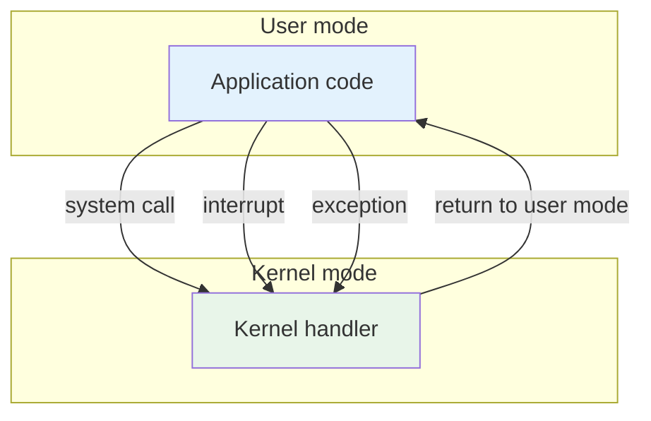

Dual-mode operation is a hardware mechanism by which the CPU executes in either a privileged kernel mode or a restricted user mode, and only kernel-mode code may execute privileged instructions or access memory outside the current process.

The mechanism determines which code controls the hardware. Direct control of the hardware by applications would be simple and fast but would provide no protection between applications or between an application and the system. The OS therefore performs hardware operations on the application's behalf, and the mode bit enforces that division.

## Dual-mode operation

Application code executes with restricted privileges under one of two hardware modes.

- **Kernel mode** is privileged. Code executes with full access to the hardware.
- **User mode** is restricted. Code can execute only the non-privileged instructions, and memory access is limited to the process's own memory.

A periodic timer interrupt guarantees that the kernel regains control from a running user process.

On x86 the current privilege level (CPL) is held in the low two bits of the CS segment register; EFLAGS holds the separate I/O privilege level (IOPL). MIPS stores the current mode in the status register.

> [!tip] Mode switch vs. context switch
> A syscall, interrupt or exception switches the CPU's *mode*, and the same process remains on the CPU throughout. A *context switch* changes which process the CPU runs, and it is a separate operation with higher overhead (see [[systems/operating-systems/lecture-notes/handle-tables|handle tables]]). Mode switches occur more frequently than context switches.

## Related notes

- [[systems/operating-systems/lecture-notes/processes|processes]]
- [[systems/operating-systems/v1-kernels-and-processes/2-the-kernel-abstraction|the kernel abstraction]]
