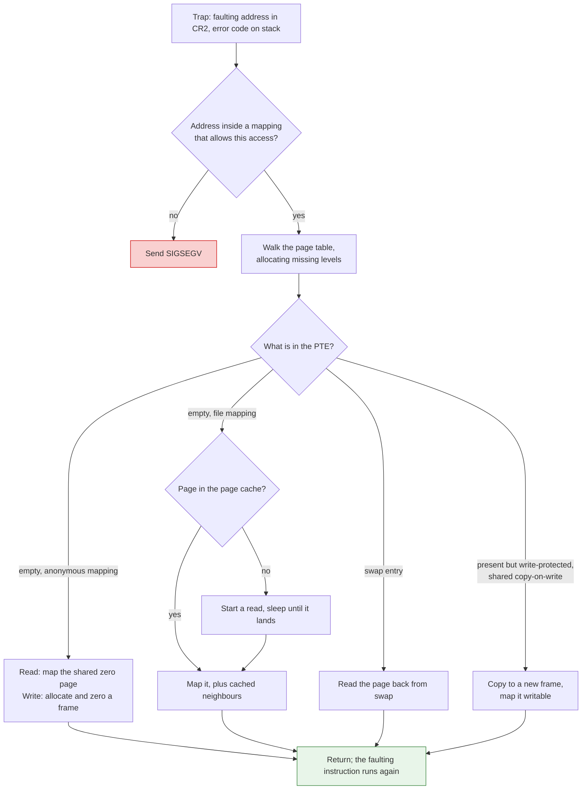
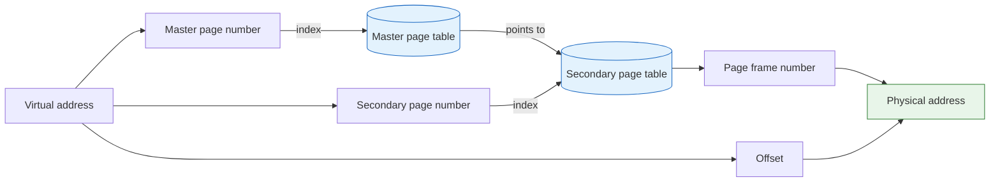

## Purpose

A page fault is the processor telling the kernel that it couldn't finish a memory access with the page table as it stands. Most faults are not errors. They are how a process gets memory it hasn't touched yet, how `fork` shares pages until someone writes, and how a file mapping or swapped-out page comes back from disk. This note follows one fault from the trap to the restarted instruction and measures what the different kinds cost on Linux. Most of its length goes to the choice the handler sometimes has to make, which page to throw out, compared on real memory traces of four programs in a simulator you can step through. The last section covers what page tables themselves cost.

It assumes the basics of [[systems/operating-systems/lecture-notes/paging|paging]]: virtual pages, physical frames, and page table entries (PTEs) with a valid bit.

## What raises a fault

The memory management unit (MMU) raises a fault when the PTE for an address is not present, or when it is present but forbids the access: a write to a read-only page, a user-mode access to a kernel page, or an instruction fetch from a page marked no-execute. On x86-64 the processor puts the faulting virtual address in the CR2 register and pushes an error code whose low bits say what went wrong ([Intel SDM Vol. 3A, §4.7](https://www.intel.com/content/www/us/en/developer/articles/technical/intel-sdm.html)):

| Bit | Name | Set when |
| --- | --- | --- |
| 0 | P | the page was present, so this is a protection violation (clear means not present) |
| 1 | W/R | the access was a write |
| 2 | U/S | the access came from user mode |
| 3 | RSVD | a reserved bit was set in some paging-structure entry |
| 4 | I/D | the access was an instruction fetch |

The processor doesn't say which process faulted. The kernel already knows, because it knows which task it was running, and that task's memory map and page table root are where the handler starts.

A page fault is a *fault* in the x86 sense: the saved instruction pointer points at the instruction that faulted, not the one after it, and no part of that instruction has taken effect. When the handler returns, the instruction runs again from the start and this time finds a usable PTE. A system call, by contrast, returns to the instruction after the trap.

The kernel sorts every fault into one of three outcomes:

- **Bad address.** No mapping covers the address, or the mapping forbids this access, such as a write to a read-only mapping. The process gets `SIGSEGV`.
- **Minor fault.** The access is legitimate and the data is already in memory, or doesn't need to be read at all. A first touch of anonymous memory gets a zeroed page. A file page already in the page cache only needs a PTE. A write to a page shared copy-on-write after `fork` gets a private copy.
- **Major fault.** The data has to be read from a file or from swap first. The faulting thread sleeps while the I/O runs, and the scheduler runs something else.

Linux reports both counts per process (`ru_minflt` and `ru_majflt` from `getrusage`, or `min_flt` and `maj_flt` in `/proc/PID/stat`). Windows calls the same two kinds soft and hard faults; [[systems/operating-systems/lecture-notes/windows-memory-management|Windows memory management]] describes the standby and modified lists that make many of its soft faults possible.

## What the handler does

Linux's handler, `handle_mm_fault`, is a concrete example of the general recipe:

The first step looks up the address in the process's list of mappings, which Linux calls virtual memory areas (VMAs). Each VMA records a range, its permissions, and what backs it: nothing (anonymous memory), or a file and an offset. A fault outside every VMA, or one the VMA's permissions don't allow, is the `SIGSEGV` case. Until Linux 6.4 this lookup held `mmap_lock`, one lock for the whole address space, so a thread faulting in one mapping could wait behind another thread changing a different one. Since 6.4 most faults lock only the VMA they hit ([LWN](https://lwn.net/Articles/937943/)).

Next the handler walks the page table from the root, allocating any missing intermediate tables, down to the PTE for the address. What it finds there decides the rest:

- **An empty PTE in an anonymous mapping** is a first touch. A read maps the kernel's shared zero page read-only, so a program that only reads its fresh memory never gets a private copy. A write allocates a frame, zeroes it, and maps it writable.
- **An empty PTE in a file mapping** means a lookup in the page cache by file and page index. If the page is there, the fault is minor, and Linux also maps neighbouring pages that are already cached ("fault-around"), so a sequential reader takes one fault per block of pages instead of one per page. If it isn't there, the kernel starts the read, usually with readahead so the next pages arrive in the same I/O, and the thread sleeps on the page's lock until the data lands.
- **A non-present PTE holding a swap entry** is an anonymous page that was swapped out. The hardware ignores every other bit of a PTE whose present bit is clear, so Linux writes the swap device and slot into the invalid PTE itself ([kernel page table docs](https://docs.kernel.org/mm/page_tables.html)). That is where the "disk address" of an evicted anonymous page lives; there is no separate table for it. File pages need no such entry, because the VMA's file and offset already say where the data lives.
- **A present PTE that is write-protected** in a writable mapping is copy-on-write. If another process still shares the frame, the kernel copies it into a new frame and maps that one writable. If this process is the last user, it just makes the PTE writable.

The frame a read is heading into has to stay put until the read finishes, which Linux guarantees by holding the page locked in the page cache. Once the PTE is filled in, the handler returns and the instruction restarts.

## What a fault costs, measured

The cost depends on which branch the handler takes. [`fault_cost.c`](page-fault-experiments/fault_cost.c) touches one byte in each page of a 64 MiB region set up eight different ways, 15 times each, and divides the time by the number of 4 KiB pages:

| What the loop touches | Faults per page | Time per 4 KiB page, median (IQR) |
| --- | ---: | ---: |
| Pages already mapped (the loop's own cost) | 0 | 23 ns (19 to 26) |
| Anonymous memory, first read (zero page) | 1 | 675 ns (629 to 766) |
| Anonymous memory, first write (zero a new frame) | 1 | 1.70 µs (1.58 to 1.95) |
| Anonymous memory after `fork`, written by the child (copy) | 1 | 2.89 µs (2.67 to 3.89) |
| Anonymous memory backed by 2 MiB huge pages, first write | 1/512 | 0.82 µs (0.56 to 1.32) |
| File pages already in the page cache | 1/32 | 73 ns (64 to 77) |
| File pages on disk, readahead off | 1 | 37.3 µs (34.9 to 38.3) |
| File pages on disk, default readahead | 1/32 | 1.48 µs (1.44 to 1.87) |

What the numbers show:

- **A minor fault costs about a microsecond.** Trapping, finding the VMA and filling the PTE costs about 0.7 µs when no frame is needed (the zero page). Allocating and zeroing a frame brings it to 1.7 µs, and copying 4 KiB instead of zeroing it to 2.9 µs.
- **A major fault costs about 20 times a minor one here, and far more on slower storage.** This machine is a virtual machine whose disk is a virtual block device, and 37 µs per random 4 KiB read is in the range of a fast SSD. A spinning disk takes several milliseconds per random read, the cost of thousands of minor faults.
- **Batching hides most of the cost.** With default readahead, one I/O brought in all 64 MiB and the rest of the accesses became minor faults that each mapped about 32 pages, for 1.5 µs per page instead of 37. The cached-file case shows the same batching on its own: 516 faults for 16,384 pages, 2.3 µs per fault, 73 ns per page.
- **Huge pages cut the fault count by 512 but not the time by 512.** Each 2 MiB fault took about 420 µs, almost all of it zeroing 2 MiB. Per byte that is about half the cost of 4 KiB faults. The bigger gain from huge pages comes later, in the TLB.

Two kinds aren't measured: this VM has no swap device, so there are no swap-ins, and the dirty-page writeback that a replacement can force isn't isolated.

> [!note]- Measurement record
> - **Code**: [`fault_cost.c`](page-fault-experiments/fault_cost.c), compiled with `gcc -O2` and run as `./fault_cost 64 15 FILE`. Raw results, one JSON line per case per repetition: [`fault_cost_results.jsonl`](page-fault-experiments/fault_cost_results.jsonl). Fault counts come from `getrusage` before and after each loop, time from `CLOCK_MONOTONIC`.
> - **Cases**: anonymous mappings use `madvise(MADV_NOHUGEPAGE)` except the huge page case, which aligns the region to 2 MiB and uses `MADV_HUGEPAGE`. The fork case times the child writing every page the parent wrote before `fork`. The uncached file cases first call `fdatasync`, `posix_fadvise(POSIX_FADV_DONTNEED)` and, as root, write `1` to `/proc/sys/vm/drop_caches`; all 16,384 accesses in the readahead-off case were counted as major faults, so the file really was out of memory. Readahead is turned off with `madvise(MADV_RANDOM)`.
> - **Environment**: a virtual machine with 4 vCPUs of an Intel Xeon at 2.10 GHz and 15 GiB of RAM, Linux 6.18.44, ext4 on a virtio block device, no swap, transparent huge pages set to `madvise`.
> - **Variability**: 15 repetitions of all eight cases, interleaved. Medians and interquartile ranges are over the repetitions. The huge page case varies most.
> - **Not established**: the pages-per-fault figure for cached file reads (about 32) is what this kernel did. The fault-around and large-folio behavior behind it has changed across kernel versions, and this note doesn't pin down which mechanism produced 32.

## Finding a free frame

A fault that needs a new frame takes one from the free lists. Linux tries hard not to run page replacement inside the fault itself. Each memory zone has three watermarks, min, low and high. When free memory drops below low, the kernel wakes `kswapd`, a background thread that reclaims pages until free memory is back above high. Only when an allocation would take free memory below min does the allocating thread reclaim pages itself ("direct reclaim"), which is where a page fault can suddenly take milliseconds ([sysctl/vm docs](https://docs.kernel.org/admin-guide/sysctl/vm.html), `min_free_kbytes` and `watermark_scale_factor`).

Reclaim picks victims and then has to make each victim's frame free. The work depends on what the frame holds:

- **A clean file page** can be dropped. Its data is still in the file, so the next access is a major fault that reads it back.
- **A dirty file page** has to be written back to its file first.
- **An anonymous page** has nowhere to go but swap. It is written to a swap slot and its PTE becomes a swap entry. With no swap configured, as on the VM above, anonymous memory can't be reclaimed at all, and the kernel can only drop file pages or, when that fails, kill a process.

The victim's PTE may belong to another process, and a shared page may be mapped by many. The kernel finds every PTE that maps a frame through its reverse map, clears each one, and flushes the stale translations from every CPU's TLB, which on a multiprocessor means interrupting the other CPUs (a TLB shootdown; see [[systems/operating-systems/lecture-notes/tlb|translation lookaside buffers]]). Doing this ahead of time, in `kswapd` and in background writeback that cleans dirty pages before anyone needs their frames, is what keeps most faults minor.

## Choosing the victim

When memory is full, something has to go, and the choice decides how many future faults there are. Four policies cover the textbook ground:

- **OPT** (Belady's MIN): evict the page whose next use is furthest in the future. It needs the future, so no kernel can run it, but it gives the fewest faults possible for a given memory size ([Belady 1966](https://doi.org/10.1147/sj.52.0078)). Every other policy is measured against it.
- **FIFO**: evict the page that was loaded earliest, however recently it was used.
- **LRU**: evict the page whose last use is furthest in the past. Exact LRU needs to record every access, which hardware doesn't do for the kernel.
- **CLOCK**: the frames sit in a circle with a reference bit each, which the hardware sets on every access. A hand sweeps the circle on each eviction, clearing set bits and evicting the first page whose bit is already clear. It needs only the bit the hardware already provides, and approximates LRU ([Corbató 1968](https://dspace.mit.edu/handle/1721.1/149379)).

The [[systems/operating-systems/lecture-notes/paging#page-replacement|paging note]] defines these and the counter-based LRU approximations in more detail. Here they run on real programs. Each trace is the full list of 4 KiB pages a program touched, in order: every instruction fetch, load and store, recorded with Valgrind's [Lackey](https://valgrind.org/docs/manual/lk-manual.html) tool, with back-to-back repeats of the same page merged. The merge changes no policy's fault count, because a repeat is always a hit and changes no state that matters. The simulator below replays one million consecutive references from the middle of each run.

Things to try:

- **Drag the memory slider on sort between 8 and 12 frames.** LRU faults 53,195 times with 9 frames, 27,289 with 10 and 3,729 with 11. Sort's inner loop cycles through about 11 pages, and once they all fit nearly every reference hits. Below that, LRU keeps evicting the page the loop needs next. OPT, which gives up on some pages to keep others, faults about a third as often at 8 and 9 frames.
- **Switch the map between policies.** Each mark is a fault. LRU and FIFO fault in dense bands when the program cycles through more pages than fit. OPT's faults are sparser at the same size.
- **Step through an eviction.** Each row says which page the policy evicted and why: when it was loaded, when it was last used, how far the clock hand swept, or when it will next be needed. At 16 frames or fewer the rows also draw the frames.
- **Try the textbook string with 3 and then 4 frames.** FIFO takes 9 faults with 3 frames and 10 with 4. That is Belady's anomaly, and the real traces show it too (see below).

<PageReplacement trace="sort200k" base="/systems/operating-systems/lecture-notes/page-fault-experiments/traces/" />

### Results on the full runs

The figure uses windows so it can replay them in a browser. The table uses the four complete runs, from 6 to 36 million references each. At each memory size it gives LRU's faults and every other policy's faults relative to LRU:

| Program | Footprint | Frames | LRU faults | FIFO | CLOCK | ARC | Random (5 seeds) | OPT |
| --- | ---: | ---: | ---: | ---: | ---: | ---: | ---: | ---: |
| sort | 593 pages | 16 | 120,672 | 1.31× | 1.16× | 1.01× | 1.09× | 0.48× |
| | (2.3 MiB) | 64 | 2,172 | 1.47× | 1.01× | 1.00× | 1.62× | 0.57× |
| gzip -9 | 260 pages | 16 | 753,809 | 1.14× | 1.03× | 1.00× | 1.14× | 0.56× |
| | (1.0 MiB) | 64 | 527 | 1.48× | 1.10× | 1.00× | 1.73× | 0.69× |
| bzip2 -9 | 508 pages | 16 | 548,828 | 1.30× | 1.03× | 0.96× | 1.36× | 0.60× |
| | (2.0 MiB) | 64 | 114,429 | 1.05× | 0.94× | 1.00× | 1.07× | 0.41× |
| gcc (cc1) | 1,883 pages | 64 | 231,224 | 1.41× | 1.18× | 1.01× | 1.32× | 0.42× |
| | (7.4 MiB) | 256 | 5,328 | 1.54× | 1.07× | 1.01× | 1.76× | 0.68× |

What the numbers show:

- **The gap to OPT is large everywhere.** LRU takes 1.5 to 2.5 times OPT's faults at these sizes. No policy that can't see the future closes much of that gap here. The best case is ARC on bzip2 with 16 frames, at 4% fewer faults than LRU.
- **CLOCK stays close to LRU.** It is within 18% of LRU everywhere in the table, and on bzip2 at 64 frames it beats LRU by 6%.
- **FIFO is the worst deterministic policy.** It evicts pages that are still in heavy use because they happened to load early. On sort at 16 frames and gcc at 64 it does worse than evicting at random. Random eviction's results across 5 seeds differ by less than 1% where faults are frequent and by up to about 6% either way where they are rare.
- **ARC buys nothing on these traces.** ARC was designed for disk and database caches, where it splits the cache between pages seen once recently and pages seen more than once. In a memory reference string nearly every page is referenced again within a few instructions, so almost everything counts as "seen more than once" and ARC behaves like LRU. The deep dives below say what kernels use instead.
- **Faults drop steeply once the working set fits.** gzip's LRU faults fall from 29,562 at 48 frames to 527 at 64. Quadrupling memory again to 256 frames only brings them to 260, one compulsory fault per page. Denning's [[systems/operating-systems/lecture-notes/paging#working-set-model|working set model]] is built on this shape.

### Belady's anomaly in real traces

Give FIFO one more frame and it can fault more. Belady, Nelson and Shedler constructed reference strings where it does ([1969](https://doi.org/10.1145/363011.363155)), and the textbook string in the figure is the standard small example. Real programs do it too. Checking every frame count from 1 to each program's footprint (to 600 frames for gcc):

| Program | Frame counts where one more frame added faults | Largest case |
| --- | --- | --- |
| sort | FIFO 3 of 592, CLOCK 60 of 592 | CLOCK, 152 → 153 frames: 805 → 839 faults |
| gzip -9 | FIFO 0 of 259, CLOCK 18 of 259 | CLOCK, 129 → 130 frames: 285 → 290 faults |
| bzip2 -9 | FIFO 20 of 507, CLOCK 38 of 507 | FIFO, 173 → 174 frames: 5,777 → 7,527 faults (+30%) |
| gcc (cc1) | FIFO 15 of 599, CLOCK 101 of 599 | FIFO, 148 → 149 frames: 31,495 → 32,732 faults |

LRU and OPT can't do this. Both are *stack algorithms* ([Mattson et al. 1970](https://doi.org/10.1147/sj.92.0078)): the set of pages they keep in $n$ frames is always a subset of what they would keep in $n + 1$, so anything that hits with less memory also hits with more. FIFO lacks this property because the order it loads pages in depends on the memory size, and CLOCK lacks it because the hand's position does. The anomaly in these traces is local, a few percent at scattered sizes with one 30% case, and the curves still fall overall. In theory it has no bound: [Fornai and Iványi](https://arxiv.org/abs/1003.1336) construct strings where the ratio of faults with more memory to faults with less is as large as you like.

> [!note]- Measurement record
> - **Traces**: recorded with `valgrind --tool=lackey --trace-mem=yes` (Valgrind 3.22.0), which logs every instruction fetch, load, store and modify. [`lackey_pages.c`](page-fault-experiments/lackey_pages.c) turns each access into its 4 KiB page number (both pages, for an access that crosses a boundary) and drops a reference to the same page as the one before it; [`to_u32.py`](page-fault-experiments/to_u32.py) renumbers pages in order of first touch. Instruction fetches are 71 to 78% of the accesses.
> - **Programs and inputs**: GNU sort 9.4 on the first 200,000 bytes of Lua 5.4's manual source and C files; gzip 1.12 at `-9` and bzip2 1.0.8 at `-9` on the first 4,000 lines (132,302 bytes) of the same text; gcc 13.3.0's `cc1 -O0` compiling Lua's `lopcodes.c` after preprocessing. The Lua sources come from the [lupa 2.8 source package on PyPI](https://pypi.org/project/lupa/2.8/). Valgrind runs programs on a synthetic CPU and places some memory differently from a native run, so these are traces of the programs as Valgrind runs them.
> - **Lengths**: sort 6,079,832 page references (10.3 million accesses), gzip 14,476,278 (33.7 million), bzip2 36,075,368 (62.8 million), cc1 20,998,072 (38.5 million).
> - **Simulator**: [`pagesim.c`](page-fault-experiments/pagesim.c) implements FIFO, CLOCK, LRU, OPT (with a heap over next-use times), ARC as in Figure 4 of the ARC paper, and random eviction. [`check.py`](page-fault-experiments/check.py) compares it with the plain Python versions in [`refsim.py`](page-fault-experiments/refsim.py) on 40 random strings at several sizes; all fault counts agree. Results: [`replacement_results.json`](page-fault-experiments/replacement_results.json).
> - **The figure**: windows of 1,000,000 references starting 500,000 before the middle of each run, renumbered and stored as gzipped 16-bit arrays beside [`window_curves.json`](page-fault-experiments/traces/window_curves.json), which holds `pagesim.c`'s counts for every frame count from 1 to the window's page count. A test runs the figure's own TypeScript policies on every window and checks their fault counts against those, checks the textbook string, and checks that every FIFO, LRU and OPT eviction follows its rule.
> - **Reproduction**: [`capture.sh`](page-fault-experiments/capture.sh) downloads the inputs, records the traces and regenerates every file here in about 20 minutes. A second full run from scratch differed slightly in trace length (gzip had 14,476,401 references against 14,476,278; cc1 touched 1,882 pages against 1,883), because addresses vary between runs with address space randomization.

> [!note]- Deep dive: what Linux actually runs
> Linux doesn't run plain CLOCK. For most of its history it has kept two lists, *active* and *inactive*, and today it keeps one pair for anonymous pages and another for file pages. New pages enter the inactive list; a page referenced again while inactive is promoted to active; reclaim takes pages off the tail of the inactive list and refills it from the active list's tail. Like ARC, this protects pages used repeatedly from a single large scan, which matters more for the file cache than for the reference strings above.
>
> Since Linux 3.15 the kernel also remembers evicted file pages briefly. An evicted page leaves a "shadow" entry in the page cache that records how many evictions had happened so far. When the page faults back in, the number of evictions since then, the *refault distance*, says how much more memory would have kept it. A short refault distance means the page fell out of a working set that almost fit, and the kernel activates it straight away (`mm/workingset.c`).
>
> Linux 6.1 added the multi-generational LRU (MGLRU), which replaces the two lists with several generations, each a group of pages with similar access recency. Instead of sweeping a clock hand frame by frame, it can scan page tables to harvest accessed bits in bulk, which is cheaper when memory is large and most pages are cold ([kernel docs](https://docs.kernel.org/admin-guide/mm/multigen_lru.html)). It is a build option, and the kernel on the VM above was built without it.

> [!note]- Deep dive: ARC, LIRS and CLOCK-Pro
> LRU's best-known failure is a loop over more pages than fit, where it evicts exactly the page that will be needed next and every reference faults. Three policies from the 2000s attack this by tracking more history than recency.
>
> - **ARC** ([Megiddo and Modha 2003](https://www.usenix.org/conference/fast-03/arc-self-tuning-low-overhead-replacement-cache)) splits memory between recently seen and repeatedly seen pages and keeps "ghost" lists of recently evicted page numbers. A hit in a ghost list shifts the split toward the list that would have kept the page. It tunes itself and costs about as much as LRU.
> - **LIRS** ([Jiang and Zhang 2002](https://doi.org/10.1145/511334.511340)) ranks pages by *reuse distance*, the number of distinct pages referenced between a page's last two uses, rather than by time since last use, and keeps the pages with short reuse distances resident.
> - **CLOCK-Pro** ([Jiang, Chen and Zhang 2005](https://www.usenix.org/conference/2005-usenix-annual-technical-conference/clock-pro-effective-improvement-clock-replacement)) carries the same idea to a clock, so it needs only reference bits.
>
> All three do well on block and database traces with scans and loops. On the instruction-and-data traces above, ARC ties LRU, for the reason given with the table.

## Huge pages

A 2 MiB huge page replaces 512 PTEs with one entry a level up. Linux backs anonymous memory with transparent huge pages (THP) when an aligned 2 MiB range is available, either at fault time or later, when the `khugepaged` thread collapses runs of small pages into large ones ([THP docs](https://docs.kernel.org/admin-guide/mm/transhuge.html)). The fault table shows the fault-side effect: 512 times fewer faults, each costing hundreds of microseconds to zero 2 MiB.

The other effect is translation reach. [`tlb_walk.c`](page-fault-experiments/tlb_walk.c) follows a random cycle of pointers, one per 4 KiB page, through 1 GiB, so every load lands on a different page. With 4 KiB pages it took 166 ns per load (median of 10 runs, range 162 to 185). With 2 MiB pages, touching exactly the same cache lines, it took 125 ns (range 121 to 130). The 41 ns difference is TLB misses and page walks: 262,144 small pages are far more than the TLB holds, while 512 huge ones nearly fit. The [[systems/operating-systems/benchmarks/tlb|TLB benchmark note]] measures the 4 KiB side of this with strided scans.

Huge pages have costs. Zeroing 2 MiB in one fault adds latency to that one access. A process that touches one byte of a 2 MiB range gets all 2 MiB, and finding free aligned 2 MiB ranges can force the kernel to move pages around (compaction). That is why many distributions set THP to `madvise`, so only programs that ask for huge pages get them.

> [!note]- Measurement record
> - **TLB reach**: [`tlb_walk.c`](page-fault-experiments/tlb_walk.c), run as `./tlb_walk 1024 10`; results in [`tlb_walk_results.jsonl`](page-fault-experiments/tlb_walk_results.jsonl). Each run builds the same random cyclic permutation of the 262,144 pages, walks it once to warm up, then times 4 million dependent loads. `AnonHugePages` in `/proc/self/smaps_rollup` was 1,048,576 KiB in every huge-page run and 0 in every small-page run.
> - **Page table size**: [`pt_size.c`](page-fault-experiments/pt_size.c), results in [`pt_size_results.jsonl`](page-fault-experiments/pt_size_results.jsonl). Each layout runs in a fresh child process with `MADV_NOHUGEPAGE`; three runs gave identical numbers.
> - **Environment**: as for the fault costs above.

## Costs of paging

### Extra memory references

Every access needs a translation. A hit in the TLB costs nothing extra. A miss makes the hardware walk the page table, one dependent memory read per level: four levels on x86-64 with 48-bit addresses, five with 57-bit addresses. Caches inside the page walker hold upper-level entries and shorten most walks. In a virtual machine both the guest's and the host's page tables have to be walked, and a walk through two 4-level tables can take up to 24 memory references ([Bhargava et al. 2008](https://doi.org/10.1145/1346281.1346286)). The measurement above ran in a VM, so its 41 ns includes that nesting.

### Page table size

A flat page table needs one PTE per page of the address space, used or not. With 32-bit addresses, 4 KiB pages and 4-byte PTEs:

$$
\frac{2^{32}}{2^{12}} = 2^{20} \text{ PTEs}, \qquad 2^{20} \times 4 \text{ B} = 4 \text{ MiB per process}
$$

x86-64 PTEs are 8 bytes, and a flat table for a 48-bit address space would need $2^{36}$ of them, 512 GiB per process. Address spaces are sparse, and the fixes below exploit that.

#### Old fix: page the page table

VAX/VMS kept the system page table in physical memory and placed each process's page tables in the system's virtual address space, so they could be paged like anything else, and a reference could fault on its page table before it faulted on its data ([Levy and Lipman 1982](https://doi.org/10.1109/MC.1982.1653971)). Linux keeps page tables in unswappable kernel memory.

#### Current fix: multi-level page tables

Add levels of indirection, and only create the tables that cover addresses actually in use. With two levels, the virtual address splits into a master page number, a secondary page number and an offset. The master table maps the master page number to a secondary table, and the secondary table maps the secondary page number to a frame:

x86-64 uses four levels of 512 eight-byte entries: 9 bits of index per level and 12 bits of offset, 48 bits in all. One 4 KiB table at the bottom level covers 2 MiB, and one at the level above covers 1 GiB.

That granularity has a cost. [`pt_size.c`](page-fault-experiments/pt_size.c) touches the same 16 MiB of data, 4,096 pages, in three layouts and reads the page table size the kernel reports (`VmPTE` in `/proc/self/status`):

| Layout of 4,096 touched pages | Address range spanned | Page table memory |
| --- | ---: | ---: |
| Contiguous | 16 MiB | 32 KiB (0.2% of the data) |
| One page per 2 MiB | 8 GiB | 16,416 KiB (100%) |
| One page per 1 GiB | 4 TiB | 32,800 KiB (200%) |

Dense data costs 8 bytes of page table per 4 KiB page. Spread one page per 2 MiB and every page needs its own bottom-level table; spread one per 1 GiB and it needs a table at the next level up as well. Multi-level tables bound the cost by what is used rather than by the size of the address space, but sparse use inside each 2 MiB still pays for whole tables.

#### Other designs

- **Hashed page tables.** Hash the virtual page number into a table whose entries hold the VPN and the frame, chaining on collisions. The table's size follows physical memory, not the address space. PowerPC's hashed page table and Itanium's optional virtually hashed page table worked this way.
- **Inverted page tables.** One entry per physical frame, holding the process ID and VPN that live there. The space is minimal, but translation becomes a search, so it goes through a hash of (process ID, VPN), and sharing a frame between processes is awkward because the frame has only one entry. IBM's RT PC used an inverted table.

## Related notes

- [[systems/operating-systems/lecture-notes/paging|Virtual Memory and Paging]], for page table entries, replacement algorithm definitions and the working set model
- [[systems/operating-systems/lecture-notes/tlb|Translation Lookaside Buffer (TLB)]]
- [[systems/operating-systems/benchmarks/tlb|TLB and Page Walk Benchmarks]]
- [[systems/operating-systems/lecture-notes/windows-memory-management|Windows Memory Management]], for working sets and soft faults from the standby list
- [[systems/research/locality-principle|The Locality Principle]], for why the fault curves fall so steeply
- [[systems/operating-systems/section-notes/lab-3-questions|Lab 3 Questions]]
