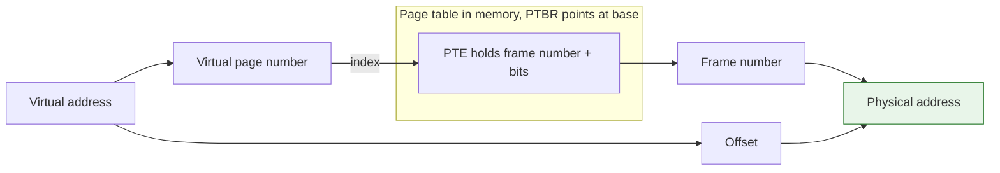

Paging is a memory management scheme that divides a process's virtual address space into fixed-size pages and physical memory into frames of the same size, and maps each page to a frame through a per-process page table.

Since any page can occupy any frame, a process's memory need not be physically contiguous. Virtual memory adds policies that determine which pages reside in memory at a given time, among them demand paging, page replacement and the working set model.

## Why pages

Dividing memory into fixed-size pages prevents **external fragmentation**, and keeping the allocation unit small limits **internal fragmentation**.

- **external fragmentation**: free memory is broken into pieces too small and scattered to use, even though the total would be enough.
- **internal fragmentation**: a process is allocated more memory than it needs, and the excess goes unused.

Virtual address space divides into *pages*, physical address space into *frames*. The page table maps pages to frames. It lives in memory, and the page table base register (PTBR) points at it. Indexed by page number, it yields a frame number.

From the programmer's perspective, memory is a single contiguous address space, independent of the physical memory and hardware beneath it.

## Protection

A process cannot name or address another process's memory, since every access goes through its own page table. The per-process page table is therefore the isolation boundary between processes.

Marking the first page invalid turns NULL pointer dereferences into exceptions.

## Address translation

- The page table provides a layer of indirection.
- A virtual address divides into a **virtual page number (VPN)**, which indexes the page table, and an **offset**.
- The page table entry (PTE) contains the frame number.
- The physical address is the frame number concatenated with the offset.

The OS manages page tables and stores them in memory. There is one PTE per page, i.e. one per VPN. Each process has its own page table, and the PTBR points at the running process's table.

## Shared frames

Multiple processes can map the same frame. Shared libraries and shared memory between processes use this. It also underlies **copy-on-write (COW)**, which reduces the cost of operations such as fork and exec when the shared pages are only read.

## Page table entries

Beyond the frame number, PTEs carry:

- **valid bit**: set when the page is in memory, cleared when it isn't. An access to an invalid page causes a page fault.
- **referenced bit**: set by hardware when the page is read or written, cleared by the OS. Used to approximate LRU replacement.
- **dirty/modified bit**: set by hardware when the page is written, cleared by the OS. Used for COW and to skip writeback of clean pages.
- **protection bits**: read/write/execute permissions, enforced in hardware.

## Advantages and costs of paging

Physical allocation is simple, since any frame on the free list (usually a linked list) can satisfy a request. External fragmentation is eliminated, since every allocation unit has the same size. Paging also extends naturally to virtual memory, because pages can be swapped in and out individually and a program need not be fully resident to run.

Paging has three costs. Internal fragmentation remains when a page is only partly used. Every memory access also requires a page table lookup, an overhead that the TLB reduces. The page table itself can be large. One PTE per page in a 32-bit address space with 4 KB pages is $2^{20}$ PTEs, about 4 MB at 4 bytes per PTE. Multi-level page tables reduce this size; see [[systems/operating-systems/lecture-notes/page-faults|page faults]].

## Paged virtual memory

- The full used address space resides on secondary storage (disk) in page-sized blocks.
- The OS uses main memory as a cache for the disk.
- When a page is needed, it is transferred into a free page frame.
- With no free frames, the OS must evict a page. A dirty page is written to disk first; a clean page can be discarded.
- The entire mechanism is transparent to the application.

## Page faults

When the OS evicts a page, it marks the PTE invalid and records the page's disk location in a separate data structure. A later access to that page raises an exception, and after trapping into the kernel the OS runs the page fault handler, which looks up the page on disk, reads it into a free frame, updates the page table, and restarts the instruction that faulted. The handler is described in detail in [[systems/operating-systems/lecture-notes/page-faults|page faults]].

### Hard vs soft page faults

- **Hard page fault**: the page is not in memory, and the OS must read it from disk or other backing storage.
- **Soft page fault**: the page is still in memory, so the OS can map it back in without touching backing storage.

## Demand paging

Pages are brought into main memory only when they are referenced, so only the code and data that are used occupy memory. Few systems attempt to anticipate which pages will be needed. Clustering is common, however. The OS tracks pages that are brought in and evicted together and brings in the whole cluster when one of them is referenced, and some interfaces let the programmer or compiler specify the clusters.

## Page replacement

Reading in a page uses either an existing free frame or a frame freed by evicting another page. Suitable eviction candidates are pages that will not be referenced for some time and pages that have not been modified, since clean pages need not be written back. The OS typically maintains a pool of free pages so that allocations need not wait for an eviction, and it keeps a supply of clean pages, which can be evicted without a write to disk.

> [!tip] How the algorithms relate
> Belady's optimal algorithm cannot be implemented and serves as the reference against which the others are measured. Exact LRU requires bookkeeping on every access, and its overhead is too high in practice. The clock algorithm approximates LRU and is the variant that production systems commonly implement.

### Belady's optimal algorithm

Replace the page that will not be used for the longest time in the future. It cannot be implemented in practice, since it requires knowledge of future references, but it serves as a benchmark for other algorithms.

### FIFO

Replace the page that has been in memory the longest. It is simple to implement. It also suffers from **Belady's anomaly**: increasing the number of frames can increase the number of page faults.

### LRU

Replace the page that has not been used for the longest time. Doing this exactly requires recording the time of the last reference to every page on every access, which has prohibitive overhead, so systems approximate it.

### Approximate LRU

Keep a counter for each page. At some regular interval, for each page:

- if the reference bit is 0, increment the counter
- if the reference bit is 1, zero the counter
- zero the reference bit

The counter then holds the number of intervals since the last reference to the page, and the page with the largest counter is the least recently used.

### LRU clock

Keep the pages in a circular list, each with a reference bit that is set when the page is referenced. To evict, sweep a clock hand around the list. If the page under the hand has its bit set, the bit is cleared and the hand advances; if the bit is clear, the page is evicted. The overhead is low when memory is plentiful. As memory size grows, the accuracy of the approximation decreases, and multiple hands can compensate.

## Loading a program

- Create the descriptor / process control block (PCB).
- Create the page table.
- Put the address space image on disk in page-sized blocks.
- Build the page table with every PTE valid bit set to 0, and record each page's disk location in a separate data structure.
- When the process starts executing, point the PTBR at its page table.

Demand paging then brings pages in from disk as they are referenced.

## Locality

- **Temporal locality**: a memory location accessed now is likely to be accessed again soon.
- **Spatial locality**: locations near an accessed location are likely to be accessed soon.

[[systems/research/locality-principle|Locality]] keeps paging infrequent and makes it worthwhile for the OS to bring in multiple pages at once. Paging relies on the assumptions that a page brought into memory is referenced many times and that, on average, the pages brought in are used.

## Local vs global replacement

Local replacement means each process evicts only from its own set of pages. Global replacement lets the OS evict any page, regardless of which process owns it. Linux replaces globally.

Global replacement is typically implemented with a shared pool of free pages, and it allows the OS to allocate frames to the processes with the greatest demand, which can reduce the total number of page faults.

## Working set model

Denning's working set model defines:

- $t$: time
- $w$: the working set window, measured in page references

A page is in the working set only if it was referenced in the last $w$ references:

$$
WS(t,w) = \{\text{pages } P \text{ such that } P \text{ was referenced in the interval } (t-w, t]\}
$$

$|WS(t, w)|$ is the number of pages in the working set at time $t$, and it varies over time. During a period of poor locality, the working set can become very large.

The model aims to reduce page faults by keeping each process's working set in memory. **Thrashing** is the condition in which a process spends more time paging than executing, and keeping working sets resident prevents it.

## Related notes

- [[systems/operating-systems/lecture-notes/page-faults|page faults]]
- [[systems/operating-systems/lecture-notes/tlb|translation lookaside buffers]]
- [[systems/operating-systems/lecture-notes/windows-memory-management|Windows memory management]]
- [[systems/research/locality-principle|The Locality Principle]]
- [[systems/operating-systems/section-notes/lab-3-questions|Lab 3 Questions]]
