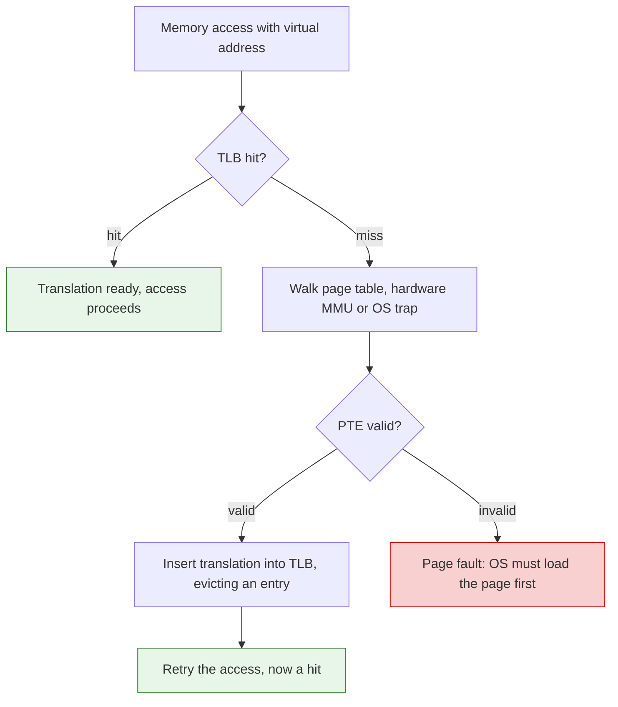

The translation lookaside buffer (TLB) is a small hardware cache of page table entries, which map virtual page numbers to physical page numbers. Under paging without a TLB, every memory access requires an additional access to read the page table entry. With a TLB, most accesses are translated without reading the page table.

## Mapping

The TLB admits the same associativity options as other caches:

- **Direct mapped**: each virtual page number can occupy exactly one TLB slot. This organization is the simplest and has the fastest lookup, and it has the most conflict misses.
- **Fully associative**: a translation can occupy any slot, and the hardware searches every slot in parallel on each access. This organization is the most flexible and the most difficult to build with many entries.
- **N-way set associative**: an intermediate design. The TLB is divided into sets, and a translation can occupy any slot within its set.

TLBs hold fewer entries than data caches, and each miss requires a page table walk, so TLBs are commonly built fully associative or with high set associativity.

## Managing the TLB

The TLB satisfies almost all address translations, and the page table is consulted only on misses. On a miss, the translation is read from the page table and inserted into the TLB, usually replacing an existing entry.

A TLB miss is handled either in hardware or in software:

- Hardware, via the MMU, as on x86. A hardware register holds the location of the page table in memory, and the MMU walks the table itself. The OS maintains the page table, and it must keep it in the hardware-defined format.
- Software, by the OS, with a software-loaded TLB. A TLB miss traps to the OS like a page fault. The OS finds the page table entry, loads it into the TLB, and restarts the instruction that missed. The handler runs on every miss and must therefore have low latency, so the CPU's ISA includes special instructions for loading TLB entries.

> [!tip] Measured cost
> On x86-64 a miss requires a page walk of up to four dependent memory loads. The [[systems/operating-systems/benchmarks/tlb|TLB benchmarks]] measure roughly 7 ns of additional latency per access when every access touches a new page.

### Context switching

The OS must keep the TLB consistent with the page table, so when the page table changes it invalidates the affected TLB entries. When a process is switched in, the OS must invalidate or flush the entire TLB, and the misses that follow account for a large part of context switch overhead. Including a process identifier in each TLB entry and in the lookup avoids the flush, since entries of different processes can then reside in the TLB at the same time.

## Functionality built on page tables

- **Memory protection**: each PTE carries protection bits specifying access rights for the page, so violations are detected in hardware, at much lower overhead than detection in software.
- **Shared memory**: multiple processes can map the same physical page. Shared libraries and shared memory use this, and copy-on-write builds on it.

### Loading shared libraries

The OS loads a shared library once and maps the same physical pages into the address space of every process that uses it, transparently to the user. The library need not occupy the same virtual address in every process, but the OS attempts to place it there, and each library typically has a preferred virtual address, which simplifies loading. Once many libraries are loaded, the preferred addresses may not all be available, so libraries must be dynamically relocatable.

### Memory-mapped files

A memory-mapped file is mapped into a process's address space, and the process accesses it with loads and stores in place of read and write calls. A store to a mapped address becomes a write to the file. Depending on the OS and the caching policy (write-through or write-back), the file is updated immediately or later. Many applications use memory mapping because it is an efficient method of reading and writing files.

#### Soft page faults

A soft fault is a fault on a page that is actually in memory, with the PTE deliberately marked invalid. Resolving one has low overhead because it involves no disk I/O. Soft faults serve any mechanism that requires the OS to be notified when a page is referenced, such as a debugger watchpoint. Windows uses soft faults in its page replacement strategy; see [[systems/operating-systems/lecture-notes/windows-memory-management|Windows memory management]].

## Related notes

- [[systems/operating-systems/lecture-notes/paging|paging]]
- [[systems/operating-systems/lecture-notes/page-faults|page faults]]
- [[systems/operating-systems/benchmarks/tlb|TLB benchmarks]]
