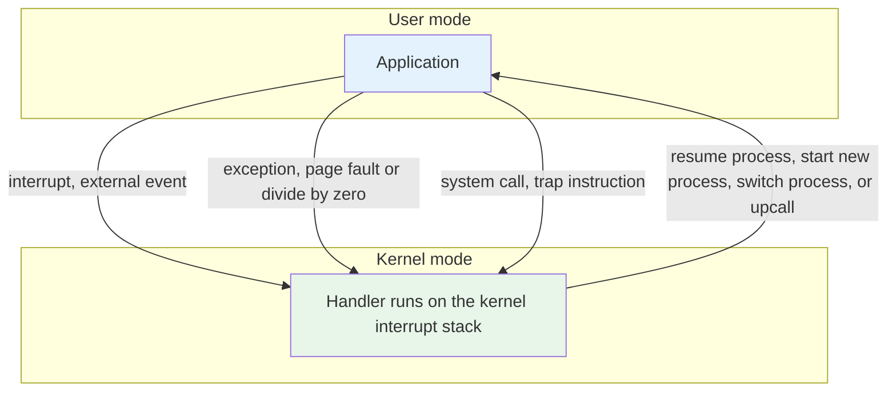
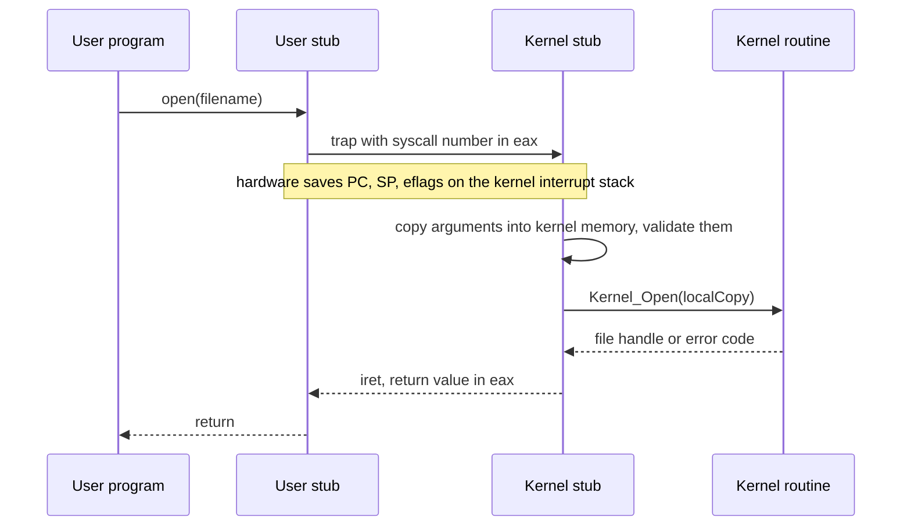

Chapter 2 of [Operating Systems: Principles and Practice](https://ospp.cs.washington.edu/) treats the kernel abstraction, the means by which the kernel runs untrusted application code directly on the hardware while retaining control of the machine. The mechanism is dual-mode operation together with a small set of tightly controlled paths between user mode and kernel mode. Anderson and Dahlin state the motivation as follows:

> "A central role of operating systems is protection - the isolation of potentially misbehaving applications and users so that they do not corrupt other applications or the operating system itself."

The chapter rests on two definitions. The **kernel** is the lowest level of software on the machine. It is the first program loaded on boot, it stays in memory until shutdown, and it is the only program that runs in privileged mode. A **process** is the execution of an application program with restricted rights. The kernel manages processes, and a process must ask the kernel to perform any operation it lacks the rights to do itself.

## The Process Abstraction

A process is an instance of a program in the same sense that an object is an instance of a class. The program's instructions are stored in a file on disk. The user edits the file and compiles it into a binary executable. When the user runs the executable, the OS creates a new process with its own program data, heap, and stack, loads the executable into memory, and starts it.

The OS tracks each process in a **process control block** (PCB). The PCB holds the process ID, the process state, the program counter, the stack pointer, memory management information, and accounting information.

Linux calls its PCB `struct task_struct` and links tasks together in a doubly linked list starting from the initial task with pid 0. Processes can be listed with `ps`, and their data read directly from `/proc` for the system and `/proc/<pid>` for a specific process.

## Dual-Mode Operation

A single bit in the processor determines whether the CPU is in user mode or kernel mode. In user mode, the hardware checks every instruction and blocks anything that could harm the system. In kernel mode, those checks are disabled.

The **principle of least privilege** says a process should only have access to the resources it needs to do its job. The hardware enforces the principle, since only code in kernel mode has unrestricted access. Some operating system code runs in ordinary user-level processes, the window manager for example. Code that runs in kernel mode must be trusted, because it can access all of the hardware.

Hardware support for user mode consists of three mechanisms:

| Feature                  | Description                                                                            |
| ------------------------ | -------------------------------------------------------------------------------------- |
| Privileged Instructions  | Instructions only the kernel can execute.                                              |
| Memory Protection        | Processes cannot access memory that does not belong to them.                           |
| Timer Interrupts         | The hardware can interrupt a running process at any time and hand control to the kernel. |

The mode bit is one of several flags in the **processor status register** (PSR), which the hardware updates when the processor switches between user and kernel mode. Application code cannot write it directly. Intel x86 processors support 4 privilege levels, of which MacOS, Windows and Linux use only two.

### User and Kernel Memory

Physical memory is conventionally split with the kernel at the top of the address space and user programs at the bottom. The kernel occupies a fixed location so that its code and data are always mapped, and user programs are loaded at runtime into the lower region.

## Virtual Memory

The simplest implementation, used by MS-DOS, loads the program directly into physical memory and gives it the whole address space. This arrangement provides no protection, fragments memory, and makes it difficult to grow the stack and heap. **Virtual memory** addresses these problems by giving each process its own address space starting at 0. The OS maps virtual addresses to physical memory in fixed size chunks called **pages**, and can swap pages in and out of memory as each process needs them. Modern systems also randomize address layout to make attacks harder.

## Timer Interrupts

Each core has a **hardware timer** that fires periodically, either by elapsed time or by instruction count, and forces a switch into kernel mode. The timer guarantees that the kernel regains control regardless of what user code does. When a user asks the OS to terminate a runaway process, the timer interrupt gives the kernel the opportunity to do so.

Older versions of MacOS had no such timer-driven preemption. They used cooperative multitasking, where a process kept the CPU until it voluntarily polled the OS to check whether it should stop. A process caught in an infinite loop never polled, so the OS never regained control, and the user saw the spinning beach ball cursor until the machine was rebooted.

## Types of Mode Transfer

A busy server may cross between kernel and user mode thousands of times per second, so the transfer must have low overhead and must be safe.



### User to Kernel

Three events move the processor from user to kernel mode. _Trapping_ is the general term for synchronously switching into the kernel.

**Interrupts** are triggered by external events, such as a hardware device or a signal from another process. The CPU finishes the current user instruction, saves state, switches to kernel mode, and calls the matching interrupt handler. On a multicore system, only one core takes a given interrupt. The alternative to interrupts is for the kernel to **poll** I/O devices, which consumes CPU cycles while no I/O is pending. For high performance I/O the OS uses **direct memory access** (DMA) with a circular queue of requests per device. Each entry in the queue is called a **buffer descriptor**.

**Exceptions** are triggered by internal events, such as a page fault or divide by zero. They are handled in the same way as interrupts: the processor saves state, switches to kernel mode and runs the exception handler. Debuggers rely on this mechanism. A breakpoint is a modified instruction that traps into the kernel when executed. The kernel then restores the original instruction and transfers control to the debugger. Exceptions are also central to virtualization, where the host OS catches privileged instructions issued by a guest and emulates them, letting an entire VM run in user mode.

**System calls** let a user program voluntarily request that the OS do something on its behalf. Most processors have a dedicated `syscall` or `trap` instruction that jumps to a pre-defined address in the kernel. Run `man syscalls` on Linux to see the full table.

### Kernel to User

| Action                           | Description                                                                                     |
| -------------------------------- | ------------------------------------------------------------------------------------------------ |
| New Process                      | The kernel switches to user mode to start executing a newly created process.                     |
| Resume Process                   | After handling an interrupt, the kernel switches back to resume the interrupted process.         |
| Switching to a Different Process | The kernel may resume a different process, for example when the current one is waiting for I/O.  |
| User-Level Upcall                | To deliver an asynchronous event to a user program, the kernel switches to user mode and runs the program's registered handler. |

## Implementing Safe Mode Transfer

Safe mode transfer requires three properties.

**Limited entry into the kernel.** User programs may only enter the kernel through paths the kernel defines. If a program violates the rules, the kernel stops it and returns an error code.

**Atomic changes to processor state.** Kernel code sees its own memory and registers plus the user program's, while user code must remain isolated. The switch between those two contexts must be atomic.

**Transparent, restartable execution.** The kernel can stop a user program at any instruction and later resume it with exactly the same state. The interruption should be undetectable by the process. On interrupt, the processor saves the current state to memory, defers further events, switches to kernel mode, and jumps to the handler. Resuming runs the same steps in reverse.

### Interrupt Vector Table

The hardware finds the right handler through the interrupt vector table. On x86 the table is laid out as follows:

| Entry  | Type                 | Example                                 |
| ------ | -------------------- | ---------------------------------------- |
| 0-31   | Processor Exceptions | Divide by zero, page fault, etc.         |
| 32-255 | Interrupts           | Hardware interrupts, system calls, etc.  |
| 64     | System Call/Trap     | Entry conventionally used for `syscall`. |

On modern multicore systems, interrupt routing is programmable at the kernel level. Programmable routing benefits I/O-intensive systems such as web servers, where the kernel routes interrupts to the core already handling that I/O to avoid cache misses.

### Interrupt Stack

Each core has its own **interrupt stack**. On interrupt, the processor pushes the current state onto the interrupt stack, switches to kernel mode, and runs the handler there. When the handler finishes, the processor pops the state back off and resumes the user program.

Most operating systems also allocate a kernel interrupt stack per user process. While a process runs, the hardware interrupt stack pointer points at that process's kernel stack, which simplifies switching processes from inside an interrupt or syscall handler. The kernel stack's contents track the process state:

- Running in user mode: the kernel stack is empty.
- Preempted (ready, off the CPU): the kernel stack holds the state at the point of interruption.
- Waiting for I/O inside a syscall: the kernel stack holds the process state plus the frames of the syscall handler and I/O driver.

### Interrupt Masking

Hardware provides a privileged instruction to disable interrupts, used for critical sections that must not be interrupted. On x86, `cli` defers interrupts and `sti` re-enables them, and each applies only to the current CPU. Deferred interrupts are buffered, but the buffer is shallow. Hardware typically holds one pending interrupt per type and drops further ones of the same type. Devices maintain their own interrupt buffers and assign priorities to the interrupt types they raise.

### Hardware Support for Saving and Restoring Registers

On x86, when an interrupt arrives in user mode the hardware:

1. Pushes the interrupted process's stack pointer onto the kernel interrupt stack, then switches to that stack.
2. Pushes the interrupted process's instruction pointer.
3. Pushes the processor status word, whose control bits and condition codes are needed to restore the interrupted execution.

### Interrupt Handlers

The handler is often part of the **device driver**. It must be non-blocking and run to completion, so any waiting inside it has to be bounded. Longer work is deferred by waking another thread (Linux uses semaphores for this), and the rest of the device driver runs as a kernel thread.

## Putting It All Together: x86 Mode Transfers

Anderson and Dahlin describe the relevant x86 state as follows:

> "The x86 is segmented, so pointers come in two parts: (i) a segment, a region of memory such as code, data, or stack, and (ii) an offset within that segment. The current user-level instruction is a combination of the code segment (cs register) plus the instruction pointer (eip register). Likewise, the current stack position is the combination of the stack segment (ss) and the stack pointer within the stack segment (esp). The current privilege level is stored as the low-order bits of the cs register rather than in the processor status word (eflags register). The eflags register has condition codes that are modified as a by-product of executing instructions; the eflags register also has other flags that control the processor's behavior, such as whether interrupts are masked or not"

A mode transfer on x86 proceeds in six steps:

1. _Mask interrupts_ so the processor cannot be interrupted mid-switch.
2. _Save the current state_ (stack pointer, execution flags, instruction pointer) to temporary hardware registers.
3. _Switch onto the kernel interrupt stack_ by pointing the stack pointer at its base.
4. _Push the saved state_ onto the kernel interrupt stack.
5. _Optionally push an error code_ if the exception carries one.
6. _Invoke the handler_ by jumping through the interrupt vector table.

The handler saves any callee-saved registers to its own stack before running code that might overwrite them. When it finishes, it pops those registers back, then executes `iret`, which restores the program counter, execution flags, and stack pointer, fully restoring the interrupted process.

For exceptions raised by an instruction that the kernel intends to skip, the handler must advance the saved program counter past the faulting instruction before returning; otherwise the same exception recurs indefinitely.

## Implementing Secure System Calls

The kernel constructs a restricted environment for each process. Whenever a process needs to do something outside its protection domain, it asks the kernel via a **system call**. System calls are designed to resemble ordinary function calls, and **stubs** on both sides of the boundary provide that interface:

1. The user program calls a library function (the user stub).
2. The user stub loads the syscall number and traps into the kernel.
3. Hardware transfers control to the kernel stub, which validates arguments and runs the real syscall.
4. The syscall returns through the kernel stub to the instruction after the trap in the user stub, which returns to the user program.



The user-level stub for `open` on x86:

```asm
 // We assume that the caller put the filename onto the stack,
 // using the standard calling convention for the x86.

 open:
 // Put the code for the system call we want into %eax.
    movl #SysCallOpen, %eax

 // Trap into the kernel.
    int #TrapCode

 // Return to the caller; the kernel puts the return value in %eax.
    ret
```

`SysCallOpen` is the number of the syscall to run, and `TrapCode` is the index into the interrupt vector table for the syscall handler. The `int` instruction saves the user's program counter, stack pointer, and eflags onto the kernel interrupt stack before jumping to the handler. The kernel stub then performs four tasks.

**Locate syscall arguments.** The arguments reside in user memory, typically on the user stack, as virtual addresses. The stub must find them, verify that any pointers lie inside the user's address space, and translate them to kernel addresses.

**Validate parameters.** The stub checks that the arguments describe a legal operation. For `open`, that means the file exists, the user has permission to open it, and so on.

**Copy before check.** The stub copies arguments into kernel memory before checking them. Otherwise a process could pass arguments that look valid, then modify them from another thread after the check but before use. This is the time of check vs. time of use (TOCTOU) attack.

> [!warning] Check the copy, not the original
> The stub copies the data first and validates the copy. Any check performed on data still in user memory can be invalidated by another thread that rewrites the data between the check and the use, which is the TOCTOU race. The kernel stub that follows copies the filename into kernel memory so that the bytes checked are the bytes used.

**Copy results back.** The stub copies results into user memory before returning, since the user program cannot read kernel memory.

```c
int KernelStub_Open() {
    char *localCopy[MaxFileNameSize + 1];
    // Check that the stack pointer is valid and that the arguments are stored at
    // valid addresses.
    if (!validUserAddressRange(userStackPointer, userStackPointer + size of arguments))
        return error_code;
    // Fetch pointer to file name from user stack and convert it to a kernel pointer.
    filename = VirtualToKernel(userStackPointer);
    // Make a local copy of the filename. This prevents the application
    // from changing the name surreptitiously.
    // The string copy needs to check each address in the string before use to make sure
    // it is valid.
    // The string copy terminates after it copies MaxFileNameSize to ensure we
    // do not overwrite our internal buffer.
    if (!VirtualToKernelStringCopy(filename, localCopy, MaxFileNameSize))
        return error_code;
    // Make sure the local copy of the file name is null terminated.
    localCopy[MaxFileNameSize] = 0;
    // Check if the user is permitted to access this file.
    if (!UserFileAccessPermitted(localCopy, current_process)
        return error_code;
    // Finally, call the actual routine to open the file. This returns a file
    // handle on success, or an error code on failure.
    return Kernel_Open(localCopy);
}
```

## Starting a New Process

Before running a program, the kernel must:

- Allocate and initialize the process control block
- Allocate memory for the process
- Load the program from disk into memory
- Allocate the user-level stack
- Allocate a kernel stack for handling syscalls, interrupts, and exceptions

To start the process, the kernel copies the arguments into the process's memory, usually at the base of the new stack. When a user double-clicks a file, for example, the window manager asks the kernel to start the associated application, and the kernel copies the file name from the window manager's memory into the new process's memory. Then the kernel transfers control to user mode, reusing the same path as any other return to user mode: it places the initial user register values at the bottom of the kernel stack and "returns" into the start of the program with `popad` and `iret`.

There is one level of indirection between the kernel and `main`. The compiler wraps the program in a stub that guarantees that `exit` is called:

```c
start(int argc, char** argv) {
    main(argc, argv);
    exit();
}
```

## Implementing Upcalls

**Upcalls** let the kernel notify a user program of an event, the counterpart of an interrupt in the opposite direction. Unix calls them _signals_; Windows calls them _asynchronous events_. Uses include:

| Upcall Purpose                 | Description                                                                                          |
| ------------------------------ | ----------------------------------------------------------------------------------------------------- |
| Preemptive user-level threads  | A threading library uses a periodic timer upcall to switch or terminate threads.                      |
| Asynchronous I/O notifications | A process issues a syscall asynchronously and gets an upcall when the kernel finishes the operation.  |
| Interprocess communication     | Processes that need to react to each other in real time, or e.g. kernel-initiated logout notification. |
| User-level exception handling  | Runtimes with their own exception systems get notified of processor exceptions.                        |
| User-level resource allocation | A resource-adaptive application monitors its own usage. The JVM does this for garbage collection.      |

Upcalls are not required in every case. Many programs use an event loop instead, and Windows for a long time did not support immediate delivery of upcalls to user level.

### Unix Signals

- The kernel defines a fixed set of signal types.
- A process registers its own handler per type, or the kernel runs a default handler.
- Handlers run either on the application stack or on a separate signal stack the process allocates.
- While a handler runs, the OS blocks delivery of further signals of the same type, and provides a syscall to mask signals as needed.
- The kernel copies the interrupted registers onto the signal stack before invoking the handler, and restores them when the handler returns.

## Booting an Operating System Kernel

Systems store boot instructions in read-only memory. On most x86 machines this is the BIOS. ROM is slow, expensive and rarely updated, while kernel code changes often, so the BIOS is kept minimal. It reads a fixed-size block from a fixed disk location, the bootloader, into memory. Newer systems verify a cryptographic signature on the bootloader before running it. The bootloader then loads the kernel into memory and jumps to it, and the kernel initializes the hardware, loads the rest of the OS, and starts the first process.

## Virtual Machines

The same mode transfer machinery lets a host kernel run an entire guest OS in user mode.

### To Boot

1. Host OS loads the guest bootloader from a virtual disk and starts running it.
2. Guest bootloader loads the guest kernel into memory and starts it.
3. Guest kernel initializes its interrupt vector table to point at its own handlers.
4. Guest kernel loads a process from the virtual disk into its emulated memory.
5. When the guest kernel starts the process, it issues the instruction to resume at user level (`iret` on x86). That instruction is privileged, so it traps into the host kernel.
6. Host kernel validates the request and simulates the mode transfer exactly as the hardware would have.

### User Level System Call

1. Host kernel saves the registers onto the interrupt stack of the guest operating system.
2. Host kernel transfers control to the guest kernel's handler, with the guest kernel running in user mode.
3. Guest kernel performs the system call, saving user state and checking arguments.
4. The guest kernel's return from the syscall triggers a processor exception, dropping back into the host kernel.
5. Host kernel restores user state as if the guest OS had returned directly.

### Processor Exceptions

Processor exceptions are handled like guest system calls, except that the host kernel tracks the guest's virtual privilege level and delegates the exception to the guest kernel when the guest was in its virtual kernel mode.

### Timer Interrupts

The host kernel returns from its own timer handler into the guest kernel's timer handler. The guest kernel may switch guest processes, and its `iret` traps back into the host kernel, which resumes the correct guest process.

### I/O Interrupts

Virtual devices do not need to resemble real ones. When the guest OS writes to a virtual disk by filling the device's buffer descriptor ring, the host OS reads those descriptors and performs the physical disk write by any means. The guest kernel later receives a completion interrupt, delivered the same way as a timer interrupt but routed to the guest's disk interrupt handler.

## Exercise Notes

The answers to selected chapter exercises are working drafts.

1. **Kernel stack on interrupt.** When a user process is interrupted or faults, x86 switches to a kernel stack before saving the process state, so user code can never overwrite or corrupt the saved kernel data.
2. **Screen buffer protection.** If any application could write any pixel, it could spoof another program's interface, capture what other programs display, or destabilize the system. Protecting the frame buffer protects the integrity of everything on screen.
3. **Dropping a dual-mode mechanism.** Without privileged instructions, user code could execute sensitive operations directly. Without memory protection, user code could modify kernel memory. Without timer interrupts, a process could monopolize the CPU indefinitely.
4. **Browser script safety.** Sandboxing, code validation, resource limits, and privilege separation keep buggy or malicious scripts from corrupting the browser.
5. **User to kernel transfers.** Interrupts, exceptions, and system calls.
6. **Kernel to user transfers.** Returning from an interrupt, syscall, or exception, starting a new process, and context switching to a different process.
7. **`iret`.** The interrupt service routine uses `iret` to return from kernel mode to user mode. Application code has no legitimate use for it; letting an application execute a mode-changing return would corrupt the OS's internal state.
8. **Many registers.** More registers reduce memory traffic, and features like register renaming, out-of-order execution, and branch prediction help hide latency. But a 16-stage pipeline with precise exceptions raises the cost of user-kernel switches, since more in-flight state must be drained or saved.
9. **x86 virtualization holes.** Instructions like `popf` behave differently in privileged and unprivileged mode instead of trapping, so a guest kernel running in user mode receives incorrect behavior without a trap. Fixing it requires hardware that traps or gives consistent behavior for such instructions.
10. **Initial program counter.** The kernel sets the initial program counter when it builds the process, as part of the saved state it "returns" into. (At machine boot, the reset vector in the boot ROM plays this role for the first instruction ever executed.)
11. **Virtualized I/O safety.** Hardware support like an I/O MMU plus software support like device emulation and hypervisor-mediated drivers.
12. **Syscall vs. procedure call cost.** Syscalls incur the overhead of mode switching and trap handling, so they take longer. A test program that times a trivial syscall (e.g. `getpid`) against a trivial function call in a loop measures the difference.
13. **No trap instruction.** An intentionally-raised exception (e.g. executing an illegal instruction at an agreed address) can substitute for a trap.
14. **No interrupts.** The kernel can fall back on polling plus exceptions and traps to regain control, at a cost in complexity and wasted cycles.
15. **Interrupt handling steps.** Save the current state, identify the interrupt source, run the matching handler, do the work, restore the saved state.
16. **Separate kernel stack.** Syscalls must run on a kernel stack separate from the application stack, both for isolation and because the user stack pointer cannot be trusted to be valid.
17. **Rogue syscall testing.** Write a program that issues illegal syscalls (bad numbers, bad pointers, bad arguments) and check the OS rejects each one cleanly.

## Related notes

- [[systems/operating-systems/v1-kernels-and-processes/3-the-programming-interface|the programming interface]]
- [[systems/operating-systems/v1-kernels-and-processes/1-introductions|what is an operating system]]
- [[systems/research/exokernel|Exokernel: An Operating System Architecture for Application-Level Resource Management]]
- [[systems/operating-systems/lecture-notes/handle-tables|Handle Tables]]
