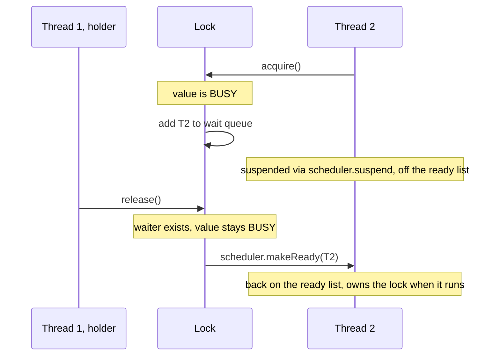

## Purpose

Notes on chapter 5 of [Operating Systems: Principles and Practice](https://ospp.cs.washington.edu/) (OSPP). Threads that share memory can step on each other's updates; this chapter is about how to stop that. It has two halves. The first is how to *use* synchronization: a lock for mutual exclusion, condition variables for waiting until shared state changes, and a few rules that make shared objects easy to get right. The second is how locks are *built* from atomic instructions, and what they cost when many processors want the same lock. For that half this note adds measurements: seven ways to increment one shared counter, from 1 to 16 threads on a 4-core machine.

Threads themselves are covered in [[systems/operating-systems/v2-concurrency/4-concurrency-and-threads|concurrency and threads]], and the hardware underneath (cache coherence, memory ordering) in [[hardware/computer-architecture/multiprocessors-cache-coherence|multiprocessors and cache coherence]].

## The problem: one line of code is three steps

`counter = counter + 1` looks indivisible, but a processor runs it as three steps: load `counter` into a register, add one to the register, store the register back. Each thread has its own registers. If two threads both load before either stores, both store the same value and one increment disappears. Which interleaving happens is up to the scheduler and the hardware, so the bug appears only sometimes. That is a **race condition**: the result depends on the timing of operations in different threads.

Step through it. Each button runs one line of that thread, so the order you press the buttons is the schedule.

<RaceStepper preset="counter" />

Of the 20 ways to interleave the two threads' three steps, only the 2 where one thread finishes before the other starts give `counter = 2`. On real hardware the losses are not rare. Running a loop of `counter = counter + 1` (a separate load and store, with no lock) on 4 threads for one second, [the benchmark below](#how-this-was-measured) recorded 1.5 billion increments, and the counter ended up 74% short of that. With 2 threads it was 49% short; with 16, 90%.

A section of code that reads or writes shared state, and must not interleave with other threads doing the same, is a **critical section**. Making critical sections appear atomic to each other is **mutual exclusion**.

> [!note]- Deep dive: why the compiler and the CPU make it worse
> The three-step picture is the optimistic one. In C and C++, two threads accessing the same non-atomic variable without synchronization, where at least one writes, is a *data race*, and a data race is undefined behavior (C11 §5.1.2.4, C++ [intro.races]). The compiler may assume no other thread touches the variable: it can keep `counter` in a register for a whole loop and store it once at the end, or read a flag once and never again, which turns a spin-wait like `while (!flag) {}` into an infinite loop. The benchmark avoids this by using relaxed atomic loads and stores for its deliberately racy counter, so the compiler emits exactly one load and one store per increment.
>
> The processor reorders too. Even x86, which keeps a fairly strong order (total store order), lets a later load complete before an earlier store to a different address leaves the store buffer, which is enough to break textbook mutual-exclusion algorithms that use only loads and stores, such as Peterson's algorithm, unless a fence is added. Weaker architectures (Arm, RISC-V) reorder more. The litmus tests in [[hardware/computer-architecture/multiprocessors-cache-coherence|the cache coherence note]] show both effects. Locks hide all of this: acquiring a lock is an *acquire* operation and releasing it a *release*, so everything written inside one critical section is visible to the next thread that takes the lock. That is the practical reason to use locks rather than clever flag protocols.

## Locks

A lock provides mutual exclusion with two operations, `acquire` and `release`:

- A lock is either `FREE` or `BUSY`, and starts `FREE`.
- `acquire` waits until the lock is `FREE`, then sets it to `BUSY`. The check and the set happen as one atomic step.
- `release` sets the lock to `FREE`. If threads are waiting in `acquire`, one of them can proceed.

Only the thread that acquired a lock releases it. A thread holds a lock for the length of one critical section, and every access to the state the lock protects happens while holding it.

### What a correct lock guarantees

OSPP states three properties:

| Property         | Meaning                                                                                                                                 |
| ---------------- | --------------------------------------------------------------------------------------------------------------------------------------- |
| Mutual exclusion | At most one thread holds the lock at any time. This is the safety property.                                                             |
| Progress         | If no thread holds the lock and some thread tries to acquire it, some thread eventually succeeds. No deadlock in the lock.              |
| Bounded waiting  | Once a thread starts trying to acquire the lock, there is a bound on how many times other threads can acquire it first. No starvation. |

Many real locks give up bounded waiting for speed. The [measurements below](#fairness-bounded-waiting-in-practice) show which ones do, and by how much.

### Why the check and the set must be one step

The obvious way to build a lock from ordinary loads and stores is to wait until `held` is 0 and then set it to 1. That is two steps, and the same race as the counter lets two threads through:

<RaceStepper preset="broken-lock" />

Both threads read `held = 0` before either writes 1, so both believe they own the lock. Fixing this with loads and stores alone is possible (Dekker's and Peterson's algorithms do it for two threads) but slow, limited and, as the deep dive above notes, broken on modern processors without fences. Real locks use either interrupts or an atomic read-modify-write instruction.

On a **uniprocessor**, the only way another thread can run in the middle of a critical section is an interrupt that leads to a context switch. A kernel can therefore get mutual exclusion by disabling interrupts. OSPP builds its uniprocessor lock this way, disabling interrupts only for the few instructions that inspect and update the lock's own state, so that a long critical section does not hold off interrupts. This does not work on a multiprocessor, where other processors keep running whatever the local interrupt flag says, and it is never available to user code. Multiprocessor locks are built on atomic instructions; the [second half of this note](#implementing-locks-on-a-multiprocessor) covers them.

## Shared objects

OSPP's recommended structure for concurrent code is the **shared object**: an object whose state is only touched by its own methods, and which contains its synchronization variables (a lock, condition variables) next to its state variables. Callers just call methods. All the reasoning about concurrency lives in one class.

### A thread-safe bounded queue

One lock protects all of the queue's state. Every public method acquires it on entry and releases it on exit, so each method runs as one atomic step relative to the others. These methods never wait: when the queue is full or empty they return `false`.

```cpp
// Thread-safe queue: tryInsert and tryRemove never block.
const int MAX = 10;
class ConcurrentQueue {
  // Synchronization variables
  Lock lock;
  // State variables
  int items[MAX];
  int front;      // index of the oldest item
  int nextEmpty;  // index where the next item goes

 public:
  ConcurrentQueue();
  ~ConcurrentQueue() {}
  bool tryInsert(int item);
  bool tryRemove(int *item);
};

ConcurrentQueue::ConcurrentQueue() {
  front = nextEmpty = 0;
}

// If the queue is full, return false; otherwise insert and return true.
bool ConcurrentQueue::tryInsert(int item) {
  bool success = false;
  lock.acquire();
  if ((nextEmpty - front) < MAX) {
    items[nextEmpty % MAX] = item;
    nextEmpty++;
    success = true;
  }
  lock.release();
  return success;
}

// If the queue is empty, return false; otherwise remove into *item and return true.
bool ConcurrentQueue::tryRemove(int *item) {
  bool success = false;
  lock.acquire();
  if (front < nextEmpty) {
    *item = items[front % MAX];
    front++;
    success = true;
  }
  lock.release();
  return success;
}
```

`front` and `nextEmpty` only ever increase, and their difference is the number of items. Two separate indexes, rather than a count, make the full and empty tests easy to read.

> [!note]- The chapter's test program
> Three worker threads each insert 50 items into their own queue; the main thread waits for the first worker only, then tries to remove 20 items from each queue. A queue holds at most 10 items, so some removals print "Nothing there", and for the second and third queues how many depends on how far those workers have got. The output differs from run to run, which is the point of the example: each queue stays consistent under any interleaving, even though the program's output is nondeterministic.
>
> ```cpp
> void *putSome(void *p);
> void testRemoval(ConcurrentQueue *queue);
>
> int main(int argc, char **argv) {
>   ConcurrentQueue *queues[3];
>   thread_t workers[3];
>   int i;
>   // Start worker threads to insert.
>   for (i = 0; i < 3; i++) {
>     queues[i] = new ConcurrentQueue();
>     thread_create(&workers[i], putSome, queues[i]);
>   }
>   // Wait for some items to be put.
>   thread_join(workers[0]);
>   // Remove 20 items from each queue.
>   for (i = 0; i < 3; i++) {
>     printf("Queue %d:\n", i);
>     testRemoval(queues[i]);
>   }
> }
>
> // Insert 50 items into a queue.
> void *putSome(void *p) {
>   ConcurrentQueue *queue = (ConcurrentQueue *)p;
>   for (int i = 0; i < 50; i++)
>     queue->tryInsert(i);
>   return NULL;
> }
>
> // Remove 20 items from a queue.
> void testRemoval(ConcurrentQueue *queue) {
>   int item;
>   for (int i = 0; i < 20; i++) {
>     if (queue->tryRemove(&item))
>       printf("Removed %d\n", item);
>     else
>       printf("Nothing there.\n");
>   }
> }
> ```

### Condition variables: waiting for state to change

`tryRemove` returns `false` on an empty queue, which leaves the caller to retry, usually in a loop that burns CPU. What the caller wants is to *sleep until the queue is not empty*. Sleeping while holding the lock would stop any producer from ever adding an item, and releasing the lock and then sleeping leaves a window in which the item arrives and the wakeup is missed. A **condition variable** (CV) closes that window: it is a queue of threads waiting for some condition on shared state, always used together with the lock that protects that state.

- `wait(lock)`: atomically release the lock and suspend on the CV's queue. When woken, reacquire the lock before returning.
- `signal()`: if any thread is waiting, wake one.
- `broadcast()`: wake every waiting thread.

The caller holds the lock for all three. A CV has no memory: a `signal` with nobody waiting does nothing, unlike a semaphore's `V`, which is counted. That is why a waiter always checks the shared state itself rather than relying on having been signaled.

Here is the bounded queue made blocking: `insert` waits while the queue is full, `remove` waits while it is empty, and each signals the other condition after changing the state.

```cpp
// Blocking bounded queue (BBQ).
class BBQ {
  // Synchronization variables
  Lock lock;
  CV itemAdded;
  CV itemRemoved;
  // State variables
  int items[MAX];
  int front;
  int nextEmpty;

 public:
  BBQ();
  ~BBQ() {}
  void insert(int item);
  int remove();
};

BBQ::BBQ() {
  front = nextEmpty = 0;
}

// Wait until there is room, then insert an item.
void BBQ::insert(int item) {
  lock.acquire();
  while ((nextEmpty - front) == MAX) {
    itemRemoved.wait(&lock);
  }
  items[nextEmpty % MAX] = item;
  nextEmpty++;
  itemAdded.signal();
  lock.release();
}

// Wait until there is an item, then remove and return it.
int BBQ::remove() {
  int item;
  lock.acquire();
  while (front == nextEmpty) {
    itemAdded.wait(&lock);
  }
  item = items[front % MAX];
  front++;
  itemRemoved.signal();
  lock.release();
  return item;
}
```

The shape is always the same: acquire the lock, wait in a loop until the state allows progress, change the state, signal anyone whose condition may now hold, release.

> [!warning] wait goes inside a while loop, never an if
> Practical systems implement **Mesa semantics** ([Lampson and Redell, 1980](https://dl.acm.org/doi/10.1145/358818.358824)): `signal` only moves a waiter to the ready list. The signaler keeps running, and by the time the waiter reacquires the lock another thread may have taken the item it was woken for. POSIX also allows `pthread_cond_wait` to return with no signal at all (a spurious wakeup). Re-checking the condition in a `while` makes both harmless; an `if` turns them into corruption bugs. Under **Hoare semantics** the lock and the processor pass straight from signaler to waiter, so the condition is guaranteed on return, but that handoff costs a context switch on every signal and mainstream thread libraries do not provide it.

### Rules for shared objects

OSPP condenses the method into a short list of rules. Paraphrased:

1. Use the same structure everywhere: shared state lives in objects, and each object has a lock and condition variables.
2. Synchronize with locks and condition variables, not with semaphores or ad hoc flags.
3. Acquire the lock at the start of each public method and release it just before the method returns.
4. Hold the lock whenever you call `wait`, `signal` or `broadcast`.
5. Always `wait` in a `while` loop.
6. (Almost) never use `sleep(time)` to wait for another thread; wait on a condition variable.

Rule 3 gives up some concurrency in exchange for being able to reason about each method as one atomic action. When that costs too much, the next steps are finer-grained locks, readers/writers locks, or per-processor data, each of which [[systems/operating-systems/v2-concurrency/7-multiprocessor-scheduling|the multiprocessor scheduling note]] runs into for the scheduler's own queues.

> [!note]- Deep dive: a readers/writers lock
> Many objects are read far more often than written. A readers/writers lock lets any number of readers in at once, or a single writer. OSPP builds one as a shared object with one lock, two condition variables and four counters; in condensed form:
>
> ```cpp
> class RWLock {
>   Lock lock;
>   CV readGo, writeGo;
>   int activeReaders = 0, activeWriters = 0;
>   int waitingReaders = 0, waitingWriters = 0;
>
>   bool readShouldWait() { return activeWriters > 0 || waitingWriters > 0; }
>   bool writeShouldWait() { return activeWriters > 0 || activeReaders > 0; }
>  public:
>   void startRead() {
>     lock.acquire();
>     waitingReaders++;
>     while (readShouldWait()) readGo.wait(&lock);
>     waitingReaders--;
>     activeReaders++;
>     lock.release();
>   }
>   void doneRead() {
>     lock.acquire();
>     activeReaders--;
>     if (activeReaders == 0 && waitingWriters > 0) writeGo.signal();
>     lock.release();
>   }
>   void startWrite() {
>     lock.acquire();
>     waitingWriters++;
>     while (writeShouldWait()) writeGo.wait(&lock);
>     waitingWriters--;
>     activeWriters++;
>     lock.release();
>   }
>   void doneWrite() {
>     lock.acquire();
>     activeWriters--;
>     if (waitingWriters > 0) writeGo.signal();
>     else readGo.broadcast();
>     lock.release();
>   }
> };
> ```
>
> `readShouldWait` makes new readers wait behind a waiting writer, so a steady stream of readers cannot starve writers; the price is that writers can starve readers. Choosing who goes next is policy, and changing the policy means changing only these two predicates and the wakeups in `doneRead` and `doneWrite`. Note the `broadcast` in `doneWrite`: every waiting reader can go, so all of them are woken. The data accessed between `startRead` and `doneRead` is not protected by the internal `lock`, which is held only while the counters change.

> [!note]- Deep dive: semaphores
> Dijkstra's semaphore is a counter with two atomic operations: `P` waits until the value is positive and then decrements it, and `V` increments it and wakes a waiter. Initialized to 1, it is a lock; initialized to 0, it can signal an event that might happen before anyone waits for it, since the count remembers it. OSPP recommends locks and condition variables for shared objects because a semaphore mixes two jobs (mutual exclusion and waiting) in one primitive, and code that uses the count as hidden state is harder to check. Semaphores remain natural for counting resources and for signaling from an interrupt handler, which must not block on a lock.

## Implementing locks on a multiprocessor

Everything above assumed a lock exists. Building one on a multiprocessor takes an atomic **read-modify-write** instruction: one that reads a memory word and writes it back with no other processor able to write that word in between. The cache coherence protocol provides this: the processor gets the cache line in an exclusive state and holds on to it for the duration of the instruction. x86 provides `xchg` and `lock`-prefixed instructions such as `lock cmpxchg` and `lock xadd`; Arm and RISC-V provide load-linked/store-conditional pairs and also single atomic instructions. In C11 these are `atomic_exchange`, `atomic_compare_exchange_*` and `atomic_fetch_add`.

### Test-and-set spinlocks

**Test-and-set** atomically sets a word to 1 and returns its old value. A thread that gets 0 back has the lock. A thread that gets 1 back tries again, so it **spins**: it stays on the processor in a loop.

```c
// C11: atomic_exchange is test-and-set.
void acquire(atomic_int *held) {
  while (atomic_exchange_explicit(held, 1, memory_order_acquire))
    ;  // somebody else holds it: try again
}
void release(atomic_int *held) {
  atomic_store_explicit(held, 0, memory_order_release);
}
```

The `acquire` and `release` orderings are what keep the critical section's own loads and stores inside the lock; without them the compiler or the processor may move them out. Step through the same increment with this lock and try to break it:

<RaceStepper preset="tas" />

However you interleave the threads, only one can read 0 from `held`, so `counter` always ends at 2. The cost shows up as wasted steps: a thread that finds the lock taken goes round its loop doing nothing useful until the holder releases.

Spinning only makes sense when the critical section is shorter than the cost of putting the thread to sleep and waking it, which is a few microseconds for a context switch, and when the holder is actually running. A spinning thread holds a processor that the lock holder or other threads could use.

### What contention costs, and better spinlocks

Every `atomic_exchange` needs the lock's cache line in exclusive state, so with several threads spinning the line moves from core to core on every attempt, and the holder's release has to wait its turn to get the line back. Several designs reduce that traffic:

- **Test-and-test-and-set (TTAS)** spins on a plain load, which hits in the spinner's own cache while the lock is held, and attempts the exchange only when the lock looks free. When the lock is released, every spinner sees it and tries at once.
- **Ticket lock**: `acquire` takes a number with `fetch_add` on `next`, then waits until `serving` equals it; `release` increments `serving`. Waiters get the lock in arrival order, which gives bounded waiting. Linux switched its x86 spinlocks to ticket locks in 2.6.25 ([LWN](https://lwn.net/Articles/267968/)). All waiters still spin on the same `serving` word, so each release invalidates every waiter's copy.
- **MCS lock** ([Mellor-Crummey and Scott, 1991](https://www.cs.rochester.edu/u/scott/papers/1991_TOCS_synch.pdf)): waiters form a linked queue, and each spins on a flag in its own queue node. A release writes only the next waiter's flag, so a handoff moves one cache line to one core however many are waiting. Linux's queued spinlock (qspinlock) is built on the same idea ([LWN](https://lwn.net/Articles/590243/)).

```c
// Ticket lock. FIFO: the order of fetch_add is the order of service.
void ticket_acquire(ticket_lock *l) {
  unsigned me = atomic_fetch_add_explicit(&l->next, 1, memory_order_relaxed);
  while (atomic_load_explicit(&l->serving, memory_order_acquire) != me)
    cpu_relax();  // the x86 pause instruction
}
void ticket_release(ticket_lock *l) {
  // Only the holder writes serving, so a plain read-then-store is safe.
  unsigned s = atomic_load_explicit(&l->serving, memory_order_relaxed);
  atomic_store_explicit(&l->serving, s + 1, memory_order_release);
}
```

The MCS lock is longer; it is in [`lock_bench.c`](./lock_bench.c) with the others.

### Measured: throughput as threads are added

The benchmark makes every thread loop on `acquire; counter++; release` for one second, with nothing outside the critical section, so every thread wants the lock all the time. That is the worst case for a lock, and it isolates the cost of the lock itself. With one thread per core:

<LockScaling preset="contention" />

Adding threads makes every lock slower in total, not faster. With one thread, a test-and-set acquire, increment and release takes about 8 ns (126 million per second), because the lock and the counter stay in that core's cache. With two threads, total throughput falls to 21 million per second for test-and-set and to 5 million for the ticket lock: each handoff now moves cache lines between cores. A critical section cannot run in parallel with itself, so more threads cannot make it faster, and here the handoff is most of the work.

On this 4-core machine the simple locks win. Test-and-set and TTAS stay ahead of the ticket and MCS locks at every count up to 4, because a ticket or MCS release has to hand the lock to one particular waiter, which then has to fetch the line, while a test-and-set release lets whichever core gets there first take it, often the core that just released it. MCS edges ahead of the ticket lock at 3 and 4 threads (5.0 against 4.1 million per second). The case for local spinning appears with many more cores than four: [Boyd-Wickizer et al.](https://people.csail.mit.edu/nickolai/papers/boyd-wickizer-locks.pdf) found Linux ticket locks causing "dramatic collapse" in real workloads on a 48-core machine, and replacing them with MCS locks avoided it. The pthread mutex, which puts waiters to sleep, is fastest at 4 threads (14 million per second). Its curve is not monotonic (29 million per second at 3 threads, with a narrow spread across runs), which this benchmark does not explain.

### Fairness: bounded waiting in practice

The same runs record how many acquisitions each thread got. If the lock is fair, each of *n* threads gets 1/*n* of them.

<LockScaling preset="fairness" />

The ticket and MCS locks hand out the lock in arrival order and come out exactly even. Test-and-set has no order at all: at 4 threads the unluckiest thread got 74% of its fair share in the median run, because a core that has just released the lock still holds the cache line and often wins it straight back. Neither TTAS nor test-and-set bounds waiting in principle; a thread can lose indefinitely, it just does not usually happen for long.

### When there are more threads than cores

A spinlock assumes the holder is running. Give the machine more threads than cores and the scheduler will sometimes preempt the holder, and every waiter then spins for the rest of a time slice, milliseconds rather than nanoseconds.

<LockScaling preset="oversubscribed" />

FIFO makes this far worse. A ticket or MCS lock must pass the lock to the next waiter in line, and if that waiter is not running, nobody can take the lock until it is scheduled again. Going from 4 to 6 threads cut the ticket lock from 4.1 million acquisitions per second to 17 thousand, and MCS from 5.0 million to 21 thousand: both about 250 times slower. Test-and-set and TTAS degrade gradually (2.2 and 2.5 million per second at 16 threads), since any running thread can take a free lock. The mutex, which sleeps instead of spinning, stays between 12 and 18 million per second all the way to 16 threads. The same effect hits virtual machines, where the hypervisor can deschedule a virtual CPU that holds or is next in line for a spinlock; [[systems/operating-systems/v2-concurrency/7-multiprocessor-scheduling|the multiprocessor scheduling note]] covers holder preemption from the scheduler's side.

This is why kernels disable preemption while holding a spinlock, and why user-space code should almost never spin without a fallback to sleeping.

### Queueing locks: sleep instead of spin

To support long critical sections without burning processors, a lock can put waiters to sleep. Busy waiting cannot be removed entirely on a multiprocessor, but a **queueing lock** keeps it to a few instructions: the lock's own state is guarded by a spinlock held only while that state is inspected or changed, and a thread that must wait adds itself to a queue and suspends.

On `acquire`, if the lock is `FREE`, the caller takes it. If it is `BUSY`, the caller joins the wait queue and suspends. On `release`, if anyone is waiting, the first waiter is made ready and the lock passes directly to it.

Suspending is the delicate part. The thread must give up the queueing lock's spinlock, but if it releases that spinlock before it is actually off the processor, a `release` on another core can run in between, find the thread on the wait queue and make it ready before it has suspended. OSPP's scheduler solves this by taking the scheduler's own spinlock (with interrupts disabled, so the thread cannot be preempted while holding it) *before* releasing the lock's spinlock, and only then switching threads.

```cpp
class Lock {
 private:
  int value = FREE;
  SpinLock spinLock;
  Queue waiting;
 public:
  void acquire();
  void release();
};

void Lock::acquire() {
  spinLock.acquire();
  if (value != FREE) {
    waiting.add(runningThread);
    scheduler.suspend(&spinLock);
    // scheduler releases spinLock; when we run again, we hold the lock
  } else {
    value = BUSY;
    spinLock.release();
  }
}

void Lock::release() {
  TCB *next;
  spinLock.acquire();
  if (waiting.notEmpty()) {
    next = waiting.remove();
    scheduler.makeReady(next);   // value stays BUSY: ownership passes to next
  } else {
    value = FREE;
  }
  spinLock.release();
}

class Scheduler {
 private:
  Queue readyList;
  SpinLock schedulerSpinLock;
 public:
  void suspend(SpinLock *lock);
  void makeReady(TCB *thread);
};

void Scheduler::suspend(SpinLock *lock) {
  TCB *chosenTCB;
  disableInterrupts();
  schedulerSpinLock.acquire();
  lock->release();
  runningThread->state = WAITING;
  chosenTCB = readyList.getNextThread();
  thread_switch(runningThread, chosenTCB);
  runningThread->state = RUNNING;
  schedulerSpinLock.release();
  enableInterrupts();
}

void Scheduler::makeReady(TCB *thread) {
  disableInterrupts();
  schedulerSpinLock.acquire();
  readyList.add(thread);
  thread->state = READY;
  schedulerSpinLock.release();
  enableInterrupts();
}
```

`makeReady` needs the scheduler spinlock too, so it cannot run on another core until the suspending thread has finished switching away. The contended path end to end:



Passing ownership directly keeps the lock FIFO, but it has the same weakness as the ticket lock: the lock stays `BUSY` while the woken thread waits for a processor, and no running thread can take it meanwhile.

### Case study: the Linux kernel mutex

Most locks are free most of the time, and a held lock usually has no waiters, so it pays to make the uncontended case cost one atomic instruction and to touch the wait queue only when needed. OSPP's case study is the Linux 2.6 mutex, which encoded its state in one counter:

```c
struct mutex {
  /* 1: unlocked, 0: locked, negative: locked, possible waiters */
  atomic_t count;
  spinlock_t wait_lock;
  struct list_head wait_list;
};
```

The x86 fast path was a few instructions, inlined at every call site:

```asm
      lock decl (%eax)      // atomically decrement lock->count (address in %eax)
      jns 1f                // result not negative: it went 1 -> 0, we own the lock
      call slowpath_acquire
1:
```

The slow path set the count to −1, meaning "locked, maybe waiters", with an atomic exchange, so that the eventual unlock knows to look at the wait list. If the exchange returned 1 the lock had come free and the caller owned it; otherwise it slept:

```c
for (;;) {
  /*
   * Lets try to take the lock again - this is needed even if
   * we get here for the first time (shortly after failing to
   * acquire the lock), to make sure that we get a wakeup once
   * it's unlocked. Later on, if we sleep, this is the
   * operation that gives us the lock. We xchg it to -1, so
   * that when we release the lock, we properly wake up the
   * other waiters:
   */
  if (atomic_xchg(&lock->count, -1) == 1)
    break;

  /* didn't get the lock, go to sleep: */
  ...
}
```

The current mutex no longer has that counter ([kernel docs](https://docs.kernel.org/locking/mutex-design.html)). Its lock word holds a pointer to the owning task, NULL when free, with a few low bits used as flags such as "the wait list is non-empty". Acquisition takes one of three paths:

- **Fast path**: a `cmpxchg` of the owner field from NULL to the current task. Uncontended acquisition is still one atomic instruction.
- **Mid path, optimistic spinning**: if the owner is running on another CPU, it will probably release soon, so the waiter spins instead of sleeping, as long as no higher-priority task needs the CPU. Spinners queue on an MCS-style lock (`osq`) so that each spins on its own cache line, the same idea as the MCS spinlock above. Adaptive spinning was proposed for mainline in 2009 ([LWN](https://lwn.net/Articles/314512/)).
- **Slow path**: the task adds itself to the wait list and sleeps until an unlock wakes it.

This is the combination the measurements argue for: spin while spinning is likely to pay off (the owner is on a CPU), and sleep when it is not.

### User space: futexes

A user-space mutex cannot disable interrupts or touch the scheduler's ready list, and a system call on every acquire would cost far more than the 8 ns lock above. Linux's answer is the **futex** ("fast user-space mutex"). The lock is an ordinary integer in user memory. In the uncontended case, threads acquire and release it with atomic instructions entirely in user mode, and "the kernel maintains no information about the lock state" ([futex(2)](https://man7.org/linux/man-pages/man2/futex.2.html)). Only when a thread has to wait does it call `futex(FUTEX_WAIT)`, which puts it to sleep if the integer still holds the value it expects; that check and the sleep are atomic in the kernel, which closes the lost-wakeup window that the queueing lock closed with its spinlock handoff. The releaser calls `futex(FUTEX_WAKE)` only if the lock word says someone may be waiting. glibc's `pthread_mutex_lock`, the "pthread mutex" in the charts, is built this way. In this benchmark it costs about 20 ns per uncontended acquire, increment and release (51 million per second on one thread), and under contention its waiters sleep instead of competing for the cache line.

### Do you need a lock at all?

For a single counter, no. One atomic `fetch_add` (`lock xadd` on x86) increments it correctly with no lock:

<LockScaling preset="lockfree" />

The atomic increment also slows down when a second core joins, from 120 million per second to 55 million, because the counter's cache line still has to move between cores. But it needs one cache-line transfer per operation where a lock needs several (the lock word on acquire and on release, plus the counter), and it can never be stuck behind a preempted holder. At 4 threads it ran 45 million increments per second, about 3 times the fastest lock, and it still ran about 48 million per second at 16 threads. Lock-free techniques extend this to queues, stacks and hash tables, at the cost of much harder correctness arguments; for anything bigger than one word, a lock around a short critical section is usually the right starting point.

## How this was measured

> [!note]- How this was measured
> **Question.** How do total throughput and fairness of a contended lock change with the number of threads, for spinlocks of different designs, a sleeping mutex, and a lock-free increment?
>
> **Harness.** [`lock_bench.c`](./lock_bench.c). Each of *n* threads loops `acquire; counter = counter + 1; release` until a stop flag is set after a fixed time; there is no work outside the critical section. The counter's load and store are relaxed atomics so the compiler cannot keep it in a register. Variants: `racy` (no lock: a separate load and store, to count lost updates), `atomic` (one `atomic_fetch_add`, no lock), `tas` (test-and-set with `atomic_exchange`, no pause), `ttas` (spin on a load with `pause`, then exchange), `ticket`, `mcs` (each thread's queue node on its own cache line) and `mutex` (glibc `pthread_mutex_t`, default type). The lock word and counter sit on separate 64-byte cache lines. After each run the program checks that the counter equals the total number of acquisitions for every variant except `racy`; every run passed.
>
> **Machine.** A 4-vCPU KVM virtual machine, Intel Xeon at 2.10 GHz, Linux 6.18, glibc 2.39, gcc 13.3 with `-O2`. Threads were not pinned. Being a VM matters for the oversubscribed results: the host may also deschedule vCPUs.
>
> **Runs.** Thread counts 1, 2, 3, 4, 6, 8, 12 and 16; each run lasts one second; five repetitions of every combination, interleaved (all variants and thread counts once, then again) so slow drift in the machine spreads over all of them. The charts plot the median of the five runs, with whiskers from the slowest to the fastest run. Fairness is the slowest thread's acquisitions divided by an even share (total / *n*), median over the five runs.
>
> **Reproduce.**
>
> ```sh
> ./run_lock_bench.sh 1000 5 > lock_bench-results.csv
> python3 summarize_lock_bench.py lock_bench-results.csv > lock_bench-summary.json
> ```
>
> Raw results: [`lock_bench-results.csv`](./lock_bench-results.csv); summary used by the charts: [`lock_bench-summary.json`](./lock_bench-summary.json).
>
> **Limits.** Four cores is small; the published differences between TTAS, ticket and MCS locks grow with core count and with multiple sockets. This is the zero-think-time worst case; with work outside the critical section, contention and all the differences shrink. No backoff variants were measured.

> [!note]- Potentially interesting ideas
> - The glibc mutex ran about twice as fast at 3 threads (29 million per second) as at 2 or 4 (14 million), consistently across all five runs. A plausible cause is how often the releasing thread re-acquires before a woken waiter runs, but that was not measured; counting futex calls per run (for example with `strace -c` or `perf trace`) would test it.
> - Adding exponential backoff to test-and-set, and work outside the critical section, would show where the crossover between spinning and sleeping lies on this machine.
> - Running the same harness on a many-core or two-socket machine should reproduce the ticket-lock collapse that Boyd-Wickizer et al. report, which four cores are too few to show.

## Related notes

- [[systems/operating-systems/v2-concurrency/4-concurrency-and-threads|Concurrency and threads]]: what a thread is and how it is scheduled.
- [[systems/operating-systems/v2-concurrency/7-multiprocessor-scheduling|Multiprocessor scheduling]]: lock contention and holder preemption in the scheduler itself.
- [[hardware/computer-architecture/multiprocessors-cache-coherence|Multiprocessors and cache coherence]]: why a contended cache line is slow, and memory ordering litmus tests.
- [[systems/operating-systems/benchmarks/false_sharing|False sharing]]: the same cache-line traffic without any shared variable.
