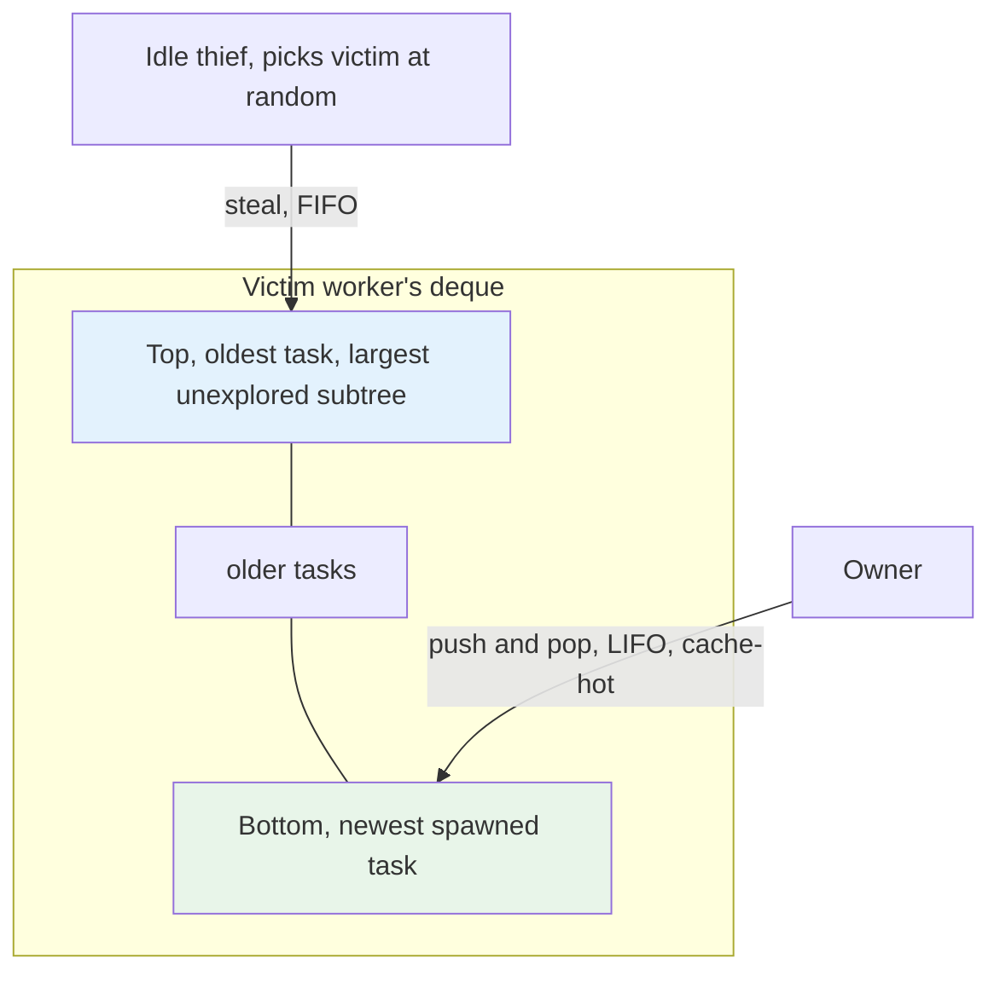

A multiprocessor scheduler assigns runnable threads to several processors over time, determining both which thread runs next and on which processor it runs.

The uniprocessor policies in [[systems/operating-systems/v2-concurrency/7-uniprocessor-scheduling|uniprocessor scheduling]] assume a single processor serving a single queue. Modern systems have multiple processors, each with multiple cores, often with hyperthreading as well, and a scheduler must exploit that parallelism while keeping the cost of coordination between processors low. The material follows the multiprocessor scheduling part of chapter 7 of [Operating Systems: Principles and Practice](https://ospp.cs.washington.edu/).

## Scheduling Sequential Applications on Multiprocessors

Consider a server processing a large number of requests. The simplest design is one shared multi-level feedback queue (MLFQ, covered in [[systems/operating-systems/v2-concurrency/7-uniprocessor-scheduling|uniprocessor scheduling]]) protected by a lock, with every processor pulling work from it. When a request blocks on I/O, it re-enters the queue and another request runs. The design has three problems:

- **Contention for the MLFQ lock**: contention grows with the number of processors, and processors spend time waiting for the lock instead of running work.
- **Cache coherence overhead**: each scheduling decision writes the shared queue, invalidating the copies cached by other processors. Every processor then fetches queue state from memory or a remote cache, which takes orders of magnitude longer than a local cache hit, and this happens while the lock is held, lengthening the critical section.
- **Limited cache reuse**: a thread runs on whichever processor is free, so it usually runs on a processor whose cache holds another thread's data.

For these reasons, operating systems commonly use a separate MLFQ per processor. Each processor uses **affinity scheduling**: once a thread is scheduled on a processor, it continues to be scheduled there, so its cache state remains useful. Load is rebalanced by occasionally migrating threads between per-processor queues.

## Migration Cost and NUMA

Per-processor queues make explicit the cost of moving a thread between processors, which affinity scheduling addresses only implicitly. The cost has three components, listed in increasing severity.

- **Cache refill.** A migrated thread restarts with cold L1/L2 (and, cross-socket, cold L3). A working set of a few MB refills at the rate the memory hierarchy allows; with misses costing on the order of 100 ns, refilling even 1 MB of dirty working set takes tens of microseconds of degraded execution, distributed over the thread's subsequent execution rather than incurred as one fixed cost. The [[systems/operating-systems/benchmarks/mlp|MLP benchmark]] measures how much of this latency overlapping misses can hide.
- **Coherence traffic.** Data the thread wrote on the old core must be invalidated or transferred as the thread accesses it from the new core; the [[systems/operating-systems/benchmarks/false_sharing|false sharing benchmark]] measures the per-line cost of these transfers between cores.
- **Remote memory on NUMA.** Cross-socket migration changes the *distance to the thread's own pages*: its memory stays on the old node, and every miss now crosses the interconnect. Remote DRAM access costs roughly 1.5-2x local latency on typical two-socket machines, and remote bandwidth is similarly reduced; the [[systems/operating-systems/benchmarks/bandwidth|bandwidth benchmark]] gives measured local and remote curves. Unlike the cache costs, this cost does not decay with time. It persists until the pages also migrate (Linux's NUMA balancing moves pages toward the threads that access them, slowly and heuristically).

Migration cost therefore increases with distance in the hierarchy. It is close to zero between the SMT siblings of one core, small within an L3 domain, noticeable across L3 domains, and large and *persistent* across sockets. Linux structures load balancing on the same hierarchy, rebalancing frequently at small distances and infrequently at large ones, as described under [A Real System: Linux CFS and EEVDF](#a-real-system-linux-cfs-and-eevdf).

**Limits of affinity.** Affinity assumes that cached state is worth more than a better load distribution. The assumption fails in two common cases. Under load imbalance, a pinned thread waits on a busy core while another core is idle, and the waiting time exceeds the refill cost that affinity avoided. Under a stale footprint, a thread whose phase has changed (it finished one file and started another) has no reusable cached state, so affinity preserves nothing. Work stealing handles both cases, because an idle core steals work, overriding affinity exactly when imbalance exists, and steals are rare when load is balanced.

## Work Stealing

For parallel programs that generate tasks dynamically (fork-join, divide-and-conquer), the scheduler within a process is commonly **work stealing**, whose mechanism has four parts.

- Each worker thread owns a **deque** of ready tasks.
- The owner treats its deque as a stack: it **pushes and pops at the bottom** (LIFO). Newly spawned subtasks are executed next, depth-first. This is the order a sequential execution would use, and it preserves cache locality, since the inputs of a newly spawned task were written immediately before it was spawned.
- An idle worker becomes a **thief**: it picks a victim **uniformly at random** and **steals from the top** of the victim's deque (FIFO). The stolen task is the *oldest*, which in divide-and-conquer is the largest unexplored subtree, so one steal provides the thief with a long stretch of independent work.
- Owner and thief operate on opposite ends, so synchronization overhead is low in the common case; the Chase-Lev deque, a widely used lock-free implementation, requires a compare-and-swap only when owner and thief contend for a nearly empty deque.

This greedy, uncoordinated scheme is provably near-optimal. Model the program as a DAG with total work $T_1$ (time on one processor) and span $T_\infty$ (critical path). Any scheduler obeys the work law $T_P \ge T_1/P$ and span law $T_P \ge T_\infty$. [Blumofe and Leiserson](https://dl.acm.org/doi/10.1145/324133.324234) proved randomized work stealing achieves

$$
\mathbb{E}[T_P] \le \frac{T_1}{P} + O(T_\infty),
$$

with space at most $P \cdot S_1$. When the parallelism $T_1/T_\infty \gg P$, the first term dominates, and the speedup is nearly linear, with steals too infrequent to affect it. Random victim selection requires no coordination and provably balances load, and the cost of a steal stays off the critical path because thieves are, by definition, idle workers. Work stealing is the scheduler in Cilk, Intel TBB, Java's ForkJoinPool, Rust's rayon, and Go's goroutine scheduler. Its limitations follow from its assumptions. It optimizes the throughput of one job's DAG and does not address priorities or deadlines across jobs; with very fine-grained tasks, steal overhead becomes significant; and stealing ignores NUMA placement, so a stolen task can run far from its data, the reverse of the trade-off that affinity makes. A treatment with a task-DAG trace is in [[systems/scheduling/2-parallel-and-multiprocessor/work-stealing-affinity-and-numa|work stealing, affinity, and NUMA]].

## A Real System: Linux CFS and EEVDF

Linux's CFS (Completely Fair Scheduler, 2007-2023) applies the weighted fair-share scheduling of [[systems/operating-systems/v2-concurrency/7-uniprocessor-scheduling|uniprocessor scheduling]] on each core. Each task accumulates **virtual runtime**, its actual runtime scaled by the inverse of its weight (each `nice` level changes the weight by ~1.25x), and the [scheduler](https://www.kernel.org/doc/html/latest/scheduler/sched-design-CFS.html) always runs the task with minimum `vruntime`, kept at the leftmost node of a red-black tree for $O(\log n)$ maintenance. The scheme is stride scheduling with kernel bookkeeping. A task that falls behind has a smaller vruntime and is selected sooner, which acts as aging, and weighted shares result without any measurement of job lengths.

Per-processor queues, affinity and migration cost all appear in the multiprocessor layer of CFS. Each CPU runs its own CFS instance, and **scheduling domains** mirror the hardware hierarchy: SMT siblings, cores sharing L3, sockets. The load balancer runs far more frequently (and moves tasks more willingly) at inner domains than at outer ones, so the policy encodes the migration-cost hierarchy. **Wake affinity** places a woken task on its previous CPU if idle, or near its waker (whose cache holds the data just produced for it), which accommodates the producer-consumer pattern at wake time.

In kernel 6.6 (2023), CFS's pick policy was replaced by **EEVDF** (earliest eligible virtual deadline first): among tasks that are *eligible* (not ahead of their fair share), run the one with the earliest virtual deadline, computed from its slice length over its weight. EEVDF retains the fairness accounting and adds a latency parameter: a task with a short slice receives an earlier deadline and preempts sooner, so interactive tasks obtain low latency without additional weight. The eligibility test prevents starvation. Proportional fairness alone cannot express that a task is small and urgent, and virtual deadlines express it while retaining fair-share accounting.

## Scheduling Parallel Applications on Multiprocessors

A parallel program usually has some logical mapping between work and processors, but the mapping cannot be fixed at compile time. The number of runnable threads and available processors changes at runtime, and work rarely divides evenly.

In **oblivious scheduling**, the scheduler operates without knowledge of the program's intent and schedules each thread independently. It is simple and efficient for the scheduler, and it fails in five recognizable ways:

- **Bulk synchronous delay**: in staged parallel computation (MapReduce, for example), every stage waits for the slowest thread, so one preempted thread stalls the whole stage.
- **Producer-consumer delay**: in a chain of producer and consumer threads (a shell pipeline), the slowest link sets the pace of the chain.
- **Critical path delay**: in a DAG of parallel work (fork-join programs), preempting a thread on the critical path delays the entire program.
- **Preemption of lock holder**: preempting a thread that holds a lock stretches the critical section across its time off the processor, delaying every waiter.
- **I/O**: a thread that blocks in the kernel on a read or write gives up its processor. Keeping the processor busy requires more threads than processors, which aggravates each of the preceding problems.

### Gang Scheduling

Under gang scheduling, the application decomposes its work into a set of threads, and those threads run together or not at all. The approach suits specialized servers that require fine-grained control over their threads, such as a DBMS. Windows, Linux, and MacOS all provide mechanisms for it.

Time-slicing two gang-scheduled programs across all processors is usually less efficient than assigning each program half the processors. Dedicating processors to tasks is called **space sharing**, and it minimizes context switches and cache invalidations. Space sharing is straightforward when tasks start and stop together; when the set of available processors changes dynamically, it requires additional mechanism, which scheduler activations provide.

### Scheduler Activations

With scheduler activations, the application receives an *execution context*, a **scheduler activation**, on each processor assigned to it. The kernel informs the application via upcalls whenever its processor allocation changes, and a thread blocking on I/O also triggers an upcall so the application can put that processor to other use. Scheduler activations define only the mechanism for telling an application about its processors. The scheduling policy stays with the application. The mechanism is covered in more depth in [[systems/operating-systems/v2-concurrency/4-concurrency-and-threads|concurrency and threads]].

## Real Time Scheduling

When responsiveness matters more than throughput, for instance in control systems or user interfaces, the objective is to complete tasks by a **deadline**. Three techniques apply.

- **Over-provisioning**: schedule only a fraction of the system's capacity, leaving headroom so that deadlines are met during bursts.
- **Earliest Deadline First (EDF)**: run the task with the earliest deadline next. For CPU-bound tasks on one processor, EDF meets every deadline whenever any schedule does, and it minimizes the maximum lateness. Mixed workloads complicate the policy, since it can be advantageous to start a later-deadline task's I/O early and then run the earlier-deadline task while the I/O is in flight.
- **Priority donation**: *priority inversion* happens when a high priority task waits on a lock held by a low priority task that is not scheduled. With priority donation, the waiting high priority task donates its priority to the lock holder, which is then scheduled, finishes the critical section, releases the lock, and drops back to its original priority.

## Related notes

- [[systems/scheduling/2-parallel-and-multiprocessor/work-stealing-affinity-and-numa|work stealing, affinity, and NUMA]]
- [[systems/scheduling/1-single-resource/real-time-scheduling-edf-and-rate-monotonic|real-time scheduling]]
- [[systems/operating-systems/v2-concurrency/7-uniprocessor-scheduling|uniprocessor scheduling]]
- [[systems/operating-systems/v2-concurrency/7-queueing-theory|queueing theory]]
- [[systems/operating-systems/v2-concurrency/4-concurrency-and-threads|concurrency and threads]]
