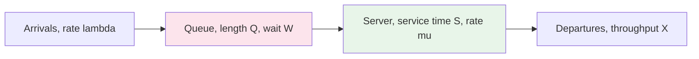

Queueing theory models a system in which tasks arrive at a server, wait in a queue while the server is busy, and depart after service, and derives quantities such as response time and queue length from the arrival and service processes.

The results give approximate answers, without simulation, to questions such as how response time changes when utilization doubles. The same analysis applies to CPUs, disks, networks, and any other resource that serves requests from a queue. The material extends the queueing theory section of chapter 7 of [Operating Systems: Principles and Practice](https://ospp.cs.washington.edu/).

Two simplifying assumptions hold throughout:

- **Work preserving**: the system will eventually process all requests.
- **FIFO scheduling**: requests are processed in the order they arrive.

## Definitions

- **Server**: anything that performs tasks, e.g. CPU, disk, network link.
- **Queueing delay ($W$)**: total time a task spends waiting to be scheduled. In a time-slicing system the task may wait many separate times, and $W$ is the sum of those waits.
- **Tasks queued ($Q$)**: number of tasks in the queue.
- **Service time ($S$)**: time to complete a task, assuming no waiting.
- **Response time ($R$)**: time for a task to complete, including queueing and service time.
    - $R = W + S$. Improving overall response time means reducing either the queueing time or the service time.
- **Arrival rate ($\lambda$)**: number of tasks arriving per unit time.
- **Arrival process**: the distribution of the time between task arrivals.
- **Service rate ($\mu$)**: number of tasks completed per unit time when busy. $\mu = 1/S$.
- **Utilization ($U$)**: fraction of time the server is busy.
    - $0 \leq U \leq 1$.
    - $U = \lambda / \mu$ if $\lambda < \mu$.
    - $U = 1$ if $\lambda \geq \mu$.
- **Throughput ($X$)**: number of tasks completed per unit time.
    - $X = U \cdot \mu$.
    - $X = \lambda$ if $U < 1$.
    - $X = \mu$ if $U = 1$.
- **Tasks in the system ($N$)**: tasks in the system, both in service and queued.
    - $N = Q + U$ on average, since utilization equals the average number of tasks in service at a single server.

The symbols correspond to the parts of a single-server queue as follows.



## Little's Law

For any stable system, regardless of arrival distribution or scheduling policy:

$$N = X \cdot R$$

The average number of tasks in the system equals throughput times average response time. If throughput is 10 tasks per second and average response time is 5 seconds, there are on average 50 tasks in the system.

The law applies to any bounded subsystem. Applied to the server alone (excluding the queue), the number of tasks inside is the average number in service, which is $U$, and the time inside is $S$, giving $U = X \cdot S$.

### Examples

A server processes requests sequentially. Requests arrive (and depart) at an average of 100 requests/sec, and the average request takes 5 ms of service. Applying Little's Law to the server alone:

$$U = X \cdot S = 100 \cdot 0.005 = 0.5$$

The server is busy 50% of the time.

A web service takes an average of 100 ms to complete a request and handles 10,000 queries per second. Applying Little's Law to the whole system:

$$N = X \cdot R = 10000 \cdot 0.1 = 1000 \text{ queries in the system}$$

## Response Time vs. Utilization

Operating a system at high utilization raises the risk of overload. If $\lambda > \mu$, the queue grows without bound and response time grows with it. A higher arrival rate $\lambda$ and a burstier arrival process both increase queue lengths.

### Best Case: Uniform Arrival

With perfectly evenly spaced arrivals:

- $\lambda < \mu$: $R = S$. Queues shrink until empty and stay empty.
- $\lambda = \mu$: $R = S$. Queues hold steady.
- $\lambda > \mu$: $R \to \infty$. Queues grow indefinitely. In practice requests are dropped or the system fails.

### Bursty Arrival

Requests often arrive in groups. The queue grows during a burst and drains between bursts, and average response time increases even when the average arrival rate is well below the service rate. Two systems illustrate the effect:

- System 1: $\lambda = 1$ request/second, $S = 1$ second, uniform arrivals.
- System 2: $\lambda = 1$ request/second, $S = 1$ second, bursty arrivals of 10 requests every 10 seconds.

System 1 serves each request as it arrives. The queue stays empty and every request sees $R = 1$ second:

$$
R = \frac{1}{10} \sum_{i=1}^{10} 1 = 1 \text{ second}
$$

System 2 serves each burst sequentially. The $i$-th request in the burst waits for the $i - 1$ requests ahead of it, finishing at time $i$:

$$R = \frac{1}{10} \sum_{i=1}^{10} i = 5.5 \text{ seconds}$$

With the same average arrival rate, System 2 has 5.5 times the average response time of System 1. In general, for bursts of $n$ requests with service time $S$ each, the $i$-th request in a burst finishes at $i \cdot S$, so

$$
R = \frac{1}{n} \sum_{i=1}^{n} i \cdot S = \frac{(n+1) S}{2}
$$

### Exponential Arrivals

An **exponential distribution** with rate $\lambda$ has mean $\lambda^{-1}$, variance $\lambda^{-2}$, and probability density

$$
f(x) = \lambda e^{-\lambda x}
$$

It is *memoryless*: given that $s$ seconds have already elapsed, the probability that at least $t$ more elapse is the same as it was at the start, $P(X > s + t \mid X > s) = P(X > t)$.

Memorylessness makes the analysis tractable. With exponential interarrival and service times, the queue becomes a state machine whose states are the number of tasks in the system, with transition rate $\lambda$ up (an arrival) and $\mu$ down (a departure), and no other history affects its evolution.

Assuming $\lambda < \mu$, the system is stable, and solving that state machine gives response time as a function of utilization and service time:

$$
R = \frac{S}{1 - U}
$$

At low utilization, response time is only slightly above $S$. As $U$ approaches 1, the denominator approaches zero and response time grows without bound. Response time is 2x the service time at $U = 0.5$ and 10x at $U = 0.9$. For this reason operators provision headroom instead of running servers near full utilization.

> [!warning] Response time near full utilization
> Plotted against $U$, the curve $R = S/(1-U)$ is nearly flat below $U \approx 0.5$, bends visibly around $0.7$, and has a vertical asymptote at $1$. Each halving of the remaining headroom doubles response time (2x at 0.5, 10x at 0.9, 100x at 0.99). A system provisioned at 95% utilization already has 20x its unloaded latency, and any burst moves it closer to the asymptote.

## M/M/1 Reference Results

The exponential-arrivals, exponential-service, single-server queue in Kendall notation is M/M/1 ("M" for memoryless). Writing $\rho = U = \lambda/\mu$, the state machine solves to a geometric distribution over queue states, $P(N = n) = (1-\rho)\rho^n$, from which the mean quantities follow:

$$
N = \frac{\rho}{1-\rho}, \qquad
R = \frac{S}{1-\rho}, \qquad
Q = \frac{\rho^2}{1-\rho}, \qquad
W = \frac{\rho S}{1-\rho},
$$

with $N = XR$ and $Q = XW$ as Little's Law cross-checks. Response time is exponentially distributed with mean $R$, so percentiles are multiples of the mean: the $q$-th percentile is $-\ln(1-q) \cdot R$, giving p50 = $0.69R$, p90 = $2.3R$, p99 = $4.6R$, p99.9 = $6.9R$. The mean and every percentile therefore share the $1/(1-\rho)$ pole.

For example, with $S = 10$ ms and $\lambda = 90$/s, $\rho = 0.9$. Then $R = 100$ ms, $N = 9$ tasks in system, and the p99 response time is $4.6 \times 100 = 460$ ms, 46 times the service time, as a consequence of utilization alone and before any further variability is added.

## Service-Time Variability: M/D/1 and M/G/1

Memoryless service is a modeling convenience. The M/G/1 queue keeps Poisson arrivals but allows *any* service distribution, and has an exact mean-wait formula, Pollaczek-Khinchine ([Larson and Odoni §4.7](https://web.mit.edu/urban_or_book/www/book/chapter4/4.7.html)):

$$
W = \frac{\lambda \, \mathbb{E}[S^2]}{2(1-\rho)}
= \frac{\rho}{1-\rho} \cdot \frac{1 + C_s^2}{2} \cdot S,
$$

where $C_s^2 = \operatorname{Var}[S]/\mathbb{E}[S]^2$. The utilization pole is unchanged; service variability enters as a multiplier $(1+C_s^2)/2$ on the waiting time:

- **M/D/1** (deterministic service, $C_s^2 = 0$): half the M/M/1 wait. At $\rho = 0.9$, $S = 1$: $R = 1 + 0.9/(2 \cdot 0.1) = 5.5$ versus M/M/1's 10. Fixed-size work units halve the waiting time at identical load.
- **M/M/1** ($C_s^2 = 1$): the baseline.
- **Heavy-tailed service** ($C_s^2 \gg 1$): waits scale linearly in $C_s^2$. A bimodal workload where 5% of requests take 10 s and the rest take 0.53 s (mean 1 s, $C_s^2 = 4.26$) at $\rho = 0.9$ has $R = 24.7$, which is 2.5x the M/M/1 value and 4.5x the M/D/1 value with the *same mean service time and same utilization*.

Service-time variance is therefore a direct capacity cost. Splitting occasional large requests into uniform chunks, capping request sizes, or isolating slow request classes in their own queue each reduce $\mathbb{E}[S^2]$ and lower latency without additional hardware.

## Checking the Formulas by Simulation

A single-server FIFO queue can be simulated with a four-line recurrence, in which a request starts when it arrives or when its predecessor departs, whichever is later. The script below (run in the repo venv, 2M requests per case) checks the M/M/1, M/D/1 and M/G/1 closed forms:

```python
import numpy as np
rng = np.random.default_rng(0)

def sim(rho, sv_fn, n=2_000_000):
    arr = np.cumsum(rng.exponential(1/rho, n))   # Poisson arrivals, mu = 1
    sv = sv_fn(n)
    dep, prev = np.empty(n), 0.0
    for i in range(n):
        start = arr[i] if arr[i] > prev else prev
        dep[i] = start + sv[i]
        prev = dep[i]
    R = dep - arr
    return R.mean(), np.percentile(R, 99)

fast = (1 - 0.05 * 10) / 0.95                    # bimodal: mean 1, cv^2 = 4.26
bimodal = lambda n: np.where(rng.random(n) < 0.05, 10.0, fast)

print(sim(0.9, lambda n: rng.exponential(1.0, n)))  # M/M/1
print(sim(0.9, lambda n: np.full(n, 1.0)))          # M/D/1
print(sim(0.9, bimodal))                            # M/G/1
```

Simulated and predicted values, all at $\rho = 0.9$ and $\mathbb{E}[S] = 1$, are as follows.

| Model | predicted $R$ | simulated $R$ | simulated p99 |
| --- | --- | --- | --- |
| M/M/1 | 10.00 | 10.18 | 45.2 (predicted 46.1) |
| M/D/1 | 5.50 | 5.55 | 23.2 |
| M/G/1 bimodal | 24.68 | 24.71 | 120 |

The Pollaczek-Khinchine prediction for the bimodal case is within 0.2% of the simulated value. The heavy-tailed workload's p99 is 5x that of the M/D/1 queue at identical mean load.

## Burstiness Revisited

The [bursty arrival example](#bursty-arrival) gives 5.5x the mean response time at identical average $\lambda$. The M/G/1 result generalizes to the *arrival* side, where variability plays the same role as variability in service. Kingman's approximation for a general-arrivals, general-service queue (G/G/1) is

$$
W \approx \frac{\rho}{1-\rho} \cdot \frac{C_a^2 + C_s^2}{2} \cdot S,
$$

with $C_a^2$ the squared coefficient of variation of interarrival times. Uniform arrivals have $C_a^2 = 0$, Poisson $C_a^2 = 1$, and bursty traffic (retry storms, thundering herds after a cache flush, synchronized cron jobs) has $C_a^2$ far above 1. Mean utilization does not appear in $C_a^2$, which is why the observations "the server is only 60% busy on average" and "requests time out every hour at :00" are consistent. Smoothing arrivals (jittered retries, staggered schedules, admission control) reduces $C_a^2$ in the same way that chunking work reduces $C_s^2$.

The consequences for tail-latency engineering (percentile SLOs, fan-out amplification, hedged requests) are treated in [[systems/performance/tail-latency-percentiles|Tail Latency, Percentiles, and Queueing Distributions]], and the consequences for scheduling policy in [[systems/scheduling/0-foundations/queueing-models-and-tail-latency|queueing models and tail latency]].

## Related notes

- [[systems/scheduling/0-foundations/littles-law-and-bottleneck-analysis|Little's Law and bottleneck analysis]]
- [[systems/scheduling/0-foundations/queueing-models-and-tail-latency|queueing models and tail latency]]
- [[systems/performance/latency-throughput-and-utilization|latency, throughput, and utilization]]
- [[systems/performance/tail-latency-percentiles|tail latency, percentiles, and queueing distributions]]
- [[systems/operating-systems/v2-concurrency/7-uniprocessor-scheduling|uniprocessor scheduling]]
- [[systems/operating-systems/v2-concurrency/7-multiprocessor-scheduling|multiprocessor scheduling]]
