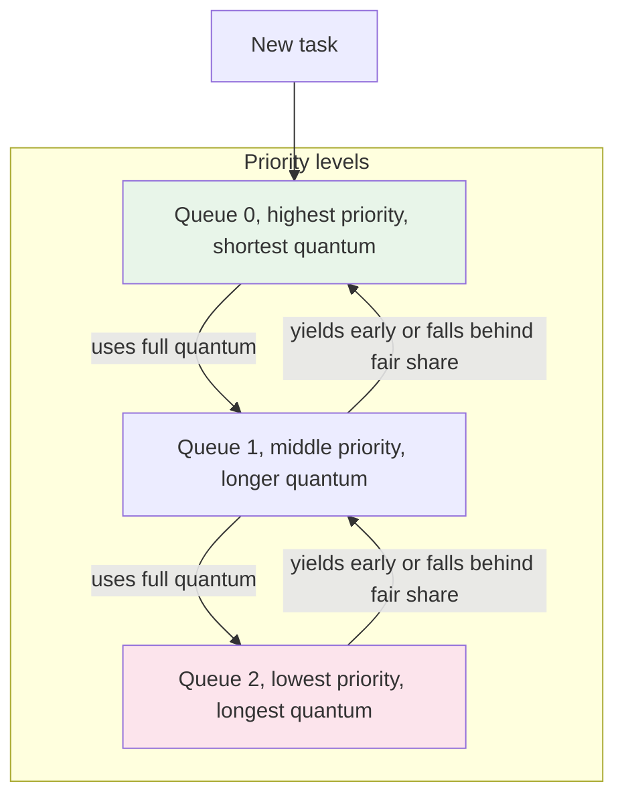

A uniprocessor scheduling policy determines which task receives the processor next whenever a task arrives or the processor becomes free.

Policies differ in the information they use to make this decision and in how they trade response time, throughput and fairness against one another. The material follows the uniprocessor scheduling part of chapter 7 of [Operating Systems: Principles and Practice](https://ospp.cs.washington.edu/), and [[systems/operating-systems/v2-concurrency/7-multiprocessor-scheduling|multiprocessor scheduling]] extends these policies to several processors.

## Performance Terminology

| Key Word | Description |
| - | - |
| **Task/Job** | A unit of work that can be scheduled. |
| **Response time/delay** | The user-perceived time to do some task. |
| **Throughput** | The number of tasks completed per unit time. |
| **Predictability** | Inversely related to variance in response time for repeated tasks. |
| **Scheduling Overhead** | The time to switch between tasks. |
| **Fairness** | Equality in the number and timeliness of resource allocations. |
| **Starvation** | Lack of progress for one task due to resources being allocated to higher-priority tasks. |
| **Workload** | The set of tasks to be scheduled. |

## First in, First Out (FIFO)

FIFO completes tasks in arrival order, finishing one before starting the next. On a uniprocessor with a fully CPU-bound workload, FIFO maximizes throughput, because its scheduling overhead is minimal. In interactive systems short tasks wait behind long ones, and its average response time is in many cases much higher than that of the policies that follow.

FIFO performs well when requests have roughly equal length. Memcached-style cache servers are an example: every request is an in-memory lookup of about the same cost, so no request waits behind a long one, and the simplicity of FIFO supports very high throughput.

## Shortest Job First (SJF)

SJF runs the task with the shortest remaining time first. For a given set of tasks this minimizes average response time, but it cannot be implemented as stated, since run times are not known in advance. It serves as a bound against which implementable policies are compared.

### SRPT and Why It Is Optimal

The preemptive version, **shortest remaining processing time** (SRPT), preempts the running task whenever a new arrival has less remaining work. [Schrage (1968)](https://dl.acm.org/doi/10.1145/321738.321743) proved SRPT optimal: among *all* scheduling disciplines, preemptive or not, with or without knowledge of the future, SRPT minimizes the number of jobs in the system at every instant; by Little's Law, minimizing the time-average number of jobs in the system is equivalent to minimizing mean response time. The exchange argument runs as follows. If the schedule ever runs a job with more remaining work while one with less waits, swapping the next unit of service finishes the short one sooner without delaying the long one's completion, reducing the jobs-in-system count during the swapped interval. Repeating the swap until no such pair exists yields SRPT.

The proof assumes one processor, known remaining times and no switching cost. Remaining times are not available to practical schedulers, which must estimate them from observed behavior. [MLFQ](#multi-level-feedback-queue-mlfq) does so, using whether a task has exhausted its quanta as an inexpensive predictor of whether it has much work remaining.

### Bias Towards Short Tasks

SJF's bias toward short tasks can starve long ones, and there is a tradeoff between average response time and the variance of response times. In interactive systems the long tasks are often the ones of most importance to users. The bias is also exploitable: a user can split a long task into many short tasks to obtain earlier service, which becomes a denial-of-service vector against other users.

### Sample Bias

Measurements that compare SJF with other policies are subject to sample bias. If short tasks keep arriving, long tasks starve, and a measurement that samples only completed tasks never observes the starving ones. The measured average is low because the starved tasks are absent from the data.

### Bandwidth Constrained Web Services

SJF suits a web service limited by network egress bandwidth. The shortest jobs are the responses that leave fastest, and large responses are limited by the network in any case, so favoring short jobs increases the rate at which the system as a whole completes responses. An overloaded server can drop the largest requests, a natural form of load shedding, at the cost of extra logic to handle what was dropped.

## Round Robin (RR)

Under round robin, each task in the queue runs for a fixed **time quantum**. A task that does not finish is preempted by a timer interrupt and moved to the back of the queue, so no task can starve indefinitely. The quantum must be long enough to keep context switch overhead small and short enough to keep response time low.

### Overhead of RR Context Switching

Much of the cost of a context switch is the loss of cache state. Each switch lets a new task evict the previous task's cache entries, so with a very short quantum every task runs with a cold cache. Lengthening the quantum does not reduce the cost of a single switch; it reduces the frequency of switches, which restores the cache hit rate.

RR sits between FIFO and SJF. With an infinite quantum, RR is FIFO. With a quantum of a single instruction and zero overhead, tasks complete in order of length, the same completion order SJF would give, although every task's response time increases because all tasks share the processor until they complete.

**Simultaneous Multithreading (SMT)** lets multiple threads issue instructions to a superscalar processor in the same cycle, which amounts to hardware-level round-robin without context switch overhead.

### Deriving RR's Response Time on a Worst-Case Workload

Consider a workload of $n$ tasks, each needing $t$ quanta of length $q$ (so each task takes $t \cdot q$ seconds of CPU). Assume no scheduling overhead. All three policies finish all $n$ tasks at time $n \cdot t \cdot q$, so throughput is identical. They differ in response time.

Under RR, every task progresses at the same rate, and all of them finish during the final round of scheduling. Each round takes $nq$ seconds and there are $t$ rounds, so the last round starts at $nq(t-1)$, and the $i$-th task in the round order finishes at $nq(t-1) + iq$:

$$
T_{\text{RR}} = \frac{1}{n} \sum_{i=1}^{n} \left( nq(t - 1) + iq \right) = nq(t-1) + q\,\frac{n + 1}{2}
$$

SJF and FIFO behave identically on this workload (all tasks are equal length and already queued): task $i$ finishes at $iqt$, so

$$
T_{\text{SJF}} = T_{\text{FIFO}} = \frac{1}{n} \sum_{i=1}^{n} iqt = qt\,\frac{n + 1}{2}
$$

The difference is $T_{\text{RR}} - T_{\text{FIFO}} = q(t-1)\frac{n-1}{2} \geq 0$, and for large $n$ and $t$ the averages approach $nqt$ versus $nqt/2$: RR roughly doubles the average response time on equal-length tasks while delivering the same throughput. Equal-length tasks are the worst case for RR, since time slicing reduces mean response time only when task lengths vary. When mean response time is the primary objective, round robin is therefore a poor choice for workloads of equal-length tasks.

### Processor Sharing: the Fluid Ideal Behind RR

As the quantum shrinks toward zero (with zero overhead), RR converges to **processor sharing** (PS): all $n$ runnable tasks progress simultaneously at rate $1/n$ each. PS stands in the same relation to RR as bit-by-bit round robin does to packet scheduling in [[systems/scheduling/3-network-and-packet/fair-queueing-wfq-and-drr|fair queueing]]; it is the continuous ideal that the discrete policy approximates one quantum at a time. PS has a simple analytical property. In the M/M/1-PS queue, a job of size $x$ has expected response time $x/(1-\rho)$, *proportional to its own size* and independent of the shapes of other jobs. Every job is slowed by the same factor $1/(1-\rho)$, no job starves, and the policy requires no knowledge of job sizes. This insensitivity makes PS a common fairness benchmark. SRPT achieves a lower mean response time by favoring short jobs, but under PS no job's slowdown depends on the sizes of the jobs it competes with. Practical RR lies between this ideal and FIFO, degraded by quantum granularity (a task waits up to $(n-1)q$ per round) and switch overhead.

### Stream Processing

Round robin suits workloads in which tasks are continuous streams rather than discrete jobs. A video server can send a small chunk to each client in round-robin order, serving all clients evenly with no client starved.

### Mixed Workloads

RR performs poorly on workloads that mix I/O-bound and CPU-bound tasks. A text editor must echo keystrokes with low latency, and under RR it may wait a full round of other tasks' quanta before its input handler runs. Similarly, for a browser on a slow link that downloads a large file in the background while the user browses, round-robin scheduling of network I/O degrades interactive browsing in favor of the bulk download.

## Max-Min Fairness

Max-min fairness maximizes the minimum share of the processor across tasks. Every task receives as much as it can use, subject to the condition that no task receives more while a task with greater demand receives less. This reduces the variance of response times.

If all tasks are compute-bound, max-min reduces to RR. I/O-bound tasks that use less than their full quantum receive all the time they use, and their unused allocation is split evenly among the remaining tasks, repeating until all CPU time is assigned.

A literal implementation would always schedule the task that has consumed the least processor time so far. This fails in practice because two equally short tasks alternate indefinitely, each preempting the other. An approximation tracks CPU usage at quantum granularity and allows a task at most one quantum beyond its ideal max-min allocation. Even the approximation requires a priority queue over tasks, a per-decision bookkeeping cost that commercial operating systems avoid.

## Weighted Fairness: Lottery and Stride

Equal shares are often not the objective; an interactive session, for example, should receive a larger share than a batch reindex. Task $i$ is given a weight $w_i$ and a target allocation $w_i / \sum_j w_j$. Two mechanisms from Waldspurger and Weihl implement weighted shares without measuring job lengths:

- **Lottery scheduling**: each task holds $w_i$ tickets; at each quantum the scheduler draws a ticket uniformly and runs its holder. The expected share is exactly proportional to tickets, starvation is impossible (every ticket has positive probability), and the mechanism composes: a task can subdivide its tickets among its own children, which yields hierarchical shares with no additional mechanism. Its drawback is variance: over a window of $k$ quanta a task's actual allocation fluctuates like a binomial, $\sigma \propto \sqrt{k}$, so fairness over short windows is low.
- **Stride scheduling** is the deterministic version: task $i$ has stride $\propto 1/w_i$ and a pass counter; the scheduler runs the task with the smallest pass, then advances its pass by its stride. A heavier weight gives a smaller stride and therefore more frequent turns. Allocation error is bounded by a constant (one quantum) over any window, versus lottery's $\sqrt{k}$ drift.

Stride scheduling is the direct ancestor of Linux CFS's virtual runtime: `vruntime` advances at a rate inversely proportional to weight, and the scheduler runs the task with the minimum `vruntime`, which is the pass and stride idea with different bookkeeping (details in [[systems/operating-systems/v2-concurrency/7-multiprocessor-scheduling|multiprocessor scheduling]]). These mechanisms are the CPU counterparts of WFQ's virtual finish times in [[systems/scheduling/3-network-and-packet/fair-queueing-wfq-and-drr|fair queueing]].

## Starvation and Aging

Any policy that ranks tasks by a static attribute can starve the bottom rank: SJF starves long jobs while short ones keep arriving, and strict priority starves low priorities under sustained high-priority load. Two observations apply to the remedies:

- Starvation requires *sustained* competition. Under light load starvation does not arise; it appears exactly when $\rho \to 1$ and the favored class alone can keep the processor busy.
- The remedy is a form of **aging**, which folds waiting time into effective priority so that a task's priority rises the longer it waits. A common form raises priority linearly with wait ($p_{\text{eff}} = p_{\text{base}} + \alpha \cdot t_{\text{wait}}$), which bounds worst-case wait by $(p_{\max} - p_{\text{base}})/\alpha$ plus the queue drain time above. The starvation bound is tunable, and lowering it reduces how strongly the scheduler favors its preferred class in the short term.

MLFQ's periodic priority boost, lottery's guaranteed ticket probability, stride's bounded pass drift, and CFS's min-vruntime pick are all forms of aging. A policy can be checked for starvation by asking whether a task can accumulate an unbounded counter while never being scheduled; if such a counter exists, the policy can starve tasks.

## One Workload, Four Policies

The policies are compared on one workload of three tasks on one CPU. A arrives at $t=0$ needing 8 units, B at $t=1$ needing 4, and C at $t=2$ needing 1. The RR quantum is 1, and response time is finish time minus arrival time. (The trace was generated by a small simulator in the repo venv; the simulator is the ~40 lines of Python below.)

| Policy | A finishes | B finishes | C finishes | Mean response time |
| --- | --- | --- | --- | --- |
| FIFO | 8 | 12 | 13 | 10.00 |
| SJF (non-preemptive) | 8 | 13 | 9 | 9.00 |
| SRPT | 13 | 6 | 3 | **6.33** |
| RR ($q=1$) | 13 | 9 | 4 | 7.67 |

The timeline shows the same trace, with RR omitted because it interleaves thirteen one-unit slices.

```mermaid
gantt
    dateFormat X
    axisFormat %s

    section FIFO
    A :f1, 0, 8s
    B :f2, 8, 4s
    C :f3, 12, 1s

    section SJF
    A :s1, 0, 8s
    C :s2, 8, 1s
    B :s3, 9, 4s

    section SRPT
    A :r1, 0, 1s
    B :r2, 1, 1s
    C :r3, 2, 1s
    B :r4, 3, 3s
    A :r5, 6, 7s
```



Under FIFO, C (1 unit of work) has a response time of 11 units, 10 of which it spends waiting behind A and B. Non-preemptive SJF cannot serve B or C until A's 8-unit run ends, because A starts at $t=0$ before either arrives. SRPT preempts A as soon as B arrives and attains the provably minimal mean, at the cost of moving A, the longest job, to last place; A's response time increases from 8 to 13, which is the fairness cost of the optimal mean. RR lies between SRPT and FIFO on the mean and is close to SRPT for the short jobs (C finishes at 4 against 3) without any knowledge of job lengths. Time slicing therefore obtains most of SRPT's benefit for short jobs without requiring clairvoyance.

```python
def rr(tasks, q=1):                       # tasks: (name, arrival, burst)
    from collections import deque
    rem = {n: b for n, a, b in tasks}
    arr = {n: a for n, a, b in tasks}
    t, run, done, added = 0.0, deque(), {}, set()
    while len(done) < len(tasks):
        for n, a, b in tasks:
            if a <= t and n not in added:
                run.append(n); added.add(n)
        if not run:
            t = min(a for n, a, b in tasks if n not in added); continue
        n = run.popleft()
        step = min(q, rem[n]); t += step; rem[n] -= step
        for m, a, b in tasks:              # arrivals during the slice
            if a <= t and m not in added:
                run.append(m); added.add(m)
        if rem[n] <= 1e-9: done[n] = t
        else: run.append(n)
    return {n: done[n] - arr[n] for n in done}

print(rr([("A", 0, 8), ("B", 1, 4), ("C", 2, 1)]))
```

The output is `{'C': 2.0, 'B': 8.0, 'A': 13.0}`, which matches the RR row (as response times rather than finish times). Replacing the policy function reproduces the other rows.

### What Each Policy Optimizes

| Policy | Optimizes / approximates | At the cost of |
| --- | --- | --- |
| FIFO | switching overhead, simplicity; fine when jobs are uniform | mean response time under variable job sizes |
| SJF / SRPT | mean response time (SRPT provably optimal, Schrage 1968) | long-job response time and variance; needs size estimates |
| RR / PS | proportional slowdown, no starvation, no job-size knowledge | ~2x mean response time on equal-length jobs |
| Lottery / stride | weighted proportional shares | lottery: short-window variance; stride: bookkeeping |
| MLFQ | SRPT-like means without clairvoyance + responsiveness | gameable heuristics, needs aging against starvation |

## Multi-level Feedback Queue (MLFQ)

MLFQ is a compromise policy with multiple priority tiers, and most general-purpose kernels build on it. It balances five goals:

| Goal | Description |
| - | - |
| **Responsiveness** | Short tasks should be completed quickly. |
| **Low Overhead** | Minimize the number of preemptions, as well as the time spent scheduling. |
| **Starvation Avoidance** | All tasks should be able to make progress. |
| **Background Tasks** | Deferrable tasks like system maintenance should not interfere with foreground tasks. |
| **Fairness** | Assign non-background tasks an approximately max-min fair share of the CPU. |

### MLFQ Algorithm

MLFQ maintains multiple RR queues, each with its own priority and time quantum. Higher priority queues receive smaller quanta and preempt lower priority queues. Tasks at the same level run round-robin.

A new task enters the highest priority queue. A task that uses its entire quantum is demoted one level; a task that yields before its quantum expires remains at its level or is promoted. The effect approximates SJF: short interactive tasks remain at high priority while long CPU-bound tasks move to lower priorities.



To avoid starvation and approximate max-min fairness, the scheduler also monitors per-process CPU time and schedules the processes that have yet to receive their fair share, demoting processes that have already received theirs and promoting processes that have fallen behind.

## Related notes

- [[systems/scheduling/1-single-resource/fifo-sjf-srpt-rr-and-mlfq|FIFO, SJF, SRPT, RR, and MLFQ]]
- [[systems/scheduling/1-single-resource/real-time-scheduling-edf-and-rate-monotonic|real-time scheduling]]
- [[systems/operating-systems/v2-concurrency/7-queueing-theory|queueing theory]]
- [[systems/operating-systems/v2-concurrency/7-multiprocessor-scheduling|multiprocessor scheduling]]
- [[systems/operating-systems/v2-concurrency/4-concurrency-and-threads|concurrency and threads]]
