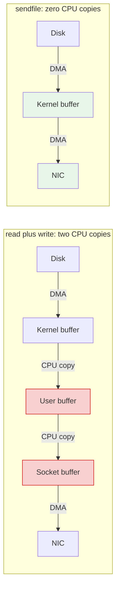

Stream processing consumes a dataset as an ordered sequence of chunks, each of which is processed and discarded before later chunks are read. Memory use is then bounded by the chunk size and the number of chunks in flight, independent of the size of the dataset. The technique applies when a dataset does not fit in memory, or when holding all of it would add latency without benefit. Uploading a large file to cloud storage such as S3 is an example. Reading the whole file into memory before sending it would delay the upload until the file is fully buffered, although the upload is the bottleneck, and would raise both end-to-end latency and memory footprint.

Libraries such as Node.js `stream` and the Java `Stream` APIs implement this mechanism and are generally efficient. Their internal behavior determines performance when the streaming machinery is itself the bottleneck.

The two metrics of interest are throughput and memory usage, measured in bytes per second and peak memory footprint. The relevant questions are whether the bottleneck is memory bandwidth or processing, how much memory a stream requires for common file formats, and where operating system overhead arises. The cache-line effects behind the bandwidth examples are measured in the [[systems/performance/streaming_benchmarks/cache_line_efficiency/README|Cache Line Efficiency Benchmark]].

## A basic model of streaming

The bottleneck of a streaming workload lies in one of two places.

- Bottlenecked by processing: each byte of input requires long-running work with significant latency, resource usage or contention that limits parallelism. Processing a file from disk with heavy per-record business logic is an example. Optimization then targets the business logic, since processing time far exceeds the time spent in the streaming machinery.
- Bottlenecked by I/O: the per-byte work is small, so the movement of data dominates and any overhead in the data path is significant.

A processing-bound workload can generally use a library for the streaming itself without further optimization of that layer. The performance of an I/O-bound workload depends on the details of the data path.

Consider a dataset that is read from memory, transformed $n$ times and written back. Each byte of input incurs $n + 2$ memory operations (read original, write temporaries, write result). Under an idealized bandwidth model with memory bandwidth $B$ (GB/s), the effective rate is approximately $B / (n + 2)$. The upper bound for a simple copy is about $B / 2$, one read plus one write. Measured rates fall below this bound because of caches, NUMA, contention and software overheads.

The achieved bandwidth $B$ is generally well below peak. CPUs move data in cache lines (typically 64 B), and the access pattern largely determines effective bandwidth:

- `seq8`: Sequential scan that touches only 8 B per 64 B line. Hardware prefetchers can sustain the stream of lines, but most of each line is unused, so effective bandwidth tracks the fraction consumed (~1/8 of peak).
- `seq64`: Sequential scan consuming the whole 64 B line (e.g., via `memcpy`). Every byte brought in from DRAM is used, so measured throughput can approach the platform's sustained memory bandwidth.
- `rand8`: Random pointer chasing with one dependent 8 B load per line. With little prefetch and limited outstanding misses, throughput is latency-bound and much lower than sequential scans.

Example relative outcomes (not absolute; highly system-dependent, measured in the [[systems/performance/streaming_benchmarks/cache_line_efficiency/README|benchmark]]):

| Pattern | Relative throughput |
|---------|---------------------|
| `seq64` | ~1.0x (approaches peak) |
| `seq8`  | ~0.125x (fraction of line used) |
| `rand8` | << 0.01x (latency-bound) |

## Streaming is like sequential pagination

Streaming is sequential pagination in which pages are processed in order and discarded immediately. This constraint, sequential access with no retention, is what permits processing datasets larger than memory.

Traditional pagination permits pages to be processed in any order. REST APIs often include metadata that allows a client to request an arbitrary page, e.g. `?page=10`. Without a hash index or B-tree behind it, however, serving an arbitrary page requires a scan of the dataset.

> Some implementations of pagination rely on pointers to the next or previous page, which is closer to streaming.

Streaming removes this freedom; pages are processed one at a time, in arrival order, and then discarded.

In both cases the memory requirement falls from O(total_dataset_size) to O(page_size). Streaming additionally requires no lookup or index structure, since it touches only sequential parts of the data. The input is often a large file, and processing it in on-disk order attains the `seq64`-style bandwidth of the table without further effort.

## File formats

Each format defines its page size differently:

- **Parquet**: Pages are row groups ([default 128 MB uncompressed](https://parquet.apache.org/docs/))
- **CSV**: Pages are lines or batches of lines (e.g. 1000 lines)
- **Arrow**: Pages are record batches (user-defined, often 64K records)

The memory required for streaming is the page size times the number of concurrent pages being processed, plus any overhead for decompression or parsing.

**Apache Parquet** uses row groups as its unit of I/O. The default row group size is 128 MB of uncompressed data. With Snappy compression at a typical 2-3x ratio, this corresponds to 43-64 MB on disk. Processing one row group requires:

- Compressed row group in memory: 64 MB
- Decompression buffer: 128 MB
- Decoded values buffer: 128 MB (Parquet stores definition levels, repetition levels, and values separately)

The total is around 320 MB of working memory for a 64 MB disk chunk. Nested columns or variable-length strings in the schema add another 1-2x for materialization.

**CSV** processes line by line. A CSV row with 20 columns might be 200 bytes (illustrative; actual sizes vary widely). With a read buffer of 8 KB, 40 rows are held in memory at once. Working memory is the buffer size plus parsing overhead, about 16 KB in total.

**Apache Arrow** uses a columnar memory layout that matches its on-disk format exactly. A column of 1 million 64-bit integers takes 8 MB on disk and 8 MB in memory, and no decompression or intermediate buffers are required. The memory requirement is exactly the size of the columns being processed.

For a 1 GB file with 10 million rows and 20 columns:

- Parquet: 320 MB working memory per row group, times the number of concurrent row groups
- CSV: 16 KB for streaming, or full file size if loaded entirely
- Arrow: exactly the size of accessed columns (selective column reading adds no overhead)

## Algorithms

Consider a simple streaming pipeline that parses JSON, filters records, enriches with external data, and aggregates results. We can calculate the theoretical throughput limits.

Each algorithmic approach corresponds to a different pagination strategy:

- **Pipeline parallelism**: One page flows through all stages sequentially
- **Data parallelism**: Multiple pages processed simultaneously, one per worker
- **Batch processing**: Accumulate many pages, then process as a group

The streaming constraint (sequential processing, immediate disposal) excludes the third, although in practice the first two are often combined through windowing.

**Pipeline parallelism** processes one record through all stages sequentially. Suppose the stages take:

- Parse: 50 μs
- Filter: 5 μs
- Enrich: 200 μs
- Aggregate: 20 μs

Total latency is 275 μs per record, but throughput is limited by the slowest stage, at $1 \div 200\ \mu s = 5{,}000$ records/second. The other stages are idle most of the time.

**Data parallelism** runs the complete pipeline on different data chunks. With 8 workers:

- Throughput: $8 \times 5{,}000 = 40{,}000$ records/second
- Memory: $8 \times$ working set size
- Coordination overhead: atomic counters, locks, or channels for aggregation

Coordination then determines scalability. If workers synchronize for aggregation (e.g. a global sum), that stage becomes the bottleneck of the whole pipeline. By Amdahl's law, if 5% of the work is serial, the maximum speedup is $1 \div 0.05 = 20x$ regardless of worker count.

**Windowing** introduces time-based memory requirements. A time-based window has a memory footprint of $W \times T \times R$, where $W$ is the window size in seconds, $T$ is the throughput in records/second, and $R$ is the record size in bytes. For example, a window of 10 seconds at 5,000 records/second must buffer 50,000 records, which at 200 bytes per record occupy 10 MB.

## Linux I/O overhead

Every `read` system call:

1. Saves user-space registers
2. Switches to kernel mode
3. Executes kernel code
4. Copies data from kernel to user buffer
5. Switches back to user mode
6. Restores registers

On modern x86-64 processors, a minimal system call (like `getpid`) is on the order of hundreds of nanoseconds depending on CPU and kernel version. I/O system calls are more expensive because they perform work beyond the mode switch.

Reading 1000 4 KB blocks with traditional `read` and with [io_uring](https://man7.org/linux/man-pages/man7/io_uring.7.html) proceeds as follows.

**Traditional read():**

```c
for (int i = 0; i < 1000; i++) {
    read(fd, buffer, 4096);  // system call per read
}
// Many syscalls (O(N)); overhead scales with call count
// Total data transfer: 4MB
```

**`io_uring`:**

```c
// Setup submission queue entries
for (int i = 0; i < 1000; i++) {
    io_uring_prep_read(sqe, fd, buffer, 4096);  // Just memory writes
}
io_uring_submit(ring);  // Single system call
// Single system call; overhead roughly constant w.r.t N
// Total data transfer: 4MB
```

The difference grows with IOPS, since `io_uring` amortizes the per-call overhead. In exchange it adds complexity, because the application manages ring buffers, tracks completions and handles partial reads. For simple sequential reading of large files, the reduction in overhead may not justify that complexity.

**Memory mapping** (mmap) amortizes system call cost differently. One `mmap` call maps the entire file into virtual address space, and page faults bring data into memory on demand:

```c
void* data = mmap(NULL, file_size, PROT_READ, MAP_PRIVATE, fd, 0);
// No system call per read, just memory access
// But: page fault on first access to each 4KB page
```

A page fault costs about as much as a system call, but after the initial fault the data is accessible at cache-line granularity. For random access patterns this often performs well. For sequential streaming, `read` with appropriate buffer sizes can trigger kernel read-ahead more effectively.

## Zero-copy: following the data path

A standard file-to-socket transfer with `read` + `write` copies the data several times along this path:

1. **DMA from disk to kernel buffer**: performed by hardware, without CPU involvement
2. **CPU copy from kernel to user buffer**: `memcpy()` at memory bandwidth
3. **CPU copy from user to kernel socket buffer**: Another `memcpy()`
4. **DMA from kernel buffer to NIC**: performed by hardware

For a 1 GB file, the CPU path performs two memory copies (kernel to user, user to kernel). If sustained memory bandwidth is $B_{mem}$, the copy time budget for steps 2 and 3 is roughly $2 \times 1\,GB \div B_{mem}$.

With [sendfile](https://man7.org/linux/man-pages/man2/sendfile.2.html), those two copies are eliminated:

1. DMA from disk to kernel buffer
2. Direct DMA from kernel buffer to NIC

The CPU does not touch the data, which leaves memory bandwidth available for other operations. The file transfer rate is then limited by the minimum of storage throughput, network throughput, and kernel path overheads rather than memory bandwidth.



## Implementations

### Java virtual threads

Java's virtual threads are user-mode threads multiplexed onto carrier threads. Each virtual thread requires only stack space for its current call chain, typically a few KB versus around 1 MB for platform threads.

```java
public class StreamProcessor {
    private static final int BUFFER_SIZE = 8192;
    private static final int MAX_CONCURRENT = 100;

    public void processLargeFile(Path inputPath, Path outputPath) throws Exception {
        try (var input = FileChannel.open(inputPath, StandardOpenOption.READ);
             var output = FileChannel.open(outputPath,
                 StandardOpenOption.WRITE, StandardOpenOption.CREATE)) {

            Semaphore backpressure = new Semaphore(MAX_CONCURRENT);
            ByteBuffer buffer = ByteBuffer.allocateDirect(BUFFER_SIZE);

            long position = 0;
            long fileSize = input.size();

            try (var executor = Executors.newVirtualThreadPerTaskExecutor()) {
                while (position < fileSize) {
                    backpressure.acquire();

                    buffer.clear();
                    int bytesRead = input.read(buffer, position);
                    if (bytesRead == -1) break;

                    buffer.flip();
                    byte[] data = new byte[bytesRead];
                    buffer.get(data);

                    long writePosition = position;
                    executor.submit(() -> {
                        try {
                            byte[] processed = transform(data);
                            ByteBuffer writeBuffer = ByteBuffer.wrap(processed);
                            output.write(writeBuffer, writePosition);
                        } catch (Exception e) {
                            // handle error
                        } finally {
                            backpressure.release();
                        }
                    });

                    position += bytesRead;
                }
            }
        }
    }

    private byte[] transform(byte[] data) {
        // transformation logic
        return data;
    }
}
```

The Semaphore limits concurrent operations to 100, preventing unbounded task creation. Direct ByteBuffers avoid JVM heap allocation and enable potential zero-copy operations.

### JavaScript stream back-pressure

[Node.js streams](https://nodejs.org/api/stream.html) use high water marks to control buffering. When a buffer fills, the stream emits 'drain' events to resume flow:

```javascript
const { Transform } = require('stream');
const fs = require('fs');

class ProcessingStream extends Transform {
    constructor(options) {
        super({
            highWaterMark: 64 * 1024  // 64KB buffer
        });
        this.activeTransforms = 0;
        this.maxConcurrent = 10;
    }

    async _transform(chunk, encoding, callback) {
        // wait if too many transforms in progress
        while (this.activeTransforms >= this.maxConcurrent) {
            await new Promise(resolve => setImmediate(resolve));
        }

        this.activeTransforms++;

        try {
            const processed = await this.processChunk(chunk);
            callback(null, processed);
        } catch (error) {
            callback(error);
        } finally {
            this.activeTransforms--;
        }
    }

    async processChunk(chunk) {
        // async processing
        return chunk;
    }
}

const input = fs.createReadStream('large.file', { highWaterMark: 64 * 1024 });
const processor = new ProcessingStream();
const output = fs.createWriteStream('output.file');

input.pipe(processor).pipe(output);
```

The 64 KB high water mark means Node buffers up to 64 KB before pausing the input stream. This prevents memory exhaustion while maintaining reasonable throughput.

### Python asyncio with bounded concurrency

Python's `asyncio` provides primitives for controlled concurrent execution:

```python
import asyncio
import aiofiles

class StreamProcessor:
    def __init__(self, max_concurrent=10):
        self.semaphore = asyncio.Semaphore(max_concurrent)
        self.chunk_size = 8192

    async def process_file(self, input_path, output_path):
        async with aiofiles.open(input_path, 'rb') as input_file:
            async with aiofiles.open(output_path, 'wb') as output_file:
                tasks = []
                position = 0

                while True:
                    chunk = await input_file.read(self.chunk_size)
                    if not chunk:
                        break

                    task = asyncio.create_task(
                        self.process_and_write(chunk, output_file, position)
                    )
                    tasks.append(task)
                    position += len(chunk)

                    # Process in batches to control memory
                    if len(tasks) >= 100:
                        await asyncio.gather(*tasks)
                        tasks = []

                # Process remaining tasks
                if tasks:
                    await asyncio.gather(*tasks)

    async def process_and_write(self, chunk, output_file, position):
        async with self.semaphore:
            processed = await self.transform(chunk)
            await output_file.seek(position)
            await output_file.write(processed)

    async def transform(self, data):
        # CPU-intensive work should be in thread pool
        return data.upper()

# Usage
processor = StreamProcessor(max_concurrent=20)
asyncio.run(processor.process_file('input.dat', 'output.dat'))
```

The semaphore ensures at most 20 chunks are processed concurrently. Batching tasks prevents unlimited growth of the task queue.

## Sources

- [Apache Parquet documentation](https://parquet.apache.org/docs/)
- [Node.js stream documentation](https://nodejs.org/api/stream.html)
- [io_uring(7) man page](https://man7.org/linux/man-pages/man7/io_uring.7.html)
- [sendfile(2) man page](https://man7.org/linux/man-pages/man2/sendfile.2.html)

## Related notes

- [[systems/performance/latency-throughput-and-utilization|latency, throughput, and utilization]]
- [[systems/operating-systems/benchmarks/bandwidth|Memory Bandwidth Benchmarks]]
- [[systems/databases/derived-data/ch10-batch-processing|Batch Processing Systems and MapReduce Fundamentals]]
- [[systems/performance/streaming_benchmarks/cache_line_efficiency/README|Cache Line Efficiency Benchmark]]
