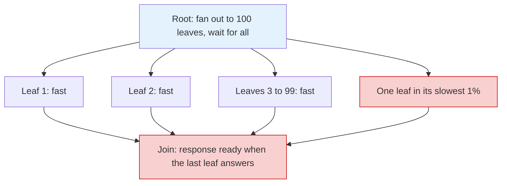

Tail latency is the latency at a high percentile of a service's response-time distribution, such as the 99th or 99.9th, and it characterizes the slowest requests the service delivers. Percentiles measure properties of the distribution that a mean cannot. Variability in service and arrival times inflates the tail well before utilization approaches 1, and fan-out across many servers makes per-server events that are rare frequent at the root. The underlying queueing model is in [[systems/operating-systems/v2-concurrency/7-queueing-theory|Queueing Theory]] and [[systems/performance/latency-throughput-and-utilization|Latency, Throughput, and Utilization]].

## Percentiles answer a different question than means

The latency distribution of a production service is typically right-skewed and often multimodal, with separate modes for a fast path, a cache-miss path and a GC-pause path. The mean combines the modes into a value that no request experiences. [Millsap](https://queue.acm.org/detail.cfm?id=1854041) frames performance questions as questions about individual experience ("how long does *my* task take"), which an average cannot answer; he recommends stating requirements as percentile specifications ("under 1 second in at least 99.9% of executions"), because "the definition of performance as an average conceals the very problems users complain about."

In a synthetic example (lognormal with $\sigma = 1$, a million samples, run in the repo venv), the mean is 1.65, the median 1.00, p95 5.19, p99 10.29 and p99.9 22.05. The mean lies at the 69th percentile, above the latency of most requests and far below that of the slowest. It describes neither the typical request (p50) nor the latency a service commits to (p99 and above). SLOs are therefore stated on percentiles. A target such as "p99 < 100 ms over a 28-day window" is checkable and corresponds to a user population, and the tolerated 1% forms the error budget that accommodates deploys and hedging load.

## Variance inflates the queue before saturation does

The growth of response time as $R = S/(1-\rho)$ in [[systems/operating-systems/v2-concurrency/7-queueing-theory|Queueing Theory]] is the M/M/1 result. The M/G/1 generalization, with Poisson arrivals and *any* service distribution, makes the role of variability explicit. The Pollaczek-Khinchine formula gives the mean queueing delay as

$$
W_q = \frac{\rho}{1-\rho} \cdot \frac{1 + C_s^2}{2} \cdot S,
$$

where $C_s^2 = \operatorname{Var}[S]/\mathbb{E}[S]^2$ is the squared coefficient of variation of service time. The delay is the product of two separate multipliers, the utilization pole $\rho/(1-\rho)$ and a **variance factor** $(1+C_s^2)/2$. Deterministic service ($C_s^2 = 0$) halves the M/M/1 wait, and a heavy-tailed service distribution with $C_s^2 = 10$ produces a wait 5.5x longer than M/M/1 *at identical utilization*. Occasional slow requests, such as a 100 ms compaction stall among 1 ms lookups, delay every request queued behind them. Headroom in average utilization reduces only the first multiplier and leaves the variance factor unchanged.

Percentiles share the pole. For M/M/1 the response-time distribution is exponential, so the $q$-th percentile is $R_q = -\ln(1-q) \cdot R$, and p99 is 4.6x the mean and p99.9 is 6.9x. Since the mean itself scales as $1/(1-\rho)$, tail percentiles grow at the same rate near saturation, multiplied by these constants. Bursty (correlated) arrivals increase delay for the same reason. An arrival-side $C_a^2 > 1$ enters the approximation symmetrically, which is the formula-level version of the burst example in [[systems/operating-systems/v2-concurrency/7-queueing-theory|Queueing Theory]].

## Fan-out amplification

In the fan-out pattern analyzed in [Dean and Barroso's *The Tail at Scale*](https://cacm.acm.org/research/the-tail-at-scale/), a root server sends a request to $n$ leaves and waits for all of them, so the *slowest* leaf determines the response time. If each leaf independently exceeds some threshold with probability $p$,

$$
P(\text{request is slow}) = 1 - (1-p)^n.
$$

In their example, a server with a 99th-percentile latency of 10 ms fans out to 100 servers, and $1 - 0.99^{100} = 63\%$ of requests take longer than 10 ms, so the single-server p99 has become the fleet's *median*. In a measured Google service, a leaf p99 of 10 ms became 140 ms at the root after fan-out, and waiting for the slowest 5% of leaf requests accounted for half of that root p99.



> [!warning] Fan-out amplifies the tail into the median
> With 100 leaves each slow only 1% of the time, $1 - 0.99^{100} = 63\%$ of root requests are slow, so a per-server p99 event affects *most* requests. A target on the root's p99 therefore becomes a target on each leaf's p99.99, a quantile two orders of magnitude further into the tail.

A ten-line simulation reproduces the effect (repo venv, same lognormal population; a request's latency is the max over $k$ independent draws):

```python
import numpy as np
rng = np.random.default_rng(0)
lat = rng.lognormal(0.0, 1.0, 1_000_000)      # p50=1.00, p99=10.29

for k in [1, 10, 100]:
    fan = lat[: len(lat) // k * k].reshape(-1, k).max(axis=1)
    print(k, np.percentile(fan, 50).round(2), np.percentile(fan, 99).round(2))
```

The measured results are p50 = 1.00 and p99 = 10.29 at fan-out 1, p50 = 4.47 at fan-out 10, and p50 = 11.69 and p99 = 41.36 at fan-out 100. At fan-out 100 the median (11.69) exceeds the single-server p99 (10.29), consistent with the $1 - 0.99^{100} \approx 63\%$ calculation, and the fleet p99 is determined by each server's p99.99.

The paper attributes per-server variability to contention for shared local resources (CPU, caches, disk), background daemons and maintenance (log compaction and GC; the authors note that SSD-internal garbage collection can increase read latency by a factor of 100), queueing at multiple layers, power throttling, and global services such as distributed locks. Some of these sources can be removed, but the paper argues that at scale not all of them can, so systems must be designed to be *tail-tolerant*.

## Tail-tolerant techniques

The same paper describes the following techniques, in increasing order of mechanism:

- **Hedged requests.** The client sends the request to one replica and, if no reply arrives within about the 95th-percentile latency, sends a second copy to another replica and uses the first answer. The additional load is about 5% by construction, and the response time becomes the *min* over two draws in exactly the cases where the first draw was slow. In their benchmark, reading 1,000 keys spread over 100 BigTable servers, hedging after 10 ms reduced p99.9 from 1,800 ms to 74 ms with 2% additional requests.
- **Tied requests.** The request is enqueued on two servers simultaneously, each informed of the other's identity, and the server that dequeues it first cancels the other copy. This targets queueing delay (the dominant variable component) without the hedge's delay before the second request, at the cost of cross-server cancellation messages.
- **Micro-partitions and selective replication.** Data is divided into many more partitions than machines, so load can be moved in small increments and hot partitions can receive extra replicas.
- **Latency-induced probation.** Requests are temporarily withheld from a replica observed to be slow (often a machine with an unrelated noisy neighbor) until it recovers, which improves the fleet's tail.
- **Good-enough responses and canaries.** When result quality permits, the root returns the answers of 99% of leaves instead of waiting for stragglers. A canary request is sent to one leaf before fanning out, so that a request exercising an untested code path cannot crash every shard at once.

These techniques leave the speed of each server unchanged and act on the distribution from which the client samples, through the minimum of two draws instead of one, avoidance of draws known to be slow, and tolerance for missing draws. They apply when the requirement is stated on the tail rather than on the mean.

## Related notes

- [[systems/performance/latency-throughput-and-utilization|Latency, Throughput, and Utilization]]
- [[systems/operating-systems/v2-concurrency/7-queueing-theory|Queueing Theory]]
- [[systems/scheduling/0-foundations/queueing-models-and-tail-latency|Queueing Models and Tail Latency]]
- [[systems/distributed-systems/load-balancing|Load Balancing]]

## Sources

- [Dean and Barroso (2013), The Tail at Scale, CACM 56(2)](https://cacm.acm.org/research/the-tail-at-scale/)
- [Millsap (2010), Thinking Clearly about Performance, ACM Queue](https://queue.acm.org/detail.cfm?id=1854041)
- [Brewer, CS262 queueing theory notes](https://people.eecs.berkeley.edu/~brewer/cs262/queueing.pdf)
