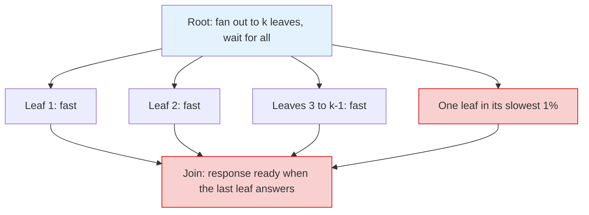

Tail latency is the latency at a high percentile of a service's response-time distribution, such as the 99th or 99.9th, and it characterizes the slowest requests the service delivers. The $q$-th percentile $t_q$ is the latency that a fraction $q$ of requests meet: $P(T \le t_q) = q$.

Percentiles measure properties of the distribution that a mean cannot. Variability in service and arrival times inflates the tail well before utilization approaches 1, and fan-out across many servers makes per-server events that are rare frequent at the root. The underlying queueing model is in [[systems/operating-systems/v2-concurrency/7-queueing-theory|Queueing Theory]] and [[systems/performance/latency-throughput-and-utilization|Latency, Throughput, and Utilization]]; the queueing side of fan-out and hedging is simulated in [[systems/scheduling/0-foundations/queueing-models-and-tail-latency|Queueing Models and Tail Latency]].

## Percentiles and the mean

The latency distribution of a production service is typically right-skewed and often multimodal, with separate modes for a fast path, a cache-miss path and a GC-pause path. The mean combines the modes into a value that no request experiences. [Millsap (2010)](https://queue.acm.org/detail.cfm?id=1854041) defines performance by the response time of an individual task and recommends stating requirements as percentile specifications in place of averages.

In a synthetic example (lognormal with $\sigma = 1$, a million samples), the mean is 1.65, the median 1.00, p95 5.19, p99 10.29 and p99.9 22.05. The mean lies at the 69th percentile ($\Phi(\sigma/2)$ for a lognormal), above the latency of most requests and far below that of the slowest. It describes neither the typical request (p50) nor the latency a service commits to (p99 and above). Service-level objectives are therefore stated on percentiles. A target such as "p99 < 100 ms over a 28-day window" is checkable and corresponds to a share of requests, and the tolerated 1% forms an error budget for deploys, failovers and hedging load.

## Variance and utilization

The growth of response time as $R = S/(1-\rho)$ in [[systems/operating-systems/v2-concurrency/7-queueing-theory|Queueing Theory]] is the M/M/1 result. The M/G/1 queue, with Poisson arrivals and any service distribution, makes the role of variability explicit. The Pollaczek-Khinchine formula gives the mean queueing delay as

$$
W_q = \frac{\rho}{1-\rho} \cdot \frac{1 + C_s^2}{2} \cdot S,
$$

where $C_s^2 = \operatorname{Var}[S]/\mathbb{E}[S]^2$ is the squared coefficient of variation of service time. The delay is the product of the utilization pole $\rho/(1-\rho)$ and a variance factor $(1+C_s^2)/2$. Deterministic service ($C_s^2 = 0$) halves the M/M/1 wait, and a service distribution with $C_s^2 = 10$ produces a wait 5.5 times the M/M/1 wait at the same utilization. Occasional slow requests, such as a 100 ms compaction stall among 1 ms lookups, delay every request queued behind them. Headroom in average utilization reduces only the first factor and leaves the variance factor unchanged.

Percentiles share the pole. For M/M/1 the response-time distribution is exponential, so the $q$-th percentile is $t_q = -\ln(1-q) \cdot R$: p99 is 4.6 times the mean and p99.9 is 6.9 times. Since the mean scales as $1/(1-\rho)$, tail percentiles grow at the same rate near saturation. Bursty arrivals increase delay in the same way. [Kingman's (1961)](https://doi.org/10.1017/S0305004100036094) heavy-traffic approximation for the G/G/1 queue replaces $(1 + C_s^2)/2$ with $(C_a^2 + C_s^2)/2$, where $C_a^2$ is the squared coefficient of variation of interarrival times, so arrival variability and service variability enter symmetrically. The burst example in [[systems/operating-systems/v2-concurrency/7-queueing-theory|Queueing Theory]] is a numerical instance.

## Fan-out amplification

In the fan-out pattern analyzed by [Dean and Barroso (2013)](https://cacm.acm.org/research/the-tail-at-scale/), a root server sends a request to $k$ leaves and waits for all of them, so the slowest leaf determines the response time. If the leaves' latencies are independent with distribution $F$,

$$
P(T_{\text{root}} \le t) = F(t)^k, \qquad P(T_{\text{root}} > t) = 1 - (1-p)^k \text{ where } p = 1 - F(t).
$$

The $q$-th percentile of the root is the $q^{1/k}$-th percentile of one leaf. For $k = 100$ the root median is the leaf's 99.31st percentile and the root p99 is the leaf's 99.99th. Dean and Barroso's example uses servers that typically respond in 10 ms but have a 99th-percentile latency of one second: with one server, one request in 100 takes a second, and with a fan-out of 100, $1 - 0.99^{100} = 63\%$ of requests do. A single server's p99 therefore lies near the 37th percentile of the root. In a measured Google service they report a p99 of 10 ms for a single random leaf request measured at the root, 140 ms for all leaf requests to finish, and 70 ms for 95% of them to finish, so waiting for the slowest 5% accounted for half of the root's p99.



A simulation with the lognormal population above reproduces the formula (a request's latency is the maximum of $k$ independent draws):

```python
import numpy as np
rng = np.random.default_rng(0)
lat = rng.lognormal(0.0, 1.0, 1_000_000)      # p50=1.00, p99=10.29

for k in [1, 10, 100]:
    fan = lat[: len(lat) // k * k].reshape(-1, k).max(axis=1)
    print(k, np.percentile(fan, 50).round(2), np.percentile(fan, 99).round(2))
```

The results are p50 = 1.00 and p99 = 10.29 at fan-out 1, p50 = 4.47 at fan-out 10, and p50 = 11.69 and p99 = 41.36 at fan-out 100, against $e^{\Phi^{-1}(0.5^{1/100})} = 11.73$ and $e^{\Phi^{-1}(0.99^{1/100})} = 41.17$ from the formula. Independence is an assumption of the formula, and on real servers it fails in two directions, as [[#Fan-out on a real server]] measures.

Dean and Barroso attribute per-server variability to contention for shared local resources (CPU, caches, memory and network bandwidth), background daemons that "can generate multi-millisecond hiccups" when scheduled, contention for global resources such as network switches and shared file systems, periodic maintenance (log compaction, garbage collection; SSD-internal garbage collection "can increase read latency by a factor of 100 with even a modest level of write activity"), multiple layers of queueing in servers and switches, CPU power and thermal throttling, and the wake-up latency of energy-saving modes. Some of these sources can be removed, but they argue that at scale not all of them can, so systems must be designed to be tail-tolerant.

## Fan-out on a real server

The formula takes one leaf's latency distribution and assumes the $k$ leaves draw from it independently. To test both inputs, I ran 64 `redis-server` processes on one VM and a Go client that, for each root request, sends `GET` to $k$ distinct servers chosen at random, waits for all replies, and records the root latency and each leaf's latency from its own send to its reply. Each fan-out $k \in \{1, 4, 16, 64\}$ was run three times with 20,000 measured root requests, closed-loop with one root request outstanding. The figure replays the recorded histograms and computes $F(t)^k$ in the page from the recorded single-leaf distribution.

<FanoutTail k={16} />

The table gives means over the three runs, in microseconds, with the standard deviation across runs where it exceeds 10% of the value. "Independent" is $F^k$ computed from the leaf distribution measured alone ($k = 1$); "loaded" computes $F^k$ from the leaf distribution measured within the same fan-out. The last two columns give the share of root requests slower than one leaf's p99 measured alone (134 µs averaged over the three runs; the figure uses the pooled value, 135 µs).

| $k$ | Leaf p50 | Root p50, independent | loaded | measured | Root p99, independent | loaded | measured | Slower than 134 µs, $1 - 0.99^k$ | measured |
| ---: | ---: | ---: | ---: | ---: | ---: | ---: | ---: | ---: | ---: |
| 1 | 51 | 51 | 51 | 61 | 134 | 134 | 147 | 1.0% | 1.9% |
| 4 | 79 | 79 | 116 | 110 | 183 | 251 | 235 | 3.9% | 25% |
| 16 | 157 | 108 | 287 | 248 | 329 (±55) | 1,055 | 480 | 15% | 99.9% |
| 64 | 453 | 132 | 1,019 | 748 | 1,054 (±788) | 3,691 (±1,138) | 1,432 (±311) | 47% | 100% |

At $k = 1$ the root exceeds the leaf by about 10 µs, the client's time to hand the send to the leaf's connection and to collect the reply.

**The leaf distribution depends on the fan-out.** A leaf's median latency rose from 51 µs alone to 79, 157 and 453 µs at fan-outs of 4, 16 and 64. Each root request makes $k$ server processes and $k$ client goroutines runnable at once (at $k = 64$ the client hands out all 64 sends within about 40 µs), on 4 vCPUs, so leaves queue for CPU behind each other. The single-leaf distribution therefore understates every root percentile: at $k = 16$ the measured median was 2.3 times the independent prediction, and the share of roots slower than one leaf's p99 was 99.9% against the formula's 15%. The size of this effect is specific to the testbed, where the leaves share 4 vCPUs. The mechanism is not: a fan-out request loads whatever its leaves share, including the root's CPU and network interface and the switch port toward it (the incast pattern), and the per-leaf latency that enters the formula is the latency at that load.

**Correlated leaves amplify the tail less than independent ones.** Using the leaf distribution measured at the same fan-out brings the predicted median within 5% of the measurement at $k = 4$, 16% at $k = 16$ and 36% at $k = 64$, but overpredicts the tail: at $k = 16$ the measured root p99 was 480 µs against 1,055 µs predicted from the loaded leaves, and at $k = 64$ it was 1,432 against 3,691. Leaves in one request were slow together. The intraclass correlation of log leaf latency within a request, the share of its variance explained by which request a leaf belonged to, was 0.28 to 0.30 at $k = 4$ and 0.23 to 0.25 at $k = 16$ and 64 (three runs each). A positive correlation makes the maximum of $k$ draws stochastically smaller than for independent draws with the same marginals, since a stall that delays many leaves at once contributes one slow maximum where independent stalls would contribute $k$ chances at one.

The two errors have opposite signs. With the single-leaf distribution, the formula predicted a $k = 64$ median 5.7 times too low (132 against 748 µs) and a p99 within the run-to-run spread of the measurement. The formula is exact under its assumptions, and its predictions are as accurate as the leaf distribution supplied to it and the independence of the leaves. For capacity planning, leaf latency has to be measured under the fan-out load that production generates. With $p$ taken from that loaded distribution, $1 - (1-p)^k$ is an upper bound on the slow fraction when leaf latencies are positively associated, and the gap between bound and measurement grows with the correlation.

> [!note]- Hedging on this testbed
> Each run above was repeated with hedging: a leaf that had not answered by the 95th percentile of leaf latency at that fan-out (106 µs at $k = 1$, 280 µs at $k = 16$) got a second `GET` on another server, and the first reply counted.
>
> | | Hedged leaf requests | Root p50 | Root p99 | Root p99.9 |
> | --- | ---: | ---: | ---: | ---: |
> | $k = 1$, no hedge | | 61 | 147 | 291 (±45) |
> | $k = 1$, hedge at 106 µs | 1.3% | 89 | 198 | 296 |
> | $k = 16$, no hedge | | 248 | 480 | 1,872 (±250) |
> | $k = 16$, hedge at 280 µs | 2.0% | 287 | 509 | 841 (±119) |
>
> Hedging raised the median and p99 at both fan-outs and lowered the $k = 16$ p99.9 from 1,872 to 841 µs. A sub-millisecond hedge needs a timer of matching resolution. A Go runtime timer set for 115 µs fired after a median of 1,107 to 1,122 µs on this VM (three sets of 2,000 trials, `fanout -timer 115`), because an idle Go process waits in the network poller with a millisecond-granularity timeout ([golang/go#44343](https://github.com/golang/go/issues/44343)), so the client arms each hedge with `nanosleep` on a separate OS thread instead. The cost of that thread falls on every request, hedged or not, on a machine whose 4 vCPUs the fan-out already saturates. That accounts for the higher median; it is an inference from the timings, not a separate measurement. Dean and Barroso hedge after 10 ms, where arming a timer costs a negligible fraction of the delay, and the queueing cost of hedge load is simulated in [[systems/scheduling/0-foundations/queueing-models-and-tail-latency#Hedged Requests Add Load|Hedged Requests Add Load]].

> [!note]- Measurement record
> - **Code**: [`fanout.go`](tail-latency-fanout/fanout.go) (client), [`servers.sh`](tail-latency-fanout/servers.sh) (starts 64 `redis-server` processes on ports 7000 to 7063 with persistence off and a 100-byte value under key `k`), [`run.sh`](tail-latency-fanout/run.sh) (every run), [`analyze.py`](tail-latency-fanout/analyze.py) (percentiles, predictions, correlation). From `notes/content/systems/performance/tail-latency-fanout/`: `./servers.sh start && ./run.sh && ./servers.sh stop && python3 analyze.py`.
> - **Data**: [`results.json`](tail-latency-fanout/results.json) has every percentile per run; [`fanout-figure.json`](tail-latency-fanout/fanout-figure.json) has the pooled histograms the figure replays (60 bins per decade from 10 µs to 20 ms). The raw per-request latencies (25 MB) are not committed; `run.sh` regenerates them.
> - **Method**: closed loop, one root request outstanding, 2,000 warm-up root requests discarded per run, then 20,000 recorded. Leaves are chosen uniformly without replacement for each root request. Each server has one primary and one hedge connection, with `TCP_NODELAY` set. Predictions use each run's own $k = 1$ leaf distribution. $F^k$ quantiles are leaf quantiles at $q^{1/k}$, so the independent p99 at $k = 64$ rests on the 99.98th percentile of 20,000 samples, which accounts for its spread.
> - **Checks**: the tests in `quartz-site/plugins/mdx/test/fanout-tail.test.mjs` check that the figure's histogram percentiles match the raw-data percentiles in `results.json` within one bin plus the run-to-run spread, that $F^k$ matches a Monte Carlo maximum of $k$ draws, and that the predicted share above one leaf's p99 is $1 - 0.99^k$.
> - **Runtime**: 2 minutes for all 18 runs.
> - **Environment**: Intel Xeon at 2.10 GHz, 4 vCPUs, Linux 6.18, Redis 7.0.15, Go 1.24.7, Python 3.13.18 with NumPy 2.5.3. All processes unpinned; the machine was otherwise idle.
> - **Limits**: the leaves share one machine, so CPU contention between them is larger, and network effects smaller, than across a fleet. Closed-loop measurement with one outstanding request excludes queueing behind other root requests.

## Measuring and aggregating percentiles

Percentiles do not compose arithmetically. The p99 of a union of request streams is not the mean, the maximum or any fixed function of the per-stream p99s, so averaging per-host or per-minute p99s produces a number that is not a percentile of any population of requests. Aggregation requires the distributions: full histograms, or mergeable quantile sketches. [HdrHistogram](https://hdrhistogram.org/) records into logarithmic buckets with a configured number of significant digits. [DDSketch](https://arxiv.org/abs/1908.10693) bounds the relative error of every quantile and merges exactly. [t-digest](https://arxiv.org/abs/1902.04023) concentrates its accuracy at the extreme quantiles. The figure above stores its data the same way, as counts in log-spaced bins, each spanning a factor of $10^{1/60} = 1.039$.

A high percentile needs many samples. Of 20,000 requests, 20 lie above the p99.9, and the estimate depends on those 20. The root p99.9 at $k = 64$ was 3,418 µs on average with a standard deviation of 1,074 µs across three runs of 20,000 requests, while the median varied by 6%. An objective on p99.9 therefore needs a window that holds thousands of samples above the threshold.

Load generators that issue a request only after the previous one completes undercount stalls. If the server stalls for one second, a closed-loop client records one slow request and sends no others during the stall, while users arriving at the planned rate would have queued behind it. [Tene](https://github.com/giltene/wrk2) calls this coordinated omission; `wrk2` corrects it by measuring each request from the time a constant-rate schedule intended to send it. The fan-out measurement above is closed-loop by design, since it measures the latency of one root request in isolation, and its percentiles exclude queueing behind other root requests.

## Tail-tolerant techniques

Dean and Barroso describe the following techniques for tolerating per-server variability:

- **Hedged requests.** The client sends the request to one replica and, if no reply arrives within about the 95th-percentile latency, sends a second copy to another replica and uses the first answer. The additional load is about 5% by construction, and the response time becomes the minimum over two draws in the cases where the first draw was slow. In their benchmark, reading 1,000 keys spread over 100 BigTable servers, hedging after 10 ms reduced p99.9 from 1,800 ms to 74 ms with 2% additional requests.
- **Tied requests.** The request is enqueued on two servers, each told the other's identity, and the server that starts executing it first cancels the other copy. The second copy is sent after about two network message delays, 1 ms or less. This targets queueing delay without the hedge's wait before the second copy. In their benchmark, tied requests reduced the median by 16% and the p99.9 by nearly 40% on an idle cluster, kept latency on a cluster running a concurrent sort job close to the idle cluster's latency without them, and added less than 1% disk utilization.
- **Micro-partitions and selective replication.** Data is divided into many more partitions than machines (their example is about 20 per machine), so load can be moved in small increments and hot partitions can receive extra replicas.
- **Latency-induced probation.** Requests are withheld from a replica observed to be slow, often because of an unrelated co-located job, and shadow requests continue to measure it until it recovers.
- **Good-enough responses and canaries.** When result quality permits, the root returns the answers of the leaves that have replied instead of waiting for stragglers. A canary request is sent to one or two leaves before fanning out, so that a request exercising an untested code path cannot crash every leaf at once.

These techniques leave the speed of each server unchanged and act on the distribution from which the client samples: the minimum of two draws instead of one, avoidance of draws known to be slow, and tolerance for missing draws. The hedging measurement in [[#Fan-out on a real server]] adds a condition to the first: the hedge delay has to be large compared with the client's cost of arming and sending the hedge.

## Related notes

- [[systems/performance/latency-throughput-and-utilization|Latency, Throughput, and Utilization]]
- [[systems/operating-systems/v2-concurrency/7-queueing-theory|Queueing Theory]]
- [[systems/scheduling/0-foundations/queueing-models-and-tail-latency|Queueing Models and Tail Latency]]: M/M/1 fan-out in closed form, and the queueing cost of hedging.
- [[systems/scheduling/4-cluster-and-datacenter/stragglers-speculation-and-overload|Stragglers, Speculation, and Overload]]
- [[systems/distributed-systems/load-balancing|Load Balancing]]

## Sources

- [Dean and Barroso (2013), The Tail at Scale, CACM 56(2)](https://cacm.acm.org/research/the-tail-at-scale/)
- [Millsap (2010), Thinking Clearly about Performance, ACM Queue](https://queue.acm.org/detail.cfm?id=1854041)
- [Kingman (1961), The single server queue in heavy traffic](https://doi.org/10.1017/S0305004100036094)
- [Masson, Rim and Lee (2019), DDSketch: A Fast and Fully-Mergeable Quantile Sketch with Relative-Error Guarantees](https://arxiv.org/abs/1908.10693)
- [Dunning and Ertl (2019), Computing Extremely Accurate Quantiles Using t-Digests](https://arxiv.org/abs/1902.04023)
- [Tene, wrk2: a constant throughput, correct latency recording variant of wrk](https://github.com/giltene/wrk2)
- [HdrHistogram](https://hdrhistogram.org/)
- [golang/go#44343, runtime: time.Sleep takes more time than expected](https://github.com/golang/go/issues/44343)
- [Brewer, CS262 queueing theory notes](https://people.eecs.berkeley.edu/~brewer/cs262/queueing.pdf)
