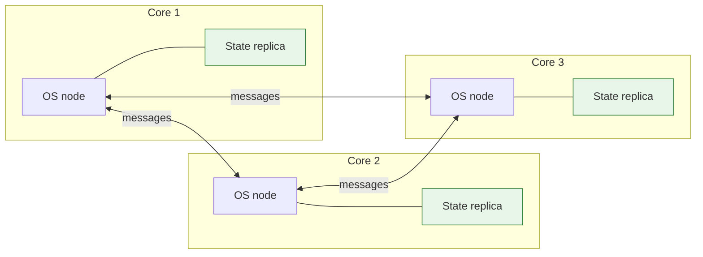

[The Multikernel](https://people.inf.ethz.ch/troscoe/pubs/sosp09-barrelfish.pdf) (Baumann et al., SOSP 2009) proposes an operating system architecture for multicore machines in which the OS is a distributed system of per-core kernels that share no state and communicate only by explicit message passing. Barrelfish is the paper's implementation of the architecture.

The results and limitations sections of my original review were never completed, so the review is partial.

## Citation

- [The Multikernel: A new OS architecture for scalable multicore systems](https://people.inf.ethz.ch/troscoe/pubs/sosp09-barrelfish.pdf), Baumann et al., SOSP 2009.

## Problem

Traditional OS architectures scale poorly on multicore hardware. Optimizations tend to be specific to a particular workload and a particular choice of hardware, so they become obsolete as machines change. Traditional kernels also contain extensive shared state, global data structures in shared memory that cause bottlenecks and unforeseen interactions between components. As core counts grow and hardware becomes more heterogeneous, this shared-state design ceases to scale.

## Main idea

The multikernel treats the machine as a network of independent cores and structures the OS as a distributed system. Each core runs its own OS instance, and all inter-core communication happens through explicit message passing rather than shared memory. The paper argues that this model matches the structure of the hardware (networked, heterogeneous) more closely than the sequential shared-state model, and that it allows communication to be pipelined.

## Mechanism

The design rests on three principles stated in the paper:

1. Make all inter-core communication explicit.
2. Make the OS structure hardware-neutral.
3. View state as replicated instead of shared.

Instead of protecting a global structure with locks, each core keeps a local replica and the OS keeps replicas consistent by exchanging messages. Sharing becomes an optimization applied where the hardware makes it inexpensive, and is no longer the default.

## Why message passing over shared memory

The paper supports this design with four observations:

- Machines, and even individual cores within a machine, are diverse. Hardware-specific shared-memory optimizations do not transfer across them.
- Even on cache-coherent systems, the underlying hardware already operates as a message-passing system, since cache coherence protocols exchange messages between caches.
- Shared state causes cores to stall on cache misses while cache lines migrate between cores. Message passing can be implemented with asynchronous RPC, so a core can continue useful work while a request is in flight.
- Coherence traffic grows with core count, and the paper cites hardware that already forgoes coherence. Programmable devices like NICs and GPUs are not cache coherent with the host, so there is precedent for building against non-coherent hardware.

## Evidence

The paper builds Barrelfish, a multikernel for x86 multicore machines, and compares message-based coordination against shared-memory alternatives. The evaluation I recall most clearly is the unmap (TLB shootdown) case study, in which the message-based protocol scales better with core count than the IPI-based approach used by mainstream kernels. My original review did not record the concrete numbers; they are in section 5 of the paper.

## Assumptions and limits

The argument assumes that messages between cores are inexpensive relative to the coherence traffic they replace, which the paper demonstrates on the cache-coherent x86 machines available to its authors. The projected benefit on large non-coherent machines is an extrapolation, since such machines were not broadly available at the time. My original review did not list weaknesses, which is its main omission.

## Sources

- [The Multikernel: A new OS architecture for scalable multicore systems](https://people.inf.ethz.ch/troscoe/pubs/sosp09-barrelfish.pdf)

## Related notes

- [[systems/operating-systems/lecture-notes/components|Components of an OS]]
- [[systems/operating-systems/v1-kernels-and-processes/1-introductions|What Is an Operating System?]]
- [[systems/research/exokernel|Exokernel]]
- [[systems/research/xen|Xen and the Art of Virtualization]]
- [[systems/research/locality-principle|The Locality Principle]]
